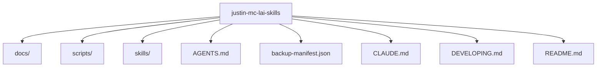

# justin-mc-lai-skills Lighthouse Map

## 1. Summary
- `justin-mc-lai-skills` 的主结构以 `docs, scripts, skills` 为主，适合先从入口文件和顶层子系统开始建立心智模型。

## 2. Scope
- mode: `system-architecture-map`
- project_root: `/Users/apple/Developer/Personal/products/justin-mc-lai-skills`
- target: `.`

## 3. Mermaid Maps

## 4. Key Entry Points
- `README.md`: top-level entry or manifest

## 5. Key Modules / Subsystems
- `docs` contains about `22` files and looks like a standalone subsystem.
- `scripts` contains about `5` files and looks like a standalone subsystem.
- `skills` contains about `137` files and looks like a standalone subsystem.
- `AGENTS.md` is a top-level file that likely anchors runtime or documentation behavior.
- `backup-manifest.json` is a top-level file that likely anchors runtime or documentation behavior.
- `CLAUDE.md` is a top-level file that likely anchors runtime or documentation behavior.

## 6. Dependencies / Infra Chain
- 当前范围下未发现明显的依赖清单或基础设施配置文件。

## 7. Confirmed Facts
- 分析模式为 `system-architecture-map`。
- 分析目标是 `.`。
- 目标类型是 `directory`。
- 检测到 `1` 个关键入口/清单文件。
- 目标范围下约有 `177` 个文件。

## 8. Inferred Structure
- 文档目录存在，说明这条线倾向于把认知材料和代码一起版本化。
- 看起来存在面向宿主或 AI 入口的 skill / prompt 适配层。

## 9. Open Questions / Risks
- 当前地图基于目录和关键文件启发式生成，跨进程/跨服务调用关系还需要继续读实现细节确认。
- 如果项目依赖运行时动态注册或插件发现机制，单次静态扫描可能看不到全部边界。

## 10. Recommended Next Steps
- 先读 `Key Entry Points` 里的文件，确认 `.` 的正式入口和初始化顺序。
- 如果需要正式需求或实现闭环，再显式把这份 Lighthouse 工件作为 PRD / implement / QA 的输入。
