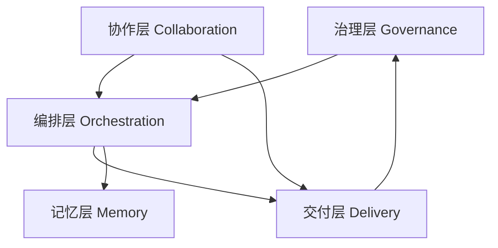

# Beacon v1.0.2 模块功能总览（防失控版）

> 目标：让人类团队快速理解 Beacon 各模块职责、边界、输入输出与控制点，避免流程失控。

---

## 1. 模块分层图



- **治理层**：`gate`, `status`, `report`, `release`
- **编排层**：`workflow`, `run`, `resume`
- **交付层**：`think`, `user-story`, `prd`, `test-case`, `auto-test`, `test-progress`
- **记忆层**：`remember`, `recall`, `save`, `feedback`
- **协作层**：`team`, `ralph-bridge`
- **策略分析层（辅助）**：`analyze`, `brainstorm`, `design`, `jtbd`, `kano`, `moscow`, `persona`, `version`, `roadmap`, `api-design`, `data-dictionary`, `ui-spec`, `wireframe`, `evolution-summary`, `debug`, `doctor`, `init`

---

## 2. 核心模块职责（必须掌握）

| 模块 | 主要命令 | 核心职责 | 关键产物 | 风险控制点 |
|---|---|---|---|---|
| 工作流编排 | `workflow start/continue` | 串联 think→verify 全流程 | run state、lifecycle events | verify 失败即阻断；输出 next-step selector |
| 运行入口 | `run workflow` | 统一 workflow/team/bridge 入口 | run events、state | strict + scope_guard + 人工确认(A/B/C) |
| 需求澄清 | `think` | 问题收敛并生成 `qa_strategy` | think-progress | blocking open question 不可忽略 |
| 用户故事 | `user-story create` | 形成 AC 结构化验收标准 | user-story 文档 | AC 七维完整性 |
| PRD | `prd create` | 需求边界、目标、里程碑 | prd 文档 | 高风险冲突必须显式处理 |
| 测试编排 | `test-case create` | 生成 AC→TC 映射与 QA9 矩阵 | `.ac-test-matrix.json`, `.qa9-matrix.json` | QA9 required type 覆盖、可执行命令 |
| 自动执行 | `auto-test create qa9` | 按矩阵执行测试并产出证据、TC 回填、compat pair evidence | `.beacon/auto-test-status.json`, evidence dir, signature-chain | assertion/junit/新鲜证据/fingerprint |
| 测试汇总 | `test-progress sync/show` | 自动汇总通过率、失败数、待处理数 | `.beacon/test-progress.json` | 与 auto-test-status 一致 |
| 治理放行 | `gate check release` | strict 校验并阻断风险发布 | gate-report、reason_codes | 无 blocked 才可放行 |

---

## 3. Gate 模块（重点）

### 3.1 Gate 在系统中的角色

- Beacon 的**最终裁判层**
- 不负责“生成需求/执行测试”，只负责“验证是否可放行”

### 3.2 常用命令

```bash
beacon gate check release --mode strict --qa-policy qa9-strict --min-automation-rate 0.85
```

### 3.3 关键策略参数

- `--mode`: strict / normal / debug / dry-run
- `--qa-policy`: legacy / qa9-core / qa9-strict
- `--require-qa-types`
- `--require-compat-matrix`

### 3.4 阻断信号（示例）

- `qa9_required_type_missing`
- `qa9_command_missing_auto_case`
- `assertion_count_zero_pass`
- `junit_missing_or_invalid`
- `execution_fingerprint_missing/mismatch`
- `evidence_replay_detected`
- `report_result_mismatch`

> 规则：**strict 模式下关键 reason_code 默认 blocked=true**。

---

## 4. 外部组件与 Beacon 关系

| 外部组件 | 在 Beacon 中的角色 | 建议定位 |
|---|---|---|
| browser-use | AI Agent 浏览器任务执行 | 探索/生成层（AI-first） |
| Playwright | 确定性自动化与兼容矩阵 | Gate 主证据执行层（优先） |
| Cypress | Web 回归执行 | 历史资产复用层（可选） |
| agent-browser | 命令级浏览器操作 | 工具层/回退通道 |
| LLM Provider | 策略与测试建议推理 | 决策辅助层 |

---

## 5. 模块边界与“失控信号”

### 5.1 典型失控模式

1. 跳过 gate 直接发布  
2. 频繁 `--force` 且无风险记录  
3. QA9 matrix 存在 required 类型缺失  
4. auto-test 通过但 assertion/junit 为空  
5. 证据路径不含 run_id（复用旧证据）

### 5.2 抑制策略

- CI 只允许 `gate --mode strict`
- 禁止默认 force；force 必须附人工审批与原因
- QA waiver 必须审批（ticket + approved_by + expires_at）
- 将 reason_code 纳入发布看板

---

## 6. 人机协同“职责合同”（RACI 简版）

| 活动 | AI（Beacon） | 人类（PM/QA/Tech Lead） |
|---|---|---|
| 策略草案生成 | R | A/C |
| 用例矩阵生成 | R | A（审阅） |
| 自动执行与回填 | R | C |
| 风险豁免（waiver） | C | A/R |
| Gate 放行决策 | C | A/R |
| 复盘与改进 | R（生成报告） | A（采纳决策） |

> R=Responsible，A=Accountable，C=Consulted

---

## 7. 推荐操作基线（团队约定）

1. 所有功能都走 `workflow start/continue` 主流程  
2. verify 统一使用 `scope=qa9`  
3. release 前必须执行 `gate check release --mode strict --qa-policy qa9-strict`  
4. 每次 blocked 必须记录修复动作与再验证结果  
5. 每周复盘 reason_code Top N，持续降噪与补漏

---

## 8. 关联文档

- `v1.0.2-solution-architecture.md`
- `v1.0.2-requirements.md`
- `v1.0.2-terminology-glossary.md`
