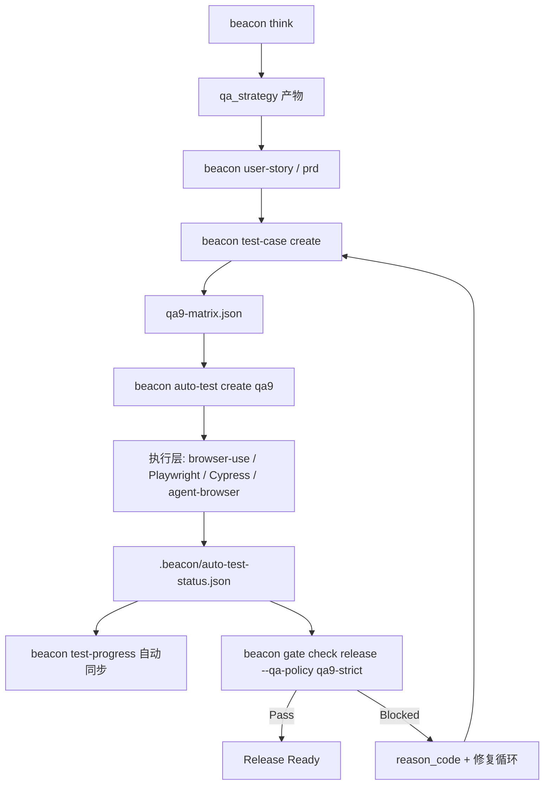
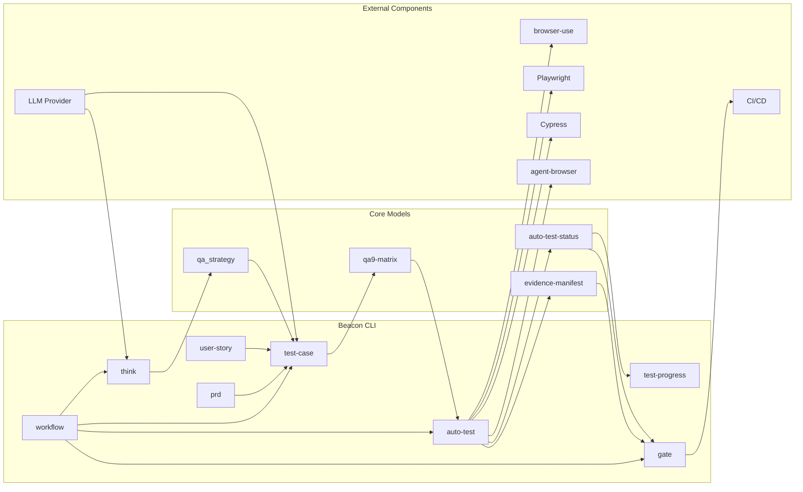
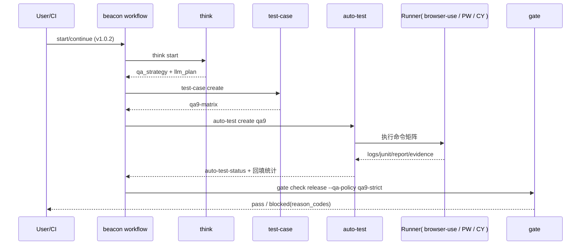

# Beacon v1.0.2 设计总览（快速理解）

> 目标：一份文档快速看懂 v1.0.2 的功能规划、架构闭环、组件角色与落地路径。

---

## 1. 一句话定位

Beacon v1.0.2 = **LLM 驱动 QA9 策略生成 + 自动化执行 + 证据回填 + strict gate 放行** 的闭环系统。

---

## 2. 设计目标与边界

### 2.1 设计目标

1. 针对不同项目类型自动选择 QA9 适用策略（required/conditional/na）
2. 支持 AI Agent 场景（browser-use）与确定性回归（Playwright/Cypress）协同
3. 建立 AC → TC → Evidence → Gate 的可审计链路
4. 输出统一测试汇总（pass/failed/blocked/pass_rate/automation_rate）

### 2.2 非目标（v1.0.2）

- 不做全量云真机兼容测试平台
- 不在本版引入复杂商业测试编排中台

---

## 3. 闭环流程图（Workflow）



---

## 4. 组件架构图（逻辑视图）



---

## 5. 时序图（关键路径）



---

## 6. 各功能模块职责（命令视角）

| 模块 | 命令 | 核心职责 | 关键输入 | 关键输出 |
|---|---|---|---|---|
| F1 策略识别 | `beacon think` | 识别项目类型、生成 qa_strategy | 代码仓/技术栈/LLM | qa_strategy, llm_plan |
| F2 需求沉淀 | `beacon user-story`, `beacon prd` | 形成 AC 与需求边界 | think 结果 | user-story/prd 文档 |
| F3 用例编排 | `beacon test-case create` | 生成 QA9 矩阵与 AC→TC 追溯 | AC + qa_strategy | `*.qa9-matrix.json` |
| F4 自动执行 | `beacon auto-test create qa9` | 按层执行并采证 | qa9 matrix + runner policy | auto-test-status, raw evidence |
| F5 结果回填 | `beacon test-progress` | 汇总 pass/failed/blocked 与覆盖率 | auto-test-status | test-progress.json |
| F6 放行治理 | `beacon gate check release` | strict 校验与阻断 | matrix + status + evidence | gate-report + reason_codes |
| F7 流程编排 | `beacon workflow` | 串联阶段并输出下一步路径 | feature/version/run_id | 端到端闭环执行 |

---

## 7. 外部组件角色定义

| 组件 | 扮演角色 | 在闭环中的位置 | 证据属性 | Release 主证据 |
|---|---|---|---|---|
| browser-use | AI Agent 驱动 E2E 探索/任务执行 | 执行层（发现与探索） | 轨迹/步骤/页面状态 | 否（建议辅助） |
| Playwright | 确定性自动化与兼容矩阵执行 | 执行层（兼容/回归） | junit/trace/video/screenshot | 是（优先） |
| Cypress | Web 回归执行器（已有资产复用） | 执行层（功能/回归） | junit/video/screenshot/report | 是（可选） |
| agent-browser | 命令级浏览器工具通道 | 执行层（脚本化/回退） | CLI 操作证据 | 否（辅助） |
| LLM Provider | 策略推理与用例建议 | think/test-case | llm_plan/project_scan | 否（决策输入） |
| CI/CD | 统一触发与结果归档 | workflow/gate | pipeline 日志与产物 | 是（流程审计） |

---

## 8. 项目类型 → QA9 策略映射（默认建议）

| 项目类型 | required | conditional | 推荐 runner policy |
|---|---|---|---|
| ai-agent-skill | unit/interface/contract/integration/smoke/regression/exception | functional/compatibility | functional=browser-use→playwright；compat=playwright |
| web-app | unit/interface/integration/smoke/functional/regression/exception/compatibility | contract | functional=cypress或playwright；compat=playwright |
| api-service | unit/interface/contract/integration/smoke/regression/exception | functional/compatibility | interface+contract=pytest/newman/schemathesis；compat=na/conditional |
| sdk-lib/cli-tool | unit/interface/smoke/regression/exception | contract/integration/functional/compatibility | unit/interface=pytest；web 相关默认 conditional |

> 若某类型判定为 `na`，必须带审批 waiver，且受 gate 校验。

---

## 9. 证据闭环与防假通过（Gate 关注）

### 9.1 证据链

`command.txt -> stdout/stderr -> junit/report -> result.json -> auto-test-status -> gate-report`

### 9.2 strict 通过最低条件

1. QA9 required type 全覆盖  
2. required auto case 全执行  
3. assertion_count > 0  
4. junit 有效  
5. evidence 路径与 run_id 匹配，时间窗有效  
6. 汇总状态与分层结果一致  
7. 无 blocked reason_code

---

## 10. 版本功能规划（P0/P1/P2）

### P0（闭环可用）
- qa_strategy 基线输出
- QA9 matrix 生成与执行
- pass/fail 回填 + gate strict 基线

### P1（能力增强）
- browser-use 与 Playwright/Cypress 混合策略产品化
- test-progress 自动同步（从 auto-test-status 派生）
- workflow verify 参数全透传与自动矩阵发现

### P2（强治理）
- runner 报告深度一致性校验
- compatibility required_pairs 执行完整性核验
- 反回放/反复用增强（指纹、时间窗、hash 三重校验）

---

## 11. 快速落地（5 分钟）

```bash
beacon think start "qa9 adaptive closure" --project . --version v1.0.2
beacon user-story create "qa9-llm-adaptive-automation-closure" --project . --version v1.0.2
beacon prd create "qa9-llm-adaptive-automation-closure" --project . --version v1.0.2
beacon test-case create "qa9-llm-adaptive-automation-closure" --project . --version v1.0.2 --qa-profile web-full --llm-auto --llm-mode auto
beacon auto-test create qa9 --project . --qa-matrix-path docs/beacon/archive/v1.0.2/qa/test-cases/qa9-llm-adaptive-automation-closure.qa9-matrix.json --ui-runner playwright --require-fresh-evidence --require-junit --require-assertion-count
beacon gate check release --mode strict --qa-policy qa9-strict --min-automation-rate 0.85
```

---

## 12. 关联文档

- `./v1.0.2-requirements.md`
- `./v1.0.2-feature-planning.md`
- `./v1.0.2-module-reference.md`
- `./v1.0.2-terminology-glossary.md`
- `./v1.0.2-human-ai-collaboration-playbook.md`
- `./v1.0.2-one-page-runbook.md`
- `../prd/qa9-llm-adaptive-automation-closure.md`
- `../user-story/qa9-llm-adaptive-automation-closure.md`
- `../research/qa-framework-adapter-comparison.md`
