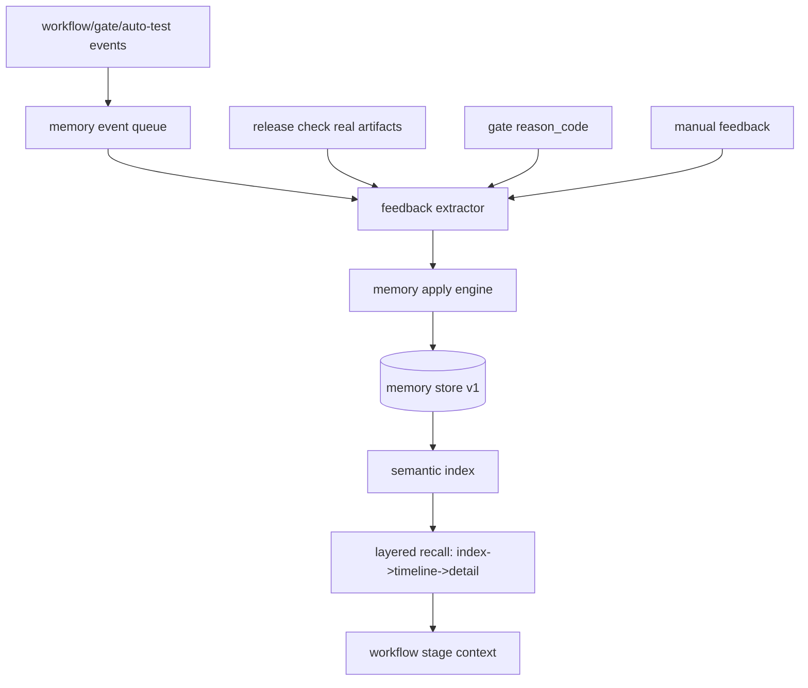

# Beacon Memory v1 改造设计稿（v1.0.3）

Date: 2026-03-05
Status: Implemented(P0) + Planned(P1/P2)
Owner: Beacon Team

---

## 1. 目标与范围

Beacon Memory v1 目标：围绕 v1.0.2 已确认短板，建立“可修订、可检索、可恢复、可审计”的记忆闭环，支撑 workflow 真闭环与 release 可放行。

本稿覆盖：

1. 数据结构（memory / lifecycle / feedback / queue / index）
2. 命令契约（CLI 行为、输入输出、兼容策略）
3. 状态机修复（workflow/gate/release）
4. 自反馈闭环（reason_code -> 修复 -> 记忆更新）

---

## 2. 现状短板（已确认）

1. 记忆只追加，无修订语义（`beacon/beacon/utils/memory.py`）
2. 检索仅关键词匹配，无语义召回与分层召回
3. feedback 为固定模板同步，非“基于失败原因的自动修订”
4. 生命周期失败不可恢复（`stage_failed` 优先 + 去重抑制重试轨迹）
5. `workflow --auto --skip` 可能写 completed（假闭环风险）
6. workflow 主状态机不含 gate
7. `release check` 仍为模拟检查，未读取真实工件

---

## 3. 借鉴原则（开源记忆体映射）

- **Claudeception**：强制复盘触发 + 可复用知识提炼
- **claude-mem**：队列写入 + CLAIM/CONFIRM + 会话隔离 + stuck 自愈
- **memsearch**：source-of-truth 与 hash 去重 + 索引可重建
- **MemOS**：反馈驱动 add/update/archive，而非只 append
- **SimpleMem**：记忆固化（decay/merge/prune）抑制膨胀

原则：先落地最小可用（P0），保持命令向后兼容，再逐步增强语义与自动化。

---

## 4. 总体架构（Memory v1）



---

## 5. 数据结构设计

### 5.1 Memory Entry v1（可修订）

文件：`.beacon/memory/memory-v1.json`

```json
{
  "schema_version": "1.0",
  "items": [
    {
      "memory_id": "mem_xxx",
      "type": "insight|decision|vocabulary|feedback",
      "status": "active|superseded|archived|pruned",
      "content": "...",
      "content_hash": "sha256:...",
      "source_session_id": "run-...",
      "source": "workflow.verify.writeback",
      "evidence_ref": [".beacon/auto-test-status.json"],
      "reason_codes": ["coverage_incomplete"],
      "confidence": 0.82,
      "tags": ["workflow", "verify"],
      "superseded_by": "mem_yyy",
      "revision_of": "mem_prev",
      "created_at": "...",
      "updated_at": "..."
    }
  ],
  "updated_at": "..."
}
```

关键点：
- `status` + `superseded_by` 支持“修订而非堆积”
- `content_hash` 防重复写入
- `reason_codes` 建立 Gate -> Memory 可追踪链

### 5.2 Lifecycle Event v2（可恢复 attempt）

文件：`.beacon/memory/workflow-lifecycle.json`

新增字段：
- `attempt_id`: `stage@attempt-N`
- `attempt_seq`: `N`
- `supersedes_event_id`: 可选，标记重试覆盖关系

状态计算规则改为：
- 按 stage 聚合时，**以最新 attempt 的终态为准**
- `failed -> retry -> completed` 允许闭环恢复

### 5.3 Memory Queue（异步写入，P1 规划）

文件：`.beacon/memory/memory-queue.json`

```json
{
  "schema_version": "1.0",
  "messages": [
    {
      "msg_id": "mq_001",
      "run_id": "run_xxx",
      "stage": "verify",
      "kind": "feedback_extract|memory_upsert|memory_archive",
      "status": "pending|processing|failed|done",
      "retry_count": 1,
      "payload": {},
      "created_at": "...",
      "started_at": "...",
      "ended_at": "..."
    }
  ]
}
```

处理模型：CLAIM -> PROCESS -> CONFIRM，失败进入 retry，超限进入 dead-letter。

### 5.4 Semantic Index（可重建，P1/P2 规划）

文件：`.beacon/memory/memory-index.json`

仅保存衍生索引，不作为事实源；可由 `memory-v1.json` 重建。

### 5.5 Reason Registry（统一来源，P1 规划）

文件：`.beacon/config/reason-registry.json`

字段：
- `reason_code`
- `severity`
- `category`
- `default_action`
- `owner`

目标：统一 gate（62）与 reason_fix_helper（22）口径。

---

## 6. 命令契约（CLI）

## 6.1 remember（增强）

### `beacon remember add`
- 新增：`--upsert`, `--revision-of <memory_id>`, `--reason-code <code>`（repeatable）
- 默认行为：按 `content_hash + source_session_id + source` 去重

### `beacon remember search`
- 新增：`--mode keyword|semantic|hybrid`（默认 hybrid）
- 新增：`--layer index|timeline|detail`（默认 detail）

## 6.2 recall（分层召回）

### `beacon recall memory`
- 新增：`--layer index|timeline|detail`
- 新增：`--ids <id1,id2>`（detail 层批量取回）

## 6.3 feedback（自反馈闭环）

### `beacon feedback extract`
输入：`<run_id>`（位置参数）, `--source gate|auto-test|manual|all`
输出：`feedback-candidates.json`

### `beacon feedback apply`
输入：`<run_id>`（位置参数）或 `--candidates <path>`
行为：执行 add/update/archive；生成 `feedback-apply-report.json`

### `beacon feedback sync`
保留兼容，但内部改为调用 extract+apply 流水线。

## 6.4 workflow（闭环修复）

### `beacon workflow start --auto`
- 完成前强制：`compute_workflow_progress().closure_complete == true`
- `--skip` 的 stage 状态写为 `skipped`，不可计入 completed

### 状态机升级
- 阶段从 6 段升级为 7 段：
  `think -> user-story -> prd -> test-case -> implementation -> verify -> gate`

## 6.5 resume（推进执行）

### `beacon resume <run_id>`
- 仅查看（兼容）

### `beacon resume continue <run_id>|--run-id <run_id>`（新增）
- 读取 lifecycle next_stage 并推进执行（等价 workflow continue）

## 6.6 release（真实工件）

### `beacon release check`
必须读取并校验：
1. `.beacon/auto-test-status.json`
2. `.beacon/gate-report.json`
3. `.beacon/evidence-manifest.json`
4. `coverage` 工件（pytest-cov 或 coverage.json）

禁止仅“模拟通过”。

---

## 7. 关键规则修订

### 7.1 stage 终态判定

- 旧：出现 `stage_failed` 即 failed
- 新：按 attempt 终态判定，允许后续 success 覆盖失败

### 7.2 dry-run 语义统一

- `gate --mode dry-run`：
  - 输出 issue 但 `blocked=false`
  - 进程退出码固定 `0`

### 7.3 completed 语义

仅当：
- 所有 required stage = completed
- gate stage = pass
- closure_complete = true

否则不可写 `workflow completed`。

---

## 8. 迁移与兼容

1. 保留旧文件：`project-insights.json / decisions.json / vocabulary.json`
2. 启动时执行一次迁移到 `memory-v1.json`
3. 老命令不破坏：默认参数保持旧行为
4. 回滚工具链为后续规划项（当前未提供 `beacon debug memory rollback` 命令）

---

## 9. 验收标准（Definition of Done）

1. `workflow --auto --skip` 不再误报 completed
2. `failed -> retry -> completed` 可恢复且可追溯
3. workflow 主状态机包含 gate
4. `release check` 基于真实工件判定
5. memory 支持 update/archive/revision
6. recall 支持 layered retrieval
7. feedback 能基于 reason_code 驱动记忆修订
8. dry-run 不阻断（exit 0）

---

## 10. v1.0.3 实施切分（建议）

### P0（本次热修）
- 状态机修复（skip/completed/gate/attempt）
- release check 真实工件化
- memory hash 去重 + revision 基础字段
- feedback extract/apply 最小实现

### P1
- 队列化写入 + CLAIM/CONFIRM + dead-letter
- layered recall（index/timeline/detail）
- reason registry 单一事实源

### P2
- semantic index + consolidation（decay/merge/prune）
- 运营报表：Top reason_code / 失败趋势 / 记忆质量分

---

## 11. 相关文档

- `../research/workflow-closure-hotfix-iteration-1.md`
- `../version/热修复迭代一版版本.md`
- `../SUMMARY.md`
