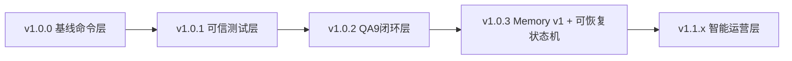
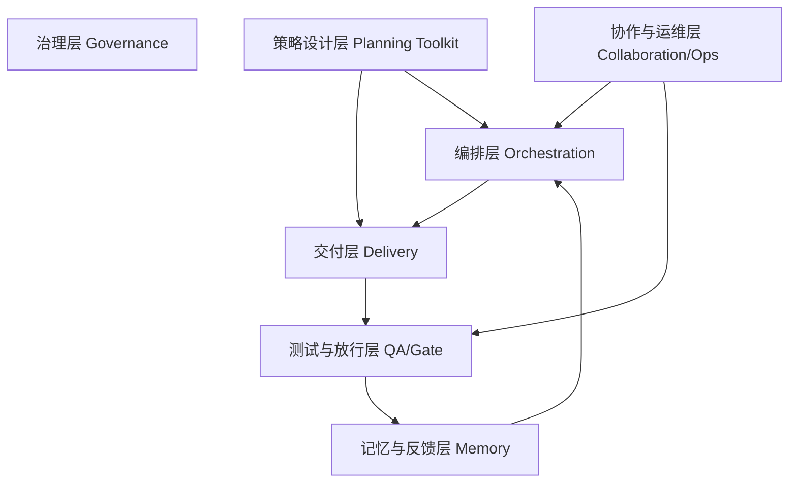
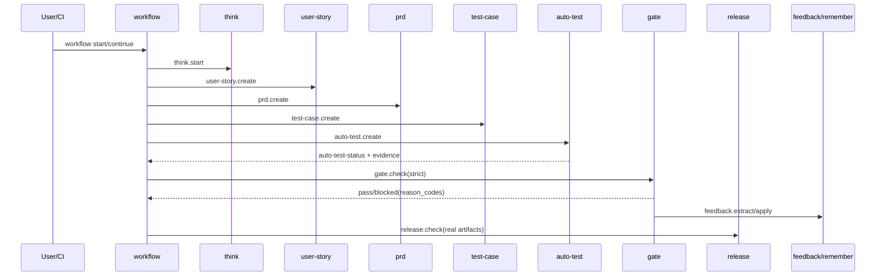

# Beacon 版本演进整体功能蓝图与子命令边界（v1.0.3）

Date: 2026-03-05  
Status: Blueprint Confirm Draft  
Scope: Beacon 全量子命令（以 `beacon/prefixed.py::SUPPORTED_SUBCOMMANDS` 为准）

---

## 0. 确认结论（本版默认生效）

1. Beacon 的产品主线固定为：**Think -> Story -> PRD -> TestCase -> Implementation -> Verify/AutoTest -> Gate -> Release(Check)**。
2. Workflow 主状态机从 v1.0.3 起按 7 阶段闭环定义（含 gate）。
3. 子命令边界以“单一职责 + 明确输入输出工件”为准，禁止跨边界隐式写入。
4. 版本演进采用“能力层逐版增量”策略：先可用、再可信、再可恢复、再智能化。

---

## 1. 版本演进蓝图（v1.0.0 -> v1.1.x）

## 1.1 演进总览

| 版本 | 演进主题 | 核心增量 | 关键风险收敛 |
|---|---|---|---|
| v1.0.0 | 基线工具化 | 建立命令框架与基础文档流 | 打通最小流程 |
| v1.0.1 | 可信测试增强 | 抗假通过、memory lifecycle 对齐 | 降低测试“伪通过” |
| v1.0.2 | QA9 闭环 | think->test-case->auto-test->gate 主链 | 放行链路可审计 |
| v1.0.3 | Memory v1 + 状态机修复 | 记忆修订语义、失败可恢复、release 真实校验 | 消除假闭环与不可恢复 |
| v1.1.x（规划） | 智能运营化 | 语义召回、consolidation、趋势报表 | 成本与质量持续优化 |

## 1.2 演进架构图

---

## 2. Beacon 整体功能蓝图（能力分层）

## 2.1 功能分层图

## 2.2 关键工件蓝图

| 工件 | 路径 | 生产命令 | 消费命令 |
|---|---|---|---|
| think-progress | `.beacon/state/think-progress/*.json` | think | user-story/prd/test-case/workflow |
| user-story | `docs/{beacon,product}/{v}/user-story/*.md` | user-story | prd/test-case/workflow |
| prd | `docs/{beacon,product}/{v}/prd/*.md` | prd | test-case/workflow |
| AC→TC矩阵 | `docs/{...}/qa/test-cases/*.ac-test-matrix.json` | test-case | auto-test/gate |
| QA9矩阵 | `docs/{...}/qa/test-cases/*.qa9-matrix.json` | test-case | auto-test/gate |
| auto-test汇总 | `.beacon/auto-test-status.json` | auto-test | workflow verify/gate/release |
| gate报告 | `.beacon/gate-report.json` | gate/workflow | release/report |
| 生命周期 | `.beacon/memory/workflow-lifecycle.json` | workflow/feedback | status/report/resume |
| 记忆库 | `.beacon/memory/*.json` | remember/feedback/workflow | recall/status/report |
| 终态工件 | `docs/{...}/execution/terminal.json` | workflow | gate/release/report |

---

## 3. 全量子命令边界（Blueprint + Boundary）

> 命令全集来源：`beacon/prefixed.py::SUPPORTED_SUBCOMMANDS`（38 个）。

## 3.1 治理层（Governance）

| 子命令 | 责任边界（做什么） | 禁止越界（不做什么） |
|---|---|---|
| gate | 校验阶段放行规则并输出 reason_code | 不生成需求/不执行业务测试逻辑 |
| status | 汇总当前状态、闭环进度与覆盖指标 | 不修改业务工件 |
| report | 生成 summary 报告（human/machine） | 不替代 gate 判定 |
| release | 生成/校验发布清单与发布前置 | 不绕过 gate 严格规则 |

## 3.2 编排层（Orchestration）

| 子命令 | 责任边界（做什么） | 禁止越界（不做什么） |
|---|---|---|
| workflow | 串联阶段、维护 run 状态、写终态工件 | 不直接承担每层业务细节实现 |
| work | `workflow start` 别名入口 | 不新增独立流程语义 |
| run | 统一入口（workflow/team/bridge）与模式控制 | 不替代具体子命令产物契约 |
| resume | 运行态恢复/续跑（v1.0.3 含 continue） | 不直接改写未执行阶段为 completed |

## 3.3 交付主链（Delivery Core）

| 子命令 | 责任边界（做什么） | 禁止越界（不做什么） |
|---|---|---|
| think | 需求澄清、事实/问题收敛、策略草案 | 不直接输出 PRD/测试执行结果 |
| user-story | 输出用户故事与 AC | 不执行测试 |
| prd | 输出需求规格与边界 | 不充当测试矩阵生成器 |
| test-case | 生成 AC->TC 与 QA9 矩阵 | 不直接执行测试 |
| auto-test | 执行测试矩阵并产出证据汇总 | 不替代 gate 做放行决策 |
| test-progress | 汇总测试进度与统计状态 | 不伪造执行结果 |

## 3.4 记忆与反馈层（Memory）

| 子命令 | 责任边界（做什么） | 禁止越界（不做什么） |
|---|---|---|
| remember | 记忆写入（v1.0.3 支持修订语义） | 不负责放行决策 |
| recall | 记忆检索与恢复（含 layered recall） | 不写入新业务工件 |
| feedback | 反馈提取/应用、经验回写 | 不越权修改 release 结论 |
| save | 会话状态保存 | 不替代 remember 的知识建模 |
| evolution-summary | 版本演进摘要（跨版本追踪） | 不替代 PRD 细节 |
| version | 版本规划工件创建与查询 | 不替代 workflow 执行 |

## 3.5 策略与设计层（Planning Toolkit）

| 子命令 | 责任边界（做什么） | 禁止越界（不做什么） |
|---|---|---|
| analyze | 竞品/问题分析 | 不直接写代码执行 |
| brainstorm | 发散方案探索 | 不输出最终执行判定 |
| design | 设计思维问题定义 | 不替代 PRD |
| jtbd | Jobs-to-be-Done 分析 | 不替代 user-story |
| kano | 需求 KANO 分类 | 不替代 gate |
| moscow | 需求优先级排序 | 不替代版本发布决策 |
| persona | 用户画像建模 | 不执行测试 |
| roadmap | 路线图规划 | 不替代版本细节工件 |
| api-design | API 契约设计 | 不替代 contract test 执行 |
| data-dictionary | 数据字典设计 | 不替代 migration 实施 |
| ui-spec | UI 规范定义 | 不替代 UI 测试执行 |
| wireframe | 线框设计输出 | 不替代实现验证 |

## 3.6 协作与运维层（Collaboration/Ops）

| 子命令 | 责任边界（做什么） | 禁止越界（不做什么） |
|---|---|---|
| team | 协作执行编排 | 不替代 workflow 主状态机 |
| ralph-bridge | 与外部编排桥接 | 不绕过本地 gate 契约 |
| init | 初始化项目结构 | 不生成业务结论 |
| doctor | 环境诊断 | 不改写业务工件 |
| debug | 调试与诊断辅助 | 不作为正式发布判定依据 |

---

## 4. 子命令边界约束（硬规则）

1. **唯一放行裁决者**：gate/release，其他命令不能声明 release pass。  
2. **唯一执行来源**：auto-test 执行结果必须来自真实命令与证据工件。  
3. **唯一状态闭环**：workflow 只能在 `closure_complete && gate_pass` 时写 completed。  
4. **唯一命令全集**：新子命令必须同步 `SUPPORTED_SUBCOMMANDS` 与文档清单。  
5. **唯一记忆事实源**：Memory v1（+迁移兼容）为可修订事实源，索引可重建。  

---

## 5. 主流程蓝图（命令时序）

---

## 6. v1.0.3 到 v1.1.x 的蓝图落地顺序

### P0（v1.0.3）
- 完成态语义修复（skip/completed/gate）
- lifecycle attempt 可恢复
- release 真实工件校验
- memory v1 基础修订语义

### P1（v1.1.0）
- layered recall 全面接入（index/timeline/detail）
- feedback extract/apply 全链路自动化
- reason registry 单一来源

### P2（v1.1.x）
- semantic index + consolidation（decay/merge/prune）
- 运营视角报表（Top reason_code、失败趋势、闭环质量分）

---

## 7. 本蓝图确认项（如无异议默认确认）

1. 38 个子命令边界按本文执行（以 `SUPPORTED_SUBCOMMANDS` 为准）。
2. workflow 主闭环固定含 gate 阶段。
3. release check 仅允许真实工件判定。
4. Memory v1 作为后续记忆演进基线。
