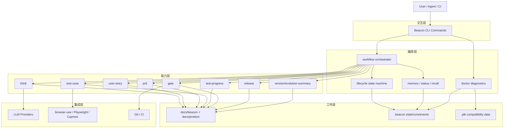

# Beacon v1.0.3 整体项目架构蓝图（功能规划 + 边界）

> 目的：给团队一份“统一认知图”，快速回答 **Beacon 是什么、包含哪些能力、接下来怎么演进、边界在哪里**。

---

## 1. 一句话定位

Beacon 是一个 **面向产品需求闭环的 CLI 工作流系统**：  
从需求思考（think）到用户故事、PRD、测试用例、验证与放行，形成可追踪、可回放、可诊断的交付链路。

---

## 2. 架构蓝图（分层视图）

---

## 3. 功能域规划（Capability Map）

| 功能域 | 目标 | 代表命令 | 当前重点 |
|---|---|---|---|
| 需求建模域 | 统一需求语义与验收口径 | `think` `user-story` `prd` | 稳定 AC 结构、减少需求歧义 |
| 测试设计与执行域 | 建立 AC → TC → Evidence 链路 | `test-case` `auto-test` `test-progress` | 提升可执行率与证据质量 |
| 放行治理域 | 用规则阻断“假通过” | `gate` `release` | 强化 strict policy 与 reason codes |
| 工作流编排域 | 统一阶段状态与恢复能力 | `workflow` `resume` | lifecycle 完整性、失败后重试可恢复 |
| 运行治理域 | 环境可用性与版本兼容性 | `doctor` `status` `debug` | 真实版本识别、兼容性诊断、setup/uninstall |
| 版本演进域 | 版本资产有序沉淀与复盘 | `version` `evolution-summary` | 版本差异可追踪、历史可审计 |

---

## 4. 中短期演进规划（Roadmap）

### 4.1 P0（已具备 / 持续加固）
- 完整 CLI 命令集与文档产物落地
- workflow 生命周期闭环 + run 级状态管理
- doctor v2：版本识别、物料版本识别、不兼容诊断与修复建议

### 4.2 P1（下一阶段）
- workflow 与 gate 的跨项目配置模板化（减少项目接入成本）
- auto-test 证据契约统一（runner 报告字段一致化）
- 版本演进报告自动串联“需求变化 → 测试变化 → 风险变化”

### 4.3 P2（后续增强）
- 多仓协同视图（跨 repo 的需求/测试追踪）
- 更细粒度的插件化能力边界（第三方命令扩展协议）
- CI 场景下的诊断自修复策略（可选自动执行）

---

## 5. 功能边界（简版）

### 5.1 In Scope（Beacon 负责）
1. 产品文档与测试文档的标准化生成与管理  
2. workflow/lifecycle 状态编排、闭环追踪与恢复  
3. gate/release 的规则校验与放行判断  
4. doctor 的环境诊断、版本兼容检查、CLI 启动器安装卸载  
5. 以本地文件工件为核心的可审计证据链输出

### 5.2 Out of Scope（Beacon 不直接负责）
1. 作为通用 CI/CD 平台替代品（只集成，不替代）  
2. 托管式分布式测试基础设施（云端调度平台）  
3. 生产环境部署执行本身（仅做放行依据，不做部署编排）  
4. 第三方工具的全兼容承诺（仅保证契约内集成）  
5. 团队权限系统与密钥托管（依赖外部平台）

---

## 6. 架构原则（用于后续变更评审）

1. **工件优先**：所有关键结论都必须落工件（docs / .beacon）  
2. **状态可追踪**：阶段状态必须可回放、可解释、可恢复  
3. **兼容可诊断**：版本差异要能被 doctor 明确识别并给出修复路径  
4. **边界清晰**：CLI 编排与外部执行器解耦，避免职责漂移  
5. **演进可回归**：新增能力必须保留已有命令契约的可兼容路径

---

## 7. 关联文档

- `./v1.0.3-command-contracts-as-implemented.md`
- `./v1.0.3-beacon-version-evolution-blueprint.md`
- `./v1.0.3-workflow-interactive-hud-design.md`
- `../release/v1.0.3-release-notes.md`
