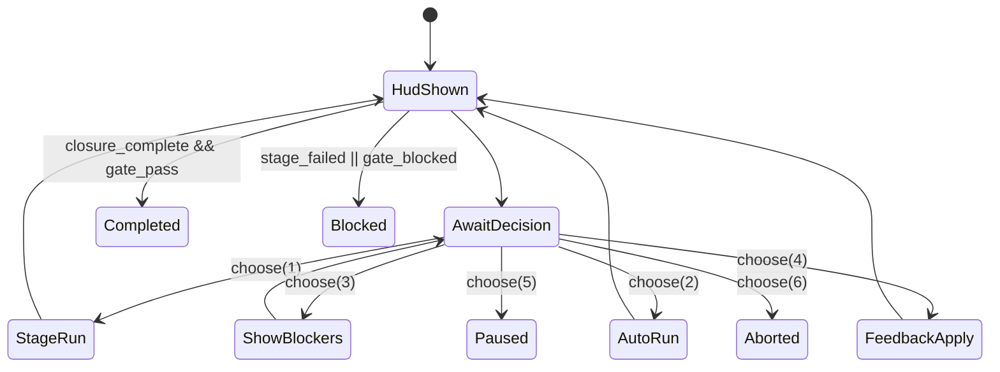
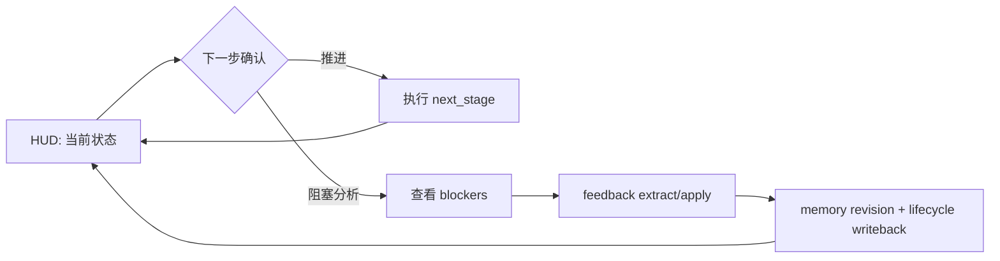

# Beacon v1.0.3 Workflow Interactive HUD 设计稿

Date: 2026-03-05  
Status: Implemented（代码与测试已对齐）  
Version: v1.0.3

---

## 1. 背景与目标

在 v1.0.2/v1.0.3 的闭环修复文档中，workflow 已明确要解决“假闭环、不可恢复、记忆反哺弱”等问题；但**人机交互协议**（先看进度，再确认下一步）尚未工程化固化。

本设计稿目标：把 workflow 升级为“**交互式 HUD + 下一步确认**”模式，支持：

1. 启动即展示 HUD 进度状态；
2. 显式展示 next step 并交互确认；
3. 关键决策写入 lifecycle + memory，形成可审计反哺；
4. 保持 CI 非交互可用（`--no-interactive`）。

---

## 2. 设计原则

1. **先看状态，再做决策**：每次执行前必须先提供 HUD。
2. **人机协作可追踪**：每次选择写入事件与记忆体。
3. **默认安全**：超时/未确认默认不推进破坏性步骤（pause）。
4. **双模兼容**：TTY 默认 interactive，CI 默认 non-interactive。
5. **闭环优先**：只在 `closure_complete && gate_pass` 时写 completed。

---

## 3. 术语与闭环路径

- **HUD**：Workflow 执行前的状态面板（Human + Machine 可读）
- **Next Step**：由 lifecycle 计算的下一阶段动作候选
- **Checkpoint**：阶段执行前的人工确认点
- **Feedback Loop**：`reason_code -> feedback extract/apply -> memory revision`

演进路径：

`需求澄清 -> 实现推进 -> 验证阻断 -> 反馈修订 -> 记忆反哺 -> 再推进`

---

## 4. 命令契约（v1.0.3 交互增强）

## 4.1 workflow start

```bash
beacon workflow start <feature> [--interactive|--no-interactive] [--hud|--no-hud]
```

新增/调整：

- `--interactive/--no-interactive`
  - TTY 默认 `--interactive`
  - 非 TTY 默认 `--no-interactive`
- `--hud/--no-hud`（默认 `--hud`）
- `--confirm-timeout <sec>`（默认 60）
- `--on-timeout pause|continue|abort`（默认 `pause`）

行为：

1. 渲染 HUD（run 初始化后）；
2. 给出 next-step 交互菜单；
3. 用户确认后执行对应路径；
4. 决策写回 run state + lifecycle + memory。

## 4.2 workflow continue

```bash
beacon workflow continue [--run-id <rid>] [--interactive|--no-interactive] [--hud|--no-hud]
```

行为：

1. 读取当前 run 的 workflow_progress；
2. 渲染 HUD（显示 next_stage、missing_stages、blockers）；
3. 进入下一步确认；
4. 按选择执行（单步/自动补齐/反馈修订/暂停）。

## 4.3 workflow hud（新增）

```bash
beacon workflow hud [--run-id <rid>] [--json]
```

行为：仅输出 HUD，不执行阶段推进。

## 4.4 resume continue（与 workflow 统一）

```bash
beacon resume continue <run_id>|--run-id <run_id> [--interactive|--no-interactive] [--hud|--no-hud]
```

行为：对齐 `workflow continue`，允许从 resume 入口推进。

---

## 5. HUD 数据结构（工程契约）

文件：`.beacon/state/workflow-hud/<run_id>.json`

```json
{
  "schema_version": "1.0",
  "run_id": "run-...",
  "feature": "...",
  "version": "v1.0.3",
  "mode": "interactive|non_interactive",
  "workflow_progress": {
    "next_stage": "think|user-story|prd|test-case|implementation|verify|gate|none",
    "closure_complete": false,
    "missing_closure_stages": ["..."]
  },
  "stage_status": {
    "think": "completed|in_progress|failed|not_started|skipped",
    "user-story": "..."
  },
  "blockers": {
    "blocking_open_questions": 0,
    "critical_conflicts": 0,
    "latest_reason_codes": ["..."]
  },
  "quality": {
    "gate_ready": false,
    "auto_test_status": "passed|failed|unknown",
    "coverage_full": false
  },
  "memory": {
    "recall_injections": 0,
    "writebacks": 0,
    "feedback_assimilations": 0
  },
  "generated_at": "..."
}
```

---

## 6. 下一步交互协议（Next-Step Menu）

每次 HUD 后统一输出：

```text
[Next Step]
1) 执行 next_stage（single-step）
2) 自动补齐到 gate（auto-run）
3) 查看阻塞详情（reason_code/open_questions/conflicts）
4) 执行反馈修订（feedback extract+apply）
5) 暂停并保存（pause）
6) 退出（abort）
```

确认规则：

- 选项 1/2/4 为执行类动作，需二次确认：`Confirm? (y/N)`
- 选项 5 默认安全落地：写 `workflow_paused`
- 超时按 `--on-timeout` 执行，默认 `pause`

---

## 7. 交互状态机（v1.0.3）



说明：

- `Completed` 仅在 `closure_complete && gate_pass` 达成；
- 失败进入 `Blocked` 后可通过反馈修订/重试回到 `HudShown`。

---

## 8. 记忆反哺设计

## 8.1 生命周期事件（新增）

- `hud_rendered`
- `next_step_prompted`
- `human_checkpoint_confirmed`
- `human_checkpoint_rejected`
- `workflow_paused`
- `feedback_apply_triggered`

## 8.2 记忆写回（decision/feedback）

每次人工确认写入：

- `mem_type=decision`
- `source=workflow.interactive`
- `tags=["workflow","interactive","checkpoint"]`
- `evidence_ref=[hud_snapshot, gate_report, auto_test_status]`

阻塞修订写入：

- `mem_type=feedback`
- `reason_codes=[...]`
- `revision_of=<old_memory_id>`（若为修订）

---

## 9. 人机协作流程（需求->实现->完善）



该回路保证：

1. 需求澄清（think/open questions）
2. 实现推进（workflow stage）
3. 验证阻断（verify/gate）
4. 修订反哺（feedback/memory）
5. 再次推进（continue）

---

## 10. 非功能要求

1. **可观测**：HUD 快照 + 交互事件可审计。
2. **可恢复**：pause 后可 resume continue。
3. **兼容 CI**：`--no-interactive` 路径无 prompt 卡死。
4. **性能**：HUD 生成 < 300ms（本地状态读取）。
5. **一致性**：interactive 与 non-interactive 使用同一状态机判定 completed。

---

## 11. 风险与缓解

1. **交互阻塞 CI**：默认非 TTY 关闭 interactive。  
2. **用户误操作推进**：执行类动作二次确认。  
3. **事件噪音膨胀**：交互事件做 dedupe 与采样阈值。  
4. **文档与实现再漂移**：将本设计 AC→TC 纳入回归。  

---

## 12. 验收标准（AC）

- AC-001：`workflow start/continue` 在 interactive 下先渲染 HUD 后执行。
- AC-002：HUD 必含 progress/next_stage/blockers/quality/memory 字段。
- AC-003：Next-step 菜单至少包含 1/2/3/4/5/6 六类动作。
- AC-004：执行类动作必须二次确认，未确认不推进。
- AC-005：`--no-interactive` 在 CI 下无 prompt，流程可自动执行。
- AC-006：交互决策写入 lifecycle + memory（可追溯）。
- AC-007：blocked 后可走 feedback apply 并重新进入 HUD。
- AC-008：`resume continue` 与 `workflow continue` 交互语义一致。
- AC-009：超时默认 pause，且写 `workflow_paused` 事件。
- AC-010：完成态仍受 `closure_complete && gate_pass` 约束。

---

## 13. 关联文档

- `docs/beacon/archive/v1.0.3/execution/v1.0.3-beacon-memory-v1-redesign.md`
- `docs/beacon/archive/v1.0.3/execution/v1.0.3-beacon-version-evolution-blueprint.md`
- `docs/beacon/archive/v1.0.3/qa/test-cases/workflow-interactive-hud.ac-test-matrix.json`
