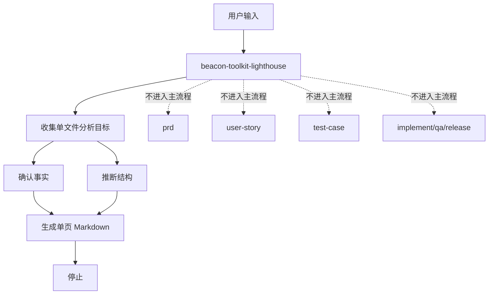
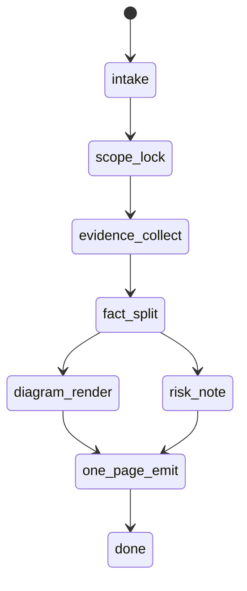

# Beacon Toolkit Lighthouse Skill Constraint Analysis

## 1. Summary

`beacon-toolkit-lighthouse` 应该保持为一个“快速单文件分析器”，不是主工作流的一部分。

设计目标只有三个：

- 快速看懂
- 只产一页
- 明确区分事实与推断

## 2. Scope

- 目标对象：`beacon-toolkit-lighthouse` skill
- 关注点：能力边界、输出约束、认知减负
- 基本原则：不进入 `prd -> user-story -> test-case -> implement -> qa -> release`

## 3. Mermaid Maps

### 3.1 Skill Boundary

### 3.2 Output State Machine

## 4. Key Entry Points

- `skills/beacon/beacon-toolkit-lighthouse/SKILL.md`
- `skills/beacon/examples/beacon-toolkit-lighthouse-analysis.md`
- `docs/beacon/v1.3.2/execution/lighthouse-analysis-toolkit-blueprint.md`
- `docs/beacon/v1.3.7/execution/beacon-toolkit-lighthouse-beacon-human-surface-closure-and-feature-intent-gap.md`

## 5. Key Constraints

- 只输出一个 Markdown artifact。
- 默认必须是 Mermaid + 少量中文说明。
- 只能做分析，不负责 freeze truth。
- 不自动路由到 `prd / user-story / test-case / implement / qa`。
- 必须明确写出 `Confirmed Facts` 和 `Inferred Structure`。
- 必须列关键 source refs / key files。
- 默认图先于文，文字只做补充解释。

## 6. Recommended Constraint Design

- 固定 10 段式结构。
- Mermaid 最多 3 张。
- 每段只保留短句和要点。
- 推断必须显式标注，不得混写成事实。
- 推荐结论只给“下一步”，不展开执行计划。

## 7. Confirmed Facts

- Skill 定位已写明是 read-only analysis sidecar。
- Skill 明确声明不进入主工作流。
- Skill 推荐输出就是单文件 Markdown。
- Skill 已要求使用 Mermaid、事实/推断分离、关键文件引用。

## 8. Inferred Structure

- 这个 skill 最适合服务“认知压缩”，而不是“认知扩张”。
- 它应当像一张地图，不像一篇报告。
- 最好的默认产物是“读完就能决定要不要继续深入”的一页纸。

## 9. Open Questions / Risks

- 是否要给 Mermaid 图数量设硬上限。
- 是否要给正文长度设硬上限。
- 是否要强制每个结论都回链到 source refs。
- 是否要把“推荐下一步”限制为最多 3 条。

## 10. Recommended Next Steps

- 保持 `beacon-toolkit-lighthouse` 仅做结构化分析。
- 把约束写成固定模板，不让输出风格漂移成长报告。
- 如果后续要更深的需求收敛，交给 `beacon-brainstorm` 或主 workflow。

## Key Source Refs

- `skills/beacon/beacon-toolkit-lighthouse/SKILL.md`
- `skills/beacon/examples/beacon-toolkit-lighthouse-analysis.md`
- `docs/beacon/v1.3.2/execution/lighthouse-analysis-toolkit-blueprint.md`
- `docs/beacon/v1.3.7/execution/beacon-toolkit-lighthouse-beacon-human-surface-closure-and-feature-intent-gap.md`
- `docs/beacon/v1.3.8/execution/beacon-toolkit-lighthouse-prototype-drift-root-cause.md`
