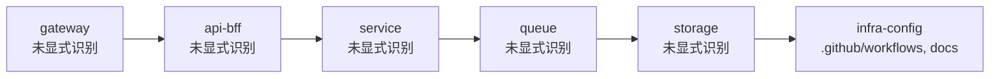

# beacon Infra Chain Map

## 1. Summary
- `beacon` 的 infra-chain-map 会优先按 `gateway → api/bff → service → queue → storage` 这条骨架输出，用来快速核对部署和数据路径。

## 2. Scope
- mode: `infra-chain-map`
- project_root: `/Users/apple/Developer/Personal/products/beacon`
- target: `.`

## 3. Mermaid Maps

## 4. Key Entry Points
- `README.md`: top-level entry or manifest
- `pyproject.toml`: top-level entry or manifest
- `beacon/main.py`: CLI module entrypoint
- `beacon/cli_factory.py`: command registration
- `beacon/commands`: primary command surface
- `tests`: verification surface

## 5. Key Modules / Subsystems
- `.github/workflows` currently looks like the `infra-config` layer candidate.
- `docs` currently looks like the `infra-config` layer candidate.

## 6. Dependencies / Infra Chain
- `.github/workflows`
- `docs`

## 7. Confirmed Facts
- 分析模式为 `infra-chain-map`。
- 分析目标是 `.`。
- 目标类型是 `directory`。
- 检测到 `6` 个关键入口/清单文件。
- 检测到 `2` 个依赖或基础设施相关引用。
- 目标范围下约有 `11632` 个文件。

## 8. Inferred Structure
- 仓库很可能把实现与验证留在同一代码库内演进。
- 文档目录存在，说明这条线倾向于把认知材料和代码一起版本化。
- 当前 infra 链路是按目录/文件命名启发式推断的，真正的数据流和控制流还需要结合部署配置验证。

## 9. Open Questions / Risks
- 当前链路图是否真的覆盖了所有 gateway / worker / storage 层，还需要核对部署配置和运行时环境变量。
- 队列与存储节点目前主要来自命名推断，是否存在托管服务或外部 SaaS 还没有证据。

## 10. Recommended Next Steps
- 先读 `Key Entry Points` 里的文件，确认 `.` 的正式入口和初始化顺序。
- 下一步最好补充部署配置、环境变量或运行拓扑，验证 gateway → service → queue → storage 的真实顺序。
