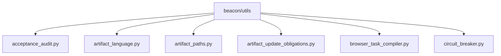

# beacon/utils Package Brief

## 1. Summary
- `beacon/utils` 是当前 package-brief 的分析目标，先抓直接文件、子模块和依赖清单，再决定是否继续做 feature-slice。

## 2. Scope
- mode: `package-brief`
- project_root: `/Users/apple/Developer/Personal/products/beacon`
- target: `beacon/utils`

## 3. Mermaid Maps

## 4. Key Entry Points
- 暂未识别到明确入口文件，需要人工补充范围或切换模式。

## 5. Key Modules / Subsystems
- `beacon/utils/acceptance_audit.py` is a direct implementation file under this package slice.
- `beacon/utils/artifact_language.py` is a direct implementation file under this package slice.
- `beacon/utils/artifact_paths.py` is a direct implementation file under this package slice.
- `beacon/utils/artifact_update_obligations.py` is a direct implementation file under this package slice.
- `beacon/utils/browser_task_compiler.py` is a direct implementation file under this package slice.
- `beacon/utils/circuit_breaker.py` is a direct implementation file under this package slice.

## 6. Dependencies / Infra Chain
- 当前范围下未发现明显的依赖清单或基础设施配置文件。

## 7. Confirmed Facts
- 分析模式为 `package-brief`。
- 分析目标是 `beacon/utils`。
- 目标类型是 `directory`。
- 目标范围下约有 `66` 个文件。

## 8. Inferred Structure
- 仓库很可能把实现与验证留在同一代码库内演进。
- 文档目录存在，说明这条线倾向于把认知材料和代码一起版本化。
- `beacon/utils` 当前更像实现切片，需要继续结合入口文件确认对外 API。

## 9. Open Questions / Risks
- `beacon/utils` 的正式对外入口是否只通过一个聚合文件暴露，还需要读 README 或上层调用点确认。
- `beacon/utils` 与相邻模块的写入/调用边界是否稳定，还需要查看集成测试或调用链。

## 10. Recommended Next Steps
- 先读 `Key Entry Points` 里的文件，确认 `beacon/utils` 的正式入口和初始化顺序。
- 如果要继续深挖调用链，下一步补一份 feature-slice 或 infra-chain-map 会更有效。
