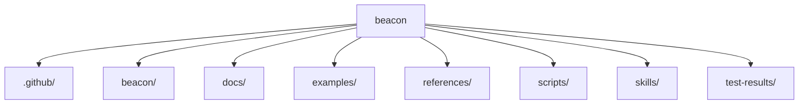

# beacon Lighthouse Map

## 1. Summary
- `beacon` 的主结构以 `.github, beacon, docs` 为主，适合先从入口文件和顶层子系统开始建立心智模型。

## 2. Scope
- mode: `system-architecture-map`
- project_root: `/Users/apple/Developer/Personal/products/beacon`
- target: `.`

## 3. Mermaid Maps

## 4. Key Entry Points
- `README.md`: top-level entry or manifest
- `pyproject.toml`: top-level entry or manifest
- `beacon/main.py`: CLI module entrypoint
- `beacon/cli_factory.py`: command registration
- `beacon/commands`: primary command surface
- `tests`: verification surface

## 5. Key Modules / Subsystems
- `.github` contains about `1` files and looks like a standalone subsystem.
- `beacon` contains about `138` files and looks like a standalone subsystem.
- `docs` contains about `11191` files and looks like a standalone subsystem.
- `examples` contains about `1` files and looks like a standalone subsystem.
- `references` contains about `3` files and looks like a standalone subsystem.
- `scripts` contains about `11` files and looks like a standalone subsystem.

## 6. Dependencies / Infra Chain
- `pyproject.toml`
- `.github/workflows`

## 7. Confirmed Facts
- 分析模式为 `system-architecture-map`。
- 分析目标是 `.`。
- 目标类型是 `directory`。
- 检测到 `6` 个关键入口/清单文件。
- 检测到 `2` 个依赖或基础设施相关引用。
- 目标范围下约有 `11630` 个文件。

## 8. Inferred Structure
- 仓库很可能把实现与验证留在同一代码库内演进。
- 文档目录存在，说明这条线倾向于把认知材料和代码一起版本化。
- 看起来存在面向宿主或 AI 入口的 skill / prompt 适配层。

## 9. Open Questions / Risks
- 当前地图基于目录和关键文件启发式生成，跨进程/跨服务调用关系还需要继续读实现细节确认。
- 如果项目依赖运行时动态注册或插件发现机制，单次静态扫描可能看不到全部边界。

## 10. Recommended Next Steps
- 先读 `Key Entry Points` 里的文件，确认 `.` 的正式入口和初始化顺序。
- 如果需要正式需求或实现闭环，再显式把这份 Lighthouse 工件作为 PRD / implement / QA 的输入。
