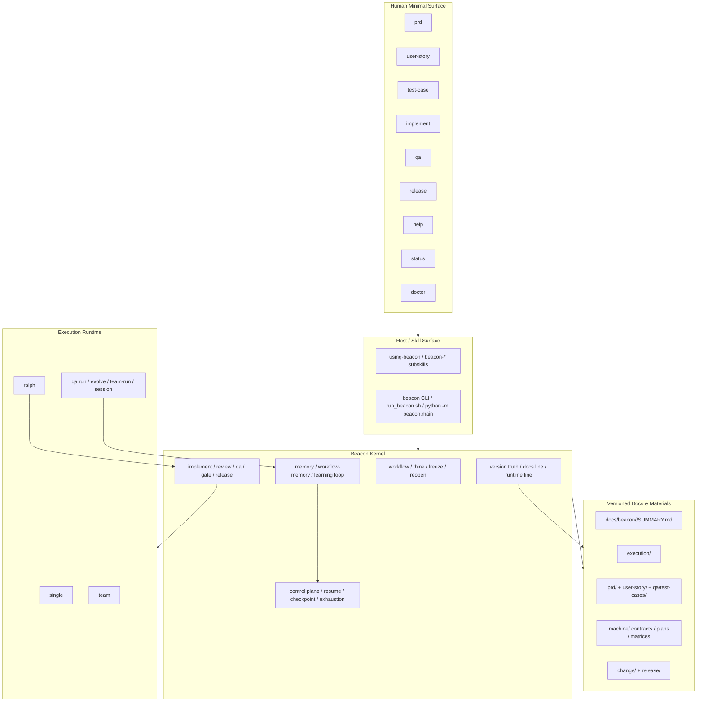
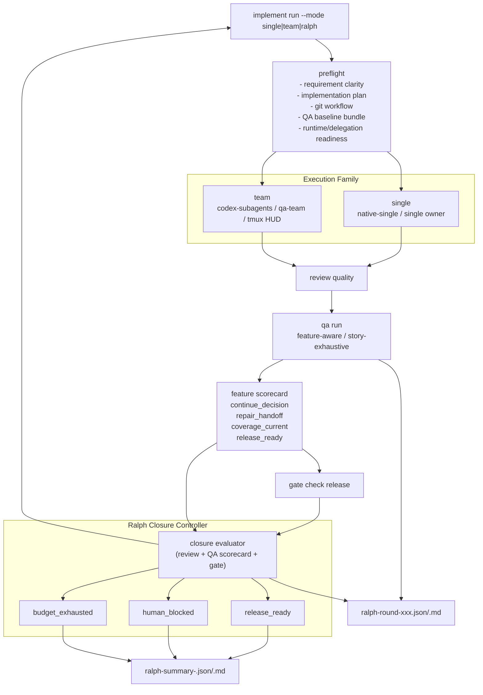
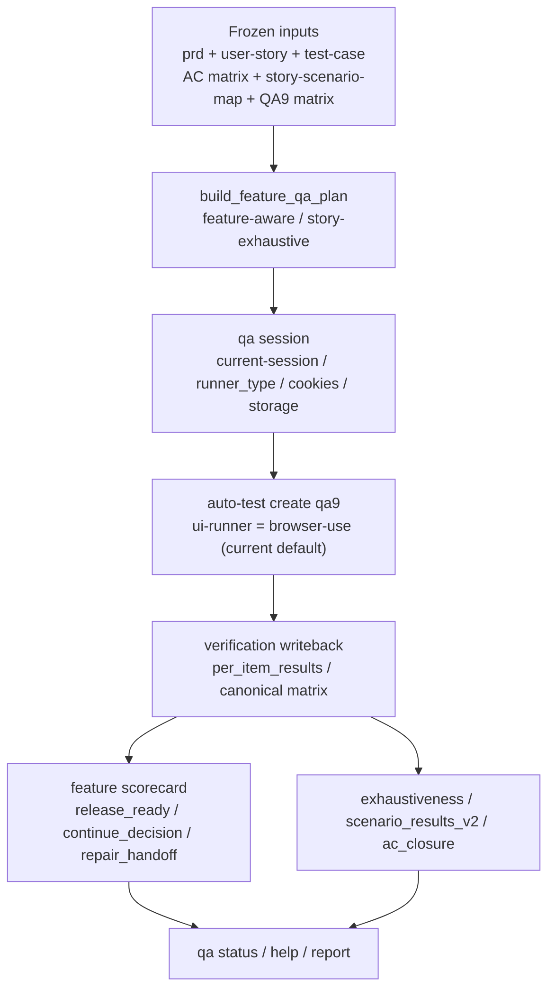
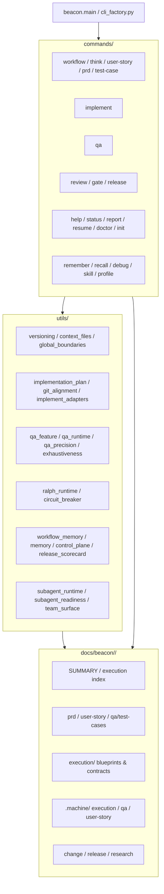

# Beacon v1.3.2 系统架构地图

> 这份文档是 **v1.3.2 执行补充线** 的图文地图。  
> 它不是替代 `architecture-blueprint.md` 的长文叙事，而是用 Mermaid + 中文说明，把 **Beacon 当前仓库已经具备的能力**、**v1.3.2 关注的执行面**、以及 **记忆/治理/交付链** 一次讲清楚。

## 怎么读这份图

如果你只想快速建立心智模型，按这个顺序看：

1. 先看“整体产品与执行分层图”
2. 再看“文档/工件/记忆能力图”
3. 再看 “implement / qa / ralph 执行闭环图”
4. 最后看“代码模块映射图”

这份图的核心判断只有一句：

> **Beacon 不是通用 agent runtime，而是 evidence-first product workflow kernel。**

---

## 1. 整体产品与执行分层图



### 这张图说明什么

- 人类长期只需要记住 `prd -> user-story -> test-case -> implement -> qa -> release` 加上 `help / status / doctor`。
- Beacon 的真正复杂度被压进了 Kernel：
  - workflow
  - execution
  - control plane
  - memory / learning
  - version truth
- `single / team / ralph` 只是 `implement + qa` 执行面的三种模式，不是三套产品。
- 一切正式交付最后都要回到 `docs/beacon/<version>/` 这套 versioned materials。

---

## 2. 文档、工件与记忆能力图

```mermaid
flowchart LR
    subgraph Requirement["Requirement Truth"]
        R1["prd/<feature>.md"]
        R2["user-story/<feature>.md"]
        R3["qa/test-cases/<feature>.md"]
        R4["execution/boundaries.md + global-boundaries.md"]
    end

    subgraph Machine["Machine Materials"]
        M1["implementation-plan-<feature>.json"]
        M2["git-workflow-<feature>.json"]
        M3["ac-test-matrix / qa9-matrix / story-scenario-map"]
        M4["requirement-clarity / rewrite-input / deterministic-contract"]
    end

    subgraph ExecutionArtifacts["Execution Artifacts"]
        A1["implementation-summary"]
        A2["technical-implementation"]
        A3["qa status / feature scorecard / exhaustiveness"]
        A4["ralph state / ralph rounds / ralph summary"]
        A5["change docs / release scorecard"]
    end

    subgraph MemoryPlane["Memory & Recovery Plane"]
        MEM1["remember / recall"]
        MEM2["workflow-lifecycle / memory metrics"]
        MEM3["control plane / resume contract / checkpoint"]
        MEM4["qa session / current-session / evidence refs"]
    end

    Requirement --> Machine
    Machine --> ExecutionArtifacts
    ExecutionArtifacts --> MemoryPlane
    MemoryPlane --> ExecutionArtifacts
```



### 当前 Beacon 的记忆能力，不只是 `remember/recall`

Beacon 的“记忆能力”实际上有 4 层：

1. **知识记忆**
   - `remember`
   - `recall`
   - 用于 insight / decision / vocabulary / feedback
2. **流程记忆**
   - workflow lifecycle
   - memory metrics
   - 哪个 run 做过什么阶段
3. **恢复记忆**
   - checkpoint
   - exhaustion
   - `resume`
   - next action / current blocker
4. **执行记忆**
   - QA session
   - evidence refs
   - Ralph round refs
   - feature scorecard

也就是说，Beacon 的记忆不是一个聊天摘要层，而是：

> **知识 + 流程 + 恢复 + 执行证据** 四层合在一起。

---

## 3. implement / qa / ralph 执行闭环图



### 这张图对应当前 v1.3.2 的关键架构判断

- `single` / `team` / `ralph` 是 **同一 execution family**。
- `ralph` 不是一个新的实现器，而是外层 closure controller。
- 现在最重要的收口点是：
  - `Ralph = 唯一 outer loop`
  - `QA 每轮单次正式执行`
  - `review + qa scorecard + gate = 唯一正式 closure evaluator`
- `CircuitBreaker` 仍然存在，但它只是 safety-only，不再决定“完成”。

### 对实际使用的理解

- `single`
  - 小任务、单 owner、最小执行面
- `team`
  - 多角色协作、HUD、worker evidence
- `ralph`
  - 不是“更强执行器”，而是“持续推进直到明确终态”的控制器

---

## 4. QA 与浏览器能力细化图



### 当前 QA 的真实状态

这条线在当前仓库里已经不是“只有文档”：

- `qa run`
- `qa evolve`
- `qa team-run`
- `qa status`
- `qa session`

这些都已存在，并能落：

- feature scorecard
- AC closure
- exhaustiveness
- targeted rerun
- repair handoff

但也要如实说明：

> 当前浏览器 family 口径在文档里是统一的，代码主路径里仍偏向 `browser-use` 作为默认 `ui-runner`。

所以 v1.3.2 当前更准确的说法是：

- **QA 迭代框架已落地**
- **browser family 产品化语义仍有继续收口空间**

---

## 5. 记忆与控制面地图

```mermaid
flowchart LR
    subgraph HumanFacing["Human Facing"]
        H1["help"]
        H2["status --board"]
        H3["report"]
        H4["resume"]
    end

    subgraph Control["Control Plane"]
        C1["failure_streak"]
        C2["escalation_level"]
        C3["required_next_action"]
        C4["current_blocker"]
        C5["checkpoint / exhaustion"]
    end

    subgraph Ralph["Ralph State"]
        R1["phase"]
        R2["stop_state"]
        R3["round_count"]
        R4["last_round_ref"]
        R5["next_action"]
    end

    subgraph WorkflowMemory["Workflow Memory"]
        W1["workflow-lifecycle"]
        W2["memory metrics"]
        W3["run state"]
        W4["implementation-plan progress"]
    end

    subgraph KnowledgeMemory["Knowledge Memory"]
        K1["remember add"]
        K2["recall memory"]
        K3["memory entries + evidence_ref"]
    end

    HumanFacing --> Control
    Control --> Ralph
    Control --> WorkflowMemory
    WorkflowMemory --> HumanFacing
    KnowledgeMemory --> HumanFacing
    Ralph --> HumanFacing
```



### 为什么 Beacon 的恢复能力比普通工作流工具更强

因为它不是只存一个 “status”：

- 有 run state
- 有 workflow lifecycle
- 有 implementation-plan progress
- 有 QA scorecard
- 有 Ralph round artifact
- 有 memory entries

所以 `help/status/report/resume` 才能做到：

1. 看到当前在哪一阶段
2. 看到当前为什么卡住
3. 看到下一步应该做什么
4. 看到上一轮证据在哪

---

## 6. 代码模块映射图



### 模块理解顺序

如果你想从代码看懂 Beacon，最值得的顺序是：

1. `cli_factory.py`
   - 看整体命令面怎么组织
2. `commands/implement.py`
   - 看 execution family 与 Ralph/QA 闭环
3. `commands/qa.py`
   - 看 feature-aware / story-exhaustive / session / scorecard
4. `utils/ralph_runtime.py`
   - 看 Ralph durable state
5. `utils/help_support.py`
   - 看为什么 `help/status` 能做阶段导航
6. `utils/workflow_memory.py` / `utils/memory.py`
   - 看 Beacon 的记忆面

---

## 7. 最新 v1.3.2 的最小心智模型

如果你要把整套架构压成最短的一段话，可以记成这样：

> Beacon 用 versioned docs 持有 requirements truth，用 `implement + qa + review + gate + release` 构成交付闭环，用 `single / team / ralph` 收敛执行模式，用 memory/control plane 保持可恢复和可解释。

或者再短一点：

```text
Docs truth
→ execution family
→ QA evidence
→ closure evaluator
→ release governance
→ memory / recovery
```

---

## 8. 当前实现与未来增强的边界

### 当前仓库里已经能成立的部分

1. requirement truth + machine materials
2. `single / team / ralph`
3. Ralph stop states
4. implement → review → qa → gate 的核心闭环
5. help/status/report/resume 的观测面
6. remember/recall/workflow-memory 的记忆能力

### 继续增强但不影响当前主架构成立的部分

1. browser execution family 的统一产品化
2. 更强的 QA auto research 增量表达
3. 更完整的 Ralph/TUI/HUD 观测层
4. worktree 深化与 team 隔离增强

---

## 9. 推荐放到 v1.3.2 执行索引里的位置

建议把这份文档放在：

1. `architecture-blueprint.md`
2. `system-architecture-map.md`
3. `implement-execution-modes-blueprint.md`
4. `qa-iterative-browser-contract.md`
5. `ralph-closure-state-machine.md`

这样阅读顺序更自然：

- 先看长文架构判断
- 再看一页图把全局装进脑子
- 再下钻到 implement/qa/ralph

