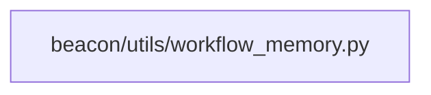

# beacon/utils/workflow_memory.py Feature Slice

## 1. Summary
- `beacon/utils/workflow_memory.py` 的 feature-slice 会先抓入口文件、直接模块和相邻测试，帮助快速界定这个功能切片。

## 2. Scope
- mode: `feature-slice`
- project_root: `/Users/apple/Developer/Personal/products/beacon`
- target: `beacon/utils/workflow_memory.py`

## 3. Mermaid Maps

## 4. Key Entry Points
- `beacon/utils/workflow_memory.py`: explicit feature target

## 5. Key Modules / Subsystems
- `beacon/utils/workflow_memory.py` is the explicit feature file; continue by reading callers and adjacent tests.

## 6. Dependencies / Infra Chain
- 当前范围下未发现明显的依赖清单或基础设施配置文件。

## 7. Confirmed Facts
- 分析模式为 `feature-slice`。
- 分析目标是 `beacon/utils/workflow_memory.py`。
- 目标类型是 `file`。
- 检测到 `1` 个关键入口/清单文件。

## 8. Inferred Structure
- 仓库很可能把实现与验证留在同一代码库内演进。
- 文档目录存在，说明这条线倾向于把认知材料和代码一起版本化。
- `beacon/utils/workflow_memory.py` 当前被当作一个 feature 边界切片，但上下游入口还需要从调用点和测试覆盖继续收口。

## 9. Open Questions / Risks
- `beacon/utils/workflow_memory.py` 的真正 feature 入口是否来自路由、任务调度或事件消费，还需要继续向上游追调用点。
- `beacon/utils/workflow_memory.py` 的测试覆盖是否完整，还需要检查相关测试文件和集成场景。

## 10. Recommended Next Steps
- 先读 `Key Entry Points` 里的文件，确认 `beacon/utils/workflow_memory.py` 的正式入口和初始化顺序。
- 下一步从这个切片的上游调用点和测试文件继续挖，补齐完整 feature path。
