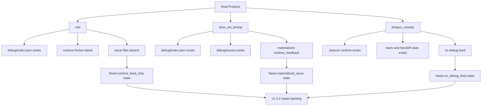
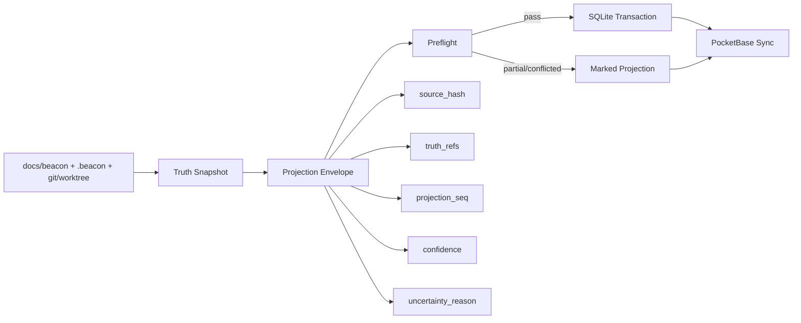
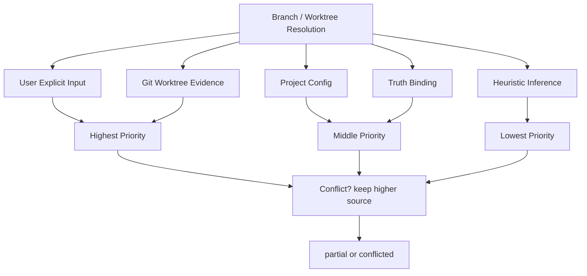

# Beacon v1.3.4 Real-Env Debug Friction And Deterministic Projection Lighthouse Map

## 1. Summary

本次 Lighthouse 聚焦 `v1.3.4` 主 PRD 之外的一个关键现实输入：

- `rolo`
- `slow_uni_bmtop`
- `shopxo_canada`

这 3 个真实项目的 `.beacon` 状态已经证明，`v1.3.4` 不能只做“SQLite + PocketBase 看板”。

它还必须同时修复 3 类 Beacon 自身摩擦：

1. 多服务 workspace discovery 误判
2. branch / worktree 解析优先级漂移
3. debug friction 从 observation 到 repair 的缺口

同时，`SQLite -> PocketBase` 的 projection 写链必须被收敛为确定性流程，而不是两套各自解释 truth 的同步器。

## 2. Scope

本文件只分析：

- 真实环境 debug feed 与 runtime friction 的输入面
- `truth -> projection -> control plane` 的确定性写链
- 为什么 `rolo/slow/shopxo` 对 `v1.3.4` 是有效外场样本

本文件不直接进入：

- user-story
- test-case
- implement
- qa

## 3. Mermaid Maps

### 3.1 Real-Env Friction Intake



### 3.2 Deterministic Projection Write Chain



### 3.3 Source Priority For Branch / Worktree



## 4. Key Entry Points

- `docs/beacon/archive/v1.3.4/prd/beacon-v1.3.4-global-runtime-projection-and-pocketbase-control-plane.md`
- `docs/beacon/archive/v1.3.4/execution/architecture-blueprint.md`
- `/Users/apple/Developer/Company/rolo/.beacon/debug/index.json`
- `/Users/apple/Developer/Company/rolo/.beacon/debug/runs/debug-rolo-v118/events.jsonl`
- `/Users/apple/Developer/Personal/products/slow_uni_bmtop/.beacon/debug/index.json`
- `/Users/apple/Developer/Personal/products/slow_uni_bmtop/.beacon/debug/issues/beacon-core--runtime_feedback.json`
- `/Users/apple/Developer/Personal/products/shopxo_canada/.beacon`

## 5. Key Modules / Subsystems

### 5.1 Truth Layer

- `docs/beacon/<version>/`
- `.beacon/`
- git/worktree 实证

### 5.2 Projection Layer

- project registry
- git scope registry
- run registry
- debug issue registry
- projection envelope

### 5.3 Control Plane

- PocketBase collections
- CEO 总览
- 项目负责人详情
- runtime / diagnostics 下钻

## 6. Dependencies / Infra Chain

```text
Local Truth
-> scanner / normalizer
-> projection envelope
-> SQLite ledger
-> PocketBase control plane
-> human board views
```

外场输入链：

```text
real project .beacon/debug
-> observation intake
-> issue materialization
-> repair lane / PRD repair items
```

## 7. Confirmed Facts

- `rolo` 存在 `debug/index.json`，最新生成时间是 `2026-04-17T07:03:04Z`。
- `rolo` 最新 debug run `debug-rolo-v118` 中同时存在 release gate blocked 与 runtime_feedback。
- `rolo` 的最新 runtime_feedback 明确涉及：
  - 多服务 discovery 误判
  - branch/worktree 解析摩擦
  - debug analyze/research/fix 子 lane 诉求
- `slow_uni_bmtop` 存在已物化的 `debug/issues/beacon-core--runtime_feedback.json`。
- `slow_uni_bmtop` 的最新 materialized issue 时间是 `2026-03-28T17:58:31Z`。
- `shopxo_canada` 当前存在 `.beacon` 运行态、team、handoff、implement 记录，但没有 `debug/index.json` 或 `debug/issues/*.json`。
- 这意味着“没有 issue 文件”并不等于“没有项目运行态”。

## 8. Inferred Structure

- `v1.3.4` 需要把 debug feed 建模为三态：
  - `materialized_issue`
  - `runtime_feed_only`
  - `no_debug_feed`
- `rolo` 说明 `project != git repo` 只是第一层；更深一层是 `project discovery != single-language root inference`。
- 如果不冻结 source priority，SQLite 与 PocketBase 很容易分别吸收不同来源，形成双写漂移。
- `projection envelope` 应成为 `truth -> sqlite -> pocketbase` 的唯一中间合同，否则无法证明双写一致性。

## 9. Open Questions / Risks

- `runtime_feed_only` 什么时候自动提升为正式 issue，什么时候只保留 observation。
- `projection envelope` 是否要持久化为 artifact，还是只做内存对象。
- `shopxo_canada` 这类“有运行态但无 debug feed”项目，是否需要低噪音自动建最小 debug index。
- PocketBase 是直接读 SQLite，还是只消费 projector 同步后的集合快照。

## 10. Recommended Next Steps

1. 把 `rolo` 的 3 条摩擦正式纳入 `v1.3.4` 主 PRD 修复项。
2. 冻结 `projection envelope + preflight` 合同，作为 SQLite / PocketBase 双写前置条件。
3. 为 `debug feed` 增加三态建模，避免只有 issue 文件才能被观察。
4. 在 `status / doctor` 里逐步暴露“高优先级冲突被保留、低优先级推断被抑制”的可见结果。
