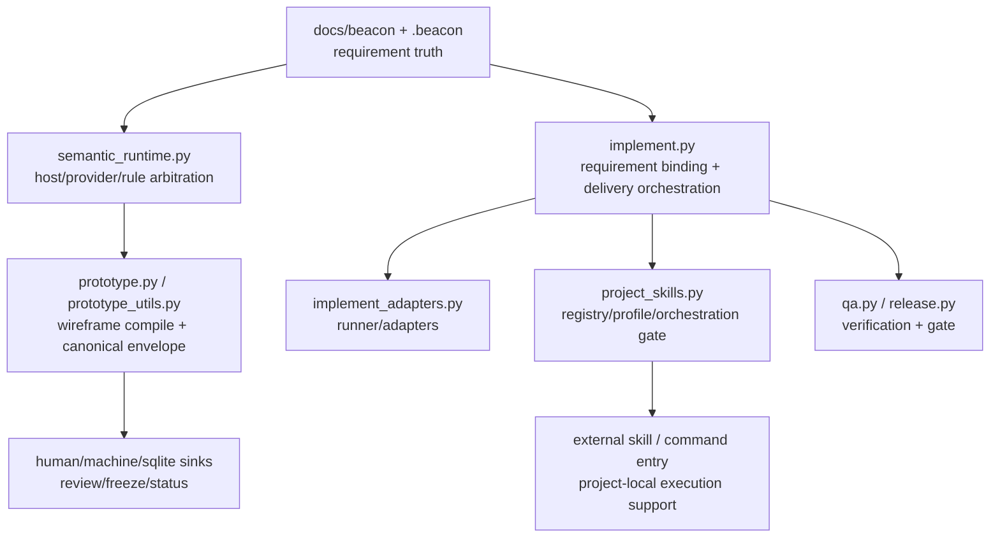
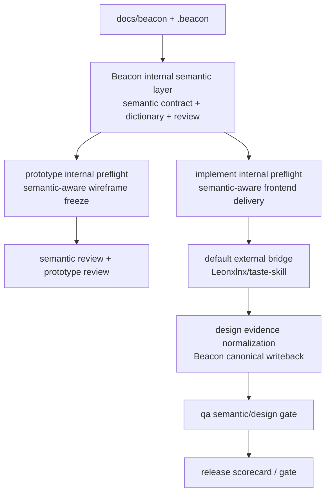

# Beacon Capability Boundary Lighthouse Map

## 1. Summary

当前 Beacon 已经具备三块与本次方案直接相关的基础能力：

- 宿主原生语义运行时骨架已经存在，`semantic_runtime` 已负责 host response / provider fallback / mode contract。
- `prototype` 已经是 requirement-driven wireframe freeze，并且拥有 canonical envelope、page specs、state flow、review/freeze/writeback 产物。
- 外部 skill bridge 已经存在，`skill registry + profile orchestration + capability/evidence gate` 能把 project-local skill 纳入受控执行。

所以这次改动不是从零设计，而是在现有边界上补齐两层：

1. Beacon 内建 `semantic layer`
2. `prototype / implement` 对默认外部设计 bridge skill 的受控接入

核心结论：

- `semantic` 应落在 Beacon 内核里，属于 requirement compile 的正式中间层。
- `taste-skill` 应落在外部 bridge 层，作为默认设计增强 skill 被 `prototype / implement` 内部消费。
- 不能把 `semantic` 做成新的公开主命令，也不能把 `taste-skill` 暴露成新的主流程入口。

## 2. Scope

本分析聚焦：

- `prototype`
- `implement`
- `skill / project_skills`
- `semantic runtime`
- `qa / release` 对语义与设计增强的 gate 能力

不展开：

- UI console 具体页面视觉重写
- 外部 skill 安装器细节
- 第三方 skill 仓库的功能评测

## 3. Mermaid Maps

### 3.1 Current Boundary Map

### 3.2 Proposed Delta Map

## 4. Key Entry Points

- `beacon/utils/semantic_runtime.py`
  - 现有宿主语义桥入口，适合承接 `semantic layer` 的 runtime arbitration。
- `beacon/commands/prototype.py`
  - `prototype` 公开入口，必须保持为唯一公开的人类阶段入口。
- `beacon/utils/prototype_utils.py`
  - 当前最关键的语义承载位，已经维护 `PAGE_CATALOG`、`PAGE_ANALYSIS_CATALOG`、canonical envelope、多 sink 投影。
- `beacon/commands/implement.py`
  - 当前正式实现入口，已经绑定 PRD / User Story / Test Case / Prototype。
- `beacon/utils/project_skills.py`
  - 当前外部 skill 受控接入面，已具备 registry / profile / orchestration gate。
- `beacon/commands/skill.py`
  - 外部 skill 检测、注册、bind、registry list 的公开管理面。
- `beacon/utils/implement_adapters.py`
  - 当前实现 runner/adapters 兼容层，适合补 `taste-skill` 默认 bridge adapter 发现逻辑。

## 5. Key Modules / Subsystems

### 5.1 Semantic Runtime Layer

- 文件：
  - `beacon/utils/semantic_runtime.py`
- 现状：
  - 已支持 `requested_mode / effective_mode / fallback_reason / capability_snapshot`
  - 已区分 host response 与 provider fallback
- 边界：
  - 这是 Beacon 内建语义能力的天然入口
  - 不适合直接承载外部设计 skill 调度

### 5.2 Prototype Compile Layer

- 文件：
  - `beacon/commands/prototype.py`
  - `beacon/utils/prototype_utils.py`
- 现状：
  - 已有 wireframe-only freeze
  - 已有 canonical envelope / page specs / review / coverage / route closure
  - 但页面语义仍混有内部词，如 `runtime`、`prototype`、`implement`、`blocker`
- 边界：
  - 这里最适合内建 `semantic layer`
  - 外部设计 skill 只能作为增强输入，不能替代 canonical 生成

### 5.3 Implementation Delivery Layer

- 文件：
  - `beacon/commands/implement.py`
  - `beacon/utils/implementation_plan.py`
  - `beacon/utils/implement_native.py`
- 现状：
  - 已经绑定 prototype 目录
  - 已有 preflight / git gate / handoff / evidence manifest
- 边界：
  - 适合消费 `semantic layer`
  - 适合挂 taste review / design-to-component 增强
  - 不适合把第三方 design skill 升格成默认 truth source

### 5.4 External Skill Bridge Layer

- 文件：
  - `beacon/commands/skill.py`
  - `beacon/utils/project_skills.py`
  - `beacon/utils/skill_discovery.py`
  - `beacon/utils/implement_adapters.py`
- 现状：
  - 已支持 registry / profile / feature binding / orchestration node
  - 已校验 `supported_stages / capabilities / evidence_contract`
- 边界：
  - 这层已经可以承载 `taste-skill` 的默认 bridge
  - 但目前 capability vocabulary 仍偏实现/验证，不足以表达 design/semantic enhancement

### 5.5 QA / Release Gate Layer

- 文件：
  - `beacon/commands/qa.py`
  - `beacon/commands/release.py`
  - `beacon/utils/release_scorecard.py`
- 现状：
  - 已有 evidence/gate/release scorecard 机制
- 边界：
  - 当前主要校验功能、资料、交付证据
  - 尚未把 semantic/design consistency 变成正式 gate

## 6. Dependencies / Infra Chain

- Truth layer
  - `docs/beacon/<version>/`
  - `.beacon/`
- Semantic runtime layer
  - host runtime (`codex` / `claude`)
  - optional provider fallback
- Structured execution layer
  - `python3 -m beacon.main`
  - Typer command surface
- Projection layer
  - human docs
  - machine json
  - sqlite/runtime projection
- External bridge layer
  - `~/.agents/skills/`
  - `~/.codex/skills/`
  - `project_skills.registry`

## 7. Confirmed Facts

- Beacon 当前公开主流程仍以 `prototype`、`implement`、`qa`、`release` 为人类面，`lighthouse` 是隐藏分析面，不是主流程入口。
- `semantic_runtime.py` 已经是共享宿主语义运行时，而不是只给某个单命令使用。
- `prototype_utils.py` 已经把 `prototype` 做成了可编译、可审阅、可投影的 canonical 产物链。
- `implement.py` 已明确把 prototype 目录作为 requirement artifact 之一绑定进入实现。
- `project_skills.py` 已经有外部 skill registry、profile binding、orchestration node 以及 capability/evidence gate。
- `cli_factory.py` 已把 `skill`、`prototype`、`implement`、`qa`、`release` 放在同一 CLI 核心表面，而把 `bridge` 和 `labs` 作为非默认面。

## 8. Inferred Structure

- 最小可行方案不是新增一个 `semantic` 公开命令，而是在 `prototype` 内部前置一层 `semantic layer` 生成与审阅。
- `semantic layer` 最适合生成四类正式产物：
  - `semantic-contract.json`
  - `semantic-dictionary.md`
  - `semantic-usage-guidelines.md`
  - `semantic-review.json`
- 默认外部设计桥接 skill 最适合通过 `project_skills.registry` + `skill discovery` 注入，而不是直接硬编码在 `prototype_utils.py`。
- `taste-skill` 的默认接入位置更像：
  - `prototype` 内部的 design-enhancement node
  - `implement` 内部的 frontend-taste-review node
- QA/release 最终需要增加一条独立 gate：
  - semantic/design consistency

## 9. Open Questions / Risks

### 9.1 Human Surface Drift

- `cli_factory.py` 的 help 文案里仍出现 `think -> user-story -> prd -> test-case -> prototype -> implement -> qa -> gate -> release`
- 这和当前全局 7+3 边界并不完全一致
- 若继续新增 semantic/design bridge，而不先统一主面文案，后续容易再次漂移

### 9.2 Stage Taxonomy Drift

- `project_skills.py` 的 stage 词汇目前偏：
  - `implementation`
  - `verify`
  - `review`
  - `delivery`
- 这与 Beacon 人类主链：
  - `prototype`
  - `implement`
  - `qa`
  - `release`
 之间并不完全一一对应
- 若要引入 `taste-skill` 默认桥接，先要明确 design/semantic capability 绑定到哪一层 stage vocabulary

### 9.3 Prototype Semantic Leakage

- `prototype_utils.py` 里的 `PAGE_CATALOG` 与 `PAGE_ANALYSIS_CATALOG` 目前仍混杂内部术语
- 如果直接叠加 design skill 而不先引入内建 `semantic layer`，只会做“美化过的内部词”

### 9.4 External Skill Boundary

- 当前 registry 支持外部 skill，但尚未形成一套 design/semantic capability 标准
- 如果直接把 `taste-skill` 接进来，容易退化成 command template 编排，而不是 capability-bounded augmentation

## 10. Recommended Next Steps

1. 先定义 Beacon 内建 `semantic layer` 的 schema 与 writeback contract，不新增公开命令。
2. 在 `prototype` 内部新增 semantic preflight：
   - 生成 semantic contract
   - 运行 semantic review
   - 再进入 wireframe freeze
3. 扩展 `project_skills.py` 的 capability vocabulary，新增：
   - `design-system-synthesis`
   - `wireframe-enhancement`
   - `frontend-taste-review`
   - `design-to-component`
   - `ui-copy-governance`
4. 把 `Leonxlnx/taste-skill` 定义为默认外部设计 bridge：
   - 默认 registry entry
   - 默认 profile binding
   - 默认 evidence contract
5. 在 `implement` 中新增 design augmentation node，但结果必须先归一化再写回 Beacon evidence。
6. 在 `qa / release` 中新增 semantic/design consistency gate，避免前台表达在实现阶段漂移。

## Key Source Refs

- `beacon/utils/semantic_runtime.py`
- `beacon/utils/prototype_utils.py`
- `beacon/commands/prototype.py`
- `beacon/commands/implement.py`
- `beacon/utils/project_skills.py`
- `beacon/commands/skill.py`
- `beacon/utils/implement_adapters.py`
- `beacon/cli_factory.py`
- `docs/beacon/archive/v1.3.6/execution/host-native-llm-and-skill-runtime-blueprint.md`
- `docs/beacon/archive/v1.3.6/execution/architecture-blueprint.md`
