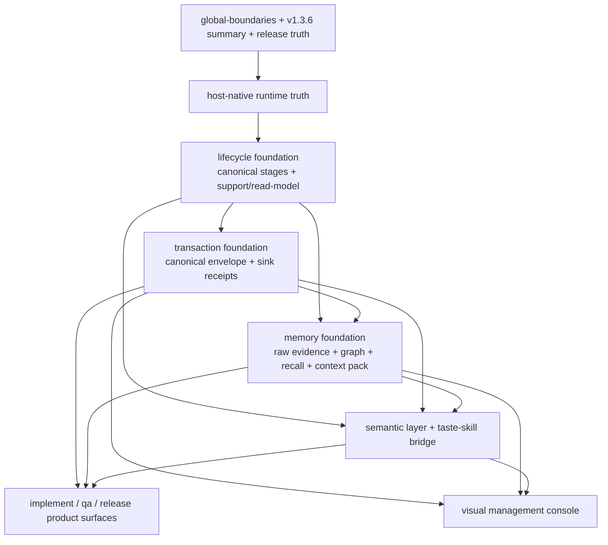

# Beacon v1.3.6 PRD 实施优先级矩阵与依赖图建议

## 1. Summary

这份文档用于收敛 `v1.3.6` 当前关键 PRD 的实施优先级、依赖关系和建议动作，避免把已经被 runtime/release truth 吸收的历史迁移线，继续和真正未实现的 foundation / capability 线混在一起推进。

核心判断：

- `host-native runtime refactor` 已经是 `v1.3.6` runtime truth 的一部分，不应再作为同等级“新主线 PRD”推进。
- `lifecycle foundation + transaction consistency` 是当前第一优先级实施线。
- `memory foundation` 是 foundation 能力主线，但需要依附 canonical lifecycle / transaction contract 收口。
- `semantic layer + taste-skill bridge` 是 foundation 之上的产品能力线，不宜先于 foundation 落地。

## 2. Scope

本矩阵主要覆盖以下 PRD：

- `beacon-v1.3.6-host-native-llm-orchestration-and-full-command-runtime-refactor`
- `beacon-v1.3.6-memory-foundation-and-full-scene-evidence-recall`
- `beacon-v1.3.6-lifecycle-foundation-transaction-consistent-dual-write-and-memory-convergence`
- `beacon-v1.3.6-internal-semantic-layer-and-default-taste-skill-bridge`
- `beacon-v1.3.6-visual-management-console-and-material-viewer`

## 3. Priority Matrix

| PRD | Current Status | Real Nature | Dependency Class | Priority | Recommended Action |
| --- | --- | --- | --- | --- | --- |
| `beacon-v1.3.6-host-native-llm-orchestration-and-full-command-runtime-refactor` | release truth / frozen mirror | 已被 `SUMMARY` 与 `release/v1.3.6.md` 吸收的 runtime truth | upstream truth | P0-truth, 非 P0-feature | 不再当新主线开发；拆成 residual alignment backlog |
| `beacon-v1.3.6-lifecycle-foundation-transaction-consistent-dual-write-and-memory-convergence` | planning line | foundation convergence 主修线 | foundation blocker | P0 | 先实施；先收口 canonical lifecycle、transaction envelope、support/read-model |
| `beacon-v1.3.6-memory-foundation-and-full-scene-evidence-recall` | planning line | memory foundation 主线 | foundation capability | P1 | 在 lifecycle contract 冻结后并行推进 evidence/index/context pack |
| `beacon-v1.3.6-internal-semantic-layer-and-default-taste-skill-bridge` | frozen-pending-implementation | 上层产品能力线 | depends-on foundation | P2 | foundation 稳定后实施；绑定 semantic contract 和 taste-skill bridge |
| `beacon-v1.3.6-visual-management-console-and-material-viewer` | frozen / release companion | 已发布 companion delivery | downstream consumer | P3-maintain | 不作为 foundation 驱动源；改为消费 foundation 输出 |

## 4. Detailed Reading

### 4.1 Host-Native Runtime Refactor

判定：

- 它的目标已经被 `v1.3.6` Summary 与 Release Note 认领为当前 runtime truth。
- 它今天更像“已发布架构线的残余对齐事项”，而不是“未开始的新功能 PRD”。

仍需处理的残余项：

- 公开命令面仍比 `7+3` 更宽
- workflow/memory 仍残留旧 vocabulary
- read-model 和 CLI help 仍有新旧语义混杂

建议：

- 将其从“主实施 PRD”降级为“truth-backed residual backlog”
- backlog 归口到 lifecycle foundation 线处理

### 4.2 Lifecycle Foundation + Transaction Consistency

判定：

- 这是当前真正的 P0 地基线。
- 它解决的是“规范已经升级，但真实状态机、读模型、事务写入还没统一”的根问题。

必须优先的原因：

- 它决定 canonical stages
- 它决定 `next_stage` / closure / blockers 的标准口径
- 它决定 human/machine/runtime 是否可以真正强一致双写
- 它是 memory foundation 和 semantic layer 的共同前置条件

建议：

- 先把它作为当前 implementation root
- 所有旧 stage 词汇清理先走这条线

### 4.3 Memory Foundation

判定：

- 这是 Beacon 的长期主能力线，不是边角增强。
- 但它不应脱离 lifecycle foundation 单独长成第二套 state machine。

最合理的关系：

- lifecycle foundation 负责定义 canonical stage 和 transaction boundary
- memory foundation 负责定义 evidence / index / context pack / recall / writeback

建议：

- 先冻结 memory 的 boundary 和 data model
- 再把 memory lineage 挂到 lifecycle transaction 上
- 避免先独立重做 recall，再回头补 transaction linkage

### 4.4 Semantic Layer + Taste Skill Bridge

判定：

- 这是明确有产品价值的上层能力线。
- 它解决的是 `prototype -> implement` 的官方语义真相和设计增强问题。

它依赖 foundation 的点：

- semantic contract 需要 canonical lifecycle 挂载点
- taste-skill 输出需要 canonical writeback
- `qa / release` 需要依赖 transaction-backed consistency gate
- `project_skills.py` stage vocabulary 收口，本质上也依赖 lifecycle canonicalization

建议：

- 不要先做完整 semantic layer
- 先等 foundation 提供 stable stage / transaction / context pack interfaces

### 4.5 Visual Management Console

判定：

- 这是已发布 companion line，不应倒过来驱动 foundation 设计。
- 它应该成为 foundation 的消费者和验证器，而不是 foundation 的真相源。

建议：

- 后续只做适配，不反向定义 lifecycle truth

## 5. Dependency Graph



## 6. Recommended Execution Order

### Stage 1: Truth Reclassification

- 将 `host-native runtime refactor` 明确定义为已发布 runtime truth
- 不再以“整条新 feature”方式推进
- 仅保留 residual alignment backlog

### Stage 2: Foundation First

- 实施 `lifecycle foundation + transaction consistency`
- 首批代码面优先：
  - `beacon/commands/workflow.py`
  - `beacon/utils/workflow_memory.py`
  - `beacon/utils/help_support.py`
  - `beacon/commands/status.py`
  - `beacon/command_catalog.py`
  - `beacon/cli_factory.py`

### Stage 3: Memory Convergence

- 在 canonical lifecycle 收口后推进 `memory foundation`
- 首批重点：
  - evidence receipts
  - transaction lineage
  - stage context packs
  - recall / friction writeback linkage

### Stage 4: Semantic Capability

- 基于稳定 foundation 实施 `semantic layer + taste-skill bridge`
- 首批重点：
  - semantic contract
  - prototype semantic preflight
  - implement semantic/design augmentation
  - `project_skills.py` canonical stage vocabulary

### Stage 5: Downstream Consumers

- 让 console / release / qa / status 完整消费 foundation outputs
- 将 companion delivery 收口为 consumer，而不再反向定义 truth

## 7. Merge / Downgrade Suggestions

### Suggestion A

将 `beacon-v1.3.6-host-native-llm-orchestration-and-full-command-runtime-refactor` 从“主实施 PRD”降级为：

- runtime truth source
- residual alignment backlog source

### Suggestion B

保留 `beacon-v1.3.6-memory-foundation-and-full-scene-evidence-recall` 作为独立 PRD，但在执行中明确：

- 不得独立生长为第二套 lifecycle
- transaction lineage 以 lifecycle foundation 为准

### Suggestion C

保留 `beacon-v1.3.6-internal-semantic-layer-and-default-taste-skill-bridge` 为独立 capability PRD，但增加执行约束：

- foundation 未收口前，不进入完整实现
- 仅允许做 schema / interface / bridge boundary 级准备

## 8. Final Recommendation

当前 `v1.3.6` 的实施主叙事建议改写为：

```text
已发布 runtime truth
→ foundation convergence
→ memory convergence
→ semantic capability
→ downstream product consumers
```

而不是：

```text
runtime refactor
+ memory foundation
+ semantic bridge
+ console
并列推进
```

前者能形成清晰依赖链，后者会继续制造新旧 foundation 并存和多源漂移。
