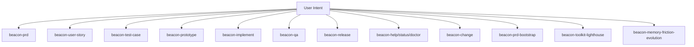
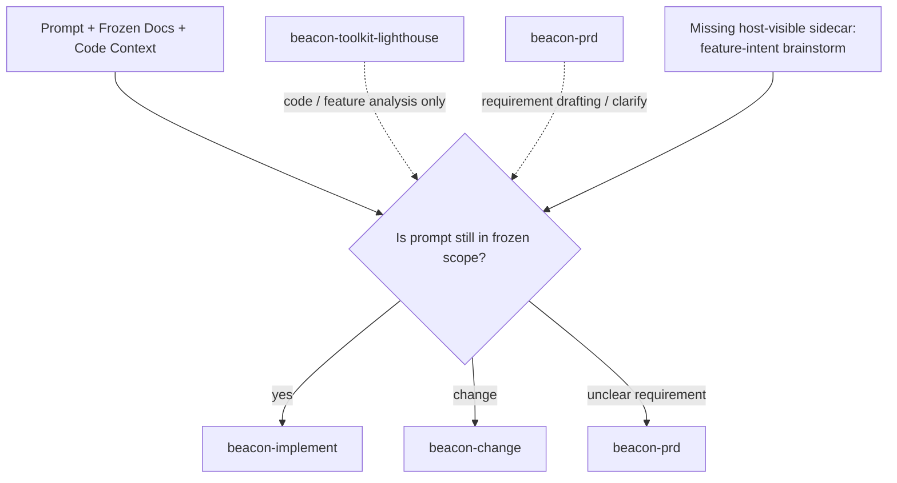

# Beacon Human Surface Closure And Feature Intent Gap Lighthouse Map

## 1. Summary

Beacon 当前的人类主面已经基本闭环 canonical lifecycle，但还没有自然闭环“任意 prompt 驱动的开发任务”。

更准确地说：

- 主流程 `7+3` 已经能覆盖 requirement -> implementation -> qa -> release
- `change / prd-bootstrap / lighthouse / memory-friction-evolution` 也补了一些 sidecar
- 但仍缺一个专门做“prompt + frozen docs + code context”头暴分析的 host-visible sidecar

这个缺口不是 `implement` 本身缺执行能力，而是：

> 在用户还没决定应该走 `implement` 还是 `change` 之前，Beacon 没有一个明确的人类面入口，去判断当前 prompt 是否仍落在 frozen truth 内。

## 2. Scope

- 目标主题：Beacon 当前人类面是否足以闭环任意任务开发
- 分析范围：
  - `docs/beacon/global-boundaries.md`
  - `docs/beacon/v1.3.6/SUMMARY.md`
  - `skills/beacon/*/SKILL.md`
  - `docs/brainstorms/2026-04-23-beacon-human-surface-closure-and-feature-intent-brainstorm-gap.md`

## 3. Mermaid Maps

### 3.1 Current Human Surface

### 3.2 Gap Before Implement Or Change

## 4. Key Entry Points

- `using-beacon`
  - 当前公开路由目标包含 `beacon-prd / user-story / test-case / change / implement / qa / release / help / status / doctor`
- `beacon-prd`
  - 负责 requirement drafting / clarification
- `beacon-change`
  - 负责 frozen 之后的 change loop
- `beacon-implement`
  - 负责 implementation planning / execution
- `beacon-toolkit-lighthouse`
  - 负责 repo / package / feature slice 分析

## 5. Key Modules / Subsystems

### 5.1 Mainline Surface

- `prd`
- `user-story`
- `test-case`
- `prototype`
- `implement`
- `qa`
- `release`
- `help / status / doctor`

### 5.2 Optional Sidecars

- `beacon-change`
- `beacon-prd-bootstrap`
- `beacon-toolkit-lighthouse`
- `beacon-memory-friction-evolution`
- `beacon-real-project-validation`

### 5.3 Missing Sidecar

建议新增一个 host-visible 但非主流程的 sidecar，用于：

- prompt 与 frozen docs 的对照分析
- scope classification
- implement vs change 路由判断

## 6. Dependencies / Infra Chain

- frozen requirement truth:
  - `prd / user-story / test-case`
- optional frozen handoff:
  - `prototype`
- implementation context:
  - current code slice / feature refs
- route targets:
  - `beacon-implement`
  - `beacon-change`
  - `beacon-prd`

## 7. Confirmed Facts

- `v1.3.6` Summary 明确 human-facing workflow 保持最小 `7+3` surface。
- `using-beacon` 的公开路由目标不包含任何 `brainstorm` 类 sidecar。
- `beacon-prototype` skill 存在，但 `using-beacon` 的公开路由目标当前没有把 `prototype` 列进去。
- `beacon-prd` 明确要求把 brainstorm 内嵌在 PRD loop 里，而不是暴露成独立主面。
- `beacon-toolkit-lighthouse` 明确定位为 analysis sidecar，不自动进入 `prd / implement / qa` 主流程。
- `beacon-change` 已经负责 frozen 后 requirement change loop，但前提是用户已经知道当前场景属于 change。

## 8. Inferred Structure

- Beacon 当前是“workflow-closed but intent-open”：
  - canonical lifecycle 已闭环
  - 但 prompt-driven feature intent judgment 还没闭环
- 真实缺口不在 `implement` 执行段，而在 `implement` 之前的人类判断段。
- 这个缺口最适合补成一个 sidecar skill，而不是扩主流程或污染 Lighthouse。

## 9. Open Questions / Risks

- 新 skill 是否应只读取 frozen `prd / user-story / test-case`，还是也读取 `prototype`？
- 它是否应该只做分析，不带自动路由执行？
- 如果把它并入 `lighthouse`，skill 边界会变糊。
- 如果把它并入 `prd`，会把 requirement drafting 和 frozen-scope judgment 混在一起。

## 10. Recommended Next Steps

- 冻结一个新 skill 方向：
  - `beacon-feature-intent-brainstorm`
- 约束它的职责：
  - prompt + frozen truth + code context analysis
  - 输出 `in_scope_implementation / clarification_within_scope / requirement_change / truth_conflict`
  - 推荐路由到 `implement / change / prd`
- 保持它为可见 sidecar，不升级为主流程 stage。
- 为该 skill 起一条独立 `v1.3.7` requirement 线。

## Key Source Refs

- `docs/beacon/v1.3.6/SUMMARY.md`
- `skills/beacon/using-beacon/SKILL.md`
- `skills/beacon/beacon-prd/SKILL.md`
- `skills/beacon/beacon-change/SKILL.md`
- `skills/beacon/beacon-implement/SKILL.md`
- `skills/beacon/beacon-toolkit-lighthouse/SKILL.md`
- `docs/brainstorms/2026-04-23-beacon-human-surface-closure-and-feature-intent-brainstorm-gap.md`
