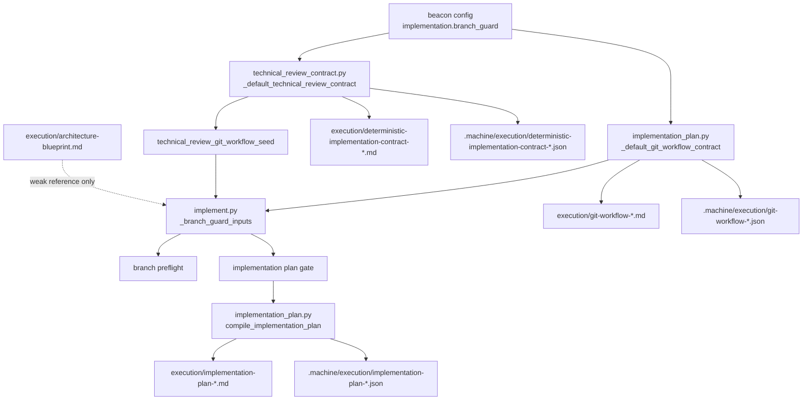
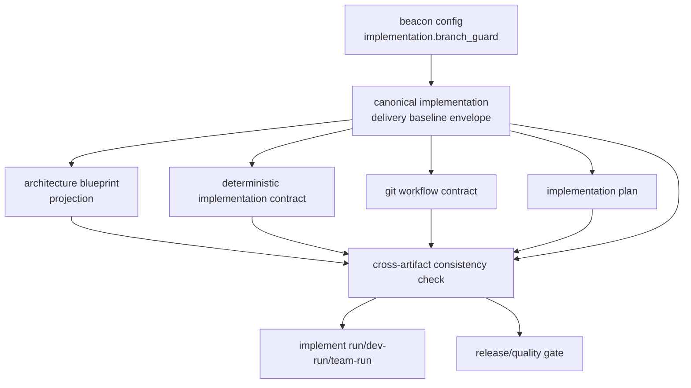

# Implement Plan Architecture Blueprint Gate Lighthouse Map

## 1. Summary

当前 Beacon 在 `implement plan` 相关链路中，已经存在三份彼此耦合但未完全收口的技术交付 contract：

- deterministic implementation contract
- git workflow contract
- implementation plan

它们都包含部分：

- 实现服务范围
- 目标分支
- branch prefix
- base branch
- worktree 使用方式

但当前仍缺少一份 canonical 的 implementation delivery baseline envelope，来统一驱动：

- `docs/beacon/<version>/execution/architecture-blueprint.md`
- deterministic implementation contract
- git workflow contract
- implementation plan

这带来的核心问题不是“缺字段”，而是：

> 同一组实现前置基础信息，目前没有唯一 canonical source，导致人类镜像、机器合同、plan 汇编之间只能互相对表，而不能单向投影。

## 2. Scope

- 目标主题：`implement plan` 的 canonical delivery baseline envelope 化
- 分析范围：
  - `beacon/commands/implement.py`
  - `beacon/utils/implementation_plan.py`
  - `beacon/utils/technical_review_contract.py`
  - `beacon/commands/gate.py`
  - `docs/beacon/v1.3.6/execution/architecture-blueprint.md`

## 3. Mermaid Maps

### 3.1 Current Materialization Path

### 3.2 Proposed Converged Path

## 4. Key Entry Points

- `beacon/commands/implement.py`
  - `_branch_guard_inputs(...)` 负责把 git workflow contract 变成运行前分支/服务输入。
  - `run_implement_stage(...)` 负责 branch preflight 和 implementation plan preflight。
- `beacon/utils/implementation_plan.py`
  - `_default_git_workflow_contract(...)` 负责根据配置或 approved technical review 生成 git workflow。
  - `compile_implementation_plan(...)` 负责生成 implementation plan，并嵌入 `git_workflow`。
- `beacon/utils/technical_review_contract.py`
  - `_default_technical_review_contract(...)` 负责生成 deterministic implementation contract 的默认草稿。
  - `technical_review_git_workflow_seed(...)` 负责从 approved technical review 派生 git workflow contract。
- `beacon/commands/gate.py`
  - 当前已检查 git workflow contract 的存在、字段完整性、markdown mirror、与 delivery manifest 的分支一致性。

## 5. Key Modules / Subsystems

### 5.1 Branch Guard Runtime

- 运行前真实消费的是 `git workflow contract`
- `implement.py` 当前并不直接消费 `architecture-blueprint.md`

### 5.2 Technical Review Contract

- 字段最完整
- 已有：
  - `service_directories`
  - `writable_services`
  - `reference_only_services`
  - `target_branch`
  - `use_git_worktree`
  - `worktree_root`
  - `workspace_root`
- 但它是 feature-specific contract，不是版本级公共锚点

### 5.3 Implementation Plan

- 已经把 `git workflow` 摘要写进 markdown/json
- 但只作为结果汇编，不是最上游 baseline source

### 5.4 Architecture Blueprint

- 当前更偏版本线说明文档
- 还没有固定 projection 模板来承载：
  - implementation service scope
  - branch/worktree strategy
  - writable/reference-only service split

## 6. Dependencies / Infra Chain

- 上游配置：
  - `beacon` project config `implementation.branch_guard`
- 人类审核合同：
  - `execution/deterministic-implementation-contract-*.md`
- 机器执行合同：
  - `.machine/execution/deterministic-implementation-contract-*.json`
  - `.machine/execution/git-workflow-*.json`
  - `.machine/execution/implementation-plan-*.json`
- 当前缺失的 canonical 提交源：
  - implementation delivery baseline envelope
- 当前缺失的人类公共镜像：
  - `execution/architecture-blueprint.md` 中的固定 delivery baseline projection block

## 7. Confirmed Facts

- `implement.py` 的 branch/runtime preflight 最终依赖 `load_or_seed_implementation_git_workflow_contract(...)`。
- `implementation_plan.py` 的默认 git workflow 来自两条路径：
  - approved technical review contract
  - project config seed
- `technical_review_contract.py` 默认合同已经包含比 git workflow 更完整的服务/工作区字段。
- `gate.py` 当前已经对 git workflow contract 做严格 release-side 校验，但还没有对 canonical envelope / projection 做对应一致性校验。
- `architecture-blueprint.md` 当前存在，但没有固定的 implementation delivery baseline projection 模板。

## 8. Inferred Structure

- 最小收敛方案不是让 `architecture-blueprint.md` 直接晋升为上游 truth，而是先定义 canonical envelope，再把它投影出去。
- `architecture-blueprint.md` 的角色应是：
  - version-level human-readable baseline mirror
  - feature-level human-readable baseline mirror
- 最合理的数据流是：
  - canonical envelope
  - -> architecture blueprint projection
  - -> deterministic contract
  - -> git workflow contract
  - -> implementation plan
- gate 校验的核心应是：
  - projection 是否引用同一个 `baseline_id`
  - projection 元数据是否与 canonical envelope 一致
  - projection 内容是否与 canonical envelope 一致

## 9. Open Questions / Risks

- canonical envelope 的持久化位置应放在：
  - `.machine/execution/`
  - 还是独立的 canonical store
- 如果多个 feature 同版本的服务范围不同，gate 应该比较：
  - canonical version baseline 与 feature overlay 的子集关系
  - projection 对应 overlay 的精确一致性
- technical review contract 现在是 feature-specific approved contract；
  - 若 canonical envelope 成为上游 source，谁拥有最终编辑权需要先冻结。

## 10. Recommended Next Steps

- 定义 canonical implementation delivery baseline envelope schema：
  - `baseline_id`
  - `transaction_id`
  - `source_hash`
  - `projection_seq`
  - version baseline
  - feature overlays
- 在 `execution/architecture-blueprint.md` 中新增固定 projection 模板块：
  - `Implementation Delivery Baseline`
  - `Delivery Service Scope`
  - `Plan-Time Gate Contract`
- 让 `implement plan` 在生成 plan 前先提交 canonical envelope，再投影所有 artifact。
- 新增 cross-artifact gate：
  - canonical envelope vs architecture blueprint
  - canonical envelope vs deterministic contract
  - canonical envelope vs git workflow
  - canonical envelope vs implementation plan
- 只要出现 service/branch/worktree drift，就在 `implement plan` 阶段阻断，而不是拖到 release 才发现。

## Key Source Refs

- `beacon/commands/implement.py`
- `beacon/utils/implementation_plan.py`
- `beacon/utils/technical_review_contract.py`
- `beacon/commands/gate.py`
- `docs/beacon/v1.3.6/execution/architecture-blueprint.md`
- `docs/beacon/v1.3.6/execution/implementation-plan-beacon-v1.3.6-host-native-llm-orchestration-and-full-command-runtime-refactor.md`
