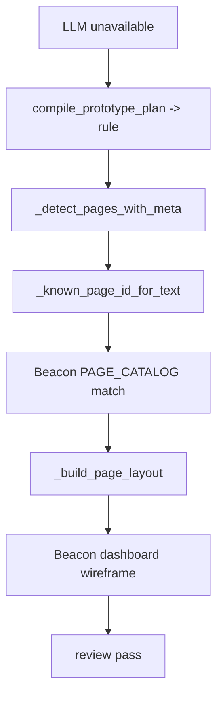

# Beacon Toolkit Lighthouse: Prototype Drift Root Cause

## 1. Summary

`mac-ai-agent-clipboard` 的 prototype 漂移，根因不在目标项目 requirement，而在 Beacon `prototype` 的 `rule` 编译链仍内置 Beacon 管理台语义，并且把 requirement 中的“禁止项文本”错误当成正式页面线索。

## 2. Scope

- Beacon `v1.3.8` prototype compiler
- `mac-ai-agent-clipboard` v1.0.0 requirement truth
- 已生成 prototype artifacts

## 3. Mermaid Maps

## 4. Key Entry Points

- Rule compile entry: [prototype_utils.py](/Users/apple/Developer/Personal/products/beacon/beacon/utils/prototype_utils.py:2337)
- Beacon page catalog: [prototype_utils.py](/Users/apple/Developer/Personal/products/beacon/beacon/utils/prototype_utils.py:48)
- Page detection: [prototype_utils.py](/Users/apple/Developer/Personal/products/beacon/beacon/utils/prototype_utils.py:621)
- Target manifest proving rule fallback: [manifest.json](/Users/apple/Developer/Personal/products/mac-ai-agent-clipboard/docs/beacon/v1.0.0/prototype/mac-ai-agent-clipboard-v1-0-0/manifest.json:12)

## 5. Key Modules / Subsystems

- `PAGE_CATALOG` 不是中性 catalog，而是 Beacon 管理台 catalog，包含 `home / project-detail / runtime-center / material-viewer` 等强领域页面。
- `_known_page_id_for_text()` 用 substring 命中 known page，导致 requirement 中的 `首页`、`project detail`、`runtime diagnostics center`、`material viewer` 被错误识别。
- `_detect_pages_with_meta()` 对全文逐行扫描，连“正式页面”“历史列表”“收藏详情”这类结构说明也会变成 custom page。
- `_build_page_layout()` 对 known page 注入 Beacon 管理台布局，直接把错误识别放大成错误原型。

## 6. Dependencies / Infra Chain

- 本案没有走 host bridge / provider LLM，而是 `llm_unavailable -> rule fallback`。
- semantic layer 虽存在，但没有阻止错误 page extraction，反而产出污染后的“官方页面名”。

## 7. Confirmed Facts

- 目标 requirement 明确只允许 `历史记录主页 / 收藏片段页 / 设置页 / 收藏片段编辑弹层`。
- 目标实现源码的页面模型也是 `history / saved / settings`。
- 生成结果却冻结出 Beacon 管理台页面。
- review 结果仍然是 `pass`。

## 8. Inferred Structure

- 当前 `rule` compiler 更像 Beacon 自身产品的模板投影器，不是跨域通用编译器。
- prototype review 缺少“禁止页面 / 负例跳转 / domain mismatch”检查。

## 9. Open Questions / Risks

- 是否要引入 machine-readable page contract，彻底替代自然语言猜页。
- 是否要按 archetype 隔离 page catalog，而不是让 `admin-workbench` 成为默认隐含语义。

## 10. Recommended Next Steps

1. 收紧 `_known_page_id_for_text()`，避免从禁止项与负例条目命中 known page。
2. 收紧 `_extract_declared_page_labels()`，过滤“正式页面”“结构说明”“布局描述”这类 meta label。
3. 增加 prototype semantic gate，若出现 forbidden page ids 直接 fail。
4. 把 `prototype_archetype` 默认值从 `admin-workbench` 改成中性值，或要求显式声明。
