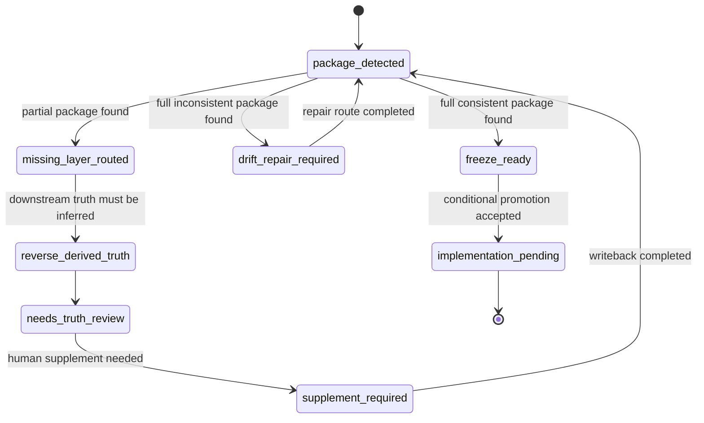

# PRD: Beacon v1.4.0 PRD bootstrap unified requirement closure orchestration

**Feature**: `beacon-v1.4.0-prd-bootstrap-unified-requirement-closure-orchestration`  
**Version**: `v1.4.0`  
**Date**: `2026-05-06`  
**Status**: `freeze-ready`  
**Track**: `optional-support-surface`  
**Scenario**: `requirement_closure_orchestration + partial_package_repair + conditional_freeze_promotion`  
**Template**: `support-surface / change-refreeze`

## Context

- Global boundaries: `docs/beacon/global-boundaries.md`
- Upstream support feature:
  - `docs/beacon/archive/v1.4.0/prd/beacon-v1.4.0-prd-bootstrap-safe-requirement-bootstrap-and-freeze-closure.md`
  - `docs/beacon/archive/v1.4.0/user-story/beacon-v1.4.0-prd-bootstrap-safe-requirement-bootstrap-and-freeze-closure.md`
  - `docs/beacon/archive/v1.4.0/qa/test-cases/beacon-v1.4.0-prd-bootstrap-safe-requirement-bootstrap-and-freeze-closure.md`
- Parent kernel blueprint:
  - `docs/beacon/archive/v1.4.0/prd/beacon-v1.4.0-lightweight-kernel-and-core-surface-refactor.md`
  - `docs/beacon/archive/v1.4.0/execution/architecture-blueprint.md`
- Source brainstorms:
  - `docs/brainstorms/2026-05-06-beacon-prd-bootstrap-one-shot-freeze-feasibility-and-minimal-closure-protocol.md`
  - `docs/brainstorms/2026-05-06-beacon-prd-bootstrap-as-unified-requirement-closure-entry-feasibility.md`
- Existing implementation surfaces:
  - `beacon/commands/prd.py`
  - `beacon/commands/user_story.py`
  - `beacon/commands/test_case.py`
  - `beacon/commands/prd_bootstrap.py`
  - `beacon/utils/prd_bootstrap.py`

## Overview

This feature turns `prd-bootstrap` into a unified requirement closure entry that can detect partial packages, route repairs, and preserve support-surface boundaries.

## Scope

In scope: package state detection, missing-layer orchestration, reverse-derived truth labeling, drift repair routing, and conditional promotion.

Out of scope: new public lifecycle stages, silent truth arbitration, and unconditional one-shot freeze behavior.

## 1. 问题

### 1.1 `beacon-prd-bootstrap` 当前只解决了安全启动，不解决 partial package closure

`v1.4.0` 已经把 `beacon-prd-bootstrap` 冻结成：

- optional support skill
- safe-by-default bootstrap capability
- draft package initializer

但它目前还不能统一处理 requirement package 的多种不完整状态：

- 只有 `prd`
- 只有 `user-story`
- 只有 `test-case`
- `prd + user-story`
- `prd + test-case`
- `user-story + test-case`
- 三件套都存在但互相漂移

结果是：

- 用户仍然要自己判断当前缺哪层
- 仍然要自己决定调用 `prd / user-story / test-case` 哪个子 skill
- support friction 仍然偏高

### 1.2 现在缺的不是生成能力，而是 closure orchestration

源码与前序分析已经证明：

- `prd` 有更强语义编译
- `user-story` 能从已有 truth 反推 story payload
- `test-case` 能基于 PRD / story 扩展 coverage
- `prd-bootstrap` 已有统一写入、安全默认值、回滚、锁

所以当前缺的不是：

- 文档生成器

而是：

1. package state detection
2. missing-layer compile orchestration
3. reverse-derived truth marking
4. drift digest and repair routing
5. conditional freeze promotion

### 1.3 `prd-bootstrap` 可以统一代理 requirement compile，但不能取代 truth structure

本 feature 的关键边界是：

- 它可以统一代理 `prd / user-story / test-case` 子 skill 的调用动作
- 但它不能取消：
  - PRD truth
  - User Story truth
  - Test Case truth
- 它不能直接代替：
  - freeze judgement
  - drift repair judgement
  - gate judgement

也就是说：

> `beacon-prd-bootstrap` 可以成为 unified requirement closure entry，但不能成为新的 requirement truth stage。

### 1.4 真正高价值的方向是 conditional closure，而不是 unconditional one-shot freeze

不是所有 partial package 都适合直接一键冻结：

- `PRD only` 风险较低
- `PRD + user-story` 风险较低
- `test-case only` 风险较高
- `full inconsistent` 风险更高

所以正确目标不是：

- 无条件一步 freeze-ready

而是：

- 统一识别状态
- 补齐缺层
- 给 closure verdict
- 仅在证据足够时 promotion 到 `freeze-ready / implementation-pending`

## 2. 目标

### 2.1 主要目标

`v1.4.0` 必须把 `beacon-prd-bootstrap` 从“safe draft initializer”补齐为“unified requirement closure entry”，并满足：

1. 自动识别当前 requirement package state
2. 统一代理 `prd / user-story / test-case` 缺层补齐
3. 对 reverse-derived upstream truth 做显式标记
4. 当三件套存在但漂移时，生成 drift digest 与 repair route
5. 输出 closure verdict 与 readiness verdict
6. 仅在闭环证据充分时进入 `freeze-ready / implementation-pending`
7. 在证据不足时生成 `supplement-required` 或 `drift-repair-required`
8. 继续保持 optional support surface 定位

### 2.2 非目标

- 不新增 public lifecycle stage
- 不删除 `prd / user-story / test-case` 三层 truth
- 不允许 bootstrap 静默裁决冲突 truth
- 不允许通过下游产物反推上游 truth 后默认跳过人工复核
- 不允许 bootstrap 直接定义 `implement complete`、`qa pass` 或 `release pass`

## 3. 设计原则

- canonical truth first
- no silent promotion
- repair before overwrite
- explicit verdicts over implicit state

## 3. 状态模型

### 3.1 Package State Detection

系统至少要识别以下状态：

- `empty`
- `prd_only`
- `user_story_only`
- `test_case_only`
- `prd_user_story`
- `prd_test_case`
- `user_story_test_case`
- `full_consistent`
- `full_inconsistent`

### 3.2 Verdict Ladder

系统最终只允许输出以下 formal verdict：

1. `draft_generated`
2. `supplement_required`
3. `drift_repair_required`
4. `freeze_ready`
5. `implementation_pending`

约束：

- `implementation_pending` 只能在 `freeze_ready` 之后
- `drift_repair_required` 高于 `supplement_required`
- `reverse-derived upstream truth` 默认不得直接 promotion 到 `implementation_pending`

### 3.3 分层与恢复

- 本 feature 的分层是 `truth -> orchestrator -> support surface`，orchestrator 只能协调补齐与路由，不能替代 truth judgment。
- 当 package drift、reverse-derived truth 或 closure analyzer 失败时，必须进入恢复路径并回到 package detect / repair route，而不是静默重写。

## 4. 范围

- in scope:
  - package state detection
  - missing-layer orchestration
  - reverse-derived truth labeling
  - drift repair routing
- out of scope:
  - new public lifecycle stage
  - unconditional one-shot freeze
  - silent arbitration of conflicting truth

## 5. 功能需求

## 4. Functional Requirements

### FR-001 Package State Detection

`beacon-prd-bootstrap` 必须能够检测当前 feature 在 version tree 下的 requirement package state。

### FR-002 Missing-Layer Compile Orchestration

系统必须能根据 package state，统一代理缺失层的生成与刷新，而不是要求操作者自己逐个决定调用哪个 requirement 子 skill。

### FR-003 Canonical Compile Order

补齐时必须遵循 canonical order：

- 优先从上游到下游编译
- 只有在上游缺失时，才允许 reverse-derive
- reverse-derive 必须显式标记

### FR-004 Reverse-Derived Truth Labeling

若 `user-story` 或 `test-case` 被用来反推上游 truth，则生成结果必须显式标记：

- `derived_from_downstream`
- `needs_truth_review`

### FR-005 Drift Digest and Repair Routing

当三件套存在但互相冲突时，系统必须输出：

- drift digest
- affected layers
- recommended repair route

而不是静默重写某一层 truth。

### FR-006 Closure Analyzer

系统必须在补齐后运行 closure analyzer，至少判断：

- 目标是否明确
- 主流程是否明确
- 边界是否明确
- AC/TC 是否足够
- 是否存在阻断级未知项

### FR-007 Conditional Promotion

只有在 closure analyzer 判定证据充分时，系统才允许把结果 promotion 到：

- `freeze_ready`
- `implementation_pending`

否则必须停在：

- `supplement_required`
- 或 `drift_repair_required`

### FR-008 Unified Human Output

输出必须统一回答：

- 当前 package state
- 缺失哪层
- 是否有 reverse-derived truth
- 是否存在 drift
- 当前 verdict
- 下一步建议命令

### FR-009 Optional Support Surface Boundary

整个能力继续是 optional support surface，不得升级成 public primary stage，也不得污染人类主流程心智。

### FR-010 Reuse Existing Truth Tree

所有生成、刷新、补齐都必须回写：

- `docs/beacon/<version>/prd/`
- `docs/beacon/<version>/user-story/`
- `docs/beacon/<version>/qa/test-cases/`

不得创建第二 requirement truth tree。

## 8. 验收标准

- 能识别 empty / partial / full / inconsistent 状态
- 能输出 closure verdict 与 readiness verdict
- 漂移时输出 repair route
- reverse-derived truth 必须显式标记
- 不得跳过人工复核直接 promotion

## 5. 设计原则

- canonical truth first
- no silent promotion
- repair before overwrite
- explicit verdicts over implicit state

## 6. 范围

- in scope:
  - package state detection
  - missing-layer orchestration
  - reverse-derived truth labeling
  - drift repair routing
- out of scope:
  - new public lifecycle stage
  - unconditional one-shot freeze
  - silent arbitration of conflicting truth

## 7. 验收标准

- 能识别 empty / partial / full / inconsistent 状态
- 能输出 closure verdict 与 readiness verdict
- 漂移时输出 repair route
- reverse-derived truth 必须显式标记
- 不得跳过人工复核直接 promotion

## 8. 风险与缓解

| 风险 | 影响 | 缓解 |
| --- | --- | --- |
| 把 unified entry 误解成 lifecycle 替代 | 高 | 明确 optional support boundary，保留三层 truth 结构 |
| 下游反推上游导致错误 truth 升格 | 高 | 强制 `derived_from_downstream + needs_truth_review` |
| full inconsistent package 被静默重写 | 高 | 强制 drift digest + repair route，禁止静默裁决 |
| support 能力再次变重 | 中 | 复用现有 compile 能力，只新增 orchestrator 和 verdict layer |
| bootstrap 输出被误认作 gate truth | 高 | verdict 只定义 requirement closure 状态，不定义 delivery completion |

## 9. 成功标准

1. `beacon-prd-bootstrap` 可以接管所有主要 partial package 状态
2. 操作者不必手动判断调用哪个 requirement 子 skill
3. 系统能显式区分：
   - missing-layer supplement
   - truth drift repair
   - closure pass
4. reverse-derived truth 有显式标签
5. full inconsistent package 不会被静默重写
6. 高置信度场景可直接进入 `freeze_ready / implementation_pending`
7. 整个能力仍保持 optional support skill 定位

## 10. 冻结结论

本 PRD 的目的是把前序 brainstorm 提出的 unified requirement closure entry 正式纳入 `v1.4.0` frozen requirement truth。

这不是新增主流程，而是对已冻结 `beacon-prd-bootstrap` support feature 的 change/refreeze 补强。

## 11. State Machine Truth

### 11.1 State Axes

- `package_state`: `empty | prd_only | user_story_only | test_case_only | prd_user_story | prd_test_case | user_story_test_case | full_consistent | full_inconsistent`
- `closure_state`: `package_detected | missing_layer_routed | reverse_derived_truth | needs_truth_review | supplement_required | drift_repair_required | freeze_ready | implementation_pending`
- `truth_origin_state`: `native_truth | derived_from_downstream | needs_truth_review`
- `decision_state`: `accepted | rejected | deferred`
- `routing_state`: `canonical_compile | reverse_derive | repair_route | conditional_promotion`
