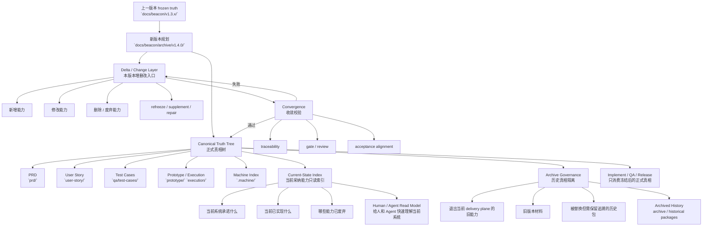

# OpenSpec 归档特性与 Beacon 版本演进认知差距 — 调研笔记

## 1. 用户问题（摘要）

- **OpenSpec** 约定：仓库内存在 **「当前已部署能力」的主规格**（main specs），变更以 **change 包** 迭代；归档不是「把文件夹挪走」这么简单。
- **Beacon** 有 **`docs/beacon/<version>/`** 的版本演进，但在版本迭代中 **没有把「当前实现 / 产品当下形态」系统性归档到该迭代**，导致团队与 Agent **认知跟不上代码与真实行为**。

本文归纳 **OpenSpec 归档在协议与实现里到底保证了什么**，再对照 Beacon **已有能力与缺口**，便于后续做「借鉴 OpenSpec 规定功能」的设计决策（不等同于照搬 `openspec/` 目录）。

---

## 2. OpenSpec：主 spec + 变更包 + 归档的三层结构

依据上游 **`openspec/specs/openspec-conventions/spec.md`** 与 **`src/core/archive.ts`**：

| 层级 | 路径（约定） | 语义 |
|------|----------------|------|
| **主规格（当前真相）** | `openspec/specs/<capability>/spec.md` | **线上 / 当前采纳的行为契约**（WHAT/WHY）；可选 `design.md`。 |
| **进行中的变更** | `openspec/changes/<change-name>/` | `proposal.md`、`tasks.md`、可选 `design.md`；**delta** 放在 `changes/.../specs/<capability>/spec.md`。 |
| **已完成变更（历史）** | `openspec/changes/archive/YYYY-MM-DD-<change-name>/` | **整条变更目录**按日期前缀移到 archive；**在此之前**主规格已被程序化更新。 |

要点：**「主 spec」始终有一条可读路径表示「现在系统承诺什么」**；变更包是 **增量提案**，不是长期并行真相。

---

## 3. OpenSpec「归档」在实现里做的四件事

源码入口：**`ArchiveCommand`**（`src/core/archive.ts`），配合 **`specs-apply.ts`**（delta → 完整主 spec）。

### 3.1 校验（可跳过但不推荐）

- 校验 change 内 **delta spec** 格式（`## ADDED|MODIFIED|REMOVED|RENAMED Requirements` 等）。
- 校验失败则 **默认阻止归档**（可用 `--no-validate` 绕过并留日志）。
- **Proposal** 校验多为提示，不阻塞归档。

### 3.2 任务进度提示（非硬门禁）

- 读取 `tasks.md` 进度；若有未完成任务，**交互确认**是否继续（`--yes` 可跳过）。

### 3.3 **程序化合并 delta → 主 spec（归档的核心价值）**

约定（见 openspec-conventions）：

1. 先处理 **RENAMED**，再 **REMOVED**，再 **MODIFIED**，再 **ADDED**。
2. 以 **`### Requirement: ...`** 标题作为 **唯一匹配键**（规范化后大小写敏感相等）。
3. 合并后的完整 spec **写回** `openspec/specs/<capability>/spec.md`。
4. 若与当前主 spec **冲突**，**中止写入**并要求人工解决。

因此：**归档一次 = 把「变更包里的意图」**落实进 **主规格**，再 **移动目录**。人类之后只看 **`specs/`** 也能跟上「系统当下答应什么」。

### 3.4 物理归档

- 目标路径：**`openspec/changes/archive/<YYYY-MM-DD>-<change-name>/`**（当天日期前缀 + 原 change 名）。
- 实现为 **移动目录**（Windows 上 rename 失败则 copy+rm）。
- 若同名 archive 已存在则 **报错**，避免静默覆盖。

### 3.5 相关工作流：`sync` 与 `bulk-archive`

- **Core profile** 工作流包含 **`sync`** 再 **`archive`**（见 `docs/workflows.md`）：强调 **先与主 spec 对齐再收口**。
- **`bulk-archive`**：多变更批量归档时处理 **多变更触碰同一 spec** 的冲突检测（文档表述：结合实现状态辅助消解）。

---

## 4. OpenSpec 归档「规定了哪些认知功能」

用一句话：**归档把「提案里的 delta」变成「主 spec 上的事实」，并把提案文件夹冻进历史目录。**

因此天然缓解：

- **规格漂移**：主目录始终是一份合并后的当前契约。
- **迭代可追溯**：`archive/日期-名称` 保留 **完整变更包**（proposal / tasks / 当时的 delta）。
- **人机可读**：同一套 Markdown 结构 + CLI + validate，**不靠口头同步**。

局限（需如实写清）：OpenSpec **归档的是 spec 文本**，**不自动等价于「代码实现快照」**；若团队从不跑验证，主 spec 仍可能与实现脱节——但 **至少「文档侧单一写入点」清晰**。

---

## 5. Beacon 当前模型（对照）

### 5.1 版本真相位置

- **`docs/beacon/<version>/`**：PRD、user-story、test-case、execution 等 **交付物料**；与 **`docs/beacon/VERSION`** / 运行时版本对齐。
- **特性闭环**：实现阶段可生成 **`implementation_summary`**、**`technical_archive`**（JSON + MD）等 **证据型归档**（见 `beacon/commands/implement.py` 等）。

### 5.2 已有「归档治理」命令

- **`beacon archive plan | apply | status | explain`**：面向 **历史需求隔离 / 治理状态**（`archive_governance`），**不是** OpenSpec 那种「把 delta 合并进单一主 spec 文件」的语义。
- **gate**：特性若标记为 **archived**，会从当前交付中排除。

### 5.3 用户感知的「认知缺口」从哪来

常见结构是：

1. **版本号前进**（如 v1.3.11 → v1.4.0），**新目录**里更新了 PRD/故事，但 **「上一迭代实际做成了什么」** 没有 **强制、单一入口** 的「实现真相摘要」写回该版本切片。
2. **`technical_archive` / summary** 依赖 **实现跑完** 才完整；若迭代中途 pivot、或多特性并行，**物料与代码**容易 **谁都没更新「当前产品长什么样」**。
3. Beacon **没有像 OpenSpec `specs/` 那样的「全能力合一主文档」**；真相分散在 **多特性、多文件**，**演进时没有自动「合并到一份当前行为地图」**。

因此：**不是 Beacon「没有归档」，而是缺少与 OpenSpec「归档 = 合并进主 spec」等价的、跨迭代的「当前实现 / 产品形态」收敛机制。**

---

## 6. 可借鉴方向（设计约束，非实现承诺）

以下与 **`docs/beacon/global-boundaries.md`** 一致：**不新增生命周期阶段**；在现有 **7 段 + doctor/archive** 内收敛。

| OpenSpec 机制 | Beacon 可对齐的抽象（命名可调） |
|---------------|----------------------------------|
| **主 `specs/`** | 在每个 **`docs/beacon/<version>/`** 内明确 **「当前采纳需求 / 能力」只读索引**（可由机器从 PRD/冻结特性汇总生成），避免多头手写打架。 |
| **delta change 包** | 已有 **变更 / 修订** 叙事（如 beacon-change）；可加 **「相对上一版本的 delta 物料」** 规范，便于审计。 |
| **归档 = merge + move** | **版本收尾闸门**：升版或特性 freeze 时，**强制**（或默认）生成 **「本迭代实现快照」**（指向 `technical_archive`、关键文件清单、对外行为摘要），写入 **`execution/` 或 `.machine/`**，作为 **该版本的「闭合证据」**。 |
| **validate** | 扩展 **`beacon doctor verify-context`** 或 **release 前检查**：缺 **闭合快照** 则 warning/block（按团队策略）。 |

### 6.1 建议中的 Beacon 版本演进归档模型

如果把上面的对齐思路进一步收敛成 Beacon 自己的版本演进模型，**不推荐**维护一个长期持续改写的“源 `prd` 文件”作为单一真相；更合适的是采用 **`canonical truth tree + delta + archive + current-state index`** 四层结构：

四层职责可概括为：

- **Canonical truth tree**：每个版本自己的正式 requirement truth root，不是单个 PRD，而是 `prd + user-story + test-case + prototype/execution + .machine` 的组合。
- **Delta / change layer**：承接本版本的新增、修改、删除、补料与 re-freeze，不把临时讨论或局部变更直接长期混入 frozen truth。
- **Archive governance**：把已经退出当前 delivery plane 的历史需求、旧版本材料、被替换能力隔离出去，但仍保留追溯链和审批语义。
- **Current-state index**：由 canonical truth 单向投影得到的“当前系统行为地图”或“当前采纳能力索引”，用于降低人和 Agent 的认知负担，但**不升级为第二真相源**。

因此，Beacon 在版本演进中的推荐姿势更接近：

1. **以版本包为 canonical**：每次升版以新的 `docs/beacon/<version>/` 作为正式真相树，而不是在一个历史 PRD 上无限追加修订。
2. **以 delta 承接变化**：新增、修改、删除先进入变更层，经过 traceability、review、gate、acceptance 对齐后再收敛进当前版本真相。
3. **以 archive 隔离历史**：历史能力或旧版本退出当前交付面时，应正式归档，而不是继续与当前版本包并列充当“半有效真相”。
4. **以 current-state index 提供当前视图**：对外回答“系统现在承诺什么”“哪些能力已经实现/废弃”时，优先读只读索引，而不是要求人类遍历多 feature、多文件、多轮实现摘要自行拼图。

这个模型吸收了 OpenSpec **`merge + archive`** 的认知优势，但仍保留 Beacon 自己的边界：

- **不把 `docs/beacon/<version>/` 降级成 change 包集合**。
- **不把单一 `spec.md` 或单一 `prd.md` 升级为唯一真相文件**。
- **不让 `current-state index` 反向改写 canonical truth**。
- **不新增生命周期阶段**；它仍然只是对现有 `prd -> user-story -> test-case -> prototype -> implement -> qa -> release` 的版本治理补强。

**刻意不做的事**：把整个仓库改成 `openspec/` 树、或用 OpenSpec delta 语法替代 Beacon PRD——除非项目 **显式双轨** 并在文档里声明 **单一交付真相**。

---

## 7. 上游参考路径（本机 oss-sync）

- `openspec/specs/openspec-conventions/spec.md` — 目录结构、delta、归档合并规则  
- `openspec/docs/workflows.md` — propose → apply → sync → archive  
- `src/core/archive.ts` — 归档命令行为  
- `src/core/specs-apply.ts` — delta 合并实现  

---

## 8. 与其它研究文档的关系

- **产品边界与可交付设计**：[`beacon-openspec-speckit-comparison-and-deliverable-design.md`](./beacon-openspec-speckit-comparison-and-deliverable-design.md)  
- **Trae / 宿主技能材质化**：[`beacon-agent-surface-speckit-trae-alignment.md`](./beacon-agent-surface-speckit-trae-alignment.md)  

本文专注 **OpenSpec 归档语义 vs Beacon 版本演进中的「实现真相」缺口**。
