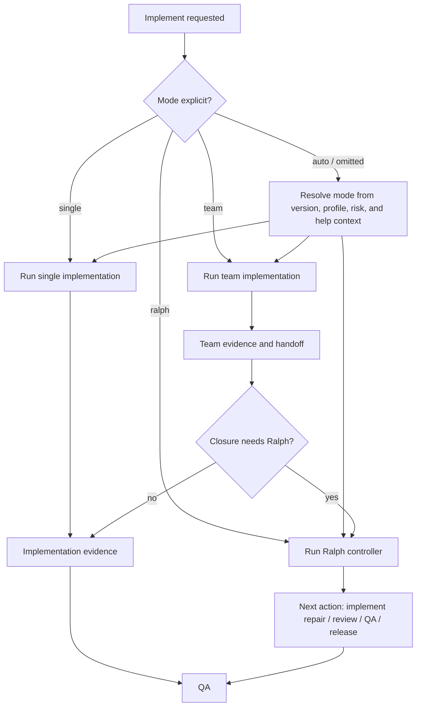
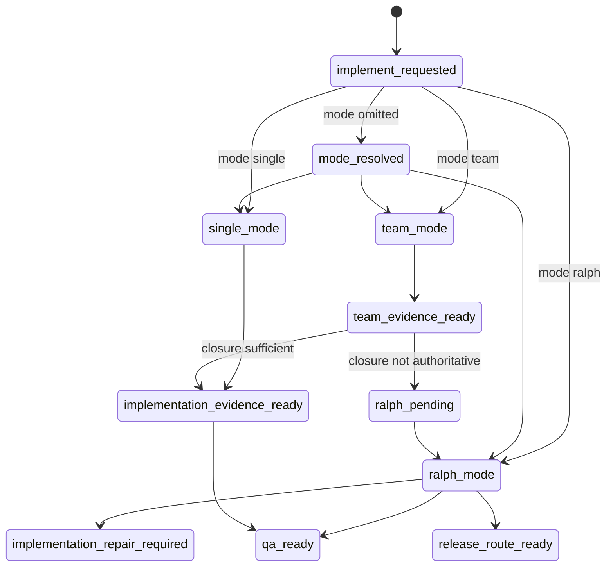

# Research: Implement Mode Human Playbooks And Routing Contract

**Feature**: `implement-mode-human-playbooks-and-routing-contract`  
**Version**: `v1.4.10`  
**Status**: `research-input`  
**Date**: `2026-05-23`

## 1. 背景

Beacon 当前 `implement` 已经存在三个运行形态：

- `single`: 普通单通道实现。
- `team`: 多角色 / subagent 实现。
- `ralph`: 多轮闭环控制，串联 implement、review、QA、release next action。

用户提出：是否应该把普通 implement、team、Ralph 拆成三个人类面 skill，以确保稳定运行。

本研究的 source-driven 结论是：不建议拆成三个公开入口；建议保留一个 `beacon-implement`，但补齐三种 mode 的人类面 playbook 和 routing contract。

## 2. Source Anchors

- `skills/beacon/beacon-implement/SKILL.md`
- `beacon/commands/implement.py`
- `beacon/commands/implement/__init__.py`
- `beacon/commands/implement/team.py`
- `beacon/commands/implement/ralph.py`
- `beacon/utils/implement_adapters.py`
- `beacon/utils/implement_native.py`
- `beacon/utils/team_surface.py`
- `beacon/utils/help_support.py`

## 3. Source-Driven Findings

## Architecture

```text
beacon-implement
  -> single public implementation skill
  -> references / playbooks explain single, team, and ralph modes
  -> CLI execution remains beacon implement run ... --mode single|team|ralph
  -> help/status may recommend a mode with reason and canonical command
  -> Skill Eval Kit verifies route stability and forbidden public mode-skill routes
```

### 3.1 `beacon-implement` 已声明为唯一公开执行入口

`skills/beacon/beacon-implement/SKILL.md` 明确约束：

- `implement` remains the only public implementation entrypoint.
- team runtime and subagent lanes stay internal unless explicitly requested.
- `implement` 不能改 frozen truth，不能替代 `change`。

因此直接新增：

```text
beacon-implement-single
beacon-implement-team
beacon-implement-ralph
```

会冲击现有边界。

### 3.2 CLI 已经是一个入口 + mode

`beacon/commands/implement.py` 里已有：

```text
beacon implement run ... --mode single|team|ralph
```

并且 mode runner 映射清楚：

- `single` -> `native-single`
- `team` -> `codex-subagents`
- `ralph` -> `codex-subagents`

这说明 runtime 模型已经是“一个 implement 入口，多种 execution mode”，不是三个 lifecycle surface。

### 3.3 Ralph 不是普通 team 的平级替代

`beacon/utils/team_surface.py` 的 `post_freeze_sequence` 包含：

```text
implement-team-plan
implement-team-run
implement-ralph
qa
release
```

并且 `help_support.py` 在 team 完成但 QA closure 不权威时，会推荐：

```text
beacon implement run <feature> --mode ralph
```

这说明 Ralph 更像 post-team closure controller，而不是和 `single` / `team` 完全平级的普通实现模式。

## 4. 判断

### 4.1 不建议拆三个公开 skill

拆成三个公开人类面 skill 的风险：

- 破坏 `implement` 唯一执行入口。
- 让用户误解为三个并行 lifecycle stage。
- 让 QA / release 读取 implementation evidence 时需要处理更多入口分叉。
- 让 Ralph 被误解为普通实现模式，而不是闭环控制器。
- 增加 Skill Eval Kit 的 route stability 回归面积。

### 4.2 建议拆 playbook，不拆入口

推荐方向：

```text
beacon-implement
  references/implement-single.md
  references/implement-team.md
  references/implement-ralph.md
```

或等价的人类面说明：

```text
Implement Mode Playbooks
- single: 最小实现 / 小修 / 低风险
- team: 多角色实现 / 复杂改动 / 需要上下文隔离
- ralph: team 后闭环控制 / 多轮 repair / QA-release 路由
```

核心原则：

> 拆说明，不拆入口；拆 mode contract，不拆 lifecycle surface。

## 5. 建议冻结范围

建议作为 v1.4.10 候选 feature：

```text
implement-mode-human-playbooks-and-routing-contract
```

最小冻结范围：

- 保留 `beacon-implement` 唯一 public skill。
- 新增三份 mode playbook。
- 明确 single / team / ralph 的适用条件。
- 明确 Ralph 是 closure controller，不是普通实现 lane。
- help/status 输出 mode 解释和下一步推荐理由。
- Skill Eval Kit 增加 implement mode route stability 用例。

不包括：

- 新增三个 public lifecycle skill。
- 拆分 CLI 为三个顶级命令。
- 让 support skill 直接选择并执行 mode。
- 让 Ralph 替代 QA 或 release。

## 6. Mode Contract

### 6.1 Single

适用：

- 低风险小改。
- 变更范围清晰。
- 不需要多角色上下文隔离。
- 不需要多轮自动 repair。

建议命令：

```bash
beacon implement run "<feature>" --project . --version <version> --mode single
```

### 6.2 Team

适用：

- 复杂实现。
- 需要 planner / implementer / reviewer / tester 分工。
- 需要实现面和 QA 面上下文隔离。
- 需要 team HUD / role evidence。

建议命令：

```bash
beacon implement run "<feature>" --project . --version <version> --mode team
```

### 6.3 Ralph

适用：

- team 完成后仍需闭环控制。
- 需要 review quality、auto QA、release gate next action。
- 需要多轮 repair routing。
- 需要把 implement / review / QA / release 连接成受控 loop。

建议命令：

```bash
beacon implement run "<feature>" --project . --version <version> --mode ralph
```

边界：

- Ralph 不替代 QA。
- Ralph 不替代 release。
- Ralph 不改 frozen truth。
- Ralph 输出 next action 和 evidence，不直接给 release pass。

## 7. Business Flow



## 8. State Machine



## 9. Skill Eval Kit Implications

Skill Eval Kit 应增加 route stability 用例：

- 用户说“普通实现 / 小修”时，仍路由到 `beacon-implement`，mode 推荐 `single`。
- 用户说“team / 多角色 / subagent”时，仍路由到 `beacon-implement`，mode 推荐 `team`。
- 用户说“Ralph / 多轮闭环 / implement 后继续推到 QA release”时，仍路由到 `beacon-implement`，mode 推荐 `ralph`。
- 不允许路由到不存在的 `beacon-implement-team` 或 `beacon-implement-ralph` public skill。

## Decision Priority

1. `beacon-implement` remains the only public implementation skill.
2. Mode playbooks explain execution shape; they do not create public lifecycle stages.
3. Help/status recommendations must include the reason and canonical command.
4. Ralph routes next action and evidence; it does not replace QA, release, gate, or frozen truth.
5. Skill Eval Kit must preserve route stability and reject nonexistent public mode-specific skills.
6. Ralph Task Loop checkpoint/recovery and learn lifecycle injection remain separate backlog features.

## 10. 收敛结论

三种 implement 运行形态需要更稳定的人类面说明，但不需要拆成三个公开 skill。

本研究采纳的推荐方向是：

推荐 v1.4.10 采取：

```text
one public implement skill
+ three mode playbooks
+ route stability eval
+ help/status mode explanation
```

这样既能提升可理解性，又不破坏 Beacon 已有的 execution entrypoint 和 evidence 读取边界。

冻结优先级建议：

- 不进入 `qa-evo-deep-and-skill-eval-kit-v1410` 的 P0。
- 可作为 Skill Eval Kit 的 `route_stability` eval case 输入。
- 后续单独冻结时，只补 playbook、help/status 解释和 mode routing evidence。
- 不创建 `beacon-implement-single`、`beacon-implement-team`、`beacon-implement-ralph` 三个 public skill。

## Truth Bindings

- `prd_refs`: `docs/beacon/archive/v1.4.10/prd/implement-mode-human-playbooks-and-routing-contract.md`
- `user_story_refs`: `docs/beacon/archive/v1.4.10/user-story/implement-mode-human-playbooks-and-routing-contract.md`
- `test_case_refs`: `docs/beacon/archive/v1.4.10/qa/test-cases/implement-mode-human-playbooks-and-routing-contract.md`
- `coverage_notes`: AC-001 through AC-008 cover the one-public-entrypoint contract, mode playbooks, mode recommendation, Ralph boundary, explainable command output, route-stability eval, nonexistent mode-skill fail-closed behavior, and truth authority boundaries.
- `out_of_scope_notes`: This research does not create public mode-specific skills, split CLI top-level commands, replace QA/release/gate with Ralph, implement full Ralph Task Loop checkpoint/recovery, inject project skills through learn, or let support/research skills execute implementation directly.

## Support Findings

### CEO Review

#### Round 2026-05-24T10:28:49.066566+00:00

- source_skill: `beacon-ceo-review`
- round_id: `2026-05-24T10:28:49.066566+00:00`
- material_effect: `read_only_route_only`
- adoption_status: `route_only`
- route_decision: implement
- finding_summary: CEO review did not find a version-level reframing blocker after challenging default downside axes.
- source_refs: `docs/beacon/archive/v1.4.10/.machine/execution/beacon-ceo-review-transaction.json`, `docs/beacon/archive/v1.4.10/execution/beacon-ceo-review-transaction.md`
