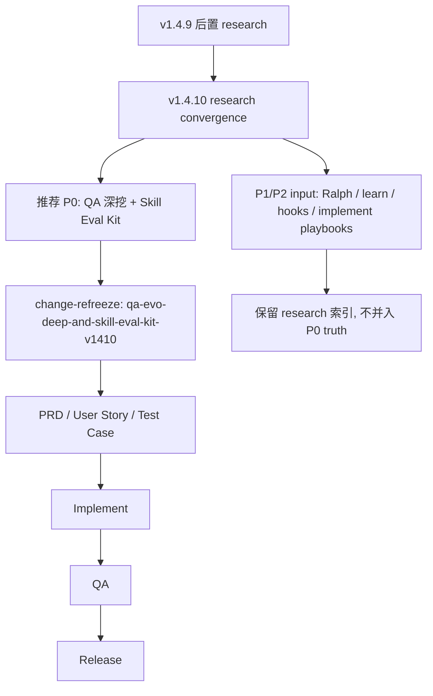
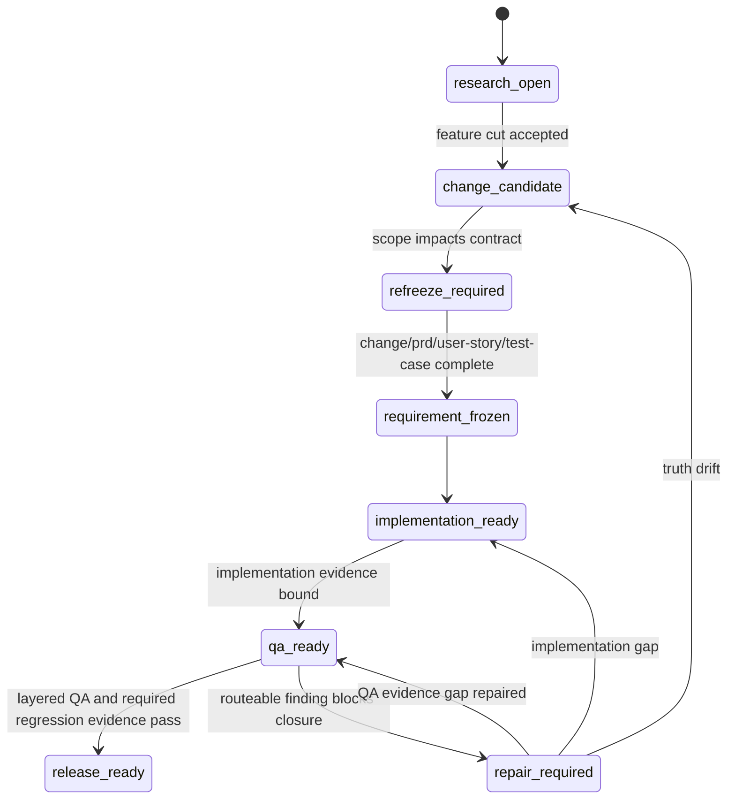

# Research: QA Evo Deep、Skill Eval Kit 与生命周期学习演进

**Feature**: `qa-evo-deep-and-skill-eval-kit-evolution`  
**Version**: `v1.4.10`  
**Status**: `research-input`  
**Date**: `2026-05-23`

## 1. 背景

v1.4.9 已经先修复了 Beacon 可信闭环的 P0 底座：

- Markdown-first requirement truth。
- 只读 support research 写入拓扑 gate。
- implementation evidence writeback / import-evidence。
- Markdown QA matrix fail-closed。
- project runner profile 与 admission blocker taxonomy。

这些修复解决的是“机器闭环不能再假稳定”的问题。

v1.4.10 需要补齐的是更深一层能力：

- QA 是否能覆盖状态机、业务流程、跨端闭环、权限、数据源一致性和场景叠加。
- 长任务 implement / Ralph 是否能有阶段、checkpoint、恢复、资源预算和轮次记忆。
- Beacon skill / harness 是否能被可审计 eval 与 regression core 治理。
- `beacon learn` 是否能从项目上下文生成项目级 Markdown skill，并在 Beacon 生命周期中受控注入。

本文件是 research input，不是 frozen requirement。

## 1.1 CEO Review Challenge

Verdict: `reduce / reframe`.

当前 research 把四条高级能力放在同一张图里：

- `qa-evo-deep`
- Skill Eval Kit / regression core
- Ralph Task Loop
- `beacon learn` context-to-project-skill

这些方向都成立，但如果 v1.4.10 同时冻结和实现，会造成三个风险：

1. `too_smooth_path`: 假设 QA 深挖、skill eval、长任务控制、learning 注入能天然协同；现实里它们有不同状态模型、证据模型和失败路线。
2. `stage_boundary_sprawl`: `qa-evo-deep`、Ralph、learn 都可能被误用成新的 shadow stage，稀释主链。
3. `false_closure_signal`: 有了 eval / memory / learning 以后，团队可能把“有证据记录”误当成“需求或 release 已闭环”。

CEO review 建议将 v1.4.10 主 promise 收窄为：

> 建立 QA 深挖与 skill/harness 回归评测的最小可验收闭环。

因此本文件建议：

- P0 保留 `qa-evo-deep-state-scenario-round-memory-contract`。
- P0 保留 `better-harness-skill-eval-kit-regression-core`。
- P1 后置 Ralph Task Loop，只要求 P0 产出的 QA / eval evidence 可被 Ralph 后续读取。
- P1/P2 后置 `learn-context-to-project-skill-lifecycle-injection`，本版最多冻结 candidate skill admission 与 learning influence audit，不做自动注入。

接受这个挑战后，后续 `change/refreeze` 不应把四条线都写成同等 P0。

## 1.2 已采纳的推荐方向

本轮 research 采纳 `reduce / reframe` 推荐：v1.4.10 先交付“深度验收可发现、skill/harness 可回归”的最小闭环，而不是同时实现 QA 深挖、Ralph 长任务、项目 hook、learn 自动注入和 implement mode 拆分。

正式冻结时建议只创建一个主 change：

```text
qa-evo-deep-and-skill-eval-kit-v1410
```

该 change 内只包含两个 P0 contract：

1. `qa-evo-deep-state-scenario-round-memory-contract`
2. `better-harness-skill-eval-kit-regression-core`

其他方向按依赖关系降级处理：

| Direction | v1.4.10 recommended role | Reason |
| --- | --- | --- |
| Ralph Task Loop | P1 research / future change input | 需要先有 QA / eval evidence 才能稳定闭环 |
| `beacon learn` project skill injection | P1/P2 governed influence input | 自动注入容易污染 truth，需要 admission 先行 |
| project lifecycle hooks | P1 manual toolkit candidate | hook 触发 UAT、全局安装、pipeline 等高副作用动作，不应并入 P0 |
| implement mode playbooks | P1/P2 route-stability eval input | 保留单一 `beacon-implement` 入口，先用 eval 防止路由漂移 |

本推荐方向的核心约束：

- P0 不新增主 lifecycle stage。
- P0 不新增 release pass verdict。
- P0 不让 support surface 变成 gate truth。
- P0 不把 runtime evidence 写成 requirement truth。
- P0 只要求后续 Ralph / learn / hook / implement mode 能读取或复用 QA / eval evidence，不要求本版自动编排它们。

## 2. Source Anchors

### 2.1 Beacon 内部材料

- `docs/beacon/v1.4.9/research/qa-evo-deep-human-subskill-and-implementation-qa-closure-gap.md`
- `docs/beacon/v1.4.9/research/better-harness-skill-eval-kit-and-source-driven-regression-core.md`
- `docs/beacon/v1.4.9/research/real-project-qa-evidence-binding-and-markdown-matrix-fail-closed.md`
- `docs/beacon/v1.4.9/research/read-only-support-research-write-topology-gate-contract.md`
- `skills/beacon/beacon-qa/SKILL.md`
- `skills/beacon/beacon-deep/SKILL.md`
- `skills/beacon/beacon-learn/SKILL.md`
- `beacon/utils/ralph_runtime.py`
- `beacon/utils/host_prompt_trace.py`
- `beacon/utils/learning_loop.py`
- `beacon/utils/agent_surface.py`

### 2.2 外部参考材料

- Browser automation Site-Memory reference: `/Users/apple/Developer/Personal/personal-brain/sources/web-notes/mp-weixin-qq-com-site-memory/2026-05-23-153230.md`
- Harness Task Loop reference: `/Users/apple/Developer/Personal/personal-brain/sources/web-notes/mp-weixin-qq-com-harness-task-loop-5-4/2026-05-23-153230.md`
- Ace-Skill self-evolution reference: `/Users/apple/Developer/Personal/personal-brain/sources/web-notes/mp-weixin-qq-com/2026-05-23-153229.md`
- Ctx2Skill reference: `/Users/apple/Developer/Personal/personal-brain/sources/web-notes/mp-weixin-qq-com-skill-ctx2skill/2026-05-23-153230.md`

## 3. 外部材料对 Beacon 的映射

### 3.1 Browser Site-Memory: QA 多轮记忆

Site-Memory 的关键启发不是保存 cookie 或 localStorage，而是保存站点级操作知识：

- 页面结构。
- 关键元素定位。
- 稳定操作路径。
- 任务轮次结果。
- 网站变化后的记忆更新。

映射到 Beacon：

- Browser QA 需要区分 auth/session state 与 agent site knowledge。
- `qa-evo-deep` 应读取历史 QA round memory，用于识别反复失败、反复 blocked、反复遗漏的场景。
- 站点记忆只能作为 QA hint / influence，不得直接转成 pass verdict。
- 对高度动态或强保护页面，记忆命中率下降时必须记录 admission risk。

### 3.2 Harness Task Loop: Ralph 长任务控制

Task Loop 的关键启发是：长任务不是更长的 agent loop，而是任务级控制系统。

映射到 Beacon：

- Ralph 需要显式阶段：plan、implement、review、qa、repair、release-readiness。
- 每轮必须有 checkpoint 和 resume 输入。
- 错误必须分类：tool failure、environment blocker、quality blocker、truth drift、no-delta loop。
- 资源必须可控：round limit、stage budget、loop detection、human checkpoint。
- 任务状态必须外置到 `.beacon` 或 machine evidence，不能只留在模型上下文。

### 3.3 Ace-Skill: Skill / Harness 自进化

Ace-Skill 的关键启发是避免无效学习和知识污染：

- 不是所有 trace 都值得学习。
- 应优先采样低熟练度、高信息量 case。
- 知识需要按能力和任务簇组织。
- 需要 holdout 和 regression core 防止过拟合。

映射到 Beacon：

- Skill Eval Kit 需要 human accept/reject candidate，而不是自动吞所有失败 trace。
- Eval case 必须带 tags 和 split。
- Regression core 必须小而硬，每次 harness patch 必跑。
- Learning influence 必须可审计，不能静默改变 route / gate。

### 3.4 Ctx2Skill: 从上下文生成项目级 Markdown Skill

Ctx2Skill 的关键启发是把复杂上下文提炼成可读、可编辑、可迁移的 Markdown skill。

映射到 Beacon：

- `beacon learn` 可生成项目级 candidate skill。
- Candidate skill 必须保留 source anchors、适用场景、不适用场景、过期条件和 audit trail。
- Skill 进入生命周期前必须经过 admission，不得直接成为全局 skill。
- 项目级 skill 的影响只能作为 governed learning influence，不能改 requirement truth。

## 4. 当前 Beacon 能力对比

| 能力面 | v1.4.9 已有 | v1.4.10 缺口 |
| --- | --- | --- |
| QA 主入口 | `beacon-qa` 有 layered proof 和 blocker 分类 | 缺少状态空间、业务流组合、跨轮 QA memory 深挖 |
| Deep support | `beacon-deep` 是通用深分析 support surface | 缺少 QA 专用 `qa-evo-deep` profile / subskill |
| Learn governance | `beacon-learn` 支持 governed recall / audit / prune | 缺少 context-to-project-skill 生成与生命周期注入 |
| Skill / prompt trace | host prompt trace、agent surface drift、learning skeleton | 缺少 Skill Eval Kit、case schema、regression core、runner |
| Ralph | 有 round state、status、resume 和 help 投影 | 缺少完整 Task Loop contract、stage budget、checkpoint recovery policy |
| Markdown-first | v1.4.9 已冻结 | v1.4.10 必须继续避免机器面双写 truth |

## 5. 推荐 feature 切分

### 5.1 P0: `qa-evo-deep-state-scenario-round-memory-contract`

目标：

- 建立 QA 专用深挖 support surface。
- 面向状态机、业务流程、场景叠加、权限、数据源、跨端闭环生成 routeable findings。
- 引入 QA round memory，但只作为 influence / hint。

建议输出：

```text
docs/beacon/<version>/qa/evo-deep/<feature>.md
```

建议包含：

- source refs。
- state-machine findings。
- business-flow findings。
- data-source consistency findings。
- permission boundary findings。
- cross-surface closure findings。
- test delta。
- blocked admissions。
- route recommendations。
- release supplement input without pass verdict。

边界：

- 不改 PRD / user-story / test-case。
- 不替代 `beacon qa run`。
- 不直接给 release verdict。
- 不新增 lifecycle stage。

### 5.2 P0: `better-harness-skill-eval-kit-regression-core`

目标：

- 把 skill / harness 从主观 prompt 体验升级为可审计工程资产。
- 建立 eval case、tags、splits、regression core、runner 和 scorecard。

建议目录：

```text
.beacon/state/skill-eval/
  cases.jsonl
  tags.yaml
  splits/
    optimization.txt
    holdout.txt
  regression-core.txt
  candidates/
    trace-candidates.jsonl
  runs/
    <run-id>/
      metrics.json
      traces/
```

Eval 维度：

- `route_stability`
- `boundary_preservation`
- `source_anchor_sufficiency`
- `actionability`
- `material_effect_closure`
- `clarification_quality`
- `token_efficiency`

边界：

- Eval result 是 harness quality evidence，不是 requirement truth。
- Source-driven 可产出 claim matrix 和 eval candidate，但不能成为 gate。
- Regression core fail 可阻断 harness patch release，但不能自动改需求。

### 5.3 P1: `ralph-task-loop-checkpoint-recovery-contract`

目标：

- 把 Ralph 从多轮推进器演进为长任务 Task Loop controller。

需要冻结：

- Stage model。
- Checkpoint schema。
- Resume contract。
- Error taxonomy。
- Resource budget。
- Loop detection。
- Human checkpoint。
- Round memory summarization。

边界：

- Ralph 服务 implementation long task。
- 不替代 QA / release。
- 不把每轮机器状态当 requirement truth。
- 不进入 v1.4.10 P0；除非 P0 QA / Skill Eval 已形成可复跑 evidence。

### 5.4 P1: `learn-context-to-project-skill-lifecycle-injection`

目标：

- 让 Beacon 能从项目上下文和历史生命周期材料提炼项目级 Markdown skill。
- 让项目级 skill 在 Beacon 生命周期中以 governed learning influence 方式注入。

建议写入：

```text
docs/beacon/<version>/learning/<feature>.md
```

或 learning transaction。

Research 只记录：

- learning influence 摘要。
- source anchors。
- admission / rejection reason。
- 对 change / test-case / implement / qa 的推荐影响。

边界：

- `beacon-learn` 不定义 truth。
- Project skill 不自动进入全局 skill。
- 过期、冲突、低置信 learning 必须显式 surfaced。
- 不进入 v1.4.10 P0 自动注入；本版最多冻结 candidate skill admission 与 influence audit。

## 6. 写入拓扑

v1.4.10 继续强制 v1.4.9 的写入拓扑：

| Surface | Allowed write target | Research behavior |
| --- | --- | --- |
| 普通 support review | `docs/beacon/<version>/research/<feature>.md` | 单 feature upsert |
| `beacon-deep` | `docs/beacon/<version>/deep/<feature>/` | research 只保留索引 |
| `beacon-learn` | `docs/beacon/<version>/learning/<feature>.md` 或 transaction | research 只写 learning influence 摘要 |
| `qa-evo-deep` | `docs/beacon/<version>/qa/evo-deep/<feature>.md` | research 只保留设计输入和索引 |
| skill eval runtime | `.beacon/state/skill-eval/` | 不写 requirement truth |

无法证明 version、feature、surface class 时必须 fail closed，不得回退到 `docs/brainstorms/`。

## 7. Business Flow



## 8. State Machine



## 9. Decision Priority

1. 先保持 Markdown-first，不引入机器面 truth 双写。
2. 先冻结 `qa-evo-deep` 和 Skill Eval Kit 的契约，再实现 runtime。
3. QA 深挖只能产出 routeable findings，不能给 release pass。
4. Skill eval 只能治理 harness quality，不能改 requirement truth。
5. Ralph Task Loop 只增强 long task execution，不替代 QA。
6. `beacon learn` 只提供 governed influence，不定义 gate verdict。

## 10. 推荐下一步

建议使用 `beacon-change-refreeze` 将本 research 收敛为 v1.4.10 正式 change：

```bash
beacon change-refreeze run "qa-evo-deep-and-skill-eval-kit-v1410" --project . --version v1.4.10
```

冻结时建议先确认：

- `qa-evo-deep` 是 `beacon qa evo-deep` 还是 `beacon deep --profile qa-evo`。
- Skill Eval Kit 的最小 regression core 数量和首批标签。
- QA round memory 的最小 evidence schema 和保留策略。
- P1/P2 方向只作为 input 引用，不进入本次 P0 requirement truth。

## 11. 收敛结论

v1.4.10 的正确方向不是继续堆更多 support skill，而是把 v1.4.9 后置的高级能力做成可审计闭环：

- `qa-evo-deep` 负责发现深层需求 / QA 缺口。
- Skill Eval Kit 负责证明 skill / harness 没有退化。
- Ralph Task Loop 负责让长任务可恢复、可观测、可控。
- `beacon learn` 负责让项目经验以 Markdown skill 的形式受控演进。

但 v1.4.10 的推荐落地顺序必须先收窄：

```text
P0: qa-evo-deep + Skill Eval Kit
P1: Ralph Task Loop / project lifecycle hooks / implement mode playbooks
P2: learn context-to-project-skill lifecycle injection
```

这样 Beacon 先获得可验收、可回归的 QA / skill 质量底座，再逐步把长任务、项目 hook 和学习注入接入生命周期。
