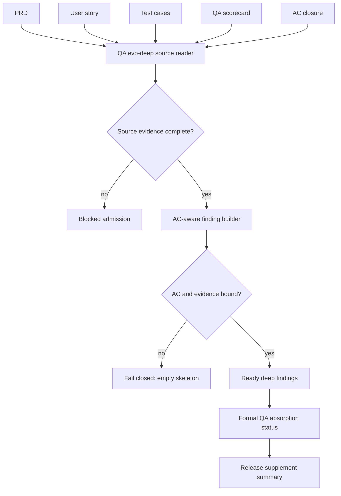
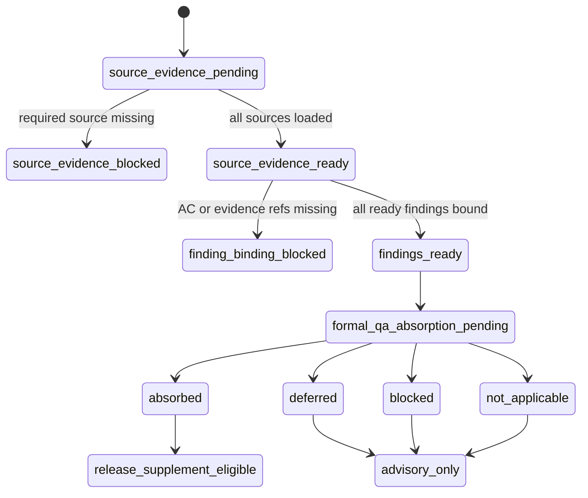
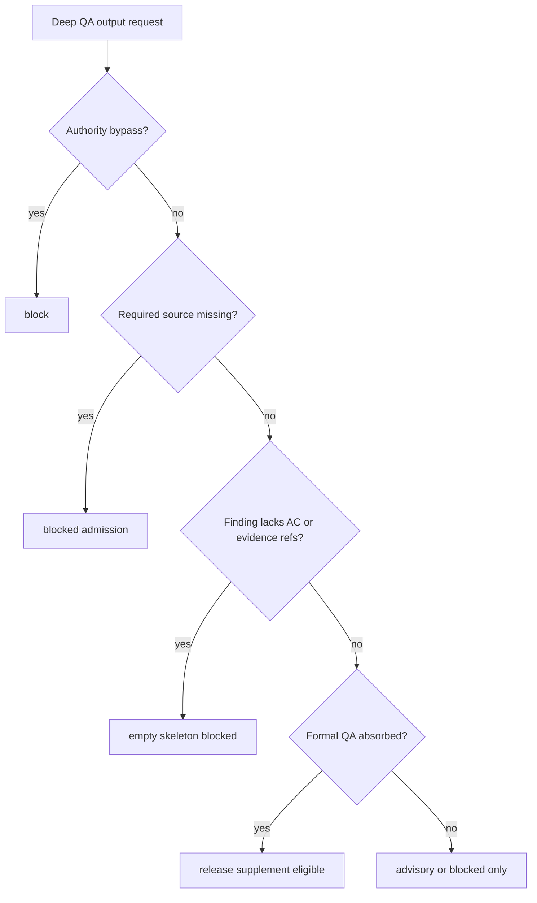

# Research: QA Evo Deep Evidence-Bound AC-Aware Closure

**Feature**: `qa-evo-deep-evidence-bound-ac-aware-closure`  
**Version**: `v1.4.10`  
**Status**: `refreeze-input`  
**Date**: `2026-05-24`

## Truth Binding

- prd_refs: `docs/beacon/archive/v1.4.10/prd/qa-evo-deep-evidence-bound-ac-aware-closure.md`
- user_story_refs: `docs/beacon/archive/v1.4.10/user-story/qa-evo-deep-evidence-bound-ac-aware-closure.md`
- test_case_refs: `docs/beacon/archive/v1.4.10/qa/test-cases/qa-evo-deep-evidence-bound-ac-aware-closure.md`
- coverage_notes: This research closes the accepted follow-up gap that QA evo-deep must bind findings to affected AC IDs and current evidence refs, and that Skill Eval Kit must replay route, boundary, and source anchoring behavior.
- out_of_scope_notes: This research does not replace formal QA, does not create release verdicts, and does not add browser automation, project hooks, Ralph checkpointing, or project skill auto-injection.

## Architecture

The strengthened QA evo-deep flow has five read surfaces and three output surfaces:

1. Read frozen requirement truth:
   - PRD
   - user-story
   - test-case
2. Read current formal QA evidence:
   - `.beacon/qa/features/<feature>/scorecard.json`
   - `.beacon/qa/features/<feature>/ac-closure.json`
3. Produce evidence-bound deep findings:
   - human report: `docs/beacon/<version>/qa/evo-deep/<feature>.md`
   - machine projection: `docs/beacon/<version>/.machine/qa/evo-deep/<feature>.json`
   - formal QA absorption signal in QA scorecard

The key architectural change is that `qa-evo-deep` can no longer treat finding family coverage as readiness. It must validate source evidence state and binding state before returning `status=ready`.

## Business Flow

The operator flow is:

1. Operator runs `beacon qa evo-deep "<feature>" --project . --version <version>`.
2. Beacon loads frozen requirement truth and current QA evidence for that feature.
3. If any required source is missing, Beacon returns a blocked admission with the missing surface and route recommendation.
4. If sources exist, Beacon builds findings and binds each finding to affected AC IDs and current evidence refs.
5. If a finding has no AC or evidence binding, Beacon blocks the report instead of returning a ready skeleton.
6. Operator routes blocked findings to change, test-case, implement, or QA as recommended.
7. Formal QA records whether each finding was absorbed, deferred, blocked, or not applicable.
8. Release readiness summarizes only absorbed findings as release supplement input.

This keeps the business meaning clear: QA evo-deep can reveal and route gaps, but it cannot close formal QA or release by itself.

## State Machine

Required state axes:

- `source_evidence_state`
- `finding_binding_state`
- `blocked_admission_state`
- `skill_eval_replay_state`
- `deep_absorption_state`
- `release_supplement_state`
- `authority_boundary`

## Decision Priority

When states conflict, Beacon must use this order:

1. Authority bypass blocks first.
2. Missing source evidence blocks readiness.
3. Empty AC/evidence binding blocks readiness.
4. Skill Eval replay failure blocks eval pass.
5. Formal QA absorption controls release supplement eligibility.
6. Advisory deep findings may influence exploration but cannot count as pass evidence.

## Closure Notes

The prior v1.4.10 P0 contract remains valid as a topology and boundary foundation. This follow-up feature freezes the stronger behavior required for business closure: a ready deep QA report must prove source reads, AC binding, current evidence binding, and formal QA absorption before release can treat it as supplement input.
