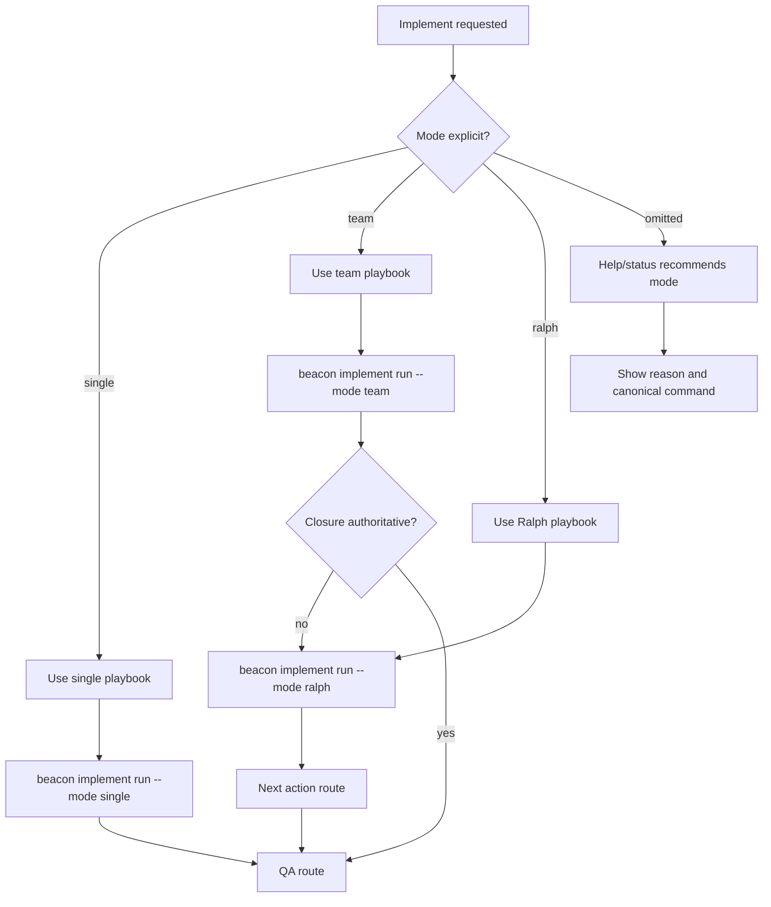
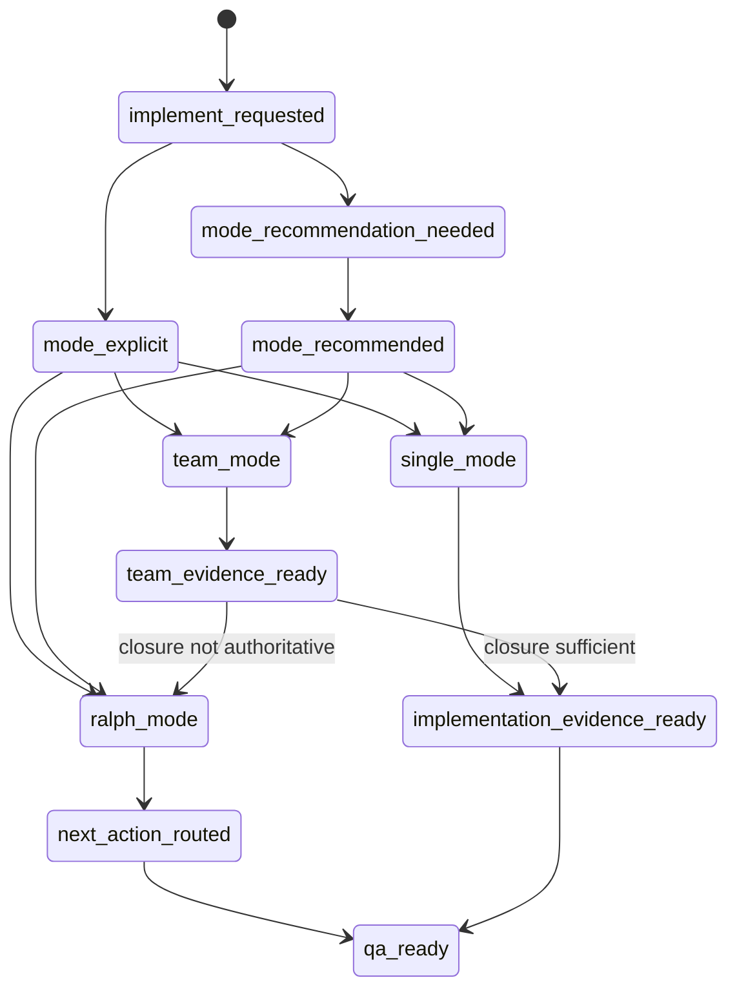

# Source Architecture: Implement Mode Human Playbooks And Routing Contract

**Feature**: `implement-mode-human-playbooks-and-routing-contract`  
**Version**: `v1.4.10`

## 1. Architecture

```text
beacon-implement public skill
  -> reads frozen requirement truth and execution context
  -> explains implementation mode choices
  -> routes execution to beacon implement run ... --mode single|team|ralph
  -> writes implementation evidence through existing implement runtime

mode playbooks
  -> single: small scoped implementation
  -> team: complex implementation with role separation
  -> ralph: closure controller for multi-round repair / QA / release next action

Skill Eval Kit
  -> route-stability cases for implement prompts
  -> expected public route remains beacon-implement
  -> expected mode metadata is single/team/ralph
  -> nonexistent mode-specific public skills fail closed or redirect
```

## 2. Source Files To Inspect During Implementation

- `skills/beacon/beacon-implement/SKILL.md`
- `beacon/commands/implement.py`
- `beacon/commands/implement/__init__.py`
- `beacon/commands/implement/team.py`
- `beacon/commands/implement/ralph.py`
- `beacon/utils/implement_adapters.py`
- `beacon/utils/implement_native.py`
- `beacon/utils/team_surface.py`
- `beacon/utils/help_support.py`
- `beacon/utils/skill_eval_kit.py`
- `docs/beacon/archive/v1.4.10/research/implement-mode-human-playbooks-and-routing-contract.md`

## 3. Required Data Contracts

### 3.1 Implement Mode Playbook

Each mode playbook must carry:

- `mode`
- `purpose`
- `admission_conditions`
- `recommended_command`
- `expected_evidence`
- `handoff_behavior`
- `authority_boundary`
- `non_goals`

### 3.2 Mode Recommendation

Each help/status recommendation must carry:

- `feature`
- `version`
- `recommended_mode`
- `reason`
- `canonical_command`
- `blocked_reason`, when unavailable
- `authority_boundary`

### 3.3 Skill Eval Route Case

Each implement mode route case must carry:

- `case_id`
- `prompt`
- `expected_public_skill`
- `expected_mode`
- `forbidden_public_skills`
- `boundary_expectations`
- `source_anchor_requirements`

## 4. Business Flow



## 5. State Machine



## 6. Decision Priority

1. `beacon-implement` remains the only public implementation skill.
2. Mode playbooks explain execution shape; they do not create lifecycle stages.
3. Help/status can recommend mode only with reason and canonical command.
4. Ralph routes next action and closure evidence; it does not replace QA, release, or gate.
5. Skill Eval Kit must preserve route stability and reject nonexistent public mode skills.
6. Frozen requirement truth remains authoritative over mode recommendations.

## 7. Boundary

This architecture freezes implement mode routing and playbook behavior only. It does not authorize public skill splitting, full Ralph Task Loop checkpoint/recovery, project lifecycle hooks, learn injection, QA pass, release pass, or gate pass.
