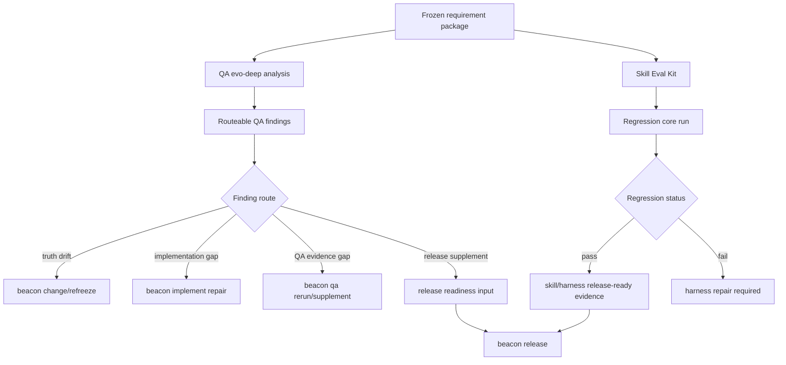
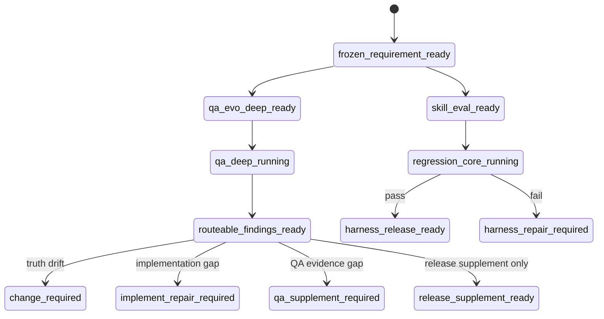

# Source Architecture: QA Evo Deep And Skill Eval Kit v1.4.10

**Feature**: `qa-evo-deep-and-skill-eval-kit-v1410`  
**Version**: `v1.4.10`

## 1. Architecture

```text
beacon qa evo-deep / qa-evo-deep support surface
  -> load frozen PRD, user-story, test-case, QA history, and route evidence
  -> generate state / flow / permission / data / cross-surface findings
  -> write docs/beacon/<version>/qa/evo-deep/<feature>.md
  -> research keeps index only
  -> QA and release consume route recommendations without treating them as pass verdicts

Skill Eval Kit
  -> load eval cases, tags, splits, and regression core
  -> run route and boundary checks against human-facing skill/harness behavior
  -> write runtime evidence under .beacon/state/skill-eval/ or machine evidence
  -> score route stability, boundary preservation, source anchoring, actionability, and closure quality
  -> block skill/harness release readiness on regression failure
```

## 2. Source Files To Inspect During Implementation

- `skills/beacon/beacon-qa/SKILL.md`
- `skills/beacon/beacon-deep/SKILL.md`
- `skills/beacon/beacon-learn/SKILL.md`
- `skills/beacon/beacon-implement/SKILL.md`
- `beacon/commands/qa.py`
- `beacon/utils/qa_matrix.py`
- `beacon/utils/requirement_clarity.py`
- `beacon/utils/support_research_topology.py`
- `beacon/utils/intent_router.py`
- `beacon/utils/host_prompt_trace.py`
- `beacon/utils/agent_surface.py`

## 3. Required Data Contracts

### 3.1 QA Evo Deep Finding

Each QA evo-deep finding must carry:

- `finding_id`
- `feature`
- `version`
- `source_refs`
- `finding_family`
- `risk`
- `affected_ac_ids`
- `state_or_flow_refs`
- `round_memory_refs`
- `current_evidence_refs`
- `blocked_admissions`
- `route_recommendation`
- `release_supplement_input`
- `authority_boundary`

### 3.2 QA Round Memory Influence

Round memory records must carry:

- `round_id`
- `source_run_id`
- `scenario`
- `outcome`
- `failure_family`
- `stability_signal`
- `influence_reason`
- `current_run_required`

The contract must mark round memory as advisory influence. It cannot satisfy an acceptance criterion without current evidence.

### 3.3 Skill Eval Case

Each eval case must carry:

- `case_id`
- `prompt`
- `expected_route`
- `boundary_expectations`
- `source_anchor_requirements`
- `tags`
- `split`
- `expected_evidence`
- `scoring_dimensions`

### 3.4 Skill Eval Run

Each run must carry:

- `run_id`
- `case_ids`
- `split`
- `regression_core`
- `metrics`
- `failures`
- `trace_refs`
- `scorecard`
- `release_blocking`

## 4. Business Flow



## 5. State Machine



## 6. Decision Priority

1. Frozen Markdown requirement truth wins over QA deep memory and eval evidence.
2. QA evo-deep findings route work; they do not pass release.
3. Current evidence is required for acceptance; round memory only prioritizes exploration.
4. Skill Eval Kit protects skill/harness quality; it does not rewrite PRD, user-story, test-case, QA verdict, release verdict, or freeze state.
5. Regression core failure blocks skill/harness changes before it blocks unrelated product delivery.
6. P1/P2 research inputs cannot silently expand this P0 scope.

## 7. Boundary

This architecture freezes the QA deep and Skill Eval contract only. It does not authorize support surfaces to update canonical truth, execute lifecycle hooks, run Ralph Task Loop, inject learned project skills, or split the public implement entrypoint.
