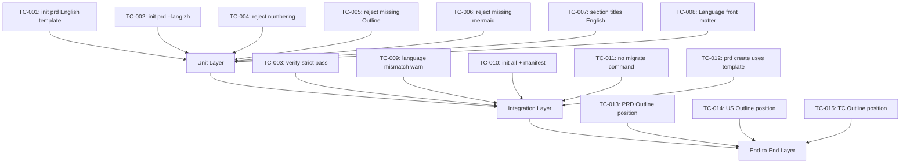

# Test Cases: Unified Truth Template CLI Contract

**Feature**: `unified-truth-template-cli-contract`
**Version**: `v1.4.12`
**Status**: `frozen`
**Date**: `2026-05-31`
**Language**: `en`

## Outline



## Coverage Matrix

| AC ID | TC ID | Layer | Planned Command | Assertion | Evidence Path |
|-------|-------|-------|-----------------|----------|---------------|
| AC-001 | TC-001 | unit | `beacon truth init prd --feature test` | Output has English section titles, no numbering, Outline mermaid block | `docs/beacon/archive/v1.4.12/prd/test.md` |
| AC-001 | TC-002 | unit | `beacon truth init prd --feature test --lang zh` | Output has English titles, `**Language**: zh`, Outline mermaid | `docs/beacon/archive/v1.4.12/prd/test.md` |
| AC-002 | TC-003 | integration | `beacon truth verify --feature test --strict` | Exits 0 for compliant file | `.machine/manifest/version-features.json` |
| AC-002 | TC-004 | unit | `beacon truth verify` on file with `## 1. Problem` | Exits 2 with `numbering_prefix_not_allowed` | `beacon/utils/truth_format.py` |
| AC-002 | TC-005 | unit | `beacon truth verify` on file missing `## Outline` | Exits 2 with `missing_mandatory_section` | `beacon/utils/truth_format.py` |
| AC-002 | TC-006 | unit | `beacon truth verify` on Outline without ` ```mermaid ` | Exits 2 with `missing_mermaid_block` | `beacon/utils/truth_format.py` |
| AC-003 | TC-007 | unit | Inspect `render_prd_template` output | All section titles are English strings defined in function | `beacon/utils/truth_template.py` |
| AC-004 | TC-008 | unit | `beacon truth init prd --lang zh` | Front matter contains `**Language**: zh` | `docs/beacon/archive/v1.4.12/prd/test.md` |
| AC-004 | TC-009 | integration | `beacon truth verify` on en content with zh Language | Returns `language_mismatch` warning | `beacon/utils/truth_format.py` |
| AC-005 | TC-010 | integration | `beacon truth init all --feature test` | Calls `manifest add-feature` and registers paths | `.machine/manifest/version-features.json` |
| AC-006 | TC-011 | unit | Verify no `migrate-truth-format` subcommand exists | `beacon doctor migrate-truth-format` returns unknown command | `beacon/commands/doctor.py` |
| AC-007 | TC-012 | integration | `beacon prd create` for v1.4.12+ | Calls `truth_template.render_prd_template()` | `beacon/commands/prd.py` |
| AC-008 | TC-013 | e2e | Inspect PRD template output | `## Outline` section immediately follows `## Overview` | `beacon/utils/truth_template.py` |
| AC-009 | TC-014 | e2e | Inspect User Story template output | `## Outline` section immediately follows `## Story` | `beacon/utils/truth_template.py` |
| AC-010 | TC-015 | e2e | Inspect Test Case template output | `## Outline` section precedes `## Coverage Matrix` | `beacon/utils/truth_template.py` |

## Branch Coverage Mapping

| TC ID | Diagram Branch | Transition | Covered |
|-------|----------------|------------|---------|
| TC-001 | template_init | absent → template_created (en) | Yes |
| TC-002 | template_init | absent → template_created (zh) | Yes |
| TC-003 | verify_pass | format_verified → compliant | Yes |
| TC-004 | verify_fail | numbering_prefix → non_compliant | Yes |
| TC-005 | verify_fail | missing_outline → non_compliant | Yes |
| TC-006 | verify_fail | missing_mermaid → non_compliant | Yes |
| TC-007 | template_render | immutable_titles → English_only | Yes |
| TC-008 | language_param | zh_flag → Language_zh | Yes |
| TC-009 | language_param | en_content_zh_format → language_mismatch | Yes |
| TC-010 | manifest_integration | init_all → add_feature | Yes |
| TC-011 | no_migrate | migrate_command → unknown | Yes |
| TC-012 | old_entry_adapt | prd_create → template_call | Yes |
| TC-013 | outline_position | prd → Outline_after_Overview | Yes |
| TC-014 | outline_position | us → Outline_after_Story | Yes |
| TC-015 | outline_position | tc → Outline_before_Coverage | Yes |

## Explicit Non Coverage

- Format migration of v1.4.11 truth files (go through `beacon change --refreeze-chain`)
- Full mermaid rendering or visualization (only syntax checking)
- PRODUCT.md, DESIGN.md, or research document format changes
- v1.4.11 or earlier backward compatibility paths
