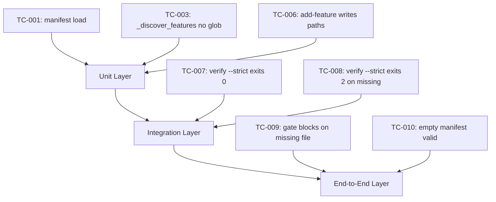

# Test Cases: Version Material File Map Contract

**Feature**: `version-material-file-map-contract`
**Version**: `v1.4.12`
**Status**: `frozen`
**Date**: `2026-05-31`
**Language**: `en`

## Outline

## Coverage Matrix

| AC ID | TC ID | Layer | Planned Command | Assertion | Evidence Path |
|-------|-------|-------|-----------------|----------|---------------|
| AC-001 | TC-001 | unit | `load_manifest_or_fail()` | Returns feature list matching disk | `.machine/manifest/version-features.json` |
| AC-001 | TC-002 | unit | `load_manifest_or_fail()` | Returns version_level_paths dict | `.machine/manifest/version-features.json` |
| AC-002 | TC-003 | unit | `_discover_features()` | Calls `load_manifest_or_fail`, not glob | `beacon/utils/material_sync.py` |
| AC-002 | TC-004 | unit | `_feature_names()` | Calls `load_manifest_or_fail`, not glob | `beacon/utils/material_audit.py` |
| AC-002 | TC-005 | unit | `build_material_audit()` | Reads manifest paths, not glob | `beacon/utils/material_audit.py` |
| AC-003 | TC-006 | integration | `beacon manifest add-feature --version v1.4.12 --feature test-feature` | Writes manifest with all paths + transaction record | `.machine/manifest/version-features.json`, `.beacon/transactions/manifest-*.json` |
| AC-004 | TC-007 | integration | `beacon manifest verify --version v1.4.12 --strict` | Exits 0 when all paths exist | `.machine/manifest/version-features.json` |
| AC-004 | TC-008 | integration | Delete truth file, then `beacon manifest verify --strict` | Exits 2 with `manifest_path_missing` | `.machine/manifest/version-features.json` |
| AC-005 | TC-009 | e2e | Delete truth file, then `build_requirement_package_gate` | Returns `blocked` with `manifest_truth_file_missing` | `beacon/utils/material_audit.py` |
| AC-005 | TC-010 | e2e | `beacon manifest sync --version v1.4.12` with empty version | Produces valid manifest with zero features | `.machine/manifest/version-features.json` |

## Branch Coverage Mapping

| TC ID | Diagram Branch | Transition | Covered |
|-------|----------------|------------|---------|
| TC-001 | manifest_read | manifest_exists → load_features | Yes |
| TC-002 | manifest_read | manifest_exists → load_paths | Yes |
| TC-003 | no_glob | discover_features → manifest_fallback | Yes |
| TC-004 | no_glob | feature_names → manifest_fallback | Yes |
| TC-005 | no_glob | material_audit → manifest_paths | Yes |
| TC-006 | write_path | add_feature → write_manifest → write_transaction | Yes |
| TC-007 | verify_pass | all_paths_exist → exit_0 | Yes |
| TC-008 | verify_fail | path_missing → exit_2 | Yes |
| TC-009 | gate_block | truth_missing → blocked → manifest_truth_file_missing | Yes |
| TC-010 | empty_manifest | sync_empty → valid_zero_features | Yes |

## Explicit Non Coverage

- Format validation of truth files (belongs to unified-truth-template-cli-contract).
- v1.4.11 or earlier backward compatibility paths.
- `.beacon/state/` or runtime-ledger projection changes.
- Skill discovery or adapter changes.
