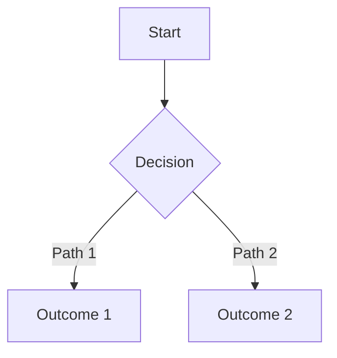
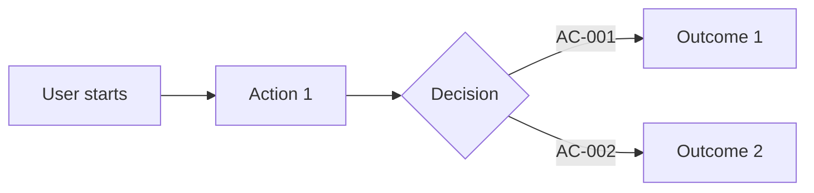
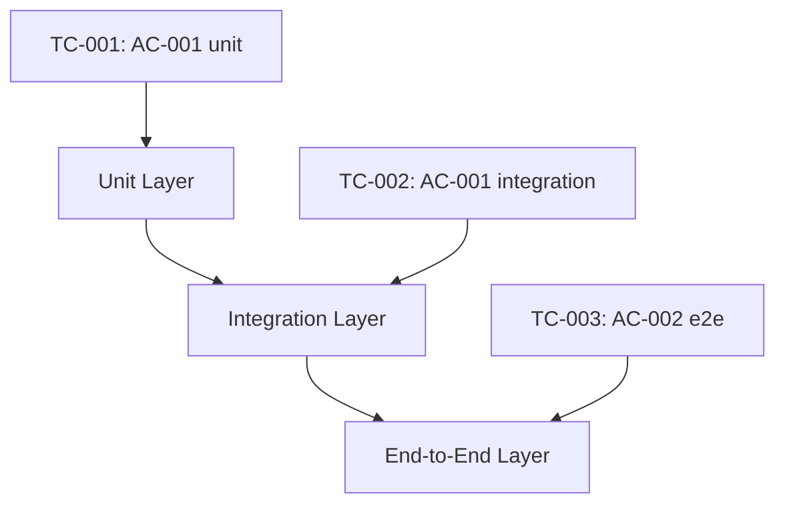

# 调研闭环: diagram-truth-triptych-closure

- version: `v1.4.12`
- feature: `unified-truth-template-cli-contract` (扩展) + `version-material-file-map-contract` (扩展)
- diagram_types: branch-flow, state-machine, decision-priority
- state_axes: diagram_propagation, mermaid_adoption, ac_traceability
- status: `source-driven-converged`
- date: `2026-05-31`
- brainstorm_revision: `R4` — mermaid 必选，层级前移，先总大纲图再具体细节

## 核心约束变更 (R4)

> **Mermaid 图示不是可选项。** 每个真相三件套文档（PRD、User Story、Test Case）都必须有一个 Outline 图示，使用 mermaid 格式，放在 Overview 之后、具体细节之前。原则：先总大纲图，再具体细节。

R4 相对 R3 的增量变更：
- Outline (mermaid 图示) 从 optional 变为 **mandatory**
- Outline 位置从 PRD 后部 (#6-#11) 前移到 **紧接 Overview/Context 之后**
- 三件套每个都有 mandatory Outline：PRD = 特性流程大纲，US = 用户旅程大纲，TC = 测试覆盖路径大纲
- mermaid 是标准格式，不是 ` ```text ` 纯文本

## 源码锚点

| 源码 | 行号/范围 | 角色 |
|------|-----------|------|
| `beacon/utils/diagram_truth.py` DIAGRAM_TYPES | L14 | `("branch-flow", "state-machine", "decision-priority")` |
| `beacon/utils/diagram_truth.py` render_diagram_truth_section | L68-94 | 生成 `## 11. Diagram Truth Layer` 带编号子标题 — 需更新 |
| `beacon/utils/diagram_truth.py` parse_diagram_truth | L122-200 | 从 PRD/user-story 提取 diagram types 和 state axes — 需扩展 mermaid 解析 |
| `beacon/commands/prd.py` --include-diagrams | CLI 参数 | 支持 `--include-diagrams` 和 `--state-axis` |
| v1.4.11 PRD diagram section 分布 | 全文 | 位置不统一：6.x / 7.x / 8.x / 11.x |
| v1.4.11 US/TC diagram 分布 | 全文 | 0/8 US 和 0/8 TC 有 diagram section |

## 发现一: Diagram truth 只停留在 PRD，没有传播到 US 和 TC

**不变**（与 R3 相同）。
PRD 6/11 有 diagram section，US 0/8，TC 0/8。

## 发现二: 图示格式使用纯文本，没有机器可解析能力

**不变**。所有 ` ```text ` 格式。

## 发现三: 图示层级靠后，不起大纲图作用

**新发现**: 当前 Diagram Truth Layer 在 PRD 中的位置是 #6 到 #11（因 feature 不同而异），放在具体细节之后。读者读到 diagram 时已经看完了 Problem、Goals、Scope 等全部细节——diagram 无法起到"先给读者一个整体认知地图"的作用。

**R4 解法**: Outline 图示前移到 Overview/Context 之后、Problem 之前。读者先看总大纲图，再读具体细节。

## 核心设计 (R4)

### 设计原则：先总大纲图，再具体细节

```
读者认知顺序：

1. Overview (一段文字) —— "这个 feature 是什么"
2. Outline (mermaid 图示) —— "整体长什么样" ← 大纲图
3. Context (引用/依赖) —— 补充上下文
4. Problem (细节开始) —— 现在可以对照大纲图读细节了
5. ...
```

### PRD 模板 (R4)

```markdown
# PRD: <Human-Readable Name>

**Feature**: `<feature-slug>`
**Version**: `<version>`
**Status**: `frozen`
**Date**: `YYYY-MM-DD`
**Language**: `en`

## Overview
<!-- FILL: One paragraph describing the problem and expected outcome. -->

## Outline
<!-- FILL: Mermaid diagram showing the feature's core flow or state transitions.
     Use flowchart TD/LR for procedural features, stateDiagram-v2 for stateful features.
     This is the reader's first visual map — keep it high-level and readable. -->



## Context
<!-- FILL: References to research docs, architecture docs, and global constraints. -->

## Problem
<!-- FILL: Specific problem in the current system, backed by source-anchored evidence. -->

## Goals
<!-- FILL: List of acceptance criteria. -->

## Design Principles
<!-- FILL: Design constraints and principles this feature must follow. -->

## Scope

### In Scope
<!-- FILL -->

### Out of Scope
<!-- FILL -->

## Functional Requirements

| FR ID | Related AC | Requirement |
|-------|-----------|-------------|
<!-- FILL: FR-001 | AC-001 | Description -->

## Source Contract
<!-- FILL: Affected source files with line numbers. -->

## State Axes

| Axis | States | Meaning |
|------|--------|---------|
<!-- FILL -->

## Acceptance Criteria
<!-- FILL: List all ACs with details. -->

## Non-Goals
<!-- FILL: Explicitly excluded items. -->

## Success Metrics
<!-- FILL: How to determine successful delivery. -->

## Diagram Truth Layer
<!-- Optional: only for features with complex state machines, branch flows, or decision priorities.
     Use mermaid stateDiagram-v2 for detailed state transitions.
     Use mermaid flowchart for detailed branch flows.
     Diagram Truth Layer extends the Outline, not replaces it. -->

### Diagram Types
<!-- FILL: branch-flow, state-machine, decision-priority -->

### State Axes

| Axis | States | Meaning |
|------|--------|---------|
<!-- FILL -->

### Branch Flow
<!-- FILL: mermaid flowchart or stateDiagram-v2 for detailed branches -->

### Propagation Contract
- Diagram truth must stay explicit through freeze readiness, implementation planning, and QA coverage.
- State axes must not be silently compressed into one implicit status field.
- User-story AC must declare which state axis transitions they cover.
- Test-case coverage must declare which diagram branches they cover.
```

**R4 关键变化**:

| 变更 | R3 | R4 |
|------|-----|-----|
| Outline 图示 | 无 (Diagram Truth 在 #6-#11) | **Mandatory，紧接 Overview 之后** |
| mermaid 格式 | 鼓励 (` ```text `) | **必须** (` ```mermaid `) |
| Diagram Truth Layer | PRD optional，靠后 | **Optional**，保留给复杂 feature 的详细图示 |
| US Outline | 无 | **Mandatory** |
| TC Outline | 无 | **Mandatory** |
| Outline 图示层级 | 靠后（具体细节之后） | **靠前（Overview 之后，细节之前）** |

### User Story 模板 (R4)

```markdown
# User Story: <Human-Readable Name>

**Feature**: `<feature-slug>`
**Version**: `<version>`
**Status**: `frozen`
**Date**: `YYYY-MM-DD`
**Language**: `en`

## Story
<!-- FILL: As a <role>, I want <goal>, so that <benefit>. -->

## Outline
<!-- FILL: Mermaid diagram showing the user journey through key paths.
     Use flowchart LR for user journey. Each node maps to an AC.
     This is the reader's first visual map of the user story. -->



## Acceptance Criteria

| AC ID | Theme | Description |
|-------|-------|-------------|
<!-- FILL: AC-001 | <theme> | <description> -->

## Test Story Map

| Test ID | Covers | Scenario |
|---------|--------|----------|
<!-- FILL: TC-001 | AC-001 | <scenario> -->

## State Axis Coverage
<!-- Optional: only when PRD declares state axes. -->

| AC ID | State Axis | Transition | Covered |
|-------|-----------|------------|---------|

## References
- Research: `docs/beacon/<version>/research/<feature-slug>.md`
- PRD: `docs/beacon/<version>/prd/<feature-slug>.md`
- Test cases: `docs/beacon/<version>/qa/test-cases/<feature-slug>.md`
```

### Test Cases 模板 (R4)

```markdown
# Test Cases: <Human-Readable Name>

**Feature**: `<feature-slug>`
**Version**: `<version>`
**Status**: `frozen`
**Date**: `YYYY-MM-DD`
**Language**: `en`

## Outline
<!-- FILL: Mermaid diagram showing test coverage layer paths.
     Use flowchart TD for test layers (unit → integration → e2e).
     Each path maps to a Coverage Matrix row. -->



## Coverage Matrix

| AC ID | TC ID | Layer | Planned Command | Assertion | Evidence Path |
|-------|-------|-------|-----------------|----------|---------------|
<!-- FILL -->

## Branch Coverage Mapping
<!-- Optional: only when PRD declares branch-flow or state-machine. -->

| TC ID | Diagram Branch | Transition | Covered |
|-------|----------------|------------|---------|

## Explicit Non Coverage
<!-- FILL: Scenarios intentionally not covered and why. -->
```

## 校验规则 (R4)

### Outline 图示 mandatory 校验

`beacon truth verify --strict` 新增校验项：

1. 三件套每个文档必须有 `## Outline` section
2. Outline section 必须包含至少一个 ` ```mermaid ` 代码块
3. mermaid 代码块必须可解析（基本语法检查：至少包含 `flowchart`、`stateDiagram-v2` 或 `sequenceDiagram` 关键字）
4. Outline section 位置必须在 Overview/Story 之后、具体细节 sections 之前

### Diagram Truth Layer optional 校验

1. Diagram Truth Layer 只在 PRD 中可选（US 和 TC 不需要独立 Diagram Truth Layer）
2. 如存在，必须包含 Diagram Types declaration
3. 如存在，State Axes 表格必须与 PRD 的 State Axes section 一致

### Mermaid 格式规范

PRD mermaid 用于三种场景：

| Feature 特性 | 推荐 mermaid 类型 | 用途 |
|-------------|-----------------|------|
| 流程型 | `flowchart TD` 或 `flowchart LR` | 显示主要流程和分支 |
| 状态型 | `stateDiagram-v2` | 显示状态转换 |
| 优先级型 | `flowchart TD` + decision node | 显示决策优先级 |

US mermaid 用于：
- `flowchart LR` 显示用户旅程，每个节点映射到一个 AC

TC mermaid 用于：
- `flowchart TD` 显示测试覆盖路径，层与层的纵向关系

## Section 分类 (R4 更新)

**PRD Mandatory sections** (必须存在，顺序合规):

```python
PRD_MANDATORY = [
    "Overview",
    "Outline",          # NEW: mandatory mermaid diagram
    "Problem",
    "Goals",
    "Scope",
    "Functional Requirements",
    "Acceptance Criteria",
    "Non-Goals",
    "Success Metrics",
]
```

**PRD Optional sections**:

```python
PRD_OPTIONAL = {
    "Context": "after_outline",       # 移到 Outline 之后
    "Design Principles": "after_goals",
    "Source Contract": "after_functional_requirements",
    "State Axes": "after_functional_requirements",
    "Runtime Behavior Contract": "after_functional_requirements",
    "Evidence Contract": "before_acceptance_criteria",
    "Diagram Truth Layer": "after_success_metrics",  # 详细图示，仅复杂 feature
}
```

**User Story Mandatory sections**:

```python
USER_STORY_MANDATORY = [
    "Story",
    "Outline",              # NEW: mandatory mermaid user journey
    "Acceptance Criteria",
    "Test Story Map",
    "References",
]
```

**Test Case Mandatory sections**:

```python
TEST_CASE_MANDATORY = [
    "Outline",              # NEW: mandatory mermaid test coverage path
    "Coverage Matrix",
    "Explicit Non Coverage",
]
```

## CEO Review 六轴挑战 (R4)

### too_smooth_path → Reduce

"mermaid mandatory" 听起来简单——每个 truth 文档加一个 mermaid 图示。但实际挑战是：
- LLM 填空质量：LLM 能否生成准确的 mermaid 图示？（可以——mermaid 语法简单，FILL 注释已经给出指引）
- `beacon truth verify` 需要基本 mermaid 语法检查——不需要完整 mermaid 解析器，只需验证关键字和基本结构
- 简单 feature 的 Outline 可能只有 3-5 个节点——这是正确的，概要图就该是高层次的

### buried_landmine → Reduce

Outline mandatory 的地雷是：LLM 生成低质量 mermaid 图示怎么办？
- FILL 注释引导 LLM 生成合适的图示类型
- `beacon truth verify` 做基本语法检查（关键字存在、节点数 ≥ 3）
- 低质量 mermaid 是内容质量问题，不是格式问题——verify 只检查格式，不检查内容语义

### truth_freeze_destabilization → Hold

Outline 是 mandatory section，但它不改变 truth 的承诺范围——它只是相同信息的可视化表达。
- 如果 Outline mermaid 与 Prose 描述的 Problem/Goals 矛盾，是人/LLM 填充的内容问题，不是模板问题
- 图文一致性问题应通过 `beacon truth verify` 的 warn 检查提示，而不是 fail

### stage_boundary_sprawl → Hold with explicit declaration

Outline 不是新的 lifecycle stage。它是 truth surface 的可视化摘要，和 front matter 中的 `**Language**` 字段一样是结构要素。

### false_closure_signal → Hold

有了 mermaid Outline 不等于需求闭环。Outline 是可视化大纲，不是 acceptance 闭环。闭环仍然是 `prd → user-story → test-case → requirement_clarity → freeze`。

### operator_cost_underpricing → Reduce

新增成本可控：
- 每个文档多一个 `## Outline` section + 1 个 mermaid 代码块
- LLM 填空指引已经清晰（FILL 注释 + 示例 mermaid 代码）
- `beacon truth verify` 新增 mermaid 基本语法检查
- `diagram_truth.py` 更新增量小（去编号 + mermaid 格式鼓励）

## 源码改造清单 (R4 追加)

| # | 模块 | 变更 |
|---|------|------|
| 10 | `beacon/utils/truth_template.py` | render_prd_template 新增 `## Outline` mandatory section + mermaid FILL 注释 |
| 11 | `beacon/utils/truth_template.py` | render_user_story_template 新增 `## Outline` mandatory section |
| 12 | `beacon/utils/truth_template.py` | render_test_case_template 新增 `## Outline` mandatory section |
| 13 | `beacon/utils/truth_format.py` | verify 新增 Outline section 存在性检查 + mermaid 代码块基本语法检查 |
| 14 | `beacon/utils/diagram_truth.py` | render_diagram_truth_section 去编号 + Diagram Truth Layer 改为 optional + Outline 图示从 diagram_truth 独立 |
| 15 | `beacon/utils/diagram_truth.py` | parse_diagram_truth 支持 mermaid 代码块解析 |
| 16 | `beacon/utils/diagram_truth.py` | 新增 render_outline_template 生成 Outline FILL 注释（自动识别 feature 类型推荐 mermaid 图类型）|

## 验证标准 (R4 追加)

1. `beacon truth init prd --feature test` 生成文件 `## Outline` section 包含 ` ```mermaid ` 代码块
2. `beacon truth verify --feature test --strict` 对包含 Outline + mermaid 的文件 exit 0
3. 缺少 `## Outline` section → verify 报 `missing_mandatory_section` (strict 模式 fail)
4. Outline section 缺少 ` ```mermaid ` 代码块 → verify 报 `missing_mermaid_block` (strict 模式 fail)
5. mermaid 代码块不包含 `flowchart`/`stateDiagram`/`sequenceDiagram` → verify 报 `invalid_mermaid_syntax` (strict 模式 fail)
6. `beacon truth init prd --feature test --lang zh` 生成文件中 Outline section 的 FILL 注释为英文，mermaid 图示代码为英文标签

## 已关闭的开放问题 (R4)

1. ~~mermaid 是否 mandatory？~~ **关闭**: mermaid 是 mandatory，每个三件套文档必须有 Outline mermaid 图示。
2. ~~Outline 图示放在哪里？~~ **关闭**: 紧接 Overview/Story 之后，具体细节之前。原则：先总大纲图，再具体细节。
3. ~~简单 feature 也要 mermaid 吗？~~ **关闭**: 是。最简单的 feature 也有至少一个线性流程（3-5 节点）。Outline 是概要，不需要复杂。
4. ~~Diagram Truth Layer 还有吗？~~ **关闭**: 保留为 optional section，仅复杂 feature 需要（详细 state machine、branch flow、decision priority）。Outline 是概要图，Diagram Truth Layer 是详细图。

## 路由

- 本 feature 依赖 `version-material-file-map-contract` (manifest 先行)
- 如 scope 变更（新增 mandatory Outline section），走 `beacon-change`
- Diagram Truth Layer 传播结构实现归入本 feature 源码改造清单
