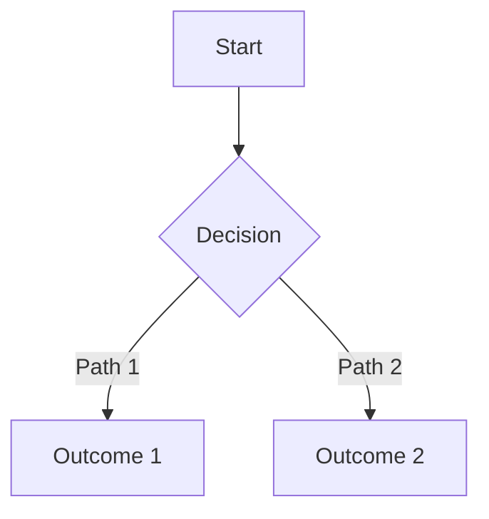
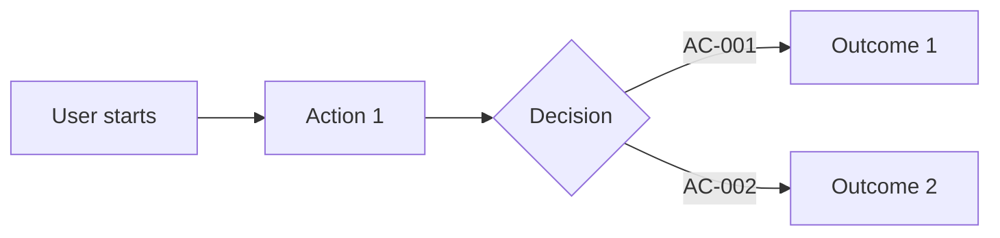
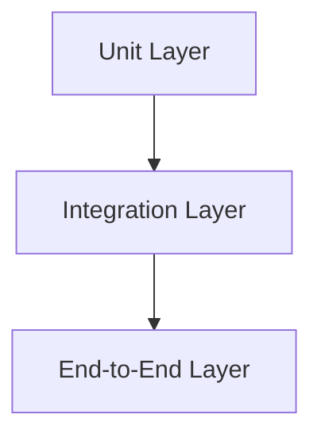

# 源码架构: diagram-truth-triptych-closure

- version: `v1.4.12`
- feature: `unified-truth-template-cli-contract` (扩展) + `version-material-file-map-contract` (扩展)
- brainstorm_revision: `R4` — mermaid 必选，层级前移，先总大纲图再具体细节

## 运行时改造

### truth_template.py 变更

```python
# beacon/utils/truth_template.py

PRD_MANDATORY = [
    "Overview",
    "Outline",          # NEW: mandatory mermaid diagram, after Overview
    "Problem",
    "Goals",
    "Scope",
    "Functional Requirements",
    "Acceptance Criteria",
    "Non-Goals",
    "Success Metrics",
]

PRD_OPTIONAL = {
    "Context": "after_outline",         # 移到 Outline 之后
    "Design Principles": "after_goals",
    "Source Contract": "after_functional_requirements",
    "State Axes": "after_functional_requirements",
    "Runtime Behavior Contract": "after_functional_requirements",
    "Evidence Contract": "before_acceptance_criteria",
    "Diagram Truth Layer": "after_success_metrics",  # 仅复杂 feature
}

USER_STORY_MANDATORY = [
    "Story",
    "Outline",              # NEW: mandatory mermaid user journey
    "Acceptance Criteria",
    "Test Story Map",
    "References",
]

TEST_CASE_MANDATORY = [
    "Outline",              # NEW: mandatory mermaid test coverage path
    "Coverage Matrix",
    "Explicit Non Coverage",
]

def render_prd_template(*, feature_slug: str, version: str, lang: str = "en") -> str:
    """返回 PRD 固定模板。Outline section 包含 mermaid FILL 注释。
       Diagram Truth Layer 是 optional section，仅复杂 feature 需要。"""
    ...

def render_user_story_template(*, feature_slug: str, version: str, lang: str = "en") -> str:
    """返回 User Story 固定模板。Outline section 包含 mermaid FILL 注释。"""
    ...

def render_test_case_template(*, feature_slug: str, version: str, lang: str = "en") -> str:
    """返回 Test Case 固定模板。Outline section 包含 mermaid FILL 注释。"""
    ...
```

### Outline 图示 FILL 注释

```python
# PRD Outline FILL
OUTLINE_FILL_PRD = """\
## Outline

<!-- FILL: Mermaid diagram showing the feature's core flow or state transitions.
     Use flowchart TD/LR for procedural features, stateDiagram-v2 for stateful features.
     This is the reader's first visual map — keep it high-level and readable. -->


"""

# User Story Outline FILL
OUTLINE_FILL_US = """\
## Outline

<!-- FILL: Mermaid diagram showing the user journey through key paths.
     Use flowchart LR for user journey. Each node maps to an AC.
     This is the reader's first visual map of the user story. -->


"""

# Test Case Outline FILL
OUTLINE_FILL_TC = """\
## Outline

<!-- FILL: Mermaid diagram showing test coverage layer paths.
     Use flowchart TD for test layers (unit → integration → e2e).
     Each path maps to a Coverage Matrix row. -->


"""
```

### truth_format.py 变更

```python
# beacon/utils/truth_format.py 新增校验

def _check_outline_section(content: str) -> list[str]:
    """检查 Outline section 存在性和 mermaid 代码块。"""
    issues = []
    if "## Outline" not in content:
        issues.append("missing_mandatory_section: Outline")
        return issues
    # 检查 mermaid 代码块
    if "```mermaid" not in content.split("## Outline")[1].split("##")[0]:
        issues.append("missing_mermaid_block: Outline section must contain ```mermaid block")
        return issues
    # 基本语法检查：至少包含 flowchart / stateDiagram / sequenceDiagram
    mermaid_block = content.split("```mermaid")[1].split("```")[0] if "```mermaid" in content else ""
    has_valid_type = any(kw in mermaid_block for kw in ["flowchart", "stateDiagram", "sequenceDiagram"])
    if not has_valid_type:
        issues.append("invalid_mermaid_syntax: mermaid block must include flowchart/stateDiagram/sequenceDiagram")
    return issues
```

### diagram_truth.py 变更

```python
# beacon/utils/diagram_truth.py 更新

def render_diagram_truth_section(*, include_diagrams: list[str], state_axes: list[str]) -> str:
    """返回无编号的 Diagram Truth Layer section（optional）。
       Outline mermaid 图示由 truth_template.py 的 mandatory Outline section 承担。
       Diagram Truth Layer 仅用于复杂 feature 的详细图示。"""
    # 旧: ## 11. Diagram Truth Layer / ### 11.1 / 11.2 / 11.3
    # 新: ## Diagram Truth Layer / ### Diagram Types / ### State Axes / ### Branch Flow / ### Propagation Contract
    ...

def parse_diagram_truth(version, prd_text, user_story_text) -> dict:
    """新增: 解析 ```mermaid 代码块中的 node 和 transition 列表。"""
    # 支持 ```mermaid 代码块的 node 提取和 transition 解析
    ...
```

## 合约边界

### 范围内

- Outline (mermaid 图示) 作为 mandatory section 加入三件套模板
- Outline 位置：PRD 在 Overview 之后，US 在 Story 之后，TC 在 Coverage Matrix 之前
- `beacon truth verify` 新增 Outline + mermaid 校验
- `diagram_truth.py` 去编号 + Diagram Truth Layer 改为 optional
- `render_outline_template` 生成 FILL 注释（推荐 mermaid 图类型）

### 范围外

- 不做完整 mermaid 渲染或可视化（只做语法检查）
- 不改变 `beacon prd create` 的 `--include-diagrams` 参数（Diagram Truth Layer 仍可选）
- 不在 `beacon truth verify` 中检查 mermaid 图示与 Prose 内容的语义一致性
- Diagram Truth Layer 保留为 optional section，不在本次 mandatory 校验中

### 显式边界声明

- Outline 是 truth surface 的可视化摘要，不是 acceptance 闭环
- 有 mermaid 图示不等于需求闭环
- Diagram Truth Layer 是复杂 feature 的详细图示扩展，不在三件套 mandatory 校验中
- `outline_mermaid_present` 是 `truth_format_compliant` 的必要条件
- `outline_mermaid_valid` 不证明内容语义正确

### baseline hash 变更声明

新增 mandatory Outline section 改变了 truth 文档的结构。旧版本 truth 升级到 v1.4.12 格式时，必须走 `beacon change --refreeze-chain`，baseline hash 重算是合法结果。
