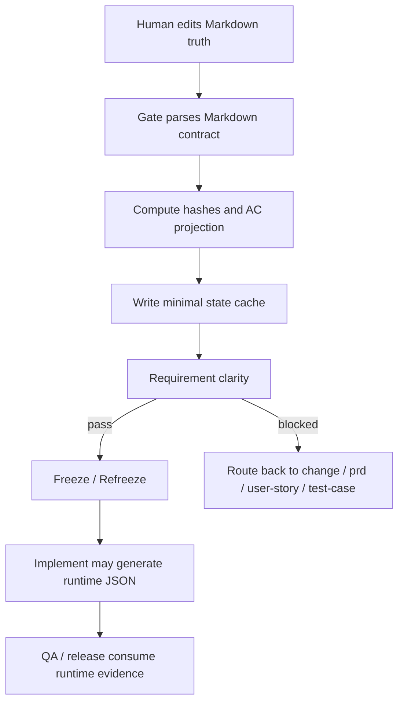
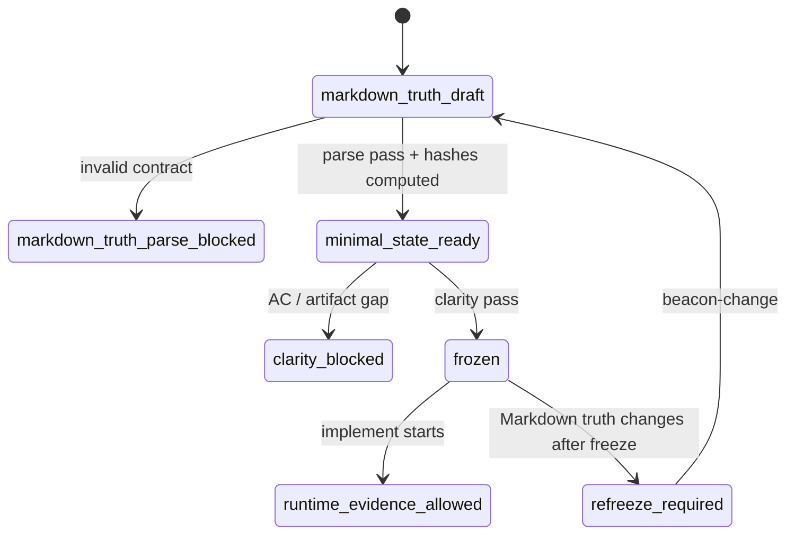

# Research: Markdown-first Freeze Truth 与 Minimal Machine State Contract

**Feature**: `markdown-first-freeze-truth-and-minimal-machine-state-contract`
**Version**: `v1.4.8`
**Status**: `frozen`
**Date**: `2026-05-21`

## 1. 背景

上一条 v1.4.8 冻结线确认 Beacon 需要恢复强 gate，并避免默认 seed、缺失 execution host、未采纳 support finding 继续 fail open。

新的问题是：为满足 gate，Beacon 生成了过多 `.machine/*.json` 投影，部分 JSON 复制了整篇 Markdown、完整 candidate ledger、完整 QA scenario map。这造成：

- token 消耗大
- 运行慢
- 人类主读材料被机器镜像喧宾夺主
- 机器状态和 Markdown truth 可能再次漂移

因此本研究收敛为：

> 需求冻结 truth 回到 Markdown-first；冻结阶段机器面只保留最小状态与 hash；运行时仍保留 implement / QA / release 的 evidence JSON。

## 2. 第一性原理

Beacon 需求冻结只需要四类事实：

- Truth：人类可审查的承诺源。
- State：revision、freeze/refreeze status、baseline hash、source revision。
- Index：AC 投影、缺失 surface、diagnostics。
- Evidence：implement / QA / release 的运行结果、session、process、trace。

其中 Truth 应由 Markdown 拥有；State 和 Index 可以是最小机器缓存；Evidence 仍应是运行时 JSON。

## 3. Architecture

本 feature 将需求冻结材料分为三层：

- Markdown truth layer：`research/`、`prd/`、`user-story/`、`qa/test-cases/`、`execution/`、`release/`。
- Minimal machine state layer：只记录 hash、revision、status、diagnostics、transaction pointer。
- Runtime evidence layer：只在 implement / QA / release 运行时写入过程、线程、session、trace、evidence JSON。

禁止冻结阶段 JSON 复制整篇 Markdown 正文。

## 4. Business Flow

## 5. State Machine

## 6. Decision Priority

1. Markdown truth 高于 machine cache。
2. Deterministic parser 高于 LLM interpretation。
3. Minimal state cache 高于 fulltext mirror。
4. Runtime JSON 只属于 implement / QA / release 过程证据。
5. 缺失或漂移时 fail closed，而不是从旧 JSON 猜测 truth。

## 7. 结论

不采用“完全移除机器面”。

采用“Markdown-first truth + minimal machine state + runtime JSON only”：

- 需求冻结阶段不再生成全文机器镜像。
- gate 从 Markdown 解析 truth。
- 最小 JSON 只作为状态缓存与漂移检测。
- implement / QA / release 的过程证据继续使用 JSON。
