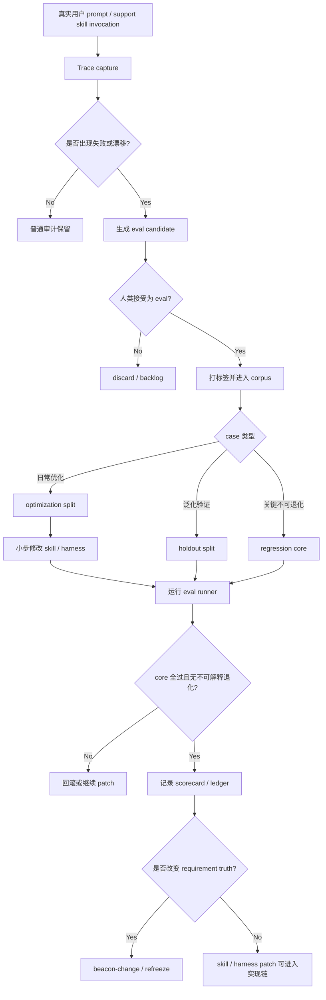
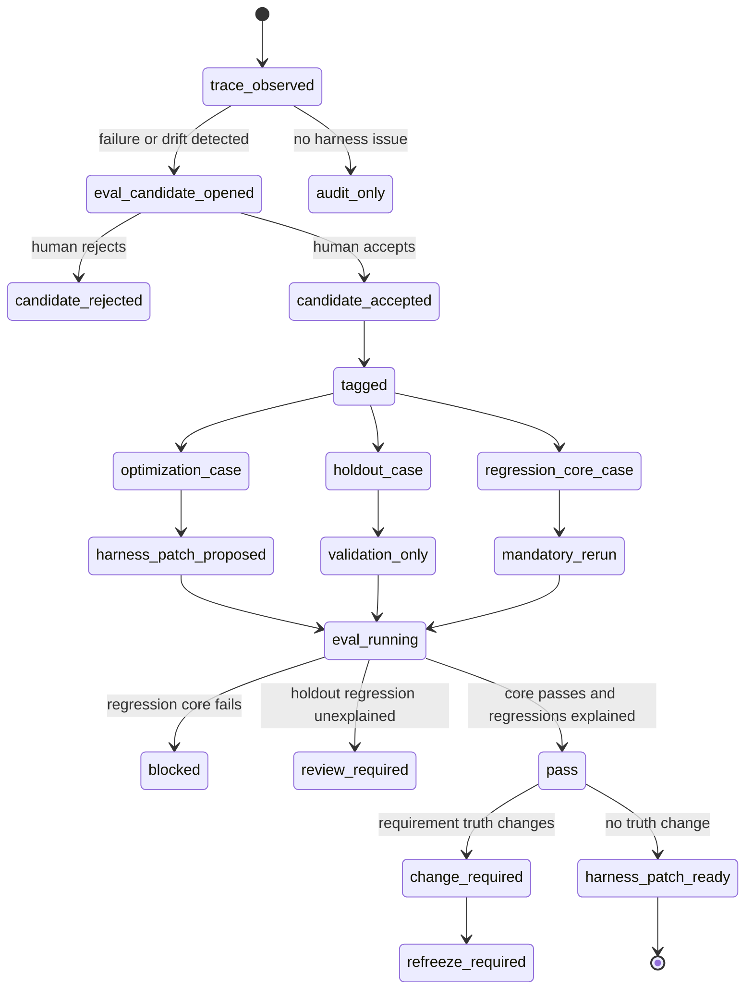

# Research: Better Harness、Skill Eval Kit 与 Source-Driven Regression Core

**Feature**: `better-harness-skill-eval-kit-and-source-driven-regression-core`  
**Version**: `v1.4.9`  
**Status**: `brainstorm-research-input`  
**Date**: `2026-05-23`

## 1. 背景

Better Harness 的核心不是更换更强模型，而是把 agent harness 当成工程资产治理。

在 Beacon 语境里，harness 包括：

- 系统 / 开发提示词
- skill 说明与工具说明
- 工作区、记忆与落盘约束
- 多步流程骨架
- 日志、trace 与 evidence
- agent host surface 与版本化 skill 分发

这些材料不能只靠主观体验调整。它们必须可版本化、可评测、可回归。

本研究的收敛判断是：

> Beacon 下一阶段不应继续盲目扩 skill 数量，而应建立 `Beacon Skill Eval Kit`、`support-skill regression core` 与 `trace -> eval -> patch` 闭环。

## 2. Source Anchors

### 2.1 外部经验来源

- `/Users/apple/Developer/Personal/personal-brain/sources/web/mp-weixin-qq-com-better-harness-evals-agent-harness.md`
- `/Users/apple/Developer/Personal/personal-brain/sources/web-notes/mp-weixin-qq-com-better-harness-evals-agent-harness/2026-05-21-110815.md`
- `/Users/apple/Developer/Personal/personal-brain/projects/notes/beacon/2026-05-21-110808.md`
- `/Users/apple/Developer/Personal/personal-brain/projects/notes/beacon/2026-05-21-114629.md`

### 2.2 Beacon 源码锚点

- `skills/beacon/beacon-source-driven/SKILL.md`
- `beacon/utils/agent_surface.py`
- `beacon/utils/host_prompt_trace.py`
- `beacon/commands/prompt.py`
- `beacon/utils/learning_loop.py`
- `beacon/utils/material_gate_contract.py`
- `docs/beacon/archive/v1.4.9/execution/evo-harness-contract.md`
- `docs/beacon/archive/v1.4.9/execution/project-skill-qa-evolution-blueprint.md`
- `tests/test_v149_ui_ux_externalization.py`

## 3. 现有实现程度

| 能力面 | 当前实现 | 实现程度 | 缺口 |
| --- | --- | --- | --- |
| skill / agent surface 版本化 | `agent_surface.py` 可安装 host-visible skills、计算 hash、校验 drift | 中 | 只校验文件存在和漂移，不评测 skill 路由语义 |
| host prompt trace | `host_prompt_trace.py` 记录 prompt、mapped command、route status、produced artifacts | 中 | trace 没有转成 eval case，也没有进入 regression core |
| prompt router history | `prompt.py` 写入 prompt router history 与 input audit | 中 | 记录偏运行审计，不形成可复跑 eval corpus |
| eval / evo 骨架 | `learning_loop.py` 有 benchmark corpus、scorecard、ledger、keep/discard | 中 | subject surface 未覆盖 `skill_harness`，缺 optimization / holdout / regression core |
| material gate | `material_gate_contract.py` 已约束 support skill material effect、execution host facts、obligation | 中高 | 约束材料闭环，不评测 support skill 本身是否稳定 |
| v1.4.9 skill QA | `project-skill-qa-evolution-blueprint.md` 聚焦 UI/UX 外部化和 prototype adapter | 中 | 不是通用 Better Harness / Skill Eval Kit |
| source-driven support | `beacon-source-driven` 明确不当 truth/gate，只做 source anchor review | 中 | 没有结构化 claim matrix，也不产出 eval candidate |

结论：Beacon 已有部分基础设施，但 Better Harness 所需的“skill/harness 可评测系统”还没有产品化。

粗略判断：

- 版本化 surface：约 60%-70%
- trace 采集：约 50%
- material gate / support 边界：约 60%
- Skill Eval Kit / regression core：约 10%-20%

## 4. 关键问题

### 4.1 Skill 仍主要靠主观体验演进

目前 Beacon 可以判断某些材料是否存在、某些 gate 是否通过，但无法回答：

- 这个 prompt 应该稳定路由到哪个 skill？
- 这个 support skill 是否越权成 truth source？
- skill body 是否过长、过泛、不可行动？
- 一次 skill 文案改动是否让历史 case 退化？
- agent host surface 更新后，路由质量是否一致？

这意味着 Beacon 现在能管 delivery truth，却还不能严肃治理自己的 agent harness。

### 4.2 eval-lab 尚未覆盖 support skill/harness

`eval-lab` 和 `evo` 当前更像 learning-plane skeleton，主要围绕 QA policy、design policy、contract policy、rewrite policy、debug policy、benchmark policy。

缺少专门的 `skill_harness` subject surface：

- route stability
- boundary preservation
- token efficiency
- actionability
- clarification quality
- source anchor sufficiency

### 4.3 trace 没有闭环到 eval

Beacon 已经记录了一些有价值的 trace：

- prompt router history
- user input audit
- host prompt trace
- support surface transaction
- debug feedback

但这些 trace 目前主要用于审计和状态解释，还没有形成：

```text
trace
-> candidate eval
-> human accept / reject
-> optimization / holdout split
-> regression core
-> skill or harness patch
-> rerun eval
```

### 4.4 source-driven 还不是结构化证据生产面

`beacon-source-driven` 当前定位正确：它不是 truth source、不是 gate source、不是 lifecycle stage。

但作为 Better Harness 的 source anchor 层，它还缺少结构化输出：

- claim
- source_ref
- support_level
- unsupported_reason
- contradicted_by
- recommended_route
- eval_candidate

没有这个 claim matrix，就很难把一次 review 的发现稳定沉淀成 regression case。

## 5. 设计原则

### 5.1 Harness is product material

Beacon 的 skill、prompt、host rules、tool descriptions、workflow skeleton、trace schema 都应被视为可治理材料。

它们不是临时文案，也不应通过“感觉更好”合并。

### 5.2 Markdown remains truth, eval is runtime evidence

Better Harness 不改变 v1.4.8 / v1.4.9 的 Markdown-first 原则。

- PRD / user-story / test-case / research / execution / release 文档仍是需求 truth。
- Skill eval case、trace、metrics、runs 属于 runtime evidence 和 harness quality evidence。
- eval 不能自动改 truth，只能提出 change / refreeze 输入。

### 5.3 Source-driven remains support, not gate

`beacon-source-driven` 应补强为 source anchor support，但不能升级为 release gate。

它可以：

- 暴露 unsupported claim
- 生成 source anchor matrix
- 推荐回 truth / execution / QA surface
- 产出 eval candidate

它不可以：

- 改 PRD / user-story / test-case
- 发 release verdict
- 绕过 `beacon-change`
- 自己决定 regression core 接纳

### 5.4 Regression core must be small and hard

regression core 不追求大，而追求“每次必过”。

优先覆盖：

- support skill 边界
- human-facing skill 路由
- explicit-only vs auto-route
- material effect 闭环
- UI/UX 外部化路由
- source-driven 不越权
- prototype adapter 不回退到设计生成
- gate 不静默默认

### 5.5 Eval must prevent prompt reward hacking

Skill eval 不能只看输出是否包含关键词。

必须同时看：

- route 是否正确
- 是否越权
- 是否产生无意义长输出
- 是否把问题推回给用户以逃避判断
- 是否引用了真实 source anchor
- 是否给出可执行下一跳

## 6. Proposed Architecture

```text
Beacon skills / prompts / host rules
-> skill harness inventory
-> trace capture
-> eval candidate extraction
-> human accept / reject
-> tagged eval corpus
-> optimization / holdout split
-> regression core
-> eval runner
-> metrics + traces
-> source-driven claim review
-> skill / harness patch proposal
-> change / refreeze when requirement truth changes
```

建议新增或补强的目录：

```text
.beacon/state/skill-eval/
  cases.jsonl
  tags.yaml
  splits/
    optimization.txt
    holdout.txt
  regression-core.txt
  candidates/
    trace-candidates.jsonl
  runs/
    <run-id>/
      metrics.json
      traces/

docs/beacon/<version>/execution/
  skill-harness-contract.md
  skill-eval-scorecard.md
```

## 7. Eval Dimensions

| Dimension | 目标 | 典型失败 |
| --- | --- | --- |
| `route_stability` | 同类 intent 稳定路由到同一 skill / command | 同一 prompt 改写后路由漂移 |
| `boundary_preservation` | support skill 不越权成 truth/gate | brainstorm 直接改 acceptance |
| `token_efficiency` | always-load core 保持短小，reference 下沉 | skill body 堆满背景和例子 |
| `actionability` | 输出给出可执行下一跳和材料影响 | 泛泛分析，没有 command / artifact |
| `source_anchor_sufficiency` | 关键 claim 有 source_ref | 结论没有代码、文档或证据支撑 |
| `clarification_quality` | 不确定时最小澄清，不乱猜 | 低置信仍自动执行 |
| `material_effect_closure` | human-facing skill invocation 能落到 allowed material effect | 静默 read-only 或静默通过 |

## 8. Eval Tags

建议最小标签集：

- `tool_selection`
- `skill_routing`
- `support_boundary`
- `truth_boundary`
- `gate_boundary`
- `material_effect`
- `source_anchor`
- `progressive_disclosure`
- `token_budget`
- `followup_quality`
- `multi_step`
- `format_compliance`
- `ui_ux_externalization`
- `prototype_adapter`

标签必须用于 split，而不是备注。

## 9. Optimization / Holdout / Regression Core

### 9.1 Optimization

用于日常迭代 skill/harness。

允许根据结果修改：

- skill description
- always-load core
- examples / references 分层
- host rules wording
- router hints
- source-driven output template

### 9.2 Holdout

只用于验泛化，不参与每次 prompt 小改的决策。

要求：

- 每个关键标签至少保留 holdout case
- holdout 分布贴近真实用户 prompt
- 不允许为 holdout case 写死规则

### 9.3 Regression Core

每次 skill/harness 变更必须全过。

建议初始 core 控制在 20-40 条，不要一开始扩成大而慢的测试集。

初始 core 应覆盖：

- `beacon-source-driven` 不越权 truth/gate
- `beacon-brainstorm` 只产 research / convergence，不自升 frozen truth
- `beacon-change-refreeze` 才能改冻结承诺面
- `beacon-prototype` v1.4.9+ 只做 adapter，不做设计生成
- UI/UX execution 路由到 `ui-ux-dev`
- material effect 缺失必须阻断
- explicit delivery facts 缺失必须阻断 implement
- host agent surface drift 必须可检测

## 10. Source-Driven 补强设计

`beacon-source-driven` 应补充一类结构化输出，但仍保持 support-only。

建议输出形态：

```text
## Source Anchor Matrix

| Claim | Source Ref | Support Level | Unsupported / Contradiction | Route |
| --- | --- | --- | --- | --- |
| ... | ... | supported / partial / unsupported / contradicted | ... | change / implement / qa / eval-candidate |

## Eval Candidates

| Candidate ID | Trigger Trace | Expected Route | Tags | Reason |
| --- | --- | --- | --- | --- |
| ... | ... | ... | ... | ... |
```

支持级别：

- `supported`: 有明确 source 支撑
- `partial`: 只有部分 source 支撑，需要降级为假设
- `unsupported`: 没有 source 支撑
- `contradicted`: source 给出反例

route 约束：

- 改 truth：回 `beacon-change`
- 补 acceptance：回 `beacon-user-story` / `beacon-test-case`
- 修执行材料：回 execution/toolkit
- 修 QA：回 `beacon-qa`
- 修 harness：进入 skill eval candidate，不直接改主链 truth

## 11. Business Flow



## 12. State Machine



## 13. Release / Gate Impact

本研究不直接改变 release gate，但建议后续 change 冻结后接入：

- `beacon doctor skill-eval harvest-traces`
- `beacon doctor skill-eval accept-candidate`
- `beacon doctor skill-eval split`
- `beacon doctor skill-eval run --core`
- `beacon gate check release --strict` 读取 skill regression core 结果

Release gate 只应强制：

- regression core 全过
- eval runner 结果有 evidence refs
- skill/harness patch 有 source anchor
- 未解释的 core 退化阻断 release

Optimization / holdout 的普通波动不应自动阻断 release，但必须出现在 scorecard。

## 14. 推荐冻结方向

建议下一步通过 `beacon-change-refreeze` 冻结新 change：

```text
better-harness-skill-eval-kit-and-source-driven-regression-core
```

冻结范围应包括：

- Skill Eval Kit 目录契约
- eval case schema
- tags / splits / regression core contract
- trace candidate extraction contract
- source-driven claim matrix
- release gate 对 regression core 的读取规则
- support skill 不越权 truth/gate 的回归用例

不建议一次性做：

- 自动改写所有 skills
- 大规模 LLM judge
- 自动从所有历史 trace 生成 core
- 把 source-driven 升级成正式 gate
- 把 eval JSON 当 requirement truth

## 15. 结论

Beacon v1.4.9 已有 delivery gate、material gate、agent surface versioning、trace capture、eval-lab skeleton 等基础，但还没有形成 Better Harness 要求的 skill/harness 评测闭环。

应收敛为：

- `Markdown is truth` 不变。
- `JSON / trace / eval` 是 runtime evidence 和 harness quality evidence。
- `beacon-source-driven` 保持 support-only，但补充 source anchor matrix 和 eval candidate handoff。
- `Beacon Skill Eval Kit` 成为下一阶段核心建设目标。
- `support-skill regression core` 必须小而硬，每次 harness patch 必跑。
- 演进闭环从真实失败 trace 出发，而不是凭主观 prompt 感觉改 skill。

一句话：

> Better Harness 对 Beacon 的价值，是把“人类感觉这个 skill 好不好用”升级为“可复现、可度量、可回归的 skill/harness 工程系统”。
