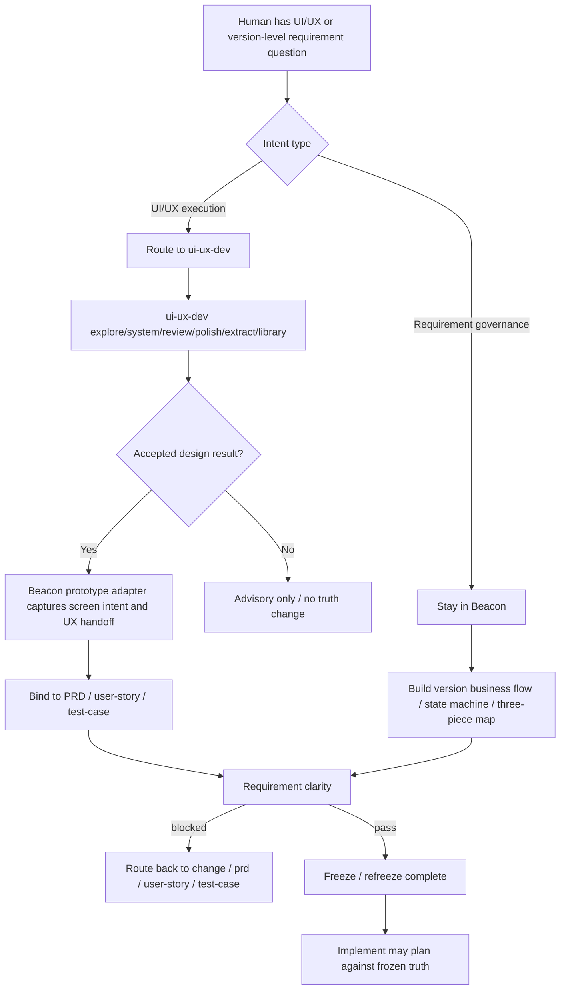
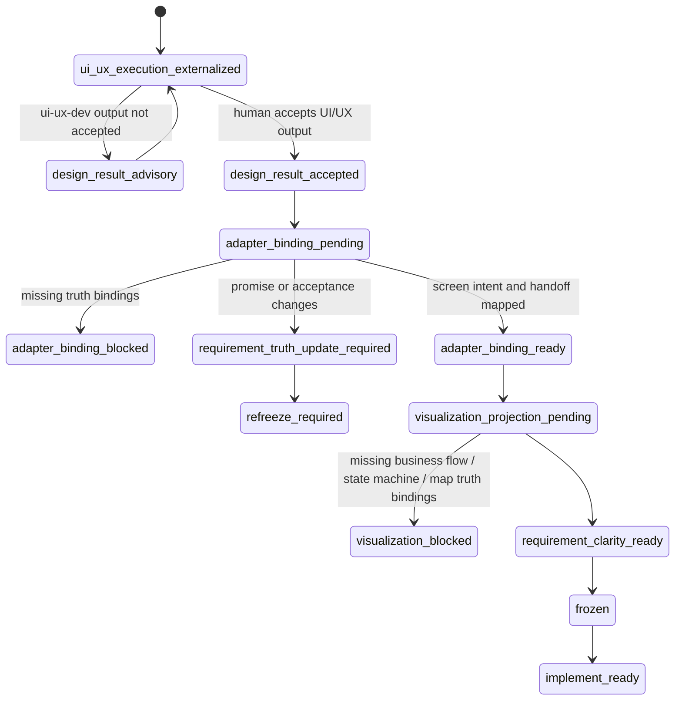
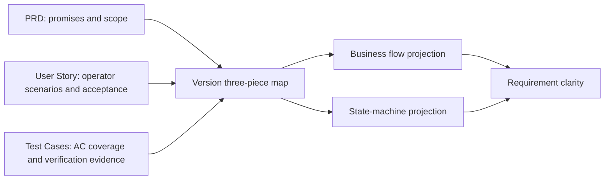

# Research: UI/UX 外部化、Prototype Adapter 与版本级需求可视化契约

**Feature**: `ui-ux-externalization-prototype-adapter-and-version-visualization-contract`
**Version**: `v1.4.9`
**Status**: `freeze-input`
**Date**: `2026-05-21`

## 1. 背景

Beacon v1.4.8 已恢复强 gate、Markdown-first truth、execution host 严肃性和人类面子 skill material effect 契约。

剩余的演进问题是：Beacon 内部仍保留一套较重的 `prototype` / design 能力，但实际使用体验不好，且与独立的 `ui-ux-dev` UI/UX 工作流包重复。继续扩张 Beacon 内建 UI/UX 执行能力，会让 Beacon 偏离自己的核心身份。

本研究收敛为：

> UI/UX execution 应外部化到 `ui-ux-dev`；Beacon 保留需求治理、设计结果适配和版本级人类可读需求投影。

## 2. Source Anchors

- `docs/beacon/v1.4.7/research/beacon-vnext-ui-ux-externalization-and-version-requirement-visualization-analysis.md`
- `docs/beacon/v1.4.8/research/beacon-vnext-business-flow-and-state-machine-document-design.md`
- `docs/beacon/v1.4.8/research/beacon-v1.4.8-human-subskill-material-closure-and-gate-contract.md`
- `/Users/apple/Developer/Personal/products/justin-mc-lai-skills/skills/ui-ux-dev/SKILL.md`
- `/Users/apple/Developer/Personal/products/justin-mc-lai-skills/skills/ui-ux-dev/references/routing-contract.md`
- `/Users/apple/Developer/Personal/products/justin-mc-lai-skills/skills/ui-ux-dev/references/upstream-compatibility.md`
- `skills/beacon/beacon-prototype/SKILL.md`
- `skills/beacon/beacon-design-review/SKILL.md`
- `beacon/commands/prototype.py`
- `beacon/utils/prototype_utils.py`
- `beacon/utils/prototype_support.py`
- `beacon/cli_factory.py`
- `beacon/command_catalog.py`

## 3. 问题

当前 Beacon 在 UI/UX 相关方向存在三个问题。

### 3.1 能力边界重复

`ui-ux-dev` 已经定义了稳定的六类 UI/UX intent：

- `explore`
- `system`
- `review`
- `polish`
- `extract`
- `library`

这些 intent 分别路由到 `vibe-to-ui`、`ui-ux-pro-max`、`impeccable` 和 `awesome-design-md` reference library。Beacon 继续维护类似的设计执行面，会产生重复维护、重复路由和人类入口混乱。

### 3.2 Beacon 的核心价值不在 UI 生成

Beacon 的不可替代价值是：

- 冻结 requirement truth
- 保持 change / refreeze 可审计
- 阻断 truth drift 和 execution drift
- 维护 implement / QA / release evidence closure
- 让人类面 skill 调用产生 material effect

它不应该变成完整 UI/UX design execution toolbox。

### 3.3 版本级人类理解面仍不足

PRD、user-story、test-case 三件套适合承载 truth，但不适合让人类快速理解一个版本的业务闭环。人类需要更板正、更少文字、更稳定的版本级 projection：

- business flow
- state machine
- PRD / user-story / test-case map

这些投影必须绑定 truth，否则只是说明图。

## 4. Architecture

本次冻结改变 Beacon 的责任边界，不改变具体 UI 渲染栈。

```text
Human UI/UX intent
-> ui-ux-dev execution router
-> upstream UI/UX skill or design reference workflow
-> accepted design result
-> Beacon prototype adapter
-> PRD / user-story / test-case truth bindings
-> requirement clarity gate
-> freeze / refreeze
```

责任边界必须保持清晰：

- `ui-ux-dev` owns UI/UX execution。
- Beacon owns requirement truth、gate、adapter binding、evidence closure。
- `prototype` owns accepted design result 的 requirement-facing adapter，不拥有设计生成。
- `beacon-design-review` owns route / governance support，不拥有 UI/UX execution verdict。
- version-level visualization owns human-readable projection，不拥有 canonical truth。

### 4.1 Component Ownership

| Component | Owns | Does Not Own |
| --- | --- | --- |
| `ui-ux-dev` | exploration, system recommendation, review, polish, extract, library lookup | Beacon lifecycle, gate verdict, requirement truth |
| Beacon prototype adapter | accepted design result intake, screen intent, state visibility, interaction handoff, truth binding diagnostics | design exploration, design-system choice, visual polish, high-fidelity generation |
| Beacon requirement truth | PRD promises, user-story acceptance, test-case coverage | UI appearance generation, screenshot extraction |
| Version visualization projections | business flow, stable closure state machine, PRD/user-story/test-case map | canonical promise, acceptance criteria, executable test truth |

### 4.2 Required Closure Path

```text
accepted UI/UX result
-> adapter binding required
-> truth delta classified
-> PRD / user-story / test-case updated or obligation opened
-> requirement clarity validates sections and AC coverage
-> freeze/refreeze may close
```

If any step is missing, Beacon must block rather than silently treating the design output as advisory truth.

## 5. 决策

### 5.1 UI/UX execution 移出 Beacon

Beacon 不再新增或强化以下内部能力：

- UI/UX exploration
- design-system recommendation
- screen review
- visual polish
- screenshot extraction
- design reference library lookup
- high-fidelity design generation

这些能力统一通过 `ui-ux-dev` 路由。

### 5.2 Prototype 降级为 design-result adapter

`prototype` 不再定义为设计生成面。

新定义：

```text
prototype = design-result adapter
```

它只负责把已接受的 UI/UX 输出转成 Beacon requirement-facing material：

- screen intent
- page / flow outline
- state visibility contract
- interaction handoff
- PRD promise mapping
- user-story acceptance mapping
- test-case coverage mapping
- truth binding diagnostics

### 5.3 Design review 降级为 route / governance support

`beacon-design-review` 不再承担 UI/UX 评审执行能力。它只判断：

- 是否应路由到 `ui-ux-dev review`
- 是否需要 `ui-ux-dev polish`
- 是否发现 requirement truth drift
- 是否需要 `beacon-change`
- 是否需要打开 material obligation

### 5.4 版本级需求可视化进入冻结契约

Beacon v1.4.9 应冻结三类版本级人类可读 projection：

- business flow projection
- state-machine projection
- PRD / user-story / test-case map projection

它们只服务理解与对齐，不替代 canonical truth。

## 6. Business Flow



该流程只表达业务闭环和材料闭环，不表达实现模块调用顺序。

## 7. State Machine



稳定状态只表达 requirement closure，不表达页面 widget 状态。

## 8. PRD / User Story / Test Case Map



该投影只说明三件套 truth 的拥有关系和版本理解入口：

- PRD owns product promise, scope, non-goals, functional requirements, acceptance criteria IDs。
- User story owns operator intent, scenarios, acceptance criteria continuity。
- Test-case owns AC-to-test mapping, verification layer, evidence expectation。
- Map projection owns traceability only; it cannot add new requirements。

Truth bindings:

- `prd_refs`: `docs/beacon/archive/v1.4.9/prd/ui-ux-externalization-prototype-adapter-and-version-visualization-contract.md`
- `user_story_refs`: `docs/beacon/archive/v1.4.9/user-story/ui-ux-externalization-prototype-adapter-and-version-visualization-contract.md`
- `test_case_refs`: `docs/beacon/archive/v1.4.9/qa/test-cases/ui-ux-externalization-prototype-adapter-and-version-visualization-contract.md`
- `coverage_notes`: AC-001 through AC-012 are mapped in the test-case coverage matrix。
- `out_of_scope_notes`: the map cannot replace PRD, user-story, or test-case truth。

## 9. Decision Priority

1. Beacon requirement truth 高于设计输出。
2. `ui-ux-dev` 负责 UI/UX execution，Beacon 负责 governance。
3. Accepted design result 必须进入 adapter binding，否则不能解锁 implementation。
4. Business flow / state-machine / map 是 projection，不是 canonical truth。
5. 没有 truth bindings 的图不算 freeze-facing projection。
6. Historical prototype bundles 可兼容读取，但新版本不得继续把 Beacon 当设计生成器。

## 10. Truth Bindings

本研究绑定以下 truth 输入：

- PRD refs:
  - `docs/beacon/archive/v1.4.9/prd/ui-ux-externalization-prototype-adapter-and-version-visualization-contract.md`
- User story refs:
  - `docs/beacon/archive/v1.4.9/user-story/ui-ux-externalization-prototype-adapter-and-version-visualization-contract.md`
- Test case refs:
  - `docs/beacon/archive/v1.4.9/qa/test-cases/ui-ux-externalization-prototype-adapter-and-version-visualization-contract.md`
- Upstream research refs:
  - `docs/beacon/v1.4.7/research/beacon-vnext-ui-ux-externalization-and-version-requirement-visualization-analysis.md`
  - `docs/beacon/v1.4.8/research/beacon-vnext-business-flow-and-state-machine-document-design.md`

Coverage notes:

- UI/UX execution ownership is covered by AC-001 through AC-003.
- Prototype adapter behavior is covered by AC-004 through AC-006.
- Version-level visualization is covered by AC-007 through AC-010.
- Migration and compatibility are covered by AC-011 and AC-012.

Out-of-scope notes:

- This research does not implement code removal.
- This research does not define production visual quality standards.
- This research does not make `ui-ux-dev` a Beacon lifecycle stage.

## 11. 结论

v1.4.9 应冻结为一条治理收敛 feature：

- UI/UX execution 外部化
- Prototype adapter 化
- Design review route 化
- Version-level visualization truth binding 化

这能保留 Beacon 的 requirement governance 强项，同时减少内部设计执行冗余。

## Deep Summary

- source_skill: `beacon-deep`
- deep_artifact_root: `docs/beacon/archive/v1.4.9/deep/ui-ux-externalization-prototype-adapter-and-version-visualization-contract`
- machine_deep_artifact_root: `docs/beacon/archive/v1.4.9/.machine/deep/ui-ux-externalization-prototype-adapter-and-version-visualization-contract`
- indexed_artifacts:
  - `deep-analysis-report.md`
  - `state-machine-report.md`
  - `risk-register.md`
  - `deep-test-delta.md`
  - `deep-closure-brief.md`
- policy: research keeps the deep index only; detailed deep findings stay under `deep/<feature>/`.
