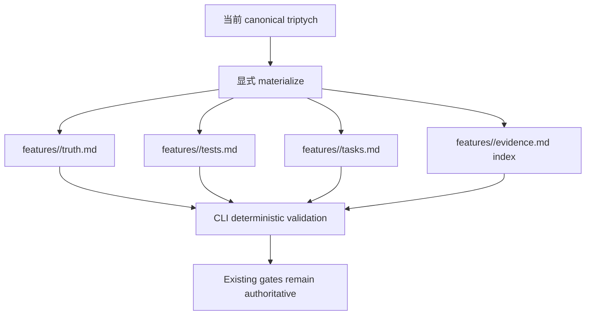

# Feature: beacon-v1.5.0-parallel-plan-b-document-capability

## Overview

This feature package is a v1.5.0 parallel read model. Canonical requirement truth remains in PRD, user-story, test-case, execution, and `.machine` surfaces.

## Canonical References

- PRD: `docs/beacon/archive/v1.5.0/prd/beacon-v1.5.0-parallel-plan-b-document-capability.md`
- User Story: `docs/beacon/archive/v1.5.0/user-story/beacon-v1.5.0-parallel-plan-b-document-capability.md`
- Test Case: `docs/beacon/archive/v1.5.0/qa/test-cases/beacon-v1.5.0-parallel-plan-b-document-capability.md`

## Acceptance Criteria

| AC ID | Theme | Description |
|-------|-------|-------------|
| AC-001 | parallel-package | v1.5.0 支持 `features/<slug>/{truth,tests,tasks,evidence}.md` 并行文档包。 |
| AC-002 | old-chain-preserved | 现有 `prd`、`user-story`、`qa/test-cases`、`execution`、`.machine` surfaces 保持 canonical 和 operational。 |
| AC-003 | cli-preserved | 旧 CLI commands 保持可用，不能变成 removed-command failure。 |
| AC-004 | evidence-index | `features/<slug>/evidence.md` 是 index/read model，不是 final verdict authority。 |
| AC-005 | support-boundary | Deep 和 CEO review 仍是 advisory support surfaces。 |
| AC-006 | gate-boundary | QA verdict 和 release readiness 保持在现有 gate/release authority surfaces。 |
| AC-007 | authority-labels | Evidence index rows 明确区分 `support_advisory`、`qa_verdict`、`release_verdict`。 |
| AC-008 | drift-check | Feature-centric files 与 canonical triptych 的 drift 可检测且不能 silent pass。 |
| AC-009 | global-boundary-preserved | v1.5.0 不削弱 canonical projection 或 transaction consistency。 |
| AC-010 | retirement-deferred | 旧体系退役推迟到 v1.6+ 真实项目验证后。 |
| AC-011 | truth-frontmatter | `features/<slug>/truth.md` 包含 YAML frontmatter，且仅作为 parallel metadata，不替代 `.machine`。 |
| AC-012 | checkbox-ledger | `features/<slug>/tasks.md` 包含 checkbox task rows，但 checkbox 不能绕过 implement 或 QA gates。 |
| AC-013 | deterministic-parser | CLI validation 确定性读取 frontmatter、AC tables、checkbox rows、evidence authority labels。 |
| AC-014 | llm-write-boundary | LLM 可以写 markdown 正文和 checklist rows，但 lifecycle state 只能在 CLI validation 后推进。 |
| AC-015 | evidence-no-gate-truth | `features/<slug>/evidence.md` 继续是 index/read model，不承载 gate truth。 |
| AC-016 | skill-template-examples | Beacon skills 提供 compact LLM-readable templates，覆盖有效 `truth.md`、`tests.md`、`tasks.md`、`evidence.md`。 |

## Source Excerpt

```markdown
# PRD: Beacon v1.5.0 Parallel Plan B Document Capability

**Feature**: `beacon-v1.5.0-parallel-plan-b-document-capability`
**Version**: `v1.5.0`
**Status**: `frozen`
**Date**: `2026-06-01`
**Language**: `zh`

## Overview

Beacon v1.5.0 上线 `features/<slug>/{truth,tests,tasks,evidence}.md` feature-centric 整体文档包。该能力以并行/read-model 形式存在，目的是提升单 feature 的整体可读性、可校验性和未来迁移准备，不退役现有 PRD、user-story、test-case、execution、`.machine` truth/gate surfaces。

## Outline



## Context

- 全局边界：`docs/beacon/global-boundaries.md`
- 来源调研：`docs/beacon/research/beacon-harness-evolution-full-analysis.md`
- 执行调研：`docs/beacon/research/beacon-v150-redesign-plan-b-execution.md`
- 收敛结论：v1.5.0 上线新整体文档能力；v1.6+ 才能在真实项目验证后讨论旧体系退役。

## Problem

原 Plan B 正确识别了重复 truth、分散投影、隐式 planning 和生成路径分散等问题。但异常分支试图一次性替换旧体系，导致 boundary sprawl、support surface 被误看成 gate truth、迁移成本过高。

## Goals

- AC-001: v1.5.0 支持 `features/<slug>/{truth,tests,tasks,evidence}.md` 并行文档包。
- AC-002: v1.5.0 保留现有 `prd`、`user-story`、`test-case`、`execution`、`.machine` 作为 canonical stable chain。
- AC-003: 现有 PRD、user-story、test-case、prototype、QA、release、support review CLI 和 skill 保持可用。
- AC-004: `features/<slug>/evidence.md` 只是 index/read model，不成为 deep、CEO review、QA verdict 或 release readiness truth。
- AC-005: Deep 和 CEO review 保持 support/advisory surface，不能替代 truth、QA 或 release gate。
- AC-006: QA verdict 和 release readiness 继续由现有 gate/release surfaces 决定。
- AC-007: Feature package 必须暴露 authority labels 和 source artifact refs。
- AC-008: Feature-centric docs 与 canonical triptych 漂移时必须阻断或显式告警，不能静默通过。
- AC-009: v1.5.0 不削弱 `global-boundaries.md` 中 canonical projection 与 transaction consistency 原则。
- AC-010: 旧体系退役不属于 v1.5.0，必须推迟到 v1.6+ 并经过真实项目验证。
- AC-011: `features/<slug>/truth.md` 必须包含 YAML frontmatter，但该 frontmatter 在 v1.5.0 中只是 parallel/read-model metadata，不替代 `.machine`。
- AC-012: `features/<slug>/tasks.md` 必须包含 checkbox task ledger，但 checkbox 不能绕过 implement 或 QA gate。
- AC-013: CLI 必须确定性解析/校验 frontmatter、AC table、checkbox rows、evidence authority labels。
- AC-014: LLM 可以写 markdown 正文和 checklist rows，但 lifecycle state advancement 必须经 CLI validation。
- AC-015: `features/<slug>/evidence.md` 继续是 index/read model，不能承载 gate truth。
- AC-016: 操作 feature package 的 Beacon skills 必须提供 LLM 可读的快速模板示例。

## Design Principles

- 先并行上线，再基于真实项目验证讨论迁移。
- 新文档提升可读性，但不静默改变 gate authority。
- Support surfaces 即使被索引，也仍是 advisory。
- Canonical truth、verdict authority 和 evidence refs 必须可追溯。
- Backward compatibility 是安全边界，不是礼貌性兼容。

## Scope

### In Scope

- 生成/校验 `features/<slug>/truth.md`、`tests.md`、`tasks.md`、`evidence.md`。
- `truth.md` YAML frontmatter：`slug`、`version`、`status`、`language`、`canonical_refs`、`parser_contract`。
- `tasks.md` checkbox task ledger。
- `evidence.md` authority-labeled index。
- CLI deterministic parser/validator。
- Drift check 与 explicit diagnostics。
- Skill quick templates。
- 旧 CLI/skill 保持可用。

### Out of Scope

- 删除 `beacon prd`、`beacon user-story`、`beacon test-case`、`beacon prototype`。
- 删除 `beacon-prd`、`beacon-user-story`、`beacon-test-case` 或 review skills。
- 删除 `.machine` 或把所有 state 迁到 frontmatter。
- 让 `evidence.md` 成为 QA verdict 或 release readiness truth。
- 让 checkbox-only 完成 implement、QA 或 release gates。
- v1.5.0 内退役旧布局。

## Functional Requirements

| FR ID | Related AC | Requirement |
|-------|------------|-------------|
| FR-001 | AC-001 | 提供生成 `docs/beacon/<version>/features/<slug>/truth.md` 的能力，且不删除旧 triptych。 |
| FR-002 | AC-001 | 从 canonical AC 数据生成 `features/<slug>/tests.md`。 |
| FR-003 | AC-001 | 生成 `features/<slug>/tasks.md` 作为 task ledger/read model。 |
| FR-004 | AC-004 | 生成 `features/<slug>/evidence.md`，仅作为带 authority labels 的索引。 |
```
