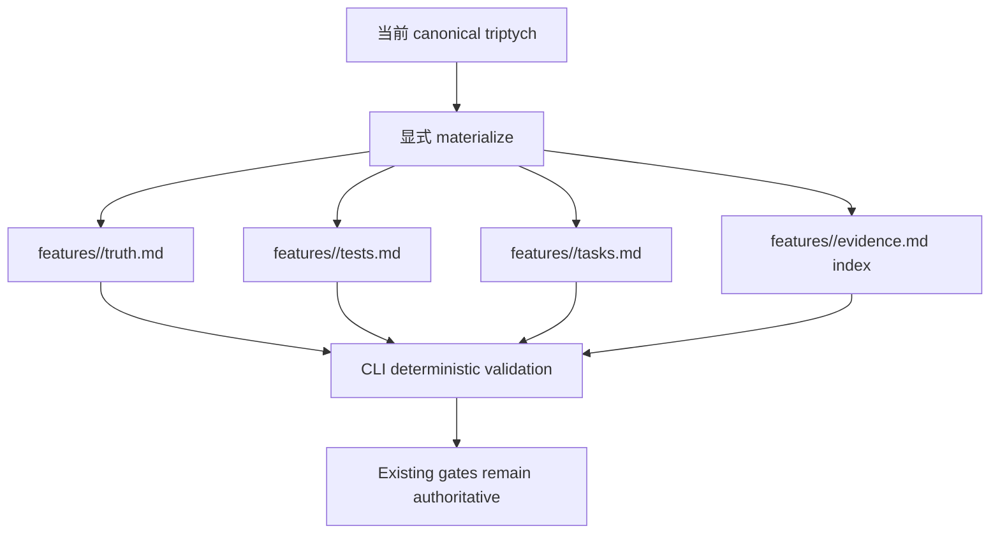
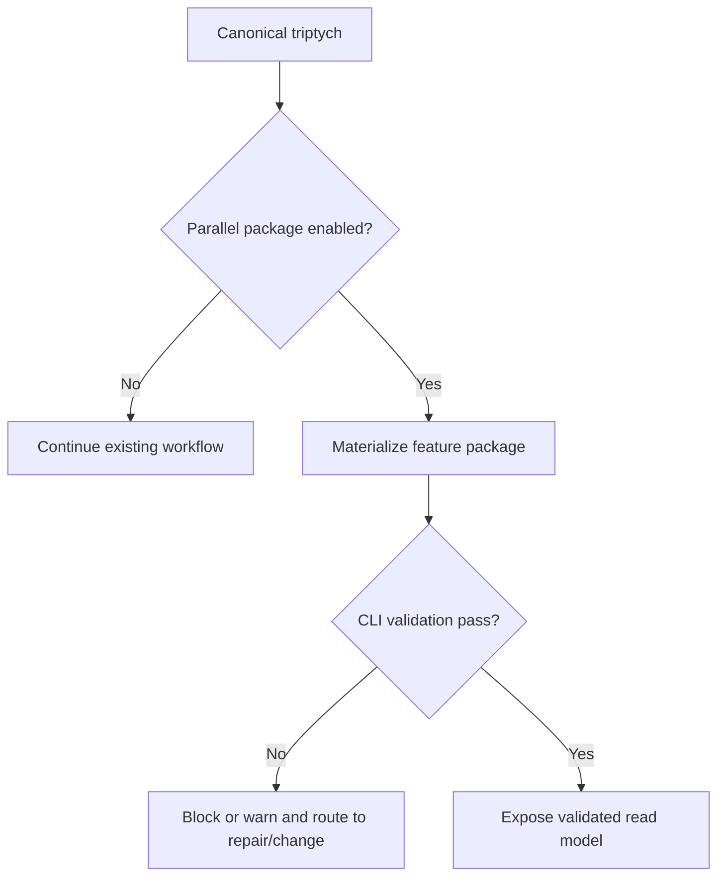
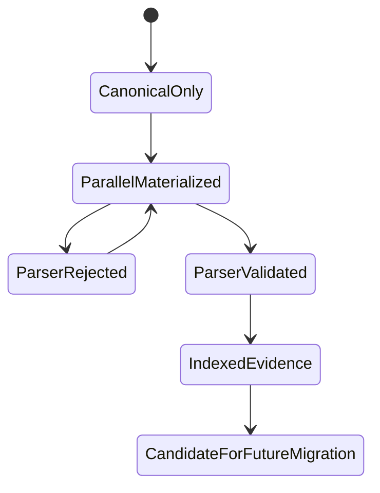

# PRD: Beacon v1.5.0 Parallel Plan B Document Capability

**Feature**: `beacon-v1.5.0-parallel-plan-b-document-capability`
**Version**: `v1.5.0`
**Status**: `frozen`
**Date**: `2026-06-01`
**Language**: `zh`

## Overview

Beacon v1.5.0 上线 `features/<slug>/{truth,tests,tasks,evidence}.md` feature-centric 整体文档包。该能力以并行/read-model 形式存在，目的是提升单 feature 的整体可读性、可校验性和未来迁移准备，不退役现有 PRD、user-story、test-case、execution、`.machine` truth/gate surfaces。

## Outline

## Context

- 全局边界：`docs/beacon/global-boundaries.md`
- 来源调研：`docs/beacon/research/beacon-harness-evolution-full-analysis.md`
- 执行调研：`docs/beacon/research/beacon-v150-redesign-plan-b-execution.md`
- 收敛结论：v1.5.0 上线新整体文档能力；v1.6+ 才能在真实项目验证后讨论旧体系退役。

## Problem

原 Plan B 正确识别了重复 truth、分散投影、隐式 planning 和生成路径分散等问题。但异常分支试图一次性替换旧体系，导致 boundary sprawl、support surface 被误看成 gate truth、迁移成本过高。

## Goals

- AC-001: v1.5.0 支持 `features/<slug>/{truth,tests,tasks,evidence}.md` 并行文档包。
- AC-002: v1.5.0 保留现有 `prd`、`user-story`、`test-case`、`execution`、`.machine` 作为 canonical stable chain。
- AC-003: 现有 PRD、user-story、test-case、prototype、QA、release、support review CLI 和 skill 保持可用。
- AC-004: `features/<slug>/evidence.md` 只是 index/read model，不成为 deep、CEO review、QA verdict 或 release readiness truth。
- AC-005: Deep 和 CEO review 保持 support/advisory surface，不能替代 truth、QA 或 release gate。
- AC-006: QA verdict 和 release readiness 继续由现有 gate/release surfaces 决定。
- AC-007: Feature package 必须暴露 authority labels 和 source artifact refs。
- AC-008: Feature-centric docs 与 canonical triptych 漂移时必须阻断或显式告警，不能静默通过。
- AC-009: v1.5.0 不削弱 `global-boundaries.md` 中 canonical projection 与 transaction consistency 原则。
- AC-010: 旧体系退役不属于 v1.5.0，必须推迟到 v1.6+ 并经过真实项目验证。
- AC-011: `features/<slug>/truth.md` 必须包含 YAML frontmatter，但该 frontmatter 在 v1.5.0 中只是 parallel/read-model metadata，不替代 `.machine`。
- AC-012: `features/<slug>/tasks.md` 必须包含 checkbox task ledger，但 checkbox 不能绕过 implement 或 QA gate。
- AC-013: CLI 必须确定性解析/校验 frontmatter、AC table、checkbox rows、evidence authority labels。
- AC-014: LLM 可以写 markdown 正文和 checklist rows，但 lifecycle state advancement 必须经 CLI validation。
- AC-015: `features/<slug>/evidence.md` 继续是 index/read model，不能承载 gate truth。
- AC-016: 操作 feature package 的 Beacon skills 必须提供 LLM 可读的快速模板示例。

## Design Principles

- 先并行上线，再基于真实项目验证讨论迁移。
- 新文档提升可读性，但不静默改变 gate authority。
- Support surfaces 即使被索引，也仍是 advisory。
- Canonical truth、verdict authority 和 evidence refs 必须可追溯。
- Backward compatibility 是安全边界，不是礼貌性兼容。

## Scope

### In Scope

- 生成/校验 `features/<slug>/truth.md`、`tests.md`、`tasks.md`、`evidence.md`。
- `truth.md` YAML frontmatter：`slug`、`version`、`status`、`language`、`canonical_refs`、`parser_contract`。
- `tasks.md` checkbox task ledger。
- `evidence.md` authority-labeled index。
- CLI deterministic parser/validator。
- Drift check 与 explicit diagnostics。
- Skill quick templates。
- 旧 CLI/skill 保持可用。

### Out of Scope

- 删除 `beacon prd`、`beacon user-story`、`beacon test-case`、`beacon prototype`。
- 删除 `beacon-prd`、`beacon-user-story`、`beacon-test-case` 或 review skills。
- 删除 `.machine` 或把所有 state 迁到 frontmatter。
- 让 `evidence.md` 成为 QA verdict 或 release readiness truth。
- 让 checkbox-only 完成 implement、QA 或 release gates。
- v1.5.0 内退役旧布局。

## Functional Requirements

| FR ID | Related AC | Requirement |
|-------|------------|-------------|
| FR-001 | AC-001 | 提供生成 `docs/beacon/<version>/features/<slug>/truth.md` 的能力，且不删除旧 triptych。 |
| FR-002 | AC-001 | 从 canonical AC 数据生成 `features/<slug>/tests.md`。 |
| FR-003 | AC-001 | 生成 `features/<slug>/tasks.md` 作为 task ledger/read model。 |
| FR-004 | AC-004 | 生成 `features/<slug>/evidence.md`，仅作为带 authority labels 的索引。 |
| FR-005 | AC-002 | 现有 PRD、user-story、test-case、execution、`.machine` 路径保持可读写和 canonical。 |
| FR-006 | AC-003 | 旧 CLI 命令继续存在，不能变成失败 alias。 |
| FR-007 | AC-005 | Deep 和 CEO review 输出保留 support advisory authority。 |
| FR-008 | AC-006 | QA verdict 和 release readiness 继续由现有 surfaces 决定。 |
| FR-009 | AC-007 | Evidence index rows 必须包含 `surface`、`authority`、`canonical_artifact`、`status`、`route`。 |
| FR-010 | AC-008 | Drift detection 必须比较 feature package 与 canonical PRD/user-story/test-case。 |
| FR-011 | AC-009 | 不削弱 global boundary 中的 canonical / transaction consistency。 |
| FR-012 | AC-010 | 任何旧体系退役必须推迟到后续版本。 |
| FR-013 | AC-011 | `truth.md` frontmatter 必须包含 `slug`、`version`、`status`、`language`、`canonical_refs`、`parser_contract`。 |
| FR-014 | AC-012 | `tasks.md` 必须包含稳定 task id 和 checkbox markers。 |
| FR-015 | AC-013 | CLI 必须在接受 package state 前校验 frontmatter、AC table、checkbox、evidence labels。 |
| FR-016 | AC-014 | LLM-authored markdown 未通过 CLI validator 时不得推进 lifecycle state。 |
| FR-017 | AC-015 | `evidence.md` 必须拒绝或标记 gate-truth fields。 |
| FR-018 | AC-016 | 相关 skills 必须提供 parser-compatible quick templates。 |

## State Axes

| Axis | States | Meaning |
|------|--------|---------|
| package_state | absent, materialized, aligned, drift_detected | 并行 feature package 生命周期。 |
| canonical_chain | existing, preserved, blocked | 旧 triptych 是否保持可用和 authoritative。 |
| evidence_authority | index_only, advisory, qa_verdict, release_verdict | evidence index 中的 authority label。 |
| migration_state | candidate, deferred, future_validation | 旧体系退役是否只是未来候选。 |
| llm_write_state | draft_md, cli_validated, rejected | LLM-authored markdown 是否通过 deterministic validation。 |
| checkbox_state | unchecked, checked, blocked, ignored_by_gate | v1.5.0 如何解释 task ledger rows。 |

## Diagram Truth Layer

### Diagram Types

- `branch-flow`
- `state-machine`
- `decision-priority`

### State Axes

- `package_state`
- `canonical_chain`
- `evidence_authority`
- `migration_state`
- `llm_write_state`
- `checkbox_state`

### Branch Flow

### State Machine

### Decision Priority

1. Canonical triptych 和现有 gate outputs 优先于 parallel package。
2. `evidence.md` 必须保留 authority labels。
3. Support advisory rows 不能变成 gate verdict rows。
4. CLI validation 是 LLM-authored markdown 影响 lifecycle state 前的必要条件。
5. Checkbox rows 只是 task-ledger inputs。
6. 未来迁移必须有真实项目验证。

### Propagation Contract

- User-story AC 必须保留 package、canonical-chain、evidence-authority、migration、llm-write、checkbox 状态轴。
- Test cases 必须覆盖 enabled / disabled 分支、parser validation、checkbox no-bypass、evidence no-gate-truth。
- Implementation 不能删除或隐藏旧 canonical surfaces。

## OpenSpec Bounded Contract

v1.5.0 采用 OpenSpec reference 的 bounded subset，而不是 full canonical rewrite。

### `truth.md` Frontmatter

Required fields:

- `slug`
- `version`
- `status`
- `language`
- `canonical_refs`
- `parser_contract`

该 frontmatter 是 parallel package metadata，不替代 `.machine`、revision state、requirement clarity、QA matrices 或 release readiness。

### `tasks.md` Checkbox Ledger

`tasks.md` 使用稳定 task id 和 checkbox markers。v1.5.0 中这些 rows 是 readable execution ledger 或 explicit opt-in parser input，不能单独把 implement、QA 或 release 标记为完成。

### Deterministic CLI Parser

CLI 必须解析和校验：

- `truth.md` YAML frontmatter
- `truth.md` acceptance-criteria table
- `tasks.md` checkbox task rows
- `evidence.md` authority labels

### LLM Write Boundary

LLM 可以写 markdown 内容、示例、AC rows 和 checklist rows。Lifecycle state changes 必须经 CLI validation 和现有 gate surfaces。

### Skill Template Boundary

写入 `features/<slug>/` 的 Beacon skills 必须提供 compact templates。模板帮助 LLM 写出 parser-compatible material，但不成为新的 truth source。

## Authority Model

| Surface | v1.5.0 Authority | Canonical Status |
|---------|------------------|------------------|
| PRD | requirement truth | canonical |
| User Story | acceptance truth | canonical |
| Test Case | test truth | canonical |
| `features/<slug>/truth.md` | parallel/read-model metadata | non-retiring |
| `features/<slug>/tests.md` | parallel/read-model test view | non-retiring |
| `features/<slug>/tasks.md` | task ledger/read model | non-retiring |
| `features/<slug>/evidence.md` | evidence index | not a verdict source |
| Deep | support advisory | unchanged |
| CEO Review | support advisory | unchanged |
| QA Verdict | QA gate verdict | unchanged |
| Release Readiness | release verdict | unchanged |

## Acceptance Criteria

- AC-001: v1.5.0 feature 可以 materialize 四个 package 文件。
- AC-002: 旧 triptych 保持 canonical 和可用。
- AC-003: 旧 CLI 与 skill surfaces 保持可发现、可执行。
- AC-004: `evidence.md` 只索引 canonical artifacts，不声明 final verdict authority。
- AC-005: Deep 和 CEO review 仍是 advisory support surfaces。
- AC-006: QA verdict 和 release readiness 保持在现有 gate/release surfaces。
- AC-007: Evidence index rows 包含 authority labels。
- AC-008: Parallel package 与 canonical triptych 的 drift 可检测并阻断或告警。
- AC-009: Global boundary canonical / transaction principles 保持完整。
- AC-010: 旧体系退役推迟到 v1.6+。
- AC-011: `truth.md` frontmatter 存在，且只是 parallel metadata。
- AC-012: `tasks.md` checkbox 不能绕过 implement 或 QA gates。
- AC-013: CLI parser/validator 确定性读取 package contract fields。
- AC-014: LLM-authored markdown 需要 CLI validation 后才能影响状态。
- AC-015: `evidence.md` 不能承载 gate-truth fields。
- AC-016: Skills 提供 parser-compatible quick templates。

## Non-Goals

- 不做 full Plan B replacement。
- 不删除旧 CLI 或旧 skills。
- 不删除 `.machine`。
- 不把 deep/CEO/QA/release authority 合并进 `evidence.md`。
- 不允许 LLM 直接改 lifecycle state。
- 不允许 checkbox-only 完成 implement、QA 或 release gates。

## Success Metrics

- 现有 v1.4.13 workflow 继续运行。
- 示例 v1.5.0 feature package 可 materialize 且 validate pass。
- Evidence index 区分 `support_advisory`、`qa_verdict`、`release_verdict`。
- 无 release gate 使用 support advisory output 作为 final truth。
- invalid frontmatter、malformed checkbox、缺失 evidence authority labels 会产生 deterministic diagnostics。
- LLM quick templates 可生成通过 parser validation 的 package。
