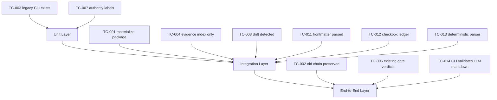

# Test Cases: Beacon v1.5.0 Parallel Plan B Document Capability

**Feature**: `beacon-v1.5.0-parallel-plan-b-document-capability`
**Version**: `v1.5.0`
**Status**: `frozen`
**Date**: `2026-06-01`
**Language**: `zh`

## Outline

## Coverage Matrix

| AC ID | TC ID | Layer | Planned Command | Assertion | Evidence Path |
|-------|-------|-------|-----------------|-----------|---------------|
| AC-001 | TC-001 | integration | `python3 -m pytest tests/test_v150_feature_package.py::test_materialize_feature_package_should_create_parallel_package_without_machine_replacement -q --junitxml "$BEACON_JUNIT_PATH"` | 创建 `features/<slug>/truth.md`、`tests.md`、`tasks.md`、`evidence.md`，不删除 triptych。 | `.beacon/evidence/qa-feature/beacon-v1.5.0-parallel-plan-b-document-capability/tc-001/__RUN_ID__.json` |
| AC-002 | TC-002 | contract | `python3 -m pytest tests/test_v150_feature_package.py::test_current_v150_materials_should_preserve_canonical_chain -q --junitxml "$BEACON_JUNIT_PATH"` | Freeze 和 package validation 仍绑定 canonical PRD、user-story、test-case chain。 | `.beacon/evidence/qa-feature/beacon-v1.5.0-parallel-plan-b-document-capability/tc-002/__RUN_ID__.json` |
| AC-003 | TC-003 | unit | `python3 -m pytest tests/test_v150_feature_package.py::test_legacy_cli_surfaces_should_remain_available -q --junitxml "$BEACON_JUNIT_PATH"` | 旧命令存在并返回 help。 | `.beacon/evidence/qa-feature/beacon-v1.5.0-parallel-plan-b-document-capability/tc-003/__RUN_ID__.json` |
| AC-004 | TC-004 | integration | `python3 -m pytest tests/test_v150_feature_package.py::test_current_v150_package_should_keep_evidence_index_read_model_only -q --junitxml "$BEACON_JUNIT_PATH"` | 文件包含 canonical artifact links 且无 final verdict field。 | `.beacon/evidence/qa-feature/beacon-v1.5.0-parallel-plan-b-document-capability/tc-004/__RUN_ID__.json` |
| AC-005 | TC-005 | integration | `python3 -m pytest tests/test_v150_feature_package.py::test_current_v150_package_should_keep_support_surfaces_advisory -q --junitxml "$BEACON_JUNIT_PATH"` | Support rows 被标记为 `support_advisory`，不能成为 gate truth。 | `.beacon/evidence/qa-feature/beacon-v1.5.0-parallel-plan-b-document-capability/tc-005/__RUN_ID__.json` |
| AC-006 | TC-006 | contract | `python3 -m pytest tests/test_v150_feature_package.py::test_current_v150_release_authority_should_remain_on_canonical_surfaces -q --junitxml "$BEACON_JUNIT_PATH"` | QA/release verdicts 从现有 canonical outputs 读取。 | `.beacon/evidence/qa-feature/beacon-v1.5.0-parallel-plan-b-document-capability/tc-006/__RUN_ID__.json` |
| AC-007 | TC-007 | unit | `python3 -m pytest tests/test_v150_feature_package.py::test_current_v150_package_should_keep_evidence_index_read_model_only -q --junitxml "$BEACON_JUNIT_PATH"` | Index 包含 `Surface`、`Authority`、`Canonical Artifact`、`Status`、`Route` columns。 | `.beacon/evidence/qa-feature/beacon-v1.5.0-parallel-plan-b-document-capability/tc-007/__RUN_ID__.json` |
| AC-008 | TC-008 | integration | `python3 -m pytest tests/test_v150_feature_package.py::test_validate_feature_package_should_reject_gate_truth_and_malformed_checkbox -q --junitxml "$BEACON_JUNIT_PATH"` | Drift 或 malformed package diagnostics 返回 blocked，不 silent pass。 | `.beacon/evidence/qa-feature/beacon-v1.5.0-parallel-plan-b-document-capability/tc-008/__RUN_ID__.json` |
| AC-009 | TC-009 | unit | `python3 -m pytest tests/test_v150_feature_package.py::test_current_v150_materials_should_preserve_canonical_chain -q --junitxml "$BEACON_JUNIT_PATH"` | Canonical projection 与 transaction consistency 未削弱。 | `.beacon/evidence/qa-feature/beacon-v1.5.0-parallel-plan-b-document-capability/tc-009/__RUN_ID__.json` |
| AC-010 | TC-010 | contract | `python3 -m pytest tests/test_v150_feature_package.py::test_current_v150_release_authority_should_remain_on_canonical_surfaces -q --junitxml "$BEACON_JUNIT_PATH"` | 旧体系退役不属于 v1.5.0，旧 surfaces 保持可用。 | `.beacon/evidence/qa-feature/beacon-v1.5.0-parallel-plan-b-document-capability/tc-010/__RUN_ID__.json` |
| AC-011 | TC-011 | integration | `python3 -m pytest tests/test_v150_feature_package.py::test_current_v150_feature_package_validation_should_pass -q --junitxml "$BEACON_JUNIT_PATH"` | YAML frontmatter 包含 required fields，且被报告为 parallel metadata。 | `.beacon/evidence/qa-feature/beacon-v1.5.0-parallel-plan-b-document-capability/tc-011/__RUN_ID__.json` |
| AC-012 | TC-012 | integration | `python3 -m pytest tests/test_v150_feature_package.py::test_current_v150_feature_package_validation_should_pass -q --junitxml "$BEACON_JUNIT_PATH"` | CLI 报告 task ledger state，但不标记 implement/QA gate complete。 | `.beacon/evidence/qa-feature/beacon-v1.5.0-parallel-plan-b-document-capability/tc-012/__RUN_ID__.json` |
| AC-013 | TC-013 | unit | `python3 -m pytest tests/test_v150_feature_package.py::test_validate_feature_package_should_reject_gate_truth_and_malformed_checkbox -q --junitxml "$BEACON_JUNIT_PATH"` | Validator 输出 deterministic diagnostics 并阻断或告警。 | `.beacon/evidence/qa-feature/beacon-v1.5.0-parallel-plan-b-document-capability/tc-013/__RUN_ID__.json` |
| AC-014 | TC-014 | contract | `python3 -m pytest tests/test_v150_feature_package.py::test_current_v150_feature_package_validation_should_pass -q --junitxml "$BEACON_JUNIT_PATH"` | Lifecycle state 在 CLI validation 通过前保持 draft/read-model。 | `.beacon/evidence/qa-feature/beacon-v1.5.0-parallel-plan-b-document-capability/tc-014/__RUN_ID__.json` |
| AC-015 | TC-015 | unit | `python3 -m pytest tests/test_v150_feature_package.py::test_validate_feature_package_should_reject_gate_truth_and_malformed_checkbox -q --junitxml "$BEACON_JUNIT_PATH"` | Validator reject 或 flag gate-truth 字段。 | `.beacon/evidence/qa-feature/beacon-v1.5.0-parallel-plan-b-document-capability/tc-015/__RUN_ID__.json` |
| AC-016 | TC-016 | integration | `python3 -m pytest tests/test_v150_feature_package.py::test_skill_templates_should_include_v150_package_examples -q --junitxml "$BEACON_JUNIT_PATH"` | Templates 包含 required fields 并通过 parser validation。 | `.beacon/evidence/qa-feature/beacon-v1.5.0-parallel-plan-b-document-capability/tc-016/__RUN_ID__.json` |

## Branch Coverage Mapping

| TC ID | Diagram Branch | Transition | Covered |
|-------|----------------|------------|---------|
| TC-001 | package_state | absent -> materialized | Yes |
| TC-002 | canonical_chain | triptych -> freeze | Yes |
| TC-003 | cli_preservation | legacy_command -> help_ok | Yes |
| TC-004 | evidence_authority | evidence_index -> no_verdict_claim | Yes |
| TC-005 | support_boundary | advisory_artifact -> indexed_advisory | Yes |
| TC-006 | gate_boundary | qa_release -> canonical_verdict | Yes |
| TC-008 | drift_state | aligned -> drift_detected | Yes |
| TC-010 | migration_state | candidate -> deferred | Yes |
| TC-011 | frontmatter_state | absent -> parsed_parallel_metadata | Yes |
| TC-012 | checkbox_state | unchecked -> checked_without_gate_bypass | Yes |
| TC-013 | parser_state | invalid -> deterministic_diagnostic | Yes |
| TC-014 | llm_write_state | draft_md -> cli_validated | Yes |
| TC-016 | template_state | missing -> parser_compatible_examples | Yes |

## Explicit Non Coverage

- Full old-system retirement。
- `.machine` state 删除。
- deep、CEO review、QA verdict、release readiness authority 迁移到 `evidence.md`。
- v1.6+ migration decision。
- 用 YAML frontmatter 完整替代 `.machine`。
- checkbox-only 完成 implement、QA 或 release gates。
