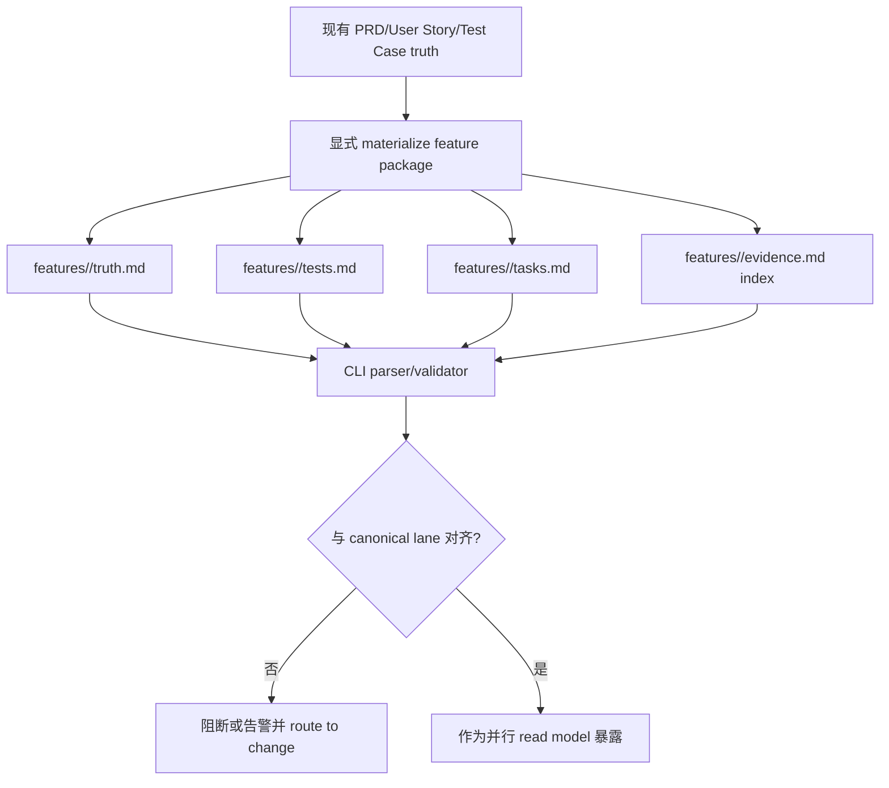
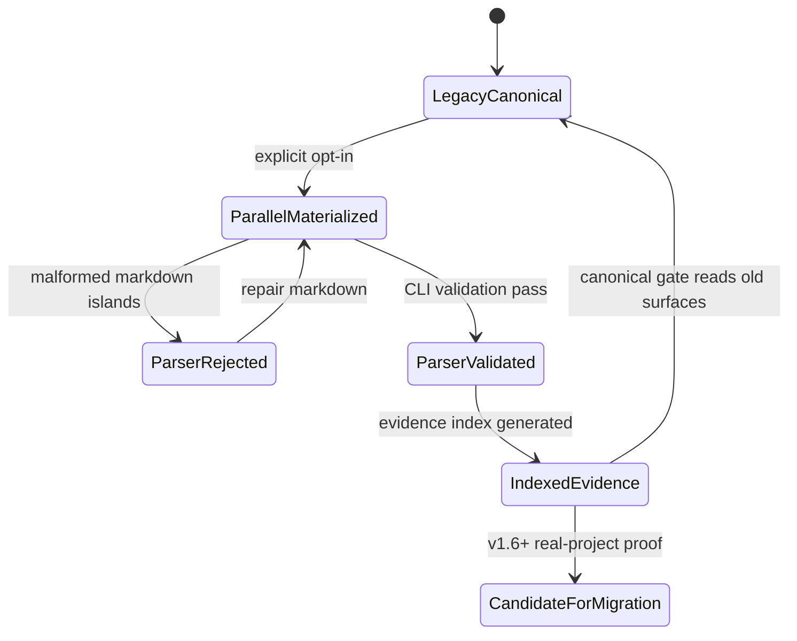

# Research: Beacon v1.5.0 Parallel Plan B Document Capability

- date: `2026-06-01`
- language: `zh`
- source research:
  - `docs/beacon/research/beacon-harness-evolution-full-analysis.md`
  - `docs/beacon/research/beacon-v150-redesign-plan-b-execution.md`
- abnormal branch source:
  - `beacon/v1.5.0-abnormal-plan-b`
- prd_refs: `docs/beacon/archive/v1.5.0/prd/beacon-v1.5.0-parallel-plan-b-document-capability.md`
- user_story_refs: `docs/beacon/archive/v1.5.0/user-story/beacon-v1.5.0-parallel-plan-b-document-capability.md`
- test_case_refs: `docs/beacon/archive/v1.5.0/qa/test-cases/beacon-v1.5.0-parallel-plan-b-document-capability.md`
- coverage_notes: AC-001 到 AC-016 已映射到 TC-001 到 TC-016。
- out_of_scope_notes: 旧体系退役、`.machine` 删除、deep/CEO/QA/release authority 迁移均不属于 v1.5.0 范围。

## Research Conclusion

原 Plan B 的诊断是有效的：Beacon 存在重复需求材料、分散投影、隐式 planning、生成路径分散等问题。真正的问题不是方向，而是异常分支尝试在一个版本内做无兼容替换。

v1.5.0 的正确收敛方式是：把 OpenSpec 风格的 feature-centric 文档能力作为并行能力上线，并保留现有 canonical truth/gate 链路。

## Architecture

新增并行文档树：

```text
docs/beacon/<version>/features/<slug>/
  truth.md
  tests.md
  tasks.md
  evidence.md
```

该树是 v1.5.0 的 materialization/read-model 能力，不是唯一 truth system，不替代当前 triptych。

## Architecture Boundary

架构保持两条 lane：

1. Canonical lane：PRD、user-story、test-case、execution、`.machine`、QA verdict、release readiness 继续作为 authoritative lifecycle surfaces。
2. Parallel package lane：`features/<slug>/` 文件作为整体文档包，由 CLI 生成或校验，并与 canonical lane 对齐。

Parallel package 可以帮助阅读、索引、校验和未来迁移准备，但不能静默覆盖 canonical truth 或 gate verdict。

## OpenSpec Bounded Subset

v1.5.0 采用 OpenSpec 的 bounded subset：

- `truth.md` 包含 YAML frontmatter：slug、version、status、language、canonical_refs、parser_contract。
- `tasks.md` 包含 checkbox task ledger。
- CLI 读取 markdown 中的 machine-readable islands：frontmatter、AC table、checkbox rows、evidence authority labels。
- LLM 可以写 markdown 正文和 checklist，但不能直接推进状态机。
- `.machine` 在 v1.5.0 中仍是 canonical machine projection surface。
- Skill 必须提供简洁模板，降低 LLM 反复撞 parser/governance 的成本。

## Business Flow



## State Machine



## Decision Priority

1. v1.5.0 中现有 truth/gate/release surfaces 仍然 authoritative。
2. Feature package 是并行文档能力，不是旧体系退役。
3. CLI validation 是 LLM-authored markdown 影响状态前的必要边界。
4. Checkbox row 只是 task ledger，不能绕过 implement / QA gate。
5. `evidence.md` 是索引，不是 final verdict source。
6. 旧体系退役只能在 v1.6+ 经真实项目验证后再讨论。
