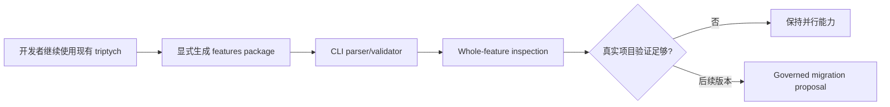

# User Story: Beacon v1.5.0 Parallel Plan B Document Capability

**Feature**: `beacon-v1.5.0-parallel-plan-b-document-capability`
**Version**: `v1.5.0`
**Status**: `frozen`
**Date**: `2026-06-01`
**Language**: `zh`

## Story

作为 Beacon 开发者，我希望 v1.5.0 增加 feature-centric 整体文档包，同时不退役现有 truth/gate 体系，这样可以先在真实项目中验证 Plan B 方向，再决定 v1.6+ 是否迁移旧体系。

## Outline

## Acceptance Criteria

| AC ID | Theme | Description |
|-------|-------|-------------|
| AC-001 | parallel-package | v1.5.0 支持 `features/<slug>/{truth,tests,tasks,evidence}.md` 并行文档包。 |
| AC-002 | old-chain-preserved | 现有 `prd`、`user-story`、`qa/test-cases`、`execution`、`.machine` surfaces 保持 canonical 和 operational。 |
| AC-003 | cli-preserved | 旧 CLI commands 保持可用，不能变成 removed-command failure。 |
| AC-004 | evidence-index | `features/<slug>/evidence.md` 是 index/read model，不是 final verdict authority。 |
| AC-005 | support-boundary | Deep 和 CEO review 仍是 advisory support surfaces。 |
| AC-006 | gate-boundary | QA verdict 和 release readiness 保持在现有 gate/release authority surfaces。 |
| AC-007 | authority-labels | Evidence index rows 明确区分 `support_advisory`、`qa_verdict`、`release_verdict`。 |
| AC-008 | drift-check | Feature-centric files 与 canonical triptych 的 drift 可检测且不能 silent pass。 |
| AC-009 | global-boundary-preserved | v1.5.0 不削弱 canonical projection 或 transaction consistency。 |
| AC-010 | retirement-deferred | 旧体系退役推迟到 v1.6+ 真实项目验证后。 |
| AC-011 | truth-frontmatter | `features/<slug>/truth.md` 包含 YAML frontmatter，且仅作为 parallel metadata，不替代 `.machine`。 |
| AC-012 | checkbox-ledger | `features/<slug>/tasks.md` 包含 checkbox task rows，但 checkbox 不能绕过 implement 或 QA gates。 |
| AC-013 | deterministic-parser | CLI validation 确定性读取 frontmatter、AC tables、checkbox rows、evidence authority labels。 |
| AC-014 | llm-write-boundary | LLM 可以写 markdown 正文和 checklist rows，但 lifecycle state 只能在 CLI validation 后推进。 |
| AC-015 | evidence-no-gate-truth | `features/<slug>/evidence.md` 继续是 index/read model，不承载 gate truth。 |
| AC-016 | skill-template-examples | Beacon skills 提供 compact LLM-readable templates，覆盖有效 `truth.md`、`tests.md`、`tasks.md`、`evidence.md`。 |

## State Axis Coverage

| AC ID | State Axis | Transition | Covered |
|-------|------------|------------|---------|
| AC-001 | package_state | absent -> materialized | Yes |
| AC-002 | canonical_chain | existing -> preserved | Yes |
| AC-004 | evidence_authority | index_only -> verdict_source_blocked | Yes |
| AC-008 | drift_state | aligned -> drift_detected | Yes |
| AC-010 | migration_state | candidate -> deferred | Yes |
| AC-011 | frontmatter_state | absent -> parsed_parallel_metadata | Yes |
| AC-012 | checkbox_state | unchecked -> checked_without_gate_bypass | Yes |
| AC-013 | parser_state | unvalidated -> cli_validated | Yes |
| AC-014 | llm_write_state | draft_md -> cli_validated | Yes |
| AC-016 | template_state | missing -> llm_readable_examples_available | Yes |

## Test Story Map

| Test ID | Covers | Scenario |
|---------|--------|----------|
| TC-001 | AC-001 | Materialize feature-centric package with four files. |
| TC-002 | AC-002 | Existing triptych files remain present and usable. |
| TC-003 | AC-003 | `beacon prd`、`beacon user-story`、`beacon test-case`、`beacon prototype` still exist. |
| TC-004 | AC-004 | `evidence.md` only contains index rows and canonical links. |
| TC-005 | AC-005 | Deep and CEO review artifacts are labeled `support_advisory`. |
| TC-006 | AC-006 | QA and release verdicts are read from existing canonical outputs. |
| TC-007 | AC-007 | Evidence index includes an `Authority` column. |
| TC-008 | AC-008 | Drift between package files and canonical files is detected. |
| TC-009 | AC-009 | Global-boundary canonical projection rules remain unchanged. |
| TC-010 | AC-010 | No old-system retirement command or deletion runs in v1.5.0. |
| TC-011 | AC-011 | `truth.md` frontmatter is present and parsed as parallel metadata. |
| TC-012 | AC-012 | `tasks.md` checkbox rows cannot mark implement or QA complete alone. |
| TC-013 | AC-013 | CLI validator rejects malformed frontmatter, AC tables, checkbox rows, or evidence labels. |
| TC-014 | AC-014 | LLM-authored markdown stays draft until CLI validation accepts it. |
| TC-015 | AC-015 | `evidence.md` rejects or flags gate-truth fields. |
| TC-016 | AC-016 | Skill quick templates produce parser-compatible package files. |

## References

- Research: `docs/beacon/archive/v1.5.0/research/beacon-v1.5.0-parallel-plan-b-document-capability.md`
- PRD: `docs/beacon/archive/v1.5.0/prd/beacon-v1.5.0-parallel-plan-b-document-capability.md`
- Test cases: `docs/beacon/archive/v1.5.0/qa/test-cases/beacon-v1.5.0-parallel-plan-b-document-capability.md`
