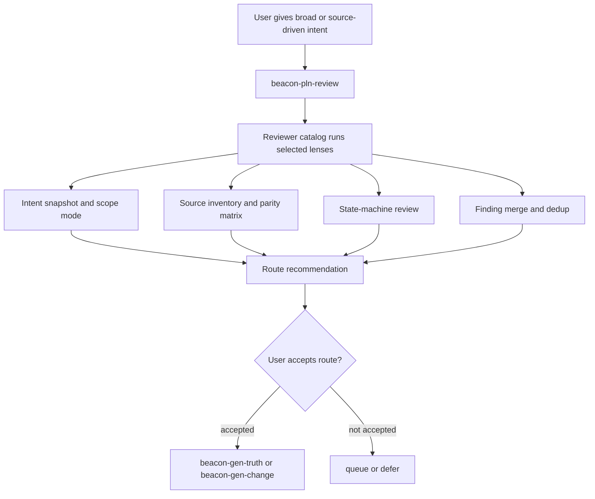
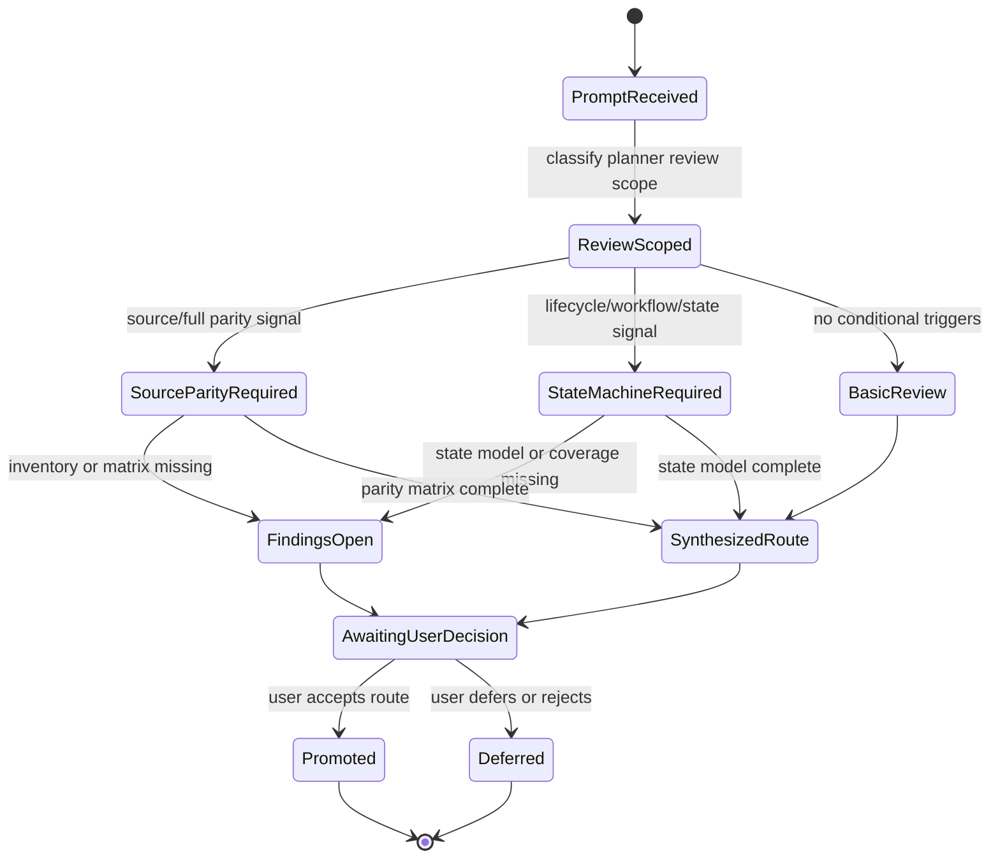

# Planner Research: Beacon Planner Review Intent Parity State Machine v1.6.0

- authority: support_advisory
- status: promoted
- outcome: 收敛 Beacon planner 面，新增多角度 `beacon-pln-review`，保护用户完整意图/source parity，并恢复有限状态机作为 plan-to-truth 的硬性审查标准。
- lake_or_ocean: lake，可作为单个 v1.6.0 feature 煮干；实现可拆任务，但需求闭环必须一次性表达完整。
- truth_refs: docs/beacon/archive/v1.6.0/features/beacon-pln-review-intent-parity-state-machine-v160/truth.md
- source_refs: skills/beacon/beacon-pln-brainstorm/SKILL.md; skills/beacon/references/state-machine-checklist.md; beacon/utils/diagram_truth.py; beacon/utils/requirement_clarity.py; /Users/apple/.codex/skills/compound-engineering/ce-code-review/SKILL.md; /Users/apple/Developer/Personal/products/justin-mc-lai-skills/skills/qi-dev/references/personal-skill-creator-spec.md
- evidence_refs: docs/beacon/archive/v1.6.0/features/beacon-pln-review-intent-parity-state-machine-v160/evidence.md
- truth_gap: v1.6.0 package-authoritative truth 尚未把 planner review、intent parity、source parity 和 state-machine reviewer 作为一等需求冻结。
- test_gap: 需要新增 behavior/contract/eval 覆盖，证明 full parity 不被 MVP 化、source parity matrix 缺失会阻断、state-machine 缺 truth/tests 落点会阻断。
- prd_refs: docs/beacon/archive/v1.6.0/features/beacon-pln-review-intent-parity-state-machine-v160/truth.md
- user_story_refs: docs/beacon/archive/v1.6.0/features/beacon-pln-review-intent-parity-state-machine-v160/truth.md
- test_case_refs: docs/beacon/archive/v1.6.0/features/beacon-pln-review-intent-parity-state-machine-v160/tests.md
- coverage_notes: AC-001..AC-020 map to TC-001..TC-020 with contract, negative, behavior, docs and eval benchmark coverage.
- out_of_scope_notes: No new public lifecycle stage; internal reviewer catalog only; planner cannot write truth, code, QA verdicts, or release verdicts.
- implementation_risk: medium；涉及 skill projection、agent surface 安装、public surface 收敛和 eval benchmark 扩展。
- verification_risk: medium；必须避免只做静态文本扫描，应补 runtime/eval behavior evidence。
- recommended_route: beacon-gen-implement
- user_decision: accepted
- promotion_ref: docs/beacon/archive/v1.6.0/features/beacon-pln-review-intent-parity-state-machine-v160/truth.md

## Scope Summary

本 feature 采用方案 2：新增 `beacon-pln-review`，并把过细 planner skill 降级为 internal reviewer catalog。公开 planner 面保留少量高辨识入口，内部通过 reviewer catalog 扩展多角度审查能力。

核心不是扩大 skill 数量，而是提高 `plan -> truth` 的保真度：

- 用户强意图必须被保留；
- source parity 必须矩阵化；
- 任何 MVP/延期/裁剪必须用户确认；
- 状态机必须重新成为复杂 feature 的硬性审查标准；
- planner 只能 route，不能越权执行。

## Business Flow

## State Machine

## Decision Priority

1. User intent fidelity outranks MVP simplification.
2. Source parity matrix outranks summary confidence.
3. State-machine completeness outranks implementation convenience.
4. Planner boundary outranks closure speed.
5. Runtime/eval evidence supports review but never replaces formal QA/release verdict.

## Route Implications

- Missing intent parity -> `beacon-gen-truth` or `beacon-gen-change`.
- Missing source parity matrix -> `beacon-pln-source` support or `beacon-gen-change` if promise changes.
- Missing state-machine truth/tests landing -> `beacon-gen-truth` / `beacon-gen-change`.
- Implementation-ready only after user accepts route and package truth/coverage are updated.
