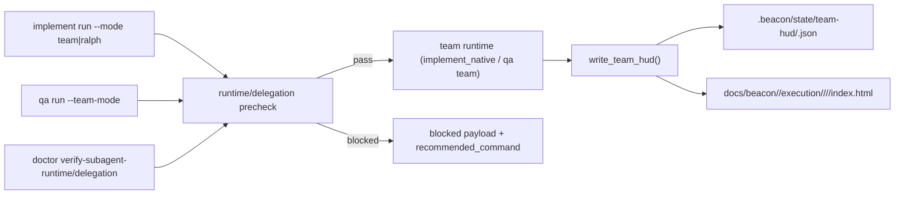
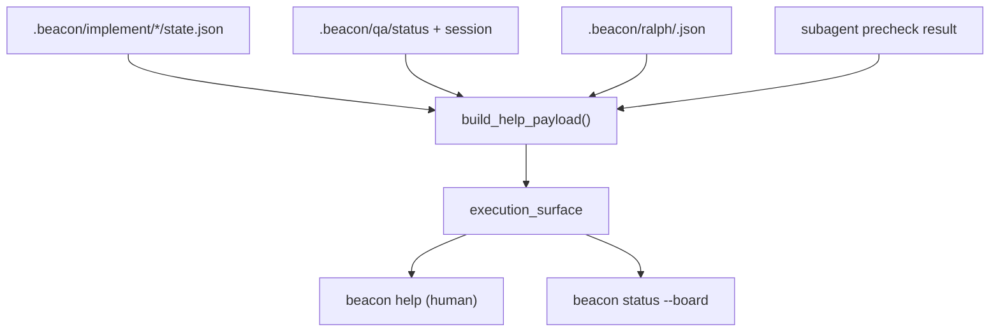

# Beacon v1.3.2 HUD 接入（Claude/Codex）Lighthouse Map

## 1. Summary
- v1.3.2 已有可用 HUD 基础：`implement team` 与 `qa team-mode` 都会落地 team HUD（JSON + HTML）。
- `help/status` 已通过 `build_help_payload().execution_surface` 暴露运行态（host runtime、precheck、Ralph phase、QA session）。
- 对 Codex/Claude 的兼容主链已经存在：`detect_host_runtime` + `runtime_readiness_precheck` + `delegation_readiness_precheck`，并由 `implement/qa` 内嵌与 `doctor` 子命令外显。
- 结论：HUD 接入应走“轻量聚合”而非新 runtime；以 `help_support` 为总汇点，把 team HUD + Ralph 状态统一进最小观察面。

## 2. Scope
- mode: `feature-slice`（扩展到关联执行面）
- project_root: `/Users/apple/Developer/Personal/products/beacon`
- target: `beacon/utils/help_support.py`
- analyzed files:
  - `beacon/utils/help_support.py`
  - `beacon/utils/subagent_runtime.py`
  - `beacon/utils/subagent_readiness.py`
  - `beacon/utils/ralph_runtime.py`
  - `beacon/commands/help.py`
  - `beacon/commands/status.py`
  - `beacon/commands/implement.py`
  - `beacon/commands/qa.py`
  - `beacon/commands/doctor.py`
  - `docs/beacon/v1.3.2/prd/*`
  - `docs/beacon/v1.3.2/user-story/*`
  - `docs/beacon/v1.3.2/qa/test-cases/*`

## 3. Mermaid Maps

## 4. Key Entry Points
- `beacon implement run "<feature>" --mode team|ralph --host-runtime codex|claude`
- `beacon qa run "<feature>" --team-mode --host-runtime codex|claude`
- `beacon doctor verify-subagent-runtime --host-runtime codex|claude`
- `beacon doctor verify-subagent-delegation "<feature>" --version v1.3.2`
- `beacon help --feature "<feature>" --version v1.3.2`
- `beacon status --board --feature "<feature>" --version v1.3.2`
- `beacon team hud --team <team_name>`

## 5. Key Modules / Subsystems
- `beacon/utils/help_support.py`
  - 汇总 execution_surface：`host_runtime`、precheck 状态、Ralph phase/stop/next、QA session/runner。
- `beacon/utils/subagent_runtime.py`
  - `write_team_hud()` 统一写入 team HUD JSON 与 HTML。
- `beacon/utils/subagent_readiness.py`
  - `detect_host_runtime()` 与两段 precheck（runtime/delegation）。
- `beacon/commands/implement.py` / `beacon/commands/qa.py`
  - team/ralph 路径在执行前做 precheck，失败即阻断并返回 recommended command。
- `beacon/commands/doctor.py`
  - 提供 `verify-subagent-runtime` 与 `verify-subagent-delegation` 独立诊断入口。
- `beacon/utils/ralph_runtime.py`
  - Ralph durable state（phase/stop/next/failure streak）写入 `.beacon/ralph/<feature>.json`。

## 6. Dependencies / Infra Chain
- Host runtime识别链：
  - 显式 `--host-runtime` → `BEACON_HOST_RUNTIME` → 本地 skill root 自动探测。
- Host skill paths：
  - Codex: `~/.agents/skills/beacon`
  - Claude: `~/.claude/skills/beacon`
- Context 依赖：
  - Codex 使用 `AGENTS.md`
  - Claude 使用 `CLAUDE.md`
  - 两者都要求继承 `docs/beacon/global-boundaries.md`
- Delegation 依赖（v1.3.2 materials）：
  - `prd/user-story/test-case`
  - implementation plan / git workflow
  - QA baseline bundle

## 7. Confirmed Facts
- v1.3.2 PRD/US 明确要求 `team` 生成 HUD，并要求 `status/help` 输出 mode/round/blocker/next step。
- `implement` 与 `qa` 已内嵌两段 precheck；失败时返回结构化 blocked payload。
- `doctor verify-subagent-runtime` 与 `doctor verify-subagent-delegation` 已实现，对应同一 precheck 逻辑。
- team HUD 已有稳定落盘路径：
  - `.beacon/state/team-hud/<team>.json`
  - `docs/beacon/<version>/execution/<surface>/<feature>/<run_id>/index.html`
- `help/status` 已消费 `execution_surface`，包含 Ralph 与 QA 关键运行态。
- `detect_host_runtime()` 在 Codex 与 Claude 同时存在时默认返回 `codex`。
- Ralph 当前有 durable state，但没有独立 Ralph HUD HTML 生成器（仅 team HUD 生成器）。

## 8. Inferred Structure
- 最小接入策略应是“单一 HUD 聚合层”：
  - 复用 team HUD 文件 + Ralph state + precheck 状态。
  - 由 `help_support` 输出统一 `hud_refs`/`hud_summary` 字段供 `help/status` 呈现。
- Claude/Codex 兼容不应再引入第三方桥接层；沿用 host-native precheck 闭环即可。
- Ralph HUD 可先做“状态卡片化输出”（JSON-first），再决定是否补 HTML 页面，避免一次做重。

## 9. Open Questions / Risks
- 当 Codex 与 Claude 同时安装且未显式传参时，默认 `codex` 可能与当前宿主不一致。
- `help/status` 目前展示 execution_surface，但未直接给出 HUD 文件引用，定位成本偏高。
- Ralph 只有状态文件，没有与 team HUD 对齐的统一页面，跨模式观测割裂。
- precheck 失败后的修复动作分散在 payload 中，用户可能跳过 `doctor` 做全量兼容迁移。

## 10. Recommended Next Steps
1. 在 `build_help_payload()` 增加 `hud` 节点（`team_hud_json/html`, `ralph_state_json`），不新增命令面。
2. 在 `help` 与 `status --board` 增加 HUD 路径输出，形成“可直接打开”的极简观测链。
3. 增加 `host_runtime_source` 字段（explicit/env/auto），降低 Codex/Claude 歧义。
4. 把 precheck 失败提示统一收敛为 `beacon doctor verify-subagent-runtime/delegation` 的固定修复链路。
5. Ralph 先实现“轻量 HUD JSON 汇总”（phase/stop/next/round/failure_streak），后续再评估 HTML。
6. 保持约束：不新增公开一级命令，不引入新外部执行器，不改写 v1.3.2 的 `single/team/ralph` 边界。
