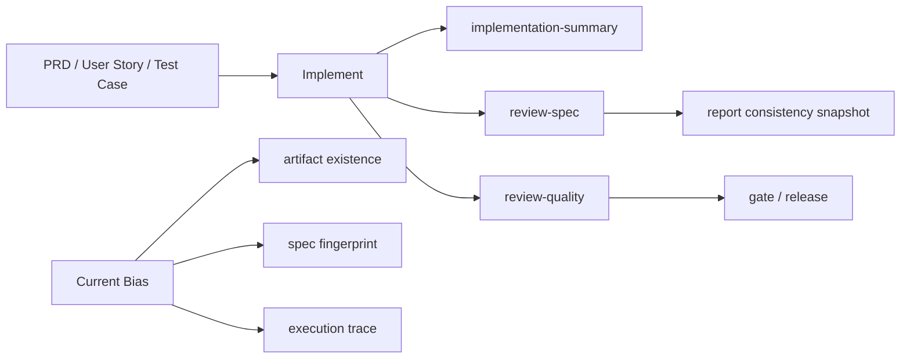
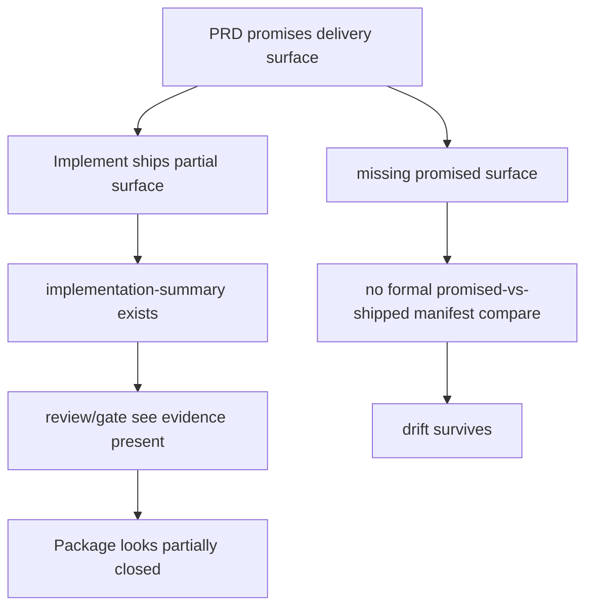
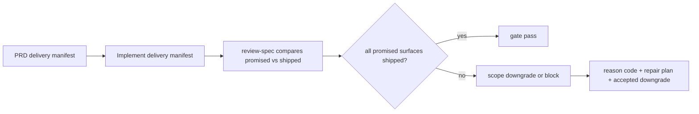

# Beacon v1.3.4 PRD / Implement Drift Closure Lighthouse Map

## 1. Summary

这次问题的核心，不是 Beacon 完全没有“实现总结”。

相反，Beacon 已经有一套比较完整的执行闭环材料：

- `implementation-summary`
- `review-spec`
- `review-quality`
- `gate/report consistency`

真正的缺口是：

- 这套闭环更偏向“实现过程是否留下证据”
- 还没有强约束“PRD 承诺的交付面是否真的 shipped”

因此 `v1.3.4` 当前暴露出的 PocketBase 偏差，本质上不是“没有文档”，而是“PRD 承诺面 > implement 真实交付面 > gate 未阻断”。

## 2. Scope

本文件只分析：

- Beacon 当前已有的 PRD / implement / verify / gate 对齐机制
- 为什么它仍然允许“承诺面漂移”
- 如何把这件事冻结成可执行防漂移闭环

本文件不直接进入：

- PocketBase 具体实现开发
- UI 原型补画
- release 操作

## 3. Mermaid Maps

### 3.1 Current Closure Chain

### 3.2 Current Drift Gap

### 3.3 Recommended No-Drift Contract

## 4. Key Entry Points

- `beacon/utils/writeback.py`
- `beacon/commands/report.py`
- `beacon/commands/gate.py`
- `beacon/utils/runtime_projection_store.py`
- `docs/beacon/v1.3.4/prd/beacon-v1.3.4-global-runtime-projection-and-pocketbase-control-plane.md`

## 5. Confirmed Facts

### 5.1 Beacon 已有实现总结与验证材料

- `writeback` 已把 `implementation-summary`、`review-spec`、`review-quality` 纳入 workflow stage evidence。
- 这说明 Beacon 不是没有“实现总结”机制，而是已经把它作为正式证据面的一部分。

### 5.2 当前 consistency 更偏向指纹漂移

- `report` 的 consistency snapshot 主要比较 `expected_spec_fingerprint` 和 `actual_spec_fingerprint`。
- 如果 execution 侧没有 fingerprint，会报 `execution_fingerprint_missing`。
- 如果指纹不一致，会报 `spec_impl_drift_detected`。

### 5.3 `gate` 会拦 spec drift，但还不会拦“承诺面未交付”

- `gate` 会把 spec fingerprint mismatch 视为 critical / blocked。
- 这能阻止“旧 spec / 新实现”之类的硬漂移。
- 但它还没有一个正式 reason code 去判断：
  - `PRD 明写要交付的 surface`
  - `实现只交付了其中一部分`
  - `且没有明确 downgrade 批准`

### 5.4 v1.3.4 主 PRD 已明确承诺 PocketBase control plane

- 主 PRD 明确要求 PocketBase 承担：
  - 可视化后台
  - 集合管理与查询
  - REST API / realtime
  - 数据导出与备份运维
- 里程碑也明确把 `PocketBase Control Plane` 作为 Phase 2 正式交付。

### 5.5 当前实现只到 mirror pack

- `runtime_projection_store` 当前在 SQLite 落盘后，只写出 PocketBase-ready JSON mirror pack。
- 当前仓库内还没有可启动的 PocketBase 服务、集合 schema 初始化、管理端入口、备份面板交付。

## 6. Inferred Structure

### 6.1 当前 Beacon 已经做到的是“执行证据闭环”

适合回答：

- 有没有实现记录
- 有没有 review-spec
- 有没有 review-quality
- spec fingerprint 是否漂移

### 6.2 当前 Beacon 还没做到的是“交付承诺闭环”

还不能稳定回答：

- PRD 承诺的每个一级交付面是否都真实 shipped
- 如果没有 shipped，是不是被正式降级
- 降级是否被 requirement owner 接受

### 6.3 所以“实现总结”不该只是流水账

实现总结后续必须升级成：

- `shipped surface ledger`
- 而不只是 `done work summary`

否则 implement 可以写“我做了 SQLite + mirror pack”，但 PRD 写的是 “PocketBase 管理看板”，两边仍然能共存，最后由人脑补差距。

## 7. Brainstorm

### 7.1 用户维度

- CEO 只关心“这条版本线到底交没交付”。
- 项目负责人关心“哪些承诺已经落地，哪些只是过渡态”。
- Beacon 自己作为执行内核，必须同时服务这两种阅读方式。

结论：

- CEO 层只看 `delivered / partial / blocked`
- 项目负责人层下钻到 `promised surface vs shipped surface`

### 7.2 场景维度

- PRD 建立时，容易写出比当前实现更大的目标面。
- implement 过程中，常会先落 MVP 或镜像层。
- 如果没有强制 downgrade 机制，最后最容易在 release 前才暴露。

结论：

- 漂移治理必须前置到 implement / review-spec，而不是留到 release 再发现

### 7.3 业务维度

- Beacon 的价值不是“多写几份文档”
- 而是降低 requirement 到 delivery 的认知漂移成本

结论：

- `implementation-summary` 的商业价值，最终体现在“减少错误承诺和错误判断”，不是增加文书量

### 7.4 技术维度

- 现在已有 spec fingerprint、implementation plan、review artifacts
- 缺的是一份结构化 `delivery manifest`

结论：

- 不需要重造整个框架
- 只要补一个 `promised surfaces -> shipped surfaces -> gate compare` 的合同层

### 7.5 体验维度

- 人类不想看大量 runtime 噪音
- 只想知道“承诺有没有兑现”

结论：

- UI / status 默认只显示：
  - `交付完成`
  - `部分完成`
  - `被正式降级`
  - `漂移阻断`

### 7.6 价值维度

- 这件事会直接提升：
  - PRD 可信度
  - implement 可审计性
  - release 判断准确性

### 7.7 风险维度

- 如果不加这层合同，Beacon 会继续出现：
  - PRD 说得比实现大
  - implement 说自己已完成
  - gate 因为证据齐全而放过

结论：

- 这是高概率、高影响风险，应该进入 debug friction 常驻治理

## 8. Recommended Contract

### 8.1 新增 PRD Delivery Manifest

PRD 不只写长文，还要冻结一份机器可比对的交付面清单，例如：

- `runtime-ledger-sqlite`
- `projection-envelope`
- `pocketbase-service-bootstrap`
- `pocketbase-collections-schema`
- `pocketbase-admin-surface`
- `backup-export-ops`

每个 surface 至少要有：

- `surface_id`
- `stage`
- `required_for_acceptance`
- `acceptance_refs`
- `allowed_degrade_mode`

### 8.2 升级 Implementation Summary 为 Delivery Summary

实现阶段必须回写：

- shipped surfaces
- partial surfaces
- intentionally deferred surfaces
- downgrade rationale

### 8.3 `review-spec` 正式比较 promised vs shipped

`review-spec` 不只看 spec fingerprint，还要看：

- `promised_required_surfaces - shipped_required_surfaces`

如果存在差集，则只允许两种结果：

- `blocked`
- `accepted_downgrade`

### 8.4 `gate` 新增 feature-surface drift 阻断

建议新增 reason codes：

- `promised_delivery_surface_missing`
- `delivery_surface_downgrade_unapproved`
- `prd_implement_scope_drift_detected`

### 8.5 `release` 只接受两种包状态

- 全部 required surface 已交付
- 或者已存在正式 downgrade 决议，并同步写回 PRD / user-story / test-case / implementation summary

## 9. Recommended Next Steps

1. 在 `v1.3.4` 并行 PRD 或 execution 合同中正式冻结 `delivery manifest`。
2. 把 `implementation-summary` 升级为 `implementation + shipped surface summary`。
3. 让 `review-spec` 比较 promised vs shipped，而不是只比较 fingerprint。
4. 让 `gate/release` 对“承诺面未交付且未降级批准”直接阻断。
5. `status --board` 与未来 PocketBase 看板只暴露有限结论，不暴露机器噪音。

## 10. Key Source Refs

- `beacon/utils/writeback.py`
- `beacon/commands/report.py`
- `beacon/commands/gate.py`
- `beacon/utils/runtime_projection_store.py`
- `docs/beacon/v1.3.4/prd/beacon-v1.3.4-global-runtime-projection-and-pocketbase-control-plane.md`
