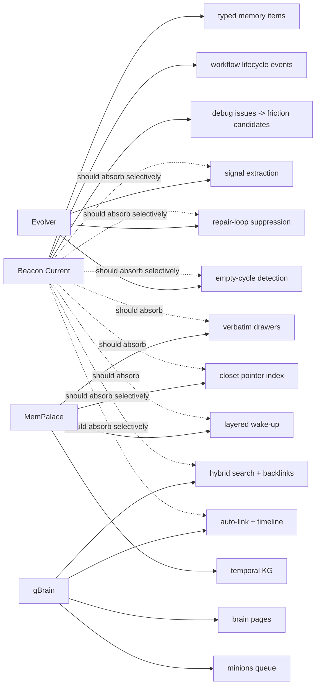
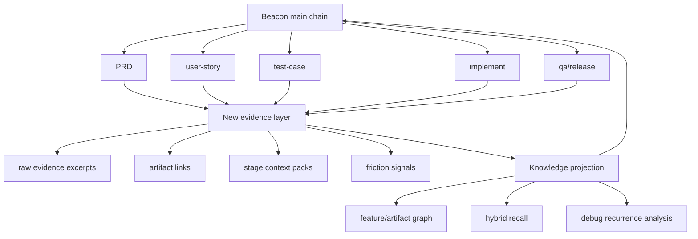

# OSS-Sync Memory Agents Lighthouse Map

## 1. Summary

这次分析的结论很明确：

- `MemPalace` 最值得 Beacon 吸收的是 `verbatim-first + structured navigation + layered recall`。
- `gBrain` 最值得 Beacon 吸收的是 `knowledge plane + hybrid retrieval + deterministic background work`。
- `Evolver` 最值得 Beacon 吸收的是 `signal suppression + empty-cycle detection + evolution control plane`。
- `Hermes Agent` 更像 host agent，不是 Beacon 当前最需要吸收的 memory kernel。

Beacon 现在已经有 memory/debug/workflow-memory 闭环，但它更像：

- `workflow memory`
- `debug candidate memory`
- `release evidence memory`

它还不是：

- `raw-evidence memory`
- `navigable knowledge plane`
- `graph-backed recall system`

所以 Beacon 不该“重做一个 mempalace/gbrain”，而应该在现有 `.beacon/memory + .beacon/debug + workflow_memory` 上，补出一层更强的 evidence/knowledge projection。

## 2. Scope

本次分析基于：

- `oss-sync/CLAUDE.md`
- `memory-agents/mempalace`
- `memory-agents/gbrain`
- `memory-agents/evolver`
- `memory-agents/hermes-agent`
- Beacon 当前实现：
  - `beacon/utils/memory.py`
  - `beacon/utils/workflow_memory.py`
  - `beacon/utils/memory_friction_evolution.py`
  - `.beacon/memory/*`
  - `.beacon/debug/*`

## 3. Mermaid Maps

## 4. Key Entry Points

### 4.1 Beacon current memory surface

- `beacon/utils/memory.py`
  - typed memory storage: `insight / decision / vocabulary / feedback`
  - single-file canonical store: `memory-v1.json`
  - legacy projection compatibility
- `beacon/utils/workflow_memory.py`
  - workflow event memory for `think -> user-story -> prd -> ... -> gate`
  - run/stage/attempt/evidence traceability
- `beacon/utils/memory_friction_evolution.py`
  - collects memory/debug evidence
  - ranks top candidates
  - optional writeback into feedback memory

### 4.2 Memory-agent projects

- `memory-agents/mempalace`
  - strongest raw-memory architecture
- `memory-agents/gbrain`
  - strongest knowledge-plane architecture
- `memory-agents/evolver`
  - strongest evolution-control architecture
- `memory-agents/hermes-agent`
  - strongest host-agent packaging, but not strongest memory kernel

## 5. Key Modules / Subsystems

### 5.1 MemPalace

#### Confirmed facts

- MemPalace explicitly defines itself as `verbatim always / incremental only / entity-first / local-first / background everything` in [`oss-sync/memory-agents/mempalace/CLAUDE.md`](../../../../../oss-sync/memory-agents/mempalace/CLAUDE.md).
- It separates `drawers` and `closets`; closets are a pointer/index layer, not the truth layer. See [`oss-sync/memory-agents/mempalace/mempalace/palace.py`](../../../../../oss-sync/memory-agents/mempalace/mempalace/palace.py).
- Search keeps direct drawer search as the floor and uses closet hits only as a ranking signal, never as a gate. See [`oss-sync/memory-agents/mempalace/mempalace/searcher.py`](../../../../../oss-sync/memory-agents/mempalace/mempalace/searcher.py).
- It has a local temporal knowledge graph backed by SQLite with `valid_from / valid_to` and provenance fields. See [`oss-sync/memory-agents/mempalace/mempalace/knowledge_graph.py`](../../../../../oss-sync/memory-agents/mempalace/mempalace/knowledge_graph.py).
- It has layered recall: L0 identity, L1 essential story, L2 filtered retrieval, L3 deep search. See [`oss-sync/memory-agents/mempalace/mempalace/layers.py`](../../../../../oss-sync/memory-agents/mempalace/mempalace/layers.py).

#### Why it matters

MemPalace solves a problem Beacon still only partially solves:

- Beacon stores memory summaries.
- MemPalace stores raw memory, then projects structure on top.

For Beacon, the important lesson is not “copy wings/rooms/drawers naming”, but:

- keep raw decisive evidence
- add deterministic addressing
- load context in layers instead of dumping everything or only keeping summaries

### 5.2 gBrain

#### Confirmed facts

- gBrain is contract-first: CLI and MCP share the same operation definitions. See [`oss-sync/memory-agents/gbrain/CLAUDE.md`](../../../../../oss-sync/memory-agents/gbrain/CLAUDE.md) and [`oss-sync/memory-agents/gbrain/src/core/operations.ts`](../../../../../oss-sync/memory-agents/gbrain/src/core/operations.ts).
- It has a hard trust boundary between local and remote callers using `OperationContext.remote`; remote callers default to stricter behavior. See [`oss-sync/memory-agents/gbrain/src/core/operations.ts`](../../../../../oss-sync/memory-agents/gbrain/src/core/operations.ts).
- It supports pluggable engines with both embedded `PGLite` and external `Postgres + pgvector`. See [`oss-sync/memory-agents/gbrain/src/core/engine.ts`](../../../../../oss-sync/memory-agents/gbrain/src/core/engine.ts).
- It has a serious hybrid retrieval stack: keyword + vector + RRF + cosine rescoring + backlink boost + dedup. See [`oss-sync/memory-agents/gbrain/src/core/search/hybrid.ts`](../../../../../oss-sync/memory-agents/gbrain/src/core/search/hybrid.ts).
- It turns brain pages into a graph and timeline system through auto-link and auto-timeline extraction. See [`oss-sync/memory-agents/gbrain/src/core/operations.ts`](../../../../../oss-sync/memory-agents/gbrain/src/core/operations.ts).
- It includes `Minions`, a Postgres-native durable job queue for deterministic background work. See [`oss-sync/memory-agents/gbrain/src/core/minions/queue.ts`](../../../../../oss-sync/memory-agents/gbrain/src/core/minions/queue.ts).

#### Why it matters

gBrain is not “a memory feature”. It is a full knowledge operating system.

For Beacon, the most useful parts are:

- graph/timeline projection from artifacts
- retrieval ranking discipline
- deterministic background execution for maintenance jobs

The least useful parts for Beacon right now are:

- person/company enrichment
- full brain repo architecture
- Postgres-first infra expansion

### 5.3 Evolver

#### Confirmed facts

- Evolver positions itself as a GEP-based self-evolution engine that scans `memory/` for signals and emits auditable evolution prompts. See [`oss-sync/memory-agents/evolver/README.md`](../../../../../oss-sync/memory-agents/evolver/README.md).
- Its signal layer explicitly tracks recurring errors, stagnation, empty cycles, repair loops, and opportunity classes. See [`oss-sync/memory-agents/evolver/src/gep/signals.js`](../../../../../oss-sync/memory-agents/evolver/src/gep/signals.js).

#### Why it matters

Beacon already has debug feedback and memory-friction-evolution, but its control logic is still simple:

- memory candidates = confidence/reason-codes projection
- friction candidates = debug issue count/sample projection
- convergence = trim low-score tail

Evolver suggests a more mature control plane:

- suppress over-processed signals
- detect repeated empty cycles
- measure recent failure ratio
- distinguish repair mode from innovation mode

Beacon should absorb this logic into its debug/release governance, not into its main memory storage.

### 5.4 Hermes Agent

#### Confirmed facts

- Hermes is a self-improving host agent with cross-session search, skill creation, periodic nudges, and pluggable memory integrations. See [`oss-sync/memory-agents/hermes-agent/README.md`](../../../../../oss-sync/memory-agents/hermes-agent/README.md).

#### Why it matters

Hermes proves that memory can stay behind the agent surface and still feel native, but its value to Beacon is mostly packaging and UX, not memory architecture. Beacon today needs stronger memory primitives first, not a multi-platform host runtime.

## 6. Beacon Current Baseline

### 6.1 Confirmed facts

- Beacon canonical memory is a typed append/upsert envelope in `.beacon/memory/memory-v1.json`, with legacy projections still maintained. See [`beacon/utils/memory.py`](../../../../beacon/utils/memory.py).
- Beacon recall is not true semantic retrieval yet. Its `semantic` mode is only term-overlap ratio over `content/source/tags`, and `hybrid` is direct-match-or-overlap. See [`beacon/utils/memory.py`](../../../../beacon/utils/memory.py).
- Beacon workflow memory is strong: it tracks `run_id / stage / event / attempt_seq / supersedes_event_id / evidence_ref`. See [`beacon/utils/workflow_memory.py`](../../../../beacon/utils/workflow_memory.py).
- Beacon memory-friction-evolution is a thin orchestration layer over existing memory/debug inputs, and its writeback compresses candidates into one-line feedback strings with recommendation and command. See [`beacon/utils/memory_friction_evolution.py`](../../../../beacon/utils/memory_friction_evolution.py) and [`.beacon/memory/feedback.json`](../../../../.beacon/memory/feedback.json).

### 6.2 Inferred structure

Beacon currently optimizes for:

- lifecycle traceability
- evidence closure
- release/debug governance

not for:

- raw conversational recall
- graph traversal across artifacts
- compiled knowledge reuse across many versions

That is the right product boundary. The gap is not “memory exists or not”; the gap is “memory is still mostly flattened into summary items”.

## 7. Dependencies / Infra Chain

| Project | Core storage | Retrieval | Graph | Background execution | Fit for Beacon |
|---|---|---|---|---|---|
| MemPalace | ChromaDB + SQLite | drawer + closet hybrid | local temporal KG | hooks/background filing | High |
| gBrain | PGLite or Postgres | keyword + vector + RRF + backlink | links + timeline + graph traversal | Minions queue | High but selective |
| Evolver | local memory/history dirs | signal extraction | evolution graph/event view | evolution loop | Medium-High |
| Hermes | agent runtime + pluggable memory | cross-session search | user modeling / skills | scheduler + subagents | Medium |
| Beacon current | JSON files under `.beacon` | simple text overlap search | stage-event graph only | workflow/debug toolkits | Base |

## 8. Confirmed Facts

### Beacon should absorb now

1. `MemPalace`-style raw evidence retention
2. `MemPalace`-style layered recall
3. `gBrain`-style artifact graph projection
4. `Evolver`-style friction suppression and empty-cycle detection

### Beacon should not absorb wholesale

1. full `gBrain` brain OS
2. full `MemPalace` naming and MCP surface
3. `Hermes` host-agent runtime
4. `gBrain` person/company enrichment and social graph

## 9. Inferred Structure

### Best absorption split

- `memory plane`: learn mostly from `MemPalace`
- `knowledge plane`: learn mostly from `gBrain`
- `evolution control plane`: learn mostly from `Evolver`
- `host runtime / UX`: optionally learn from `Hermes`

### Beacon-compatible target

Beacon should become:

- `workflow-native knowledge system`

not:

- `general personal brain`

That means every absorbed feature must strengthen:

- PRD traceability
- story/test coverage
- implementation/release evidence closure
- debug recurrence learning

## 10. Recommended Next Steps

### P0: absorb immediately

1. Add a raw evidence layer under `.beacon/memory/evidence/`
   - store decisive excerpts from research, review, debug, QA, implementation summary
   - every entry must keep `source_path`, `anchor`, `excerpt`, `artifact_type`, `feature`, `version`
2. Keep `memory-v1.json` as the index/summary plane
   - do not replace it
   - add `evidence_ids` and `artifact_refs` instead of stuffing everything into `content`
3. Add stage context packs
   - `think/prd/test-case/implement/qa/release` should load compact evidence packs, similar to MemPalace L1/L2

### P1: absorb next

1. Add a deterministic artifact graph
   - nodes: `prd`, `user-story`, `test-case`, `implementation-summary`, `qa-result`, `debug-issue`, `release-decision`, `research-doc`
   - edges: `derived_from`, `implements`, `verifies`, `blocks`, `supersedes`, `evidence_for`
2. Upgrade recall
   - keep existing keyword path
   - add optional embedding/BM25 path for research and evidence docs
   - do not require database migration first
3. Add debug/friction control heuristics
   - recurring issue suppression
   - empty-cycle alerts
   - repeated-repair detection

### P2: absorb only if Beacon iteration pressure justifies it

1. Add deterministic background jobs for:
   - evidence projection
   - graph rebuild
   - memory compaction
   - debug recurrence summarization
2. Consider a light local SQLite store only if JSON files become too flat

### Explicitly avoid for now

1. Do not introduce a second memory silo beside `.beacon/memory`
2. Do not import `wings/rooms/drawers` terminology directly into user-facing Beacon flows
3. Do not turn Beacon into a people/company CRM brain
4. Do not make Postgres/pgvector a prerequisite

## 11. Proposed Beacon Work Items

### Slice A: evidence-backed memory

- new file family: `.beacon/memory/evidence/*.json`
- extend `memory-v1.json` items with:
  - `evidence_ids`
  - `artifact_refs`
  - `material_type`
  - `feature`
  - `version`

### Slice B: knowledge projection

- new file: `.beacon/state/knowledge-projection/latest.json`
- deterministic edge builder over docs and evidence manifests

### Slice C: smarter friction evolution

- extend `memory-friction-evolution` with:
  - repeated-candidate suppression
  - empty-cycle detection
  - repair-loop policy
  - “keep/review/discard” confidence that considers recurrence trend, not only static count

## 12. Key Source Refs

- Beacon
  - [`beacon/utils/memory.py`](../../../../beacon/utils/memory.py)
  - [`beacon/utils/workflow_memory.py`](../../../../beacon/utils/workflow_memory.py)
  - [`beacon/utils/memory_friction_evolution.py`](../../../../beacon/utils/memory_friction_evolution.py)
  - [`.beacon/memory/feedback.json`](../../../../.beacon/memory/feedback.json)
- MemPalace
  - [`oss-sync/memory-agents/mempalace/CLAUDE.md`](../../../../../oss-sync/memory-agents/mempalace/CLAUDE.md)
  - [`oss-sync/memory-agents/mempalace/mempalace/palace.py`](../../../../../oss-sync/memory-agents/mempalace/mempalace/palace.py)
  - [`oss-sync/memory-agents/mempalace/mempalace/searcher.py`](../../../../../oss-sync/memory-agents/mempalace/mempalace/searcher.py)
  - [`oss-sync/memory-agents/mempalace/mempalace/knowledge_graph.py`](../../../../../oss-sync/memory-agents/mempalace/mempalace/knowledge_graph.py)
  - [`oss-sync/memory-agents/mempalace/mempalace/layers.py`](../../../../../oss-sync/memory-agents/mempalace/mempalace/layers.py)
- gBrain
  - [`oss-sync/memory-agents/gbrain/CLAUDE.md`](../../../../../oss-sync/memory-agents/gbrain/CLAUDE.md)
  - [`oss-sync/memory-agents/gbrain/src/core/operations.ts`](../../../../../oss-sync/memory-agents/gbrain/src/core/operations.ts)
  - [`oss-sync/memory-agents/gbrain/src/core/engine.ts`](../../../../../oss-sync/memory-agents/gbrain/src/core/engine.ts)
  - [`oss-sync/memory-agents/gbrain/src/core/search/hybrid.ts`](../../../../../oss-sync/memory-agents/gbrain/src/core/search/hybrid.ts)
  - [`oss-sync/memory-agents/gbrain/src/core/minions/queue.ts`](../../../../../oss-sync/memory-agents/gbrain/src/core/minions/queue.ts)
- Evolver
  - [`oss-sync/memory-agents/evolver/README.md`](../../../../../oss-sync/memory-agents/evolver/README.md)
  - [`oss-sync/memory-agents/evolver/src/gep/signals.js`](../../../../../oss-sync/memory-agents/evolver/src/gep/signals.js)
- Hermes
  - [`oss-sync/memory-agents/hermes-agent/README.md`](../../../../../oss-sync/memory-agents/hermes-agent/README.md)
