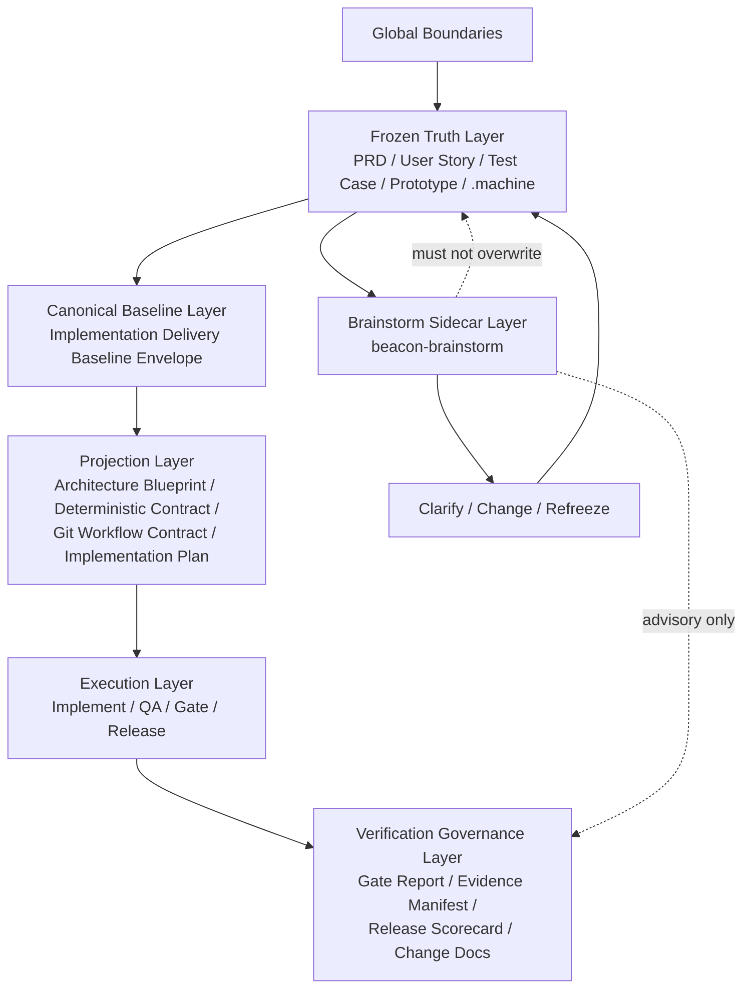
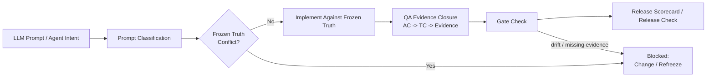
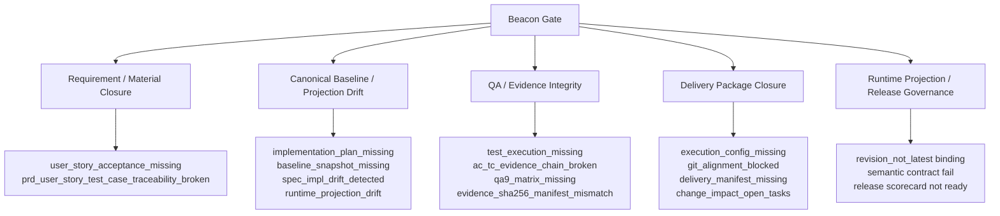

# Beacon Gate Governance And Drift Lighthouse Map

## 1. Summary

这份 Lighthouse 图说明 Beacon 当前最新发布线 `v1.3.7` 的实现架构，重点回答四件事：

1. 最新特性是什么。
2. gate 门禁主要卡在哪些责任面。
3. 为什么 Beacon 要把 LLM 产出收束到冻结真相、canonical baseline、QA 证据、release closure。
4. 漂移校验是怎么分层工作的。

结论先行：

- `v1.3.7` 当前新增的核心不是“再多一层文档”，而是把 implementation delivery baseline envelope 提升为实现投影唯一真相。
- `beacon-brainstorm` 被纳入 Beacon 内置 sidecar，但明确不进入主生命周期真相链。
- Beacon 的 gate 不是“多文档互相对表”，而是强制 LLM 产物从 frozen truth 单向流入 canonical baseline，再单向投影到 implement / qa / release。
- 真正让 LLM 产出“有效有序有价值”的，不是 prompt 本身，而是 gate 把 requirement completeness、projection consistency、evidence integrity、delivery package、runtime projection 这些收口点硬性卡住。

## 2. Scope

本分析聚焦：

- `docs/beacon/v1.3.7/` 版本线
- gate / implement / qa / release 的门禁责任
- canonical baseline 与 projection 的单向投影关系
- drift 检测链
- `beacon-brainstorm` 的 sidecar 边界

不进入：

- 新需求设计
- 重新规划 PRD
- 改 runtime 行为

## 3. Mermaid Maps

### 3.1 Overall Layered Architecture

### 3.2 LLM Output Closure Path

### 3.3 Gate And Drift Families

## 4. Key Entry Points

- `beacon/commands/gate.py`
  - gate 主引擎，集中定义 reason codes，并在 release gate 上把 requirement、QA、delivery、drift 统一收口。
- `beacon/utils/delivery_baseline.py`
  - 生成 canonical `implementation delivery baseline envelope`，并校验 projection 是否偏离 baseline。
- `beacon/utils/implementation_plan.py`
  - 从 frozen revision + approved technical review + canonical baseline 编译 implementation plan / git workflow contract。
- `beacon/utils/material_audit.py`
  - 审计版本文档树是否具备最小闭环材料，覆盖 main chain、execution package、git workflow contract。
- `beacon/utils/release_scorecard.py`
  - 聚合 gate、QA、feature scorecard、requirement clarity、technical review、change docs、semantic contract，计算 release_ready。
- `beacon/commands/release.py`
  - release 面向最终发布判断，并把 runtime projection transaction contract 纳入发布侧校验。
- `beacon/utils/runtime_projection_store.py`
  - 负责 runtime projection transaction metadata / checksum 一致性校验，直接产出 `runtime_projection_drift`。

## 5. Key Modules / Subsystems

### 5.1 Frozen Truth System

职责：

- 管正式 requirement truth。
- 冻结 feature scope、acceptance、test intent。
- 为 implement / qa / release 提供唯一 requirement baseline。

核心载体：

- `docs/beacon/<version>/prd/`
- `docs/beacon/<version>/user-story/`
- `docs/beacon/<version>/qa/test-cases/`
- `docs/beacon/<version>/prototype/`
- `docs/beacon/<version>/.machine/`

### 5.2 Canonical Delivery Baseline System

职责：

- 只维护一份 implementation delivery 真相。
- 固定 branch、worktree、service scope、projection metadata。
- 禁止 architecture blueprint / git workflow / implementation plan 互相当真相。

关键字段：

- `baseline_id`
- `transaction_id`
- `source_hash`
- `projection_seq`

### 5.3 Projection System

职责：

- 将 canonical baseline 单向投影为不同执行视角文档。
- 每份投影必须带 canonical metadata。
- 任何 metadata、branch、service scope、worktree 不一致都应该被 gate 打回。

核心投影件：

- `architecture-blueprint.md`
- `deterministic-implementation-contract-*.md/.json`
- `git-workflow-*.md/.json`
- `implementation-plan-*.md/.json`
- `implementation-summary-*.md/.json`

### 5.4 Execution System

职责：

- `implement` 只对 frozen truth 做实现，不负责改需求。
- `qa` 对 feature-specific matrix 做证据化验证。
- `gate` 判断“能不能继续”和“能不能发布”。
- `release` 判断整个版本/feature 是否可发布。

### 5.5 Governance System

职责：

- 汇总 gate / QA / change docs / semantic / revision binding。
- 把“看起来做完了”升级成“证据闭环可发布”。
- 为 LLM 产出提供最终价值约束。

### 5.6 Brainstorm Sidecar System

职责：

- 继续头暴、补齐缺口、做未来演进分析。
- 允许第一性原理、苏格拉底提问、奥卡姆剃刀。
- 输出 markdown 结论，服务于 clarify / change。

硬边界：

- 不直接改 frozen truth。
- 不作为 release truth。
- 不绕过 canonical baseline。

## 6. Dependencies / Infra Chain

项目里的规范职责可以收敛成下面这条依赖链：

1. `docs/beacon/global-boundaries.md`
   - 定义 Beacon 全局约束。
2. `docs/beacon/v1.3.7/`
   - 定义当前版本线 frozen truth 与 execution evidence。
3. `implementation delivery baseline envelope`
   - 定义实现投影唯一真相。
4. projection artifacts
   - 供 implement / QA / gate / release 消费。
5. `.beacon` runtime state
   - 提供 gate report、QA status、runtime projection transaction、scorecard 等机器证据。
6. release governance
   - 对外给出 release_ready 结论。

如果从“LLM 应该被什么约束”看，这条链可以再简化成：

`prompt` -> `frozen truth` -> `canonical baseline` -> `projection contract` -> `execution evidence` -> `gate` -> `release decision`

## 7. Confirmed Facts

- `v1.3.7` 是当前 active runtime and delivery line，包含两条 feature：
  - canonical implementation delivery baseline enforcement
  - built-in `beacon-brainstorm` sidecar
- `docs/beacon/v1.3.7/SUMMARY.md` 明确要求：
  - implement delivery baseline envelope 是 implementation projection 的唯一真相
  - brainstorm 不得直接改写 frozen truth
- `docs/beacon/v1.3.7/execution/architecture-blueprint.md` 明确采用六层结构：
  - Frozen Truth
  - Canonical Baseline
  - Projection
  - Execution
  - Verification / Release Governance
  - Brainstorm Sidecar
- `docs/beacon/v1.3.7/execution/boundaries.md` 明确 guardrails：
  - gate / release 只消费 main-chain docs、machine materials、formal evidence
  - brainstorm outputs 仅 advisory
- `docs/beacon/v1.3.7/execution/project-skill-qa-evolution-blueprint.md` 明确：
  - 公开主链仍然是 `prd -> user-story -> test-case -> prototype -> implement -> qa -> release`
  - `beacon-brainstorm` 是 host-visible sidecar，不进入主链
- `beacon/commands/gate.py` 中 gate reason codes 已把卡点扩展到 requirement、QA、evidence、baseline、delivery package、prototype、semantic、runtime projection 等多簇。
- `beacon/utils/delivery_baseline.py` 已实现 projection metadata 和 baseline scope 的程序化校验。
- `beacon/utils/implementation_plan.py` 已把 implementation plan、git workflow contract 绑定到 canonical baseline，并提供 mismatch / missing 的阻断理由。
- `beacon/utils/material_audit.py` 已把 main-chain completeness、execution package schema、git workflow contract、change impact closure 纳入材料审计。
- `beacon/utils/release_scorecard.py` 已把 gate、QA、requirement clarity、technical review、semantic、change docs、revision binding 聚合成 release_ready。
- `beacon/utils/runtime_projection_store.py` 已把 runtime projection 多 sink metadata / checksum 一致性收口为 `runtime_projection_drift`。
- `docs/beacon/v1.3.7/release/v1.3.7.md` 与 `CHANGELOG.md` 都把 `v1.3.7` 标记为已 promoted 的当前线。

## 8. Inferred Structure

下面这些是基于代码与文档关系得出的结构推断：

- Beacon 的核心设计目标不是“帮 LLM 写更多文档”，而是把 LLM 输出压缩到一个可验证的 delivery transaction 中。
- canonical baseline 是 Beacon v1.3.7 的真正分水岭：
  - 在它之前，多份 execution 文档仍然可能被人拿来互相兜底。
  - 在它之后，projection 只能回指 canonical baseline，不能互证成真。
- `beacon-brainstorm` 的价值不是扩主链，而是给冻结后的产品线提供一个“只读、可收敛、可溯源”的 thinking sidecar。
- gate 之所以复杂，是因为 Beacon 试图解决 LLM 常见失效模式：
  - 需求偷偷漂移
  - 文档彼此自洽但都不对
  - 测试口头通过但没有证据
  - 发布看似 ready，实际 runtime / docs / machine state 不一致
- `release_scorecard` 的存在说明 Beacon 的最终判断不再是单点 gate pass，而是多系统交叉收敛后的治理层结论。

## 9. Open Questions / Risks

- gate reason codes 已经很多，如果没有按责任簇做更高层摘要，LLM 和人都容易“知道被拦了，但不知道该回哪一层修”。
- `material_audit`、`gate`、`release_scorecard` 分别覆盖不同闭环面，后续若没有统一“责任映射表”，新增规则容易出现理解成本上升。
- `beacon-brainstorm` 当前边界定义是清晰的，但后续如果加上更多自动汇入 change 的能力，必须继续保持“advisory -> formal change”这条硬转换。
- runtime projection 已经进入 release 校验，这意味着 docs promotion、machine artifacts、runtime sinks 的同步成本会持续提高，需要长期维护自动修复/doctor 能力。

## 10. Recommended Next Steps

1. 补一份 gate reason-code taxonomy 文档，把 reason codes 归并到 5 到 7 个责任簇，降低 LLM 与人类排障成本。
2. 在 `release scorecard` 上方再抽一层“修复路由建议”，把典型 reason code 直接映射到 `doctor / change / implement / qa / release repair`。
3. 把 canonical baseline 的字段契约单独沉淀为一页简明规范，方便 LLM 先理解“哪些字段绝不能漂移”。
4. 给 `beacon-brainstorm` 增加标准输出约束模板，固定区分：
   - convergence gaps
   - optional evolution ideas
   - must-change-via-formal-change items

## Key Source Refs

- `docs/beacon/v1.3.7/SUMMARY.md`
- `docs/beacon/v1.3.7/execution/architecture-blueprint.md`
- `docs/beacon/v1.3.7/execution/boundaries.md`
- `docs/beacon/v1.3.7/execution/project-skill-qa-evolution-blueprint.md`
- `docs/beacon/v1.3.7/release/v1.3.7.md`
- `CHANGELOG.md`
- `beacon/commands/gate.py`
- `beacon/utils/delivery_baseline.py`
- `beacon/utils/implementation_plan.py`
- `beacon/utils/material_audit.py`
- `beacon/utils/release_scorecard.py`
- `beacon/utils/runtime_projection_store.py`
