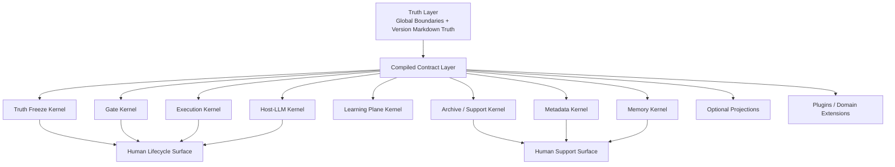
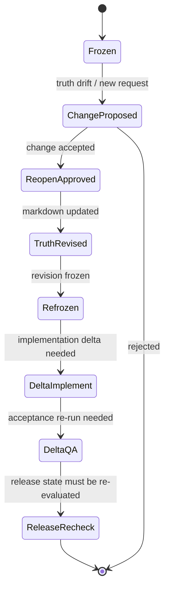
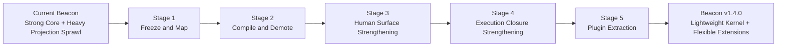

# Beacon v1.4.0 Architecture Blueprint

## Architecture Intent

`v1.4.0` is the version where Beacon stops behaving like a truth kernel plus many semi-equal state planes, and starts behaving like a strict layered system:

1. one truth root
2. one compiled machine contract
3. a small set of core kernels
4. a minimal public surface
5. optional projections and plugins outside the truth path

The product goal is not “less capability”.  
The product goal is “less default weight with the same core judgment power”.

## Kernel Layers

Beacon `v1.4.0` is frozen into five layers:

1. Truth Layer
2. Contract Layer
3. Kernel Services Layer
4. Surface Layer
5. Plugin and Projection Layer

### 1. Truth Layer

Canonical source:

- `docs/beacon/global-boundaries.md`
- `docs/beacon/<version>/**/*.md`

Primary contents:

- PRD
- User Story
- Test Case
- Prototype freeze
- Change records
- Release truth

Rules:

- only markdown truth may define requirement and delivery truth
- revisions, refreeze, and change loops belong here
- implement, qa, goal, board, and task ledger may not redefine this layer

### 2. Contract Layer

The contract layer is the single machine-readable compilation target for core execution.

It exists to serve:

- `implement`
- `qa`
- `gate`
- `release`
- support routing

Rules:

- one-way compiled from truth
- minimal, not exhaustive
- auditable
- host/runtime agnostic at the truth boundary

### 3. Kernel Services Layer

The kernel services that must survive any lightweight refactor are:

1. Truth Freeze Kernel
2. Gate Kernel
3. Execution Kernel
4. Host-LLM Kernel
5. Learning Plane Kernel
6. Metadata / Topology Kernel
7. Memory / Workflow Memory Kernel
8. Archive / Support Kernel

These are non-negotiable Beacon base capabilities.

### 4. Surface Layer

Human lifecycle surface:

- `prd`
- `user-story`
- `test-case`
- `prototype`
- `implement`
- `qa`
- `release`

Human support surface:

- `help`
- `status`
- `doctor`
- `archive`
- `global-boundaries human surface`

Rules:

- surfaces explain and route
- surfaces do not own truth
- support surfaces must answer “what next, why, and what unlocks”

### 5. Plugin and Projection Layer

This layer absorbs optional or domain-specific bulk:

- media workflow
- copywriting workflow
- novel workflow
- analysis toolkits
- experimental project-specific skills
- sqlite / board / pocketbase / report projections

Rules:

- optional by default
- cannot define completion truth
- must consume truth or compiled contract, not bypass them

## Layer Diagram



## Minimal Machine Contract

## Purpose

The contract must be just large enough to support:

- gate decisions
- implement planning and progress
- qa entry and acceptance tracking
- release verification
- support routing

It must not be a second world-model.

## Required Contract Families

Each feature contract must contain at least:

1. identity
2. truth refs
3. revision state
4. acceptance mapping
5. execution mapping
6. gate state
7. change state
8. metadata bindings
9. learning hooks
10. archive state

## Minimal Feature Contract Shape

```json
{
  "schema_version": "2.0",
  "contract_kind": "beacon_feature_contract",
  "version": "v1.4.0",
  "feature_slug": "beacon-v1.4.0-lightweight-kernel-and-core-surface-refactor",
  "truth_refs": {
    "prd": "docs/beacon/v1.4.0/prd/...",
    "user_story": "docs/beacon/v1.4.0/user-story/...",
    "test_case": "docs/beacon/v1.4.0/qa/test-cases/..."
  },
  "revision": {
    "revision_id": "R1",
    "source_revision_id": "R0",
    "doc_status": "frozen"
  },
  "change": {
    "active_change_id": null,
    "change_state": "none"
  },
  "execution": {
    "implement_entry": "implement",
    "qa_entry": "qa",
    "host_mode": "host-native-or-fallback",
    "goal_mode": "optional",
    "task_ledger_ref": "docs/beacon/v1.4.0/execution/tasks-...md"
  },
  "gate": {
    "requirement_gate": "pending",
    "qa_gate": "pending",
    "release_gate": "pending",
    "blocked_reason_codes": []
  },
  "metadata": {
    "canonical_branch": "beacon/v1.4.0",
    "default_execution_service": "beacon"
  }
}
```

## Contract Rules

- compiled from markdown only
- no projection state as source truth
- no release pass without QA and evidence
- no goal or checkbox-only completion
- no freeform writeback from support surfaces

## Change Kernel

`v1.4.0` formalizes `change` as a transaction kernel, not a new public stage.

Required fields:

- `change_id`
- `target_version`
- `target_feature`
- `baseline_revision`
- `reason`
- `affected_truth_refs`
- `affected_layers`
- `verification_refs`
- `archive_status`
- `change_state`

Lifecycle:



## Implement Closure Model

`implement` remains the only implementation entry, but its closure is strengthened.

Execution chain:

```text
frozen requirement package
-> compiled contract
-> implementation plan json
-> tasks ledger projection
-> optional Codex goal
-> Ralph rounds / execution
-> QA handoff
-> gate evidence
```

### Goal Integration Rule

- enabled only when host is Codex and goal capability is available
- objective must map to requirement package and plan
- `goal.complete` is never sufficient completion truth
- `budget_limited` must trigger explicit handoff or block

### Ralph Integration Rule

- Ralph reads current goal state when available
- Ralph stop states must map to gate-facing semantics
- release readiness requires explicit QA closure
- execution audit artifacts remain queryable

### Task Ledger Rule

- `tasks.md`-style ledger is required for human readability
- it is projected from implementation plan and machine progress
- it may not become gate truth

## Support Surface Model

Human support surfaces must become action-oriented.

Default questions they must answer:

1. what artifact is current
2. what is blocked
3. what should happen next
4. why that next step is correct
5. what will unlock after that step

Detailed machine state remains available, but only as a deeper layer.

## Skill Taxonomy and Visibility

`v1.4.0` freezes four tiers:

1. lifecycle core
2. support core
3. advanced project-specific
4. internal maintainer

Visibility rules:

- existence and visibility are different
- default public surface must stay small
- advanced/internal skills are recommended contextually
- `beacon-iteration-governance` is internal maintainer
- `beacon-prototype-reconcile` is advanced project-specific

## Commands To Keep Core

Keep as first-class human surface:

- `prd`
- `user-story`
- `test-case`
- `prototype`
- `implement`
- `qa`
- `release`
- `help`
- `status`
- `doctor`
- `archive`

Keep as support or controlled routing surface:

- `change`
- `brainstorm`
- `global-boundaries human surface`

## Commands or Capabilities To Migrate Outward

Move to plugin, advanced, or internal layers:

- domain-specific media/copy/novel workflows
- experimental deep runtime adapters
- specialized prototype drift reconciliation
- self-repo iteration governance
- optional board or database-first operational views

Rule:

- keep the capability if it is useful
- demote its default visibility if it pollutes the core mental model

## Migration Stages

### Stage 1: Freeze and Map

- freeze kernel boundaries
- freeze test-case coverage
- map every current machine artifact to:
  - canonical contract
  - optional projection
  - removable legacy

### Stage 2: Compile and Demote

- implement minimal machine contract compiler
- rewire gate, implement, qa, and release to consume the compiled contract
- demote legacy projections from primary path

### Stage 3: Human Surface Strengthening

- add task ledger projection
- add action-oriented support outputs
- add global boundary explain/calibrate/route surface
- freeze skill taxonomy and visibility

### Stage 4: Execution Closure Strengthening

- connect goal capability to implement
- align Ralph stop states with QA handoff and gate
- make interruption recovery artifact-anchored

### Stage 5: Plugin Extraction

- move non-core domains and heavy optional capabilities into plugin or advanced layers
- keep truth alignment reusable across domains

## Migration Diagram



## Python Decision

Beacon should continue using Python in `v1.4.0`.

Reason:

- the dominant cost today is prompt volume, artifact sprawl, and contract duplication
- Python is not the primary source of that cost
- existing command, metadata, learning, and runtime utilities are already built in Python
- a language rewrite would increase migration risk while not directly solving truth/projection over-coupling

Performance direction should be:

1. reduce artifact fan-out
2. reduce compile breadth
3. reduce prompt payload size
4. reduce repeated scans and repeated cross-file parsing
5. cache compiled contract and stable metadata
6. lazily materialize optional projections

Only if a post-refactor profile still shows Python as the dominant bottleneck should selective acceleration be considered.

## Final Architecture Decision

Beacon `v1.4.0` is not a simplification-by-deletion release.

It is a simplification-by-separation release:

- keep the base kernels
- shrink the default contract
- demote optional weight
- strengthen change and implement closure
- preserve one frozen truth system across more future domains

<!-- BEACON:TECHNICAL-DELTA-BLUEPRINT:beacon-v1.4.0-prd-bootstrap-safe-requirement-bootstrap-and-freeze-closure:START -->
## Technical Delta Blueprint

- project_mode: `greenfield`
- feature: `beacon-v1.4.0-prd-bootstrap-safe-requirement-bootstrap-and-freeze-closure`
- version: `v1.4.0`

### Source Refs
- prd: `docs/beacon/v1.4.0/prd/beacon-v1.4.0-prd-bootstrap-safe-requirement-bootstrap-and-freeze-closure.md`
- user_story: `docs/beacon/v1.4.0/user-story/beacon-v1.4.0-prd-bootstrap-safe-requirement-bootstrap-and-freeze-closure.md`
- test_case: `docs/beacon/v1.4.0/qa/test-cases/beacon-v1.4.0-prd-bootstrap-safe-requirement-bootstrap-and-freeze-closure.md`

### Delivery Change Surface
- none
### Available Entry Surfaces
- none
### Current Service Facts
- none

### Must Change
- none

### Can Reuse
- none

### No-Expand Guardrails
- none

### Compatibility Rules
- none

### Delivery Constraints
- none

### Implement Handoff
- none
<!-- BEACON:TECHNICAL-DELTA-BLUEPRINT:beacon-v1.4.0-prd-bootstrap-safe-requirement-bootstrap-and-freeze-closure:END -->

<!-- BEACON:IMPLEMENTATION-DELIVERY-BASELINE:beacon-v1.4.0-prd-bootstrap-safe-requirement-bootstrap-and-freeze-closure:START -->
## Implementation Delivery Baseline

- baseline_id: `impl-delivery-baseline-v1.4.0-beacon-v1.4.0-prd-bootstrap-safe-requirement-bootstrap-and-freeze-closure-R1`
- transaction_id: `tx-45185092e24bb53aa`
- source_hash: `sha256:19079fd10c3d9e6669f797d8c72ef639b050af6015e999e547556ec7d1da93c9`
- projection_seq: `1`
- version: `v1.4.0`
- feature: `beacon-v1.4.0-prd-bootstrap-safe-requirement-bootstrap-and-freeze-closure`
- lifecycle_role: `pre-implement delivery blueprint projection`
- projection_refresh_trigger: `implement plan against the active frozen revision`
- branch_strategy: `single-branch`
- base_branch: `main`
- default_target_branch: `beacon/v1.4.0`
- branch_prefix: `beacon/`
- use_git_worktree: `False`
- worktree_root: `.`
- workspace_root: `.`

### Delivery Service Scope
- direct_delivery_services: .
- writable_services: .
- reference_only_services: docs
- depends_on_features: -

### Plan-Time Gate Contract
- canonical envelope is the only delivery baseline source.
- deterministic implementation contract, git workflow contract, and implementation plan are projections.
- gates must block if projection metadata or service/branch/worktree fields drift.
<!-- BEACON:IMPLEMENTATION-DELIVERY-BASELINE:beacon-v1.4.0-prd-bootstrap-safe-requirement-bootstrap-and-freeze-closure:END -->

<!-- BEACON:TECHNICAL-DELTA-BLUEPRINT:beacon-v1.4.0-prd-bootstrap-unified-requirement-closure-orchestration:START -->
## Technical Delta Blueprint

- project_mode: `greenfield`
- feature: `beacon-v1.4.0-prd-bootstrap-unified-requirement-closure-orchestration`
- version: `v1.4.0`

### Source Refs
- prd: `docs/beacon/v1.4.0/prd/beacon-v1.4.0-prd-bootstrap-unified-requirement-closure-orchestration.md`
- user_story: `docs/beacon/v1.4.0/user-story/beacon-v1.4.0-prd-bootstrap-unified-requirement-closure-orchestration.md`
- test_case: `docs/beacon/v1.4.0/qa/test-cases/beacon-v1.4.0-prd-bootstrap-unified-requirement-closure-orchestration.md`

### Delivery Change Surface
- none
### Available Entry Surfaces
- none
### Current Service Facts
- none

### Must Change
- none

### Can Reuse
- none

### No-Expand Guardrails
- none

### Compatibility Rules
- none

### Delivery Constraints
- none

### Implement Handoff
- none
<!-- BEACON:TECHNICAL-DELTA-BLUEPRINT:beacon-v1.4.0-prd-bootstrap-unified-requirement-closure-orchestration:END -->

<!-- BEACON:IMPLEMENTATION-DELIVERY-BASELINE:beacon-v1.4.0-prd-bootstrap-unified-requirement-closure-orchestration:START -->
## Implementation Delivery Baseline

- baseline_id: `impl-delivery-baseline-v1.4.0-beacon-v1.4.0-prd-bootstrap-unified-requirement-closure-orchestration-R1`
- transaction_id: `tx-2508e9668fc0af414`
- source_hash: `sha256:108cfb84612b60249a8d6b133707d82e04d05e3d760f0902d3f5d0ae40a598b8`
- projection_seq: `1`
- version: `v1.4.0`
- feature: `beacon-v1.4.0-prd-bootstrap-unified-requirement-closure-orchestration`
- lifecycle_role: `pre-implement delivery blueprint projection`
- projection_refresh_trigger: `implement plan against the active frozen revision`
- branch_strategy: `single-branch`
- base_branch: `main`
- default_target_branch: `beacon/v1.4.0`
- branch_prefix: `beacon/`
- use_git_worktree: `False`
- worktree_root: `.`
- workspace_root: `.`

### Delivery Service Scope
- direct_delivery_services: .
- writable_services: .
- reference_only_services: docs
- depends_on_features: -

### Plan-Time Gate Contract
- canonical envelope is the only delivery baseline source.
- deterministic implementation contract, git workflow contract, and implementation plan are projections.
- gates must block if projection metadata or service/branch/worktree fields drift.
<!-- BEACON:IMPLEMENTATION-DELIVERY-BASELINE:beacon-v1.4.0-prd-bootstrap-unified-requirement-closure-orchestration:END -->

<!-- BEACON:IMPLEMENTATION-DELIVERY-HOST:START -->
## Implementation Delivery Host

- version: `v1.4.0`
- feature_count: `3`
- transaction_id: `tx-342d09c9fca28c89c`
- source_hash: `sha256:6acdedc6e3ab74ff90a5f48d08c0e39a876fe846944b633deeb554d84cb1d1ed`

### Registered Feature Baselines
- `beacon-v1.4.0-lightweight-kernel-and-core-surface-refactor` | revision=`R1` | branch=`beacon/v1.4.0` | writable_services=. | depends_on=- | baseline_ref=`docs/beacon/v1.4.0/.machine/execution/implementation-delivery-baseline-beacon-v1.4.0-lightweight-kernel-and-core-surface-refactor.json`
- `beacon-v1.4.0-prd-bootstrap-safe-requirement-bootstrap-and-freeze-closure` | revision=`R1` | branch=`beacon/v1.4.0` | writable_services=. | depends_on=- | baseline_ref=`docs/beacon/v1.4.0/.machine/execution/implementation-delivery-baseline-beacon-v1.4.0-prd-bootstrap-safe-requirement-bootstrap-and-freeze-closure.json`
- `beacon-v1.4.0-prd-bootstrap-unified-requirement-closure-orchestration` | revision=`R1` | branch=`beacon/v1.4.0` | writable_services=. | depends_on=- | baseline_ref=`docs/beacon/v1.4.0/.machine/execution/implementation-delivery-baseline-beacon-v1.4.0-prd-bootstrap-unified-requirement-closure-orchestration.json`
<!-- BEACON:IMPLEMENTATION-DELIVERY-HOST:END -->

<!-- BEACON:TECHNICAL-DELTA-BLUEPRINT:beacon-v1.4.0-lightweight-kernel-and-core-surface-refactor:START -->
## Technical Delta Blueprint

- project_mode: `greenfield`
- feature: `beacon-v1.4.0-lightweight-kernel-and-core-surface-refactor`
- version: `v1.4.0`

### Source Refs
- prd: `docs/beacon/v1.4.0/prd/beacon-v1.4.0-lightweight-kernel-and-core-surface-refactor.md`
- user_story: `docs/beacon/v1.4.0/user-story/beacon-v1.4.0-lightweight-kernel-and-core-surface-refactor.md`
- test_case: `docs/beacon/v1.4.0/qa/test-cases/beacon-v1.4.0-lightweight-kernel-and-core-surface-refactor.md`

### Delivery Change Surface
- none
### Available Entry Surfaces
- none
### Current Service Facts
- none

### Must Change
- none

### Can Reuse
- none

### No-Expand Guardrails
- none

### Compatibility Rules
- none

### Delivery Constraints
- none

### Implement Handoff
- none
<!-- BEACON:TECHNICAL-DELTA-BLUEPRINT:beacon-v1.4.0-lightweight-kernel-and-core-surface-refactor:END -->

<!-- BEACON:IMPLEMENTATION-DELIVERY-BASELINE:beacon-v1.4.0-lightweight-kernel-and-core-surface-refactor:START -->
## Implementation Delivery Baseline

- baseline_id: `impl-delivery-baseline-v1.4.0-beacon-v1.4.0-lightweight-kernel-and-core-surface-refactor-R1`
- transaction_id: `tx-4709358de6898126b`
- source_hash: `sha256:68eeacb4d25735b1564e8387ba4cb0182eacaabd84b620b0980370c841d699e4`
- projection_seq: `1`
- version: `v1.4.0`
- feature: `beacon-v1.4.0-lightweight-kernel-and-core-surface-refactor`
- lifecycle_role: `pre-implement delivery blueprint projection`
- projection_refresh_trigger: `implement plan against the active frozen revision`
- branch_strategy: `single-branch`
- base_branch: `main`
- default_target_branch: `beacon/v1.4.0`
- branch_prefix: `beacon/`
- use_git_worktree: `False`
- worktree_root: `.`
- workspace_root: `.`

### Delivery Service Scope
- direct_delivery_services: .
- writable_services: .
- reference_only_services: docs
- depends_on_features: -

### Plan-Time Gate Contract
- canonical envelope is the only delivery baseline source.
- deterministic implementation contract, git workflow contract, and implementation plan are projections.
- gates must block if projection metadata or service/branch/worktree fields drift.
<!-- BEACON:IMPLEMENTATION-DELIVERY-BASELINE:beacon-v1.4.0-lightweight-kernel-and-core-surface-refactor:END -->
