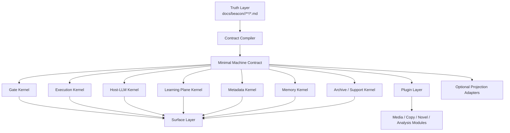
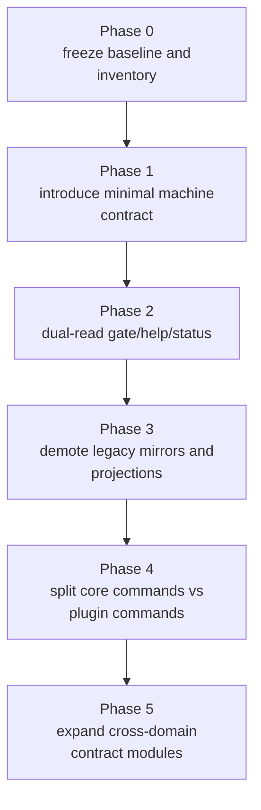
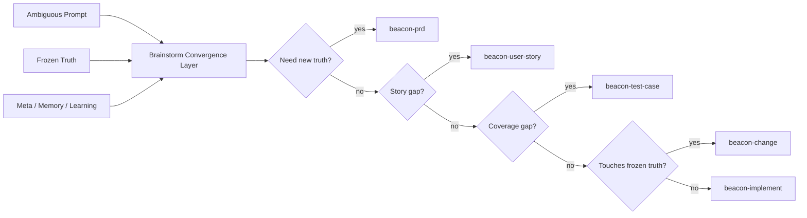
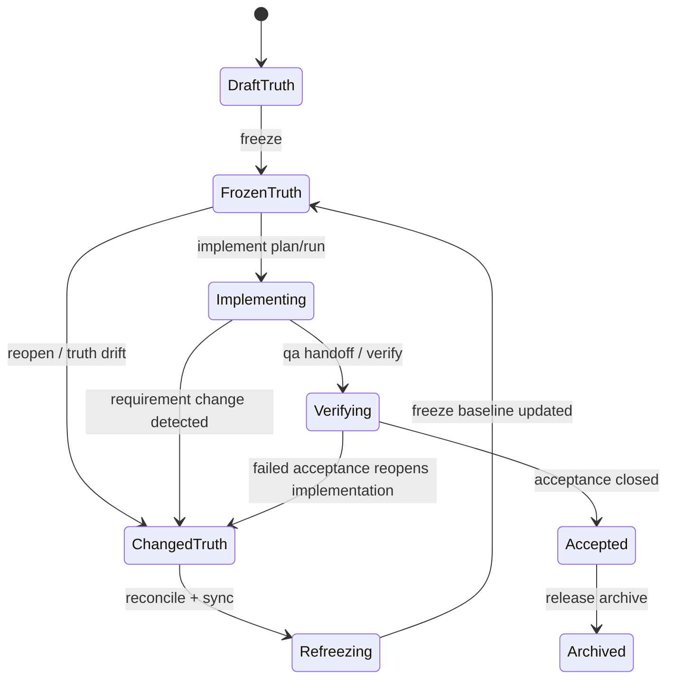

# PRD: Beacon v1.4.0 lightweight kernel and core surface refactor

**Feature**: `beacon-v1.4.0-lightweight-kernel-and-core-surface-refactor`  
**Version**: `v1.4.0`  
**Date**: `2026-05-06`  
**Status**: `freeze-ready`  
**Track**: `main`  
**Scenario**: `kernel_lightweight_refactor + truth_contract_reduction + core_surface_governance`  
**Template**: `主 PRD / architecture-refactor`

## Context

- Global boundaries: `docs/beacon/global-boundaries.md`
- Latest runtime line: `docs/beacon/v1.3.12/`
- Source-grounded analysis:
  - `docs/brainstorms/2026-05-06-beacon-core-kernel-spec.md`
  - `docs/brainstorms/2026-05-06-beacon-capability-gap-map-and-lightweight-evolution.md`
  - `docs/brainstorms/2026-05-06-beacon-v2-lightweight-kernel-architecture.md`
  - `docs/brainstorms/2026-05-06-beacon-v2-brainstorm-integration-architecture.md`
  - `docs/brainstorms/2026-05-06-beacon-v1.4.0-feasibility-of-lightweight-change-and-implement-strengthening.md`
  - `docs/brainstorms/2026-05-06-beacon-v1.4.0-opsx-borrowing-map-and-missing-boundaries.md`
  - `docs/brainstorms/2026-05-06-beacon-v1.4.0-human-surface-skill-audit-iteration-governance-and-prototype-reconcile.md`
- External workflow references:
  - `oss-sync/automation/autoresearch/openspec/README.md`
  - `oss-sync/automation/autoresearch/openspec/docs/workflows.md`
  - `oss-sync/automation/autoresearch/openspec/docs/commands.md`
  - `oss-sync/automation/autoresearch/openspec/src/commands/change.ts`
- Current Codex goal references:
  - `oss-sync/agents/tools/codex/codex-rs/features/src/lib.rs`
  - `oss-sync/agents/tools/codex/codex-rs/tools/src/goal_tool.rs`
  - `oss-sync/index/learning/openai-codex-goal-user-guide.zh-CN.md`
  - `oss-sync/index/learning/openai-codex-goal-runtime-deep-dive.zh-CN.md`
- Key command surfaces:
  - `beacon/commands/prd.py`
  - `beacon/commands/brainstorm.py`
  - `beacon/commands/gate.py`
  - `beacon/commands/implement.py`
  - `beacon/commands/qa.py`
- Key kernel utilities:
  - `beacon/utils/semantic_runtime.py`
  - `beacon/utils/project_metadata.py`
  - `beacon/utils/learning_loop.py`
  - `beacon/utils/memory.py`
  - `beacon/utils/workflow_memory.py`
  - `beacon/utils/material_sync.py`
- `beacon/utils/runtime_projection_store.py`
- `beacon/utils/writeback.py`

## Overview

`v1.4.0` 的目标不是重写 Beacon，也不是删除既有治理能力，而是在保留 frozen truth、gate、implement/qa、host-runtime、learning、metadata、memory、archive 等核心基座的前提下，把默认运行形态收敛为更轻的 kernel 与更清晰的 core surface。

这一轮交付需要同时解决两类问题：

- 让 truth、machine contract、optional projection 三层边界重新收敛，降低多真相幻觉与默认路径重量。
- 让 change、implement、global-boundaries、support surface、skill visibility 等关键协作面具备更低摩擦、更可审计的人类面与执行闭环。

## Scope

In scope:

- 收敛 Beacon 的 lightweight kernel、minimal machine contract 与 core surface governance。
- 正式化 change identity / contract / archive 与 implement -> QA -> release 的闭环边界。
- 增强 Codex goal / Ralph / task ledger / global-boundaries / help-status-archive / skill visibility 等主线能力。

Out of scope:

- 改写 Beacon 的主语言或重做整套 runtime。
- 删除 frozen truth、gate、implement、qa、host-runtime、learning、metadata、memory、archive 等既有核心能力。
- 把 brainstorm、projection 或 support surface 升格为新的 truth 源或新的 primary lifecycle stage。

## 1. 问题

### 1.1 Beacon 已具备较强工程治理能力，但当前默认形态过重

现有 Beacon 已经能够满足大部分基础 code 开发治理需求，尤其在以下方面已有明显积累：

1. requirement freeze
2. gate 阻断与完成判定
3. git workflow 约束
4. host-runtime LLM 语义执行
5. metadata / memory / learning / archive 等工程化支撑

但源码分析显示，当前默认运行路径已经出现明显“内核与投影耦合过深”的问题：

- truth 之外存在过多 machine mirror、projection、runtime ledger、board/read-model 参与主路径判断
- 事务性双写约束被放大为多处状态面，而不是围绕单一 canonical source 的单向投影
- gate / implement / qa 对碎片 artifact 输入有较重依赖，导致 token、I/O、状态理解成本偏高
- 一部分历史命令与模板面仍挂在核心 CLI 叙事里，扩大了人类面与机器面的心智负担

### 1.2 当前重量的根本问题不是 Python，而是职责耦合与多真相幻觉

本轮分析的高置信度结论是：

- 性能与 token 消耗的主要矛盾，不在于 Beacon 使用 Python
- 主要矛盾在于：
  - truth / contract / projection / support surface 没有彻底分层
  - 多写入点缺乏“唯一 canonical 驱动”的严格收敛
  - machine artifact 数量超出 gate 必需最小集
  - 非核心场景与基础 code gate 主路径耦合过多

因此，`v1.4.0` 的方向不是重写语言，而是：

> 在保留 Beacon 核心基座能力的前提下，重构为更轻的 kernel + minimal machine contract + plugin/domain 分层体系。

### 1.3 Beacon 不能为了减重而丢掉内核身份

通过源码反推，Beacon 当前真实存在的不可误删基座至少包括：

1. Truth Freeze Kernel
2. Gate Kernel
3. Execution Kernel
4. Host-LLM Kernel
5. Learning Plane Kernel
6. Metadata / Topology Kernel
7. Memory / Workflow Memory Kernel
8. Archive / Support Surface Kernel

其中用户显式强调至少要保留的包括：

- 学习面
- 真相冻结能力
- 实现能力
- 门禁能力
- host-llm 能力
- meta 元信息
- 子学习

所以 `v1.4.0` 不是“做薄一切”，而是：

> 只减非核心重量，不减核心判断力、冻结力、学习力与执行闭环。

### 1.4 为什么 `v1.4.0` 现在必须做整体减负

如果继续沿当前默认重路径演进，会出现四类问题：

1. 基础 code 开发场景继续承担过量 machine/runtime artifact 成本
2. Beacon 作为 host-runtime LLM 的轻量 agent skill 定位会被削弱
3. 后续扩展到 media / copy / novel 等场景时，会把当前重量错误复制到新域
4. 真相冻结与 gate 的强能力会被外围投影复杂度稀释

因此 `v1.4.0` 的主题必须是：

> 让 Beacon 回到“轻量 workflow kernel”定位，以冻结真相与 gate 为核心，对基础 code 开发保持强治理，对其他场景保持可扩展，但不默认背负过重投影。

### 1.5 `change` 现在还不是足够健壮的一等事务单元

结合源码与 OpenSpec 参考可以确认，Beacon 当前关于变更的能力存在明显结构性缺口：

- `beacon-change` 目前更像 host-visible router，而不是成型的强事务命令
- 实际 change 语义分散在：
  - `reopen`
  - `freeze`
  - `change-impact.json`
  - `release` 聚合文档
  - gate / help / status 的 change_loop 推荐
- 缺少类似 OpenSpec 那种以“change folder / change metadata / validate / archive”为中心的稳定工作单元

这意味着 Beacon 虽然已经知道“什么时候该进入变更回路”，但还不够擅长：

- 把变更提案、影响面、任务面、验收面固化为单一 change contract
- 在 refreeze、implement、qa、release 之间稳定传递同一变更身份
- 在并行变更、打断恢复、版本归档时保持强一致

### 1.6 Beacon 还没有把 Codex `goal` 与 Ralph 闭环正式收编进 `implement` 主路径

基于 2026-05-06 对 `openai/codex` 上游与本地镜像的核验：

- 本地镜像 `HEAD` 为 `fe24a180ab6f6b3639b682cc6a1e71150fea6d48`
- 远端 `main` 已前进到 `8f3bb355f432317e8fdef3b6a5f9ef014c575fa1`
- 当前 Codex 已存在实验性 `Goals` 子系统，包含：
  - persisted thread goal
  - goal status
  - token/time accounting
  - model-visible `get_goal / create_goal / update_goal`

但 Beacon 当前 `implement` 虽已具备 host runtime 与 Ralph 支持，仍缺少：

- requirement package 到 Codex goal objective 的正式映射
- goal status 到 Beacon implement state 的正式映射
- goal budget / pause / resume / complete 与 Ralph round state 的统一闭环
- 当 host 是 Codex 且 goals 可用时的默认接入策略

结果是 Beacon 已经具备“实现入口”和“Ralph 执行面”，但还没有形成：

> requirement truth -> thread goal -> Ralph rounds -> QA handoff -> release readiness

这条更强的默认实现闭环。

### 1.7 Beacon 仍缺少若干低摩擦人类面协作边界

结合 OPSX 的 artifact-guided workflow 与 Beacon 当前实现，可以确认 Beacon 还存在几类“能力已部分存在、但 human surface 不够显性”的缺口：

- `implement` 缺少 `tasks.md` checkbox progress ledger 这类人机共读执行账本
- `global-boundaries.md` 已存在，但没有显性的人类面子 skill/命令来操作全局上下文边界
- `help/status/archive` 能回答很多问题，但对人类而言仍偏 machine/read-model 叙事
- artifact dependency、并行 change、中断恢复等边界仍没有足够轻的人类可见面

这些缺口不直接表现为“功能不存在”，而表现为：

> 内核很强，但人类面协作成本仍偏高。

### 1.8 Beacon skill 存在性 与 默认可见性 仍未分层治理

最近审计表明，Beacon 的 skill 树中混入了不属于默认用户心智面的能力，例如：

- `beacon-iteration-governance`
- `beacon-prototype-reconcile`

它们都有用途，但用途分别偏向：

- Beacon 自仓库维护 / release governance
- 特定项目 takeover / prototype drift reconcile

问题不在于“这些 skill 不该存在”，而在于：

- 目前 skill 的存在性与人类面默认可见性没有清晰分层
- internal maintainer skill、advanced rescue skill、主流程 skill 混在同一人类心智面中
- 这会直接破坏 Beacon 极简用户面

因此 `v1.4.0` 需要补的不是“删除这些能力”，而是：

> 正式建立 skill taxonomy 与 visibility governance。

## 2. 目标

### 2.1 主要目标

`v1.4.0` 必须完成以下目标：

1. 保留 `docs/beacon/<version>/**/*.md` 作为唯一冻结真相源
2. 把 machine 面收敛为一套 minimal machine contract
3. 让 `implement` 仍是唯一实现入口，`qa` 仍是唯一验收入口
4. 让 gate 仍是 completion/blocking 的统一判定器
5. 保留 host-runtime LLM 的原生桥接、fallback 和 readiness 能力
6. 保留 metadata / learning / memory / archive 等系统级基座
7. 把非基础 code 核心路径之外的能力迁到 plugin/domain layer
8. 把 Brainstorm 保留为只读收敛层，而不是新的 truth 源或公开主阶段
9. 把 `change` 收敛成正式的一等事务单元，但不新增新的公开一级主命令
10. 在 host 为 Codex 且 `goal` 可用时，让 `implement` 默认具备 goal 驱动能力，并与 Ralph 闭环联动
11. 为 `implement` 增加轻量 human-readable tasks progress ledger，但不引入第二执行真相源
12. 为 `global-boundaries` 增加显性的人类面上下文/边界操作子 skill
13. 让 `help/status/archive` 更偏 action-oriented human projection，而不是暴露底层复杂度
14. 为 Beacon skill 建立正式的人类面分层与默认可见性治理

### 2.2 非目标

- 不改变人类主流程：
  - `prd -> user-story -> test-case -> prototype -> implement -> qa -> release`
- 不新增新的公开一级主命令
- 不让 board/sqlite/pocketbase/runtime ledger 继续默认定义 truth closure
- 不让 Brainstorm 直接 freeze、change、implement 或 release
- 不把所有内容场景一次性产品化完毕
- 不因为“追求高性能”而仓促迁移出 Python
- 不照搬 OpenSpec 的公开命令面
- 不要求所有 host runtime 都必须实现 Codex goal 语义才能执行 implement

### 2.3 核心判断

`v1.4.0` 的第一性原则是：

- 真相只能有一份
- 机器契约只能保留最小必需
- 投影只能从 canonical 单向生成
- gate 只依赖必要 contract，不依赖历史噪音
- 命令分层必须服务于“轻量内核 + 灵活扩展”

## 3. 设计原则

### 3.1 Frozen Truth First

- `docs/beacon/<version>/**/*.md` 是唯一冻结真相源
- 所有 machine contract、runtime projection、support read-model 都只能由其单向编译
- human 文档不能反向驱动 machine 真相漂移

### 3.2 Minimal Machine Contract

- 机器面只保留 gate / implement / qa / release 真正需要的最小结构
- 多份同义 mirror 不再作为主路径依赖
- machine contract 必须幂等、可重编译、可审计

### 3.3 Keep the Kernel, Move the Bulk

- 需要保留的内核继续留在 core
- 不属于基础 code gate 主路径的内容迁往 plugin/domain layer
- 扩展优先通过 contract/module，而不是继续增加一级命令

### 3.4 Human Surface Must Stay Small

- 人类心智面继续保持极简
- 复杂 runtime/team/subagent/projection 细节默认留在机器内部
- `doctor` 只做诊断与修复，不成为新增常驻主流程
- 允许增加显性子 skill 或 support projection，但不得把它们扩张为新的一级主命令

### 3.5 Brainstorm Is Convergence, Not Truth

- Brainstorm 保留
- Brainstorm 只读
- Brainstorm 负责 gap 收敛与 route recommendation
- Brainstorm 不产生平行 truth package

### 3.6 Python Continues Unless Profiling Proves Otherwise

- 现阶段继续沿用 Python
- 先通过架构减耦、artifact 减量、compile 单向化解决 80% 问题
- 只有在真实 profiling 证明 Python 成为瓶颈时，才讨论局部重写

## 4. 范围

### In scope

- Beacon core kernel 分层重构
- minimal machine contract 定义与编译规则
- gate / implement / qa 对 contract 的主路径切换
- core commands vs plugin commands 分层
- Brainstorm 的 v2 收敛定位
- metadata / learning / memory / archive 的轻量保留方案
- 基础 code 开发 gate 能力保留
- 后续扩展到 media / copy / novel 的统一 freeze kernel 抽象

### Out of scope

- 立即移除所有 legacy artifact 的物理文件
- 在 `v1.4.0` 同时完成所有 domain plugin 的实现
- 重新设计新的大而全 CLI
- 让 runtime projection 成为新的 truth root

## 5. 功能需求

### FR-001 Beacon 必须冻结一套正式的 v2 轻量内核分层

`v1.4.0` 必须把架构正式收敛为以下五层：

1. Truth Layer
2. Contract Layer
3. Kernel Services Layer
4. Surface Layer
5. Plugin Layer

其中：

- Truth Layer 只包含 `docs/beacon/<version>/**/*.md`
- Contract Layer 只包含 minimal machine contract
- Kernel Services Layer 至少保留 gate / execution / host-llm / learning / meta / memory / archive-support
- Surface Layer 继续暴露极简主面
- Plugin Layer 承载非核心 domain / tooling / projection 扩展

### FR-002 Beacon 必须正式定义 minimal machine contract

`v1.4.0` 必须把当前分散 machine 面收敛为至少两类 artifact：

- `docs/beacon/<version>/.machine/compiled/<feature>.json`
- `docs/beacon/<version>/.machine/compiled/index.json`

单 feature contract 至少要覆盖：

- truth refs
- revision / baseline / doc status
- promised surfaces
- acceptance criteria
- test-case references
- AC/TC mapping
- execution entry contract
- git workflow binding
- gate verdict fields
- acceptance evidence refs
- metadata binding
- learning hooks
- archive status
- compile metadata

### FR-003 machine contract 必须由 markdown 单向编译得出

编译规则必须满足：

- 输入唯一来源于冻结 truth 与必要 metadata
- 编译幂等
- 允许重编译
- 不反写 truth
- 不直接嵌入 runtime projection truth
- 编译失败时必须阻断依赖该 contract 的主路径 gate

### FR-004 Beacon 必须重新定义事务性双写为“canonical 驱动的单向投影”

`v1.4.0` 必须保留事务一致性要求，但把当前重双写收敛为：

- 只有 canonical envelope 可以提交
- 所有 human/machine/runtime sink 都由 canonical 单向投影
- sink 不是独立真相源

提交流程必须遵循：

`prepare -> validate -> commit -> publish -> verify`

事务元数据至少包括：

- `source_hash`
- `projection_seq`
- `transaction_id`
- `committed_at`
- `sink_checksums`

### FR-004A Beacon 必须把 `change` 升级为正式 change kernel，而不是零散路由

借鉴 OpenSpec 的高价值部分，但保持 Beacon 自身边界，`v1.4.0` 必须补齐：

- 单一 change identity
- 单一 change contract
- 单一 change archive / merge / re-freeze 路径

建议 change contract 至少覆盖：

- `change_id`
- `target_version`
- `target_feature`
- `trigger_type`
- `change_reason`
- `baseline_revision`
- `affected_truth_refs`
- `affected_layers`
- `proposal_summary`
- `decision_log`
- `task_closure`
- `verification_refs`
- `archive_status`

公开人类面仍保持 `beacon-change` 作为 router，但内核里必须有稳定的一等 change 单元。

### FR-004B Beacon `change` 必须借鉴 OpenSpec 的“单变更工作单元”而不是照搬其公开工作流

OpenSpec 值得借鉴的不是其全部命令，而是以下机制：

- 每个 change 都有稳定目录与身份
- proposal / spec / design / tasks 围绕同一 change 聚合
- validate / archive 围绕同一 change 工作
- 支持并行 change 与恢复

Beacon 应借鉴为：

- 每个 frozen truth 变更都必须有显式 change contract
- reopen / revise / refreeze / implement delta / qa delta / release recheck 必须绑定同一 change identity
- change archive 必须能回写 version-level change summary
- 并行 change 必须可被 status/help/report 检出

Beacon 不应照搬为：

- 新增一套 OpenSpec 式公开 phase 命令
- 让 change 取代 Beacon 原有 requirement truth 主链

### FR-005 基础 code gate 基座能力必须完整保留

在减重后，Beacon 对基础 code 开发的核心门禁能力不能下降，至少保留：

- requirement completeness 判定
- AC/TC coverage 判定
- git workflow / branch alignment 判定
- revision / baseline drift 判定
- prototype readiness 判定
- implementation / qa acceptance evidence 判定
- semantic contract 判定
- blocked reason / next step / repair route 输出

### FR-006 `implement` 与 `qa` 仍必须是唯一执行入口

`v1.4.0` 必须保持：

- `implement` 是唯一实现入口
- `qa` 是唯一验收入口

同时要求：

- team / ralph / subagent 只作为内部执行形态
- runtime mode 只能改变执行形态，不能改变 truth 或 acceptance 口径

### FR-006A `implement` 必须默认支持 Codex goal 驱动执行

当 host runtime 为 Codex 且 `Goals` feature 可用时，`implement` 应默认具备以下能力：

- 从 requirement package / implementation plan 生成 goal objective
- 把 goal 绑定到当前 persisted thread
- 读取 goal status、tokens used、time used、budget state
- 在目标完成时，把完成状态回写到 Beacon implement state

最低映射关系至少包括：

- `goal.active` -> `implement_in_progress`
- `goal.paused` -> `implement_waiting`
- `goal.budget_limited` -> `implement_budget_limited`
- `goal.complete` -> `implement_ready_for_verification`

### FR-006B Ralph 必须与 Codex goal 形成统一闭环，而不是并行孤岛

`v1.4.0` 必须要求 Ralph runtime 与 goal runtime 建立正式耦合：

- Ralph 每轮 round 必须知道当前 goal objective 与 status
- 当 goal 进入 `budget_limited` 时，Ralph 必须进入收尾/交接态，而不是继续无边界推进
- 当 Ralph 需要人工接手时，必须保留 goal 状态与未完成工作摘要
- 当 Ralph 完成实现并通过必要验证时，可触发 goal 完成或进入 QA handoff

这条闭环至少要形成：

`truth -> implement plan -> goal -> Ralph rounds -> verification -> qa handoff`

### FR-006C `implement` 必须补齐 human-readable tasks progress ledger

借鉴 OPSX 的 `tasks.md` 执行账本思路，`v1.4.0` 必须为 `implement` 增加一层显性的人类面任务进度投影。

该投影至少要满足：

- 能展示任务总数与已完成数
- 能以 checkbox 或等价低摩擦格式显示任务状态
- 能显示当前阻断任务与下一步任务
- 能支持中断后恢复阅读
- 能被 agent 与人类共同消费

但必须明确：

- 这份 task ledger 不是 truth
- 这份 task ledger 不是 gate 真相
- 这份 task ledger 不是 release 准入真相
- 它是 implementation contract 的 human projection

### FR-006D `tasks progress ledger` 必须由 canonical implementation plan 单向投影

建议最小结构：

- canonical source:
  - `docs/beacon/<version>/.machine/execution/implementation-plan-<feature>.json`
- machine progress:
  - `docs/beacon/<version>/.machine/execution/implementation-plan-<feature>.progress.json`
- human projection:
  - `docs/beacon/<version>/execution/tasks-<feature>.md`

规则：

- JSON plan 定义 task identity / dependency / traceability
- progress json 定义 machine aggregation
- tasks markdown 只负责人类可读勾选进度与阻断提示

### FR-007 Host-LLM Kernel 必须保留并减耦

`v1.4.0` 必须保留：

- host runtime detection
- native bridge / fallback
- requested/effective/fallback mode
- runtime readiness precheck
- delegation readiness precheck
- prompt boundary / host trace

但应减少：

- 非必要 adapter 花样
- 与 projection/read-model 的额外耦合

### FR-007A Host runtime 特性差异必须进入实现 contract

不同 host runtime 的能力差异，尤其是 Codex goal、thread persistence、tool/runtime boundary，必须进入 implement contract，而不是只停留在 adapter 内部。

至少应显式记录：

- host supports persisted thread goal
- host supports goal tool set
- host supports pause/resume lifecycle
- host supports Ralph-compatible continuation
- fallback route when unsupported

### FR-008 Learning Plane Kernel 必须保留 typed contract，而不是被删掉

`v1.4.0` 必须为 learning plane 保留正式职责：

- 记录反馈
- 吸收 debug / workflow / rewrite input
- 定义 keep/discard / policy topic / evaluation skeleton
- 允许对后续语义收敛与补齐产生影响

但 learning plane 不能：

- 直接改写 frozen truth
- 越权替代 gate verdict

### FR-009 Metadata / Topology Kernel 必须继续作为工程运行底座

`v1.4.0` 必须继续支持：

- topology kind
- service / repo binding
- per-version canonical branch
- default execution service
- metadata transaction consistency

没有 metadata 的版本线，不应被视为完整工程交付面。

### FR-010 Memory / Workflow Memory Kernel 必须保留统一 envelope

`v1.4.0` 必须保留：

- memory envelope
- lifecycle memory
- workflow journal
- debug feedback event
- feedback assimilation

但要减少：

- 对主路径 gate 非必要的重复影子写入
- 与外围 support 报表的强耦合

### FR-011 Archive / Support Surface 必须保留，但不再膨胀为主路径复杂度

`v1.4.0` 必须保留：

- `help`
- `status`
- `doctor`
- `archive`

其中：

- `help/status` 优先读取 minimal machine contract
- `doctor` 负责显式诊断、阻断修复、编译修复
- `archive` 负责历史 truth 退出 active delivery plane 的治理

### FR-011A `help/status/archive` 必须增加 action-oriented human projection

借鉴 OPSX 的轻反馈面，Beacon 的 support surface 应更显式回答：

- 当前卡在哪个 artifact
- 下一个可推进动作是什么
- 为什么是它
- 做完会 unlock 什么
- 当前 closure summary 是什么

要求：

- 默认输出面优先人类可读
- 复杂 read-model 留在 JSON / machine 面
- 不扩大公开一级命令数量

### FR-011B support surface 必须承担 advanced/internal skill 的条件式推荐

对于不属于默认用户人类面的能力，Beacon 不应默认暴露技能名，而应由：

- `help`
- `status`
- `doctor`
- 相关 lifecycle/surface

在满足特定条件时再推荐。

例如：

- severe prototype drift -> 推荐 `beacon-prototype-reconcile`
- Beacon self-repo release-governance -> 推荐 `beacon-iteration-governance`

### FR-012 Brainstorm 必须作为只读收敛层被正式保留

`v1.4.0` 必须把 Brainstorm 定义为：

- Support Kernel + Learning Plane + Host-LLM semantic convergence surface

而不是：

- lifecycle core
- truth layer
- contract compiler

Brainstorm 输出必须至少区分：

- confirmed facts
- assumptions under test
- contradictions
- open questions
- route candidates
- recommended route
- confidence
- closure state

### FR-012A Beacon 必须增加显性的人类面全局上下文/边界子 skill

`v1.4.0` 必须补齐一个正式的人类面 global context / boundary operation surface。

它的职责至少包括：

- 解释 Beacon 全局边界
- 判断当前问题是否违反全局边界
- 判断某条原则应进入 `global-boundaries`、版本 PRD，还是只保留在 brainstorm
- 解释某个 feature/版本线当前受哪些上位边界约束

该能力：

- 可以是子 skill
- 可以是 support surface 的专门入口
- 但不应扩张为新的 primary lifecycle stage

### FR-012B global boundary surface 必须区分全局原则与版本线原则

该人类面能力必须显式区分：

- Beacon-wide global constraints
- version-line constraints
- feature-local constraints

并能回答：

- 这是全局原则吗
- 这是某个版本线吸收的原则吗
- 这是某个 feature 的局部边界吗

### FR-012C Beacon 必须建立正式 skill taxonomy

`v1.4.0` 必须把 Beacon skill 至少分为以下四层：

1. Lifecycle Core Skills
2. Support Core Skills
3. Advanced / Project-Specific Skills
4. Internal Maintainer Skills

该 taxonomy 必须可被：

- 文档
- router
- help/status
- skill discovery

共同消费。

### FR-012D Beacon 必须建立默认 skill visibility governance

Beacon 必须明确：

- 哪些 skill 默认对用户可见
- 哪些 skill 只在条件满足时推荐
- 哪些 skill 属于 internal-only / maintainer-only
- 哪些 skill 只在 advanced/project mode 下可见

至少应明确：

- `beacon-iteration-governance` 属于 internal maintainer skill
- `beacon-prototype-reconcile` 属于 advanced/project-specific skill

### FR-012E skill existence 与 human-surface visibility 必须分开治理

Beacon 必须正式承认：

- 技能存在于仓库中
- 不等于技能应进入默认人类面

也就是说：

- keep capability
- govern visibility

这是 `v1.4.0` human-surface 减负的一部分。

### FR-013 Brainstorm 必须支持统一 route matrix，而不是继续做模板生成器

对于基础 code 场景，Brainstorm 至少要能路由到：

- `beacon-prd`
- `beacon-user-story`
- `beacon-test-case`
- `beacon-change`
- `beacon-implement`

闭口状态至少包括：

- `brainstorm_closed`
- `supplement_required`
- `change_required`
- `truth_ready`

`brainstorm create/list` 这类旧模板产品文档面，不应继续承担 Beacon 核心 Brainstorm 语义。

### FR-014 Beacon 必须正式分离 core commands 与 plugin/domain commands

`v1.4.0` 核心保留命令至少包括：

- Lifecycle Core:
  - `prd`
  - `user-story`
  - `test-case`
  - `prototype`
  - `implement`
  - `qa`
  - `release`
- Support Core:
  - `help`
  - `status`
  - `doctor`
  - `archive`
- Governance Core:
  - `gate`
  - `freeze`
  - `reopen`
  - `verify`
  - `workflow`
- Kernel Support:
  - `debug`
  - `review`
  - `report`
  - `skill`

应迁到 plugin/domain layer 或降级的命令至少包括：

- `analyze`
- jobs-to-be-done analysis workflows
- `persona`
- `api-design`
- `design`
- `moscow`
- `kano`
- `roadmap`
- `data-dictionary`
- `ui-spec`
- 其他不属于基础 code gate 主路径的内容/分析面

### FR-014A `beacon-change` 应保留为核心路由面，但其内部 contract 必须升级

尽管不新增公开一级 `change` 命令，`beacon-change` 仍应被视为核心 requirement governance route，而不是可选帮助文案。

要求：

- `help/status/brainstorm/gate/implement/qa` 在发现 frozen drift 时统一推荐 `beacon-change`
- `beacon-change` 必须能定位或创建当前 change identity
- 后续 reopen / revise / refreeze / delta implement / delta qa / release recheck 必须沿这份 change identity 继续

### FR-014B Beacon 必须让 artifact dependency 与中断恢复边界对人类可见

借鉴 OPSX 的 artifact/dependency 直观表达，Beacon 应明确暴露：

- 当前 artifact 状态：ready / blocked / completed
- 缺失 dependency
- 下一个 unlock artifact
- 中断后应从哪个 task / artifact 恢复
- 哪些任务已完成，哪些不应重复做

这层可见性应优先体现在：

- `help`
- `status`
- `implement tasks ledger`

### FR-014C 默认人类面 skill 集合必须重新冻结

Beacon `v1.4.0` 应冻结默认人类面 skill 集合，使之与极简主心智面一致。

默认集合应优先围绕：

- `beacon-prd`
- `beacon-user-story`
- `beacon-test-case`
- `beacon-prototype`
- `beacon-change`
- `beacon-brainstorm`
- `beacon-implement`
- `beacon-qa`
- `beacon-release`
- `beacon-help`
- `beacon-status`
- `beacon-doctor`
- `beacon-archive`

不属于默认集合但仍可保留的，应进入：

- advanced/project-specific
- internal/maintainer

### FR-015 Beacon 必须允许在 requirement freeze 基座上扩展更多场景，但不把扩展默认塞回 core

`v1.4.0` 必须明确，未来可在统一 freeze kernel 上扩展：

- code
- media
- copy
- novel

扩展方式应是：

- 先定义 contract mapping
- 再定义 domain module
- 最后按需提供命令面

而不是反过来先加大量一级命令。

### FR-016 `doctor sync-materials` 类历史能力应向 contract compile / verify 语义收敛

`v1.4.0` 应逐步把历史“同步材料”语义收敛为更清晰的：

- compile contract
- verify contract
- repair contract inputs

从而减少“同步了很多，但哪些是 canonical、哪些是 projection 不清楚”的问题。

### FR-017 Beacon 必须以“先双读、后单读”的方式迁移，避免 gate 漂移

迁移过程必须满足：

- 先生成 minimal machine contract
- gate/help/status/release 先双读旧 artifact 与新 contract
- 验证口径一致后，再切到 contract 单读
- projection 先降级为 optional，再考虑进一步裁剪

### FR-018 `v1.4.0` 必须保留 Python 作为主实现语言

保留 Python 的理由包括：

- 当前问题主要是架构分层与 artifact 数量，而非语言本身
- Python 适合 CLI、文档编译、治理逻辑、host bridge 与脚本化集成
- 重写语言会在短期内放大迁移风险，且不能直接解决 truth / contract / projection 耦合

同时要求：

- 对重路径建立 profiling 基线
- 对编译、解析、gate 热点进行增量优化
- 必要时只局部替换热点实现，而非全量重写

## 6. 数据 / 状态 / 集成

### 6.1 Truth 来源

唯一 truth root：

- `docs/beacon/global-boundaries.md`
- `docs/beacon/<version>/**/*.md`

Truth 层至少覆盖：

- PRD
- User Story
- Test Case
- Prototype Freeze
- Change
- Release

### 6.2 Contract 层

最小 contract 目录建议为：

- `docs/beacon/<version>/.machine/compiled/<feature>.json`
- `docs/beacon/<version>/.machine/compiled/index.json`

本层是 gate / implement / qa / release 的唯一机器主入口。

同时建议补充：

- `docs/beacon/<version>/.machine/compiled/change/<change-id>.json`

用于承载正式 change contract。

### 6.3 Optional Projection 层

以下能力可继续存在，但不再默认定义 truth closure：

- sqlite runtime ledger
- pocketbase projection
- board / dashboard read-model
- legacy machine mirrors
- 历史 support export

### 6.4 Brainstorm 集成边界

Brainstorm 可读取：

- global boundaries
- active version materials
- feature truth refs
- metadata
- archive / help / status payload
- learning / memory context

Brainstorm 不得写入：

- `prd`
- `user-story`
- `qa/test-cases`
- `prototype`
- `.machine`

### 6.5 命令分层集成

Core CLI 负责：

- requirement freeze
- implementation
- acceptance
- governance

Plugin/domain layer 负责：

- 产品分析
- 内容策略
- 选题/文案/小说等跨场景工作流
- 可选投影与报表

### 6.5A Global Boundary Human Surface

建议补充一类 support-skill surface，例如：

- `beacon-boundaries`
- `beacon-context`
- `beacon-global-boundaries`

其职责是：

- 全局边界解释
- 越界判断
- 上下文边界对齐
- global vs version vs feature constraint 分层解释

### 6.5B Skill Taxonomy and Visibility

建议在 support/configuration surface 中补充一类正式 skill visibility model，至少包含：

- `public_default`
- `support_default`
- `advanced_contextual`
- `internal_maintainer`

每个 skill 应至少可声明：

- taxonomy tier
- default visibility
- recommendation trigger
- intended audience

这样才能避免：

- 仓库里存在的 skill 被用户误认为都是主流程能力

### 6.6 Change Kernel 集成

Change kernel 建议至少形成以下单元：

- truth change document:
  - `docs/beacon/<version>/change/<change-id>.md`
- machine change contract:
  - `docs/beacon/<version>/.machine/compiled/change/<change-id>.json`
- runtime change state:
  - `.beacon/state/change/<change-id>.json`

其中：

- truth document 面向人类审核
- compiled change contract 面向 gate / implement / qa / release 消费
- runtime state 只负责短期执行状态，不定义 truth

### 6.7 Codex Goal / Ralph 集成

当 host = `codex` 且 goals enabled 时，implement contract 应补充：

- `goal_objective`
- `goal_status`
- `goal_budget`
- `goal_tokens_used`
- `goal_time_used_seconds`
- `goal_thread_id`
- `ralph_round_index`
- `ralph_stop_state`
- `qa_handoff_ready`

若 host 不支持 goals，则必须显式回落到普通 implement mode，并记录 fallback reason。

### 6.8 Implement Task Ledger Projection

建议额外补充：

- human task ledger:
  - `docs/beacon/<version>/execution/tasks-<feature>.md`

它至少应投影：

- overall progress: `N/M`
- current task
- blocked tasks
- completed tasks
- next task
- last updated

它必须是 implementation-plan 的单向投影，不得反向独立定义 machine progress truth。

## 7. 风险与缓解

| 风险 | 影响 | 缓解 |
|------|------|------|
| gate 切换到新 contract 后出现 verdict 漂移 | 高 | 先双读、对账、记录差异，再切单读 |
| legacy artifact 过早移除导致恢复困难 | 高 | 先降级为 optional，保留一定版本线兼容窗口 |
| Brainstorm 重新膨胀成平行 truth 面 | 高 | 强制只读边界与 route-only contract |
| plugin/domain 再次侵入 core CLI | 中 | 明确 core command inventory 与插件边界 |
| 误判 Python 为主瓶颈而启动高风险重写 | 中 | 先 profiling，再做热点级优化 |
| `change` 仍然停留在路由层，导致变更闭环不稳定 | 高 | 引入正式 change contract 与 archive/verify 语义 |
| Codex goal 与 Ralph 两条执行状态链各自为政 | 高 | 建立统一状态映射与 handoff contract |
| 新增 `tasks.md` 进度账本后变成第二执行真相源 | 高 | 强制声明它是 implementation-plan 的 human projection，只做单向投影 |
| `global-boundaries` 新增 human surface 后演变成配置漂移入口 | 中 | 严格区分解释/校准/路由 与 truth 写入；global truth 仍回到 canonical docs |
| internal/advanced skill 继续默认暴露，污染用户心智 | 中 | 引入 skill taxonomy 与 visibility governance，默认降级 internal/advanced skill |

## 8. 验收标准

### AC-001 Beacon v1.4.0 能在不改变主流程的前提下完成内核减重

- 人类主流程仍为：
  - `prd -> user-story -> test-case -> prototype -> implement -> qa -> release`
- `implement` 与 `qa` 仍为唯一执行入口
- 无新增公开一级主命令

### AC-002 Beacon 存在一套正式 minimal machine contract，并可由 truth 单向编译

- 至少存在 feature contract 与 index contract
- 编译幂等
- 编译失败可被 gate / doctor 明确识别
- 新 contract 可覆盖 gate 主路径的必需输入

### AC-003 基础 code gate 能力减重后不退化

- requirement completeness、AC/TC coverage、git workflow、baseline drift、acceptance evidence 等关键判定仍保留
- gate 能输出 blocked reason、recommended action、next step

### AC-003A Beacon 的 `change` 已成为正式事务单元

- frozen drift 不再只产生零散 `change-impact.json`
- 至少存在稳定 change identity 与 change contract
- refreeze、delta implement、delta qa、release recheck 可共享同一 change identity
- version-level change summary 可由 per-change contract 聚合而成

### AC-004 Brainstorm 被收敛为只读 convergence layer

- `brainstorm run` 保留并支持 route matrix
- Brainstorm 不写 frozen truth
- Brainstorm 输出含 confidence 与 closure state
- `brainstorm create/list` 不再作为核心能力叙事

### AC-005 core commands 与 plugin commands 有正式边界

- 核心命令 inventory 已冻结
- 非核心分析/内容类命令不再与生命周期核心同级承载产品定位

### AC-005A `implement` 对 Codex goal 与 Ralph 闭环有正式支持

- 当 host 为 Codex 且 goals 可用时，Beacon 可创建或接入 thread goal
- goal status 能被 implement / Ralph 读取
- budget limited 会触发收尾或 handoff，而不是静默继续
- goal complete 能进入 QA handoff 或验证完成态

### AC-005B `implement` 拥有正式 human-readable task progress ledger

- 至少存在一份 execution task ledger markdown
- 能反映 `N/M tasks complete`
- 能反映 current/blocked/next task
- 与 implementation plan / progress json 一致
- 但不会被单独当成 gate/release truth

### AC-005C `global-boundaries` 拥有正式的人类面操作入口

- 用户可以显式请求全局边界解释与校准
- 用户可以显式判断某条原则属于 global / version / feature 哪一层
- 该入口不会扩张为新的 primary lifecycle stage

### AC-005D Beacon skill 拥有正式 taxonomy 与 visibility governance

- skill 至少被分为 public/support/advanced/internal 四层中的一层
- internal maintainer skill 不再默认进入用户主心智面
- advanced/project skill 不再与 lifecycle core 并列暴露
- support surface 可按条件推荐 advanced/internal skill

### AC-005E `beacon-iteration-governance` 与 `beacon-prototype-reconcile` 的定位已冻结

- `beacon-iteration-governance` 被标记为 internal/maintainer
- `beacon-prototype-reconcile` 被标记为 advanced/project-specific
- 二者都不属于默认 public skill surface

### AC-006 metadata / learning / memory / archive 等基座能力仍可用

- 基础 contract 与运行治理仍能读取 metadata
- learning plane 仍保留反馈与 rewrite input
- memory/workflow 仍保留统一 envelope
- archive/support 仍可报告 active vs historical 状态

### AC-007 v1.4.0 保持 Python 主实现路线，并对热点建立性能观察基线

- 没有因为本 PRD 触发全量语言重写
- 至少识别出 gate / compile / parse / projection 等热点
- 有明确的 profiling 与后续优化入口

## 9. 成功指标

- 主指标：基础 code 场景的主路径 token 与状态读取复杂度显著下降
- 主指标：gate / implement / qa 对 machine artifact 的输入面明显收敛
- 辅指标：Brainstorm、learning、meta、memory 等基座仍保持可用
- 辅指标：后续扩展到非 code 场景时，不再复制当前重耦合结构
- 辅指标：change loop 从“推荐动作”升级为“稳定事务单元”
- 辅指标：Codex host 下的 implement 连续执行、预算收尾、Ralph handoff 更稳定
- 辅指标：implement 进度对人类与 agent 都更直观，不再只依赖 machine JSON
- 辅指标：global boundaries 不再只是内核文档，而是具备显性 human-usable context surface
- 辅指标：internal/advanced skill 不再污染默认用户心智面

## 10. 依赖与冻结决策

### 10.1 依赖

- `docs/beacon/global-boundaries.md` 继续作为 Beacon 全局边界源
- 后续需要基于本 PRD 继续拆解：
  - `user-story`
  - `test-case`
  - `execution/architecture-blueprint`
- 迁移实施前需要补齐：
  - minimal contract compiler spec
  - change kernel spec
  - route engine spec
  - codex goal / Ralph integration spec
  - implement task-ledger projection spec
  - global-boundary human-surface spec
  - skill taxonomy and visibility governance spec
  - command migration checklist
  - rollout / rollback 验证清单

### 10.2 Requirement Freeze Verdict

- Verdict: `freeze-ready`
- Reason:
  - 方向已通过源码与全局边界双重收敛
  - 核心保留项与迁移项边界已足够清晰
  - Python 路线判断具备高置信度
- Follow-up:
  - 进入 `user-story` 拆解核心 epic 与 migration lane
  - 进入 `test-case` 定义 contract/gate/migration 验收集

## 11. Diagram Truth Layer

### 11.1 Architecture Blueprint

### 11.2 Migration Phases

### 11.3 Brainstorm Route Layer

### 11.4 Contract State Axes

- `truth_state`: `draft | frozen | changed | archived`
- `contract_state`: `missing | compiled | stale | blocked`
- `gate_state`: `pass | blocked | downgrade`
- `projection_state`: `not_configured | healthy | drifted | failed`
- `brainstorm_state`: `brainstorm_closed | supplement_required | change_required | truth_ready`
- `change_state`: `proposed | approved | refreezing | implementing | verifying | archived`
- `goal_state`: `none | active | paused | budget_limited | complete | unsupported`

### 11.5 Change And Delivery State Machine

### 11.5 Propagation Contract

- Truth 变更后，必须先重编译 minimal machine contract，再允许 gate 进入 pass 判定
- Contract 更新后，可选择性刷新 projection，但 projection 失败不得伪造 truth 完成
- Brainstorm 只能产出 route 与收敛证据，不能直接推进 truth state

---

该 PRD 定义 `v1.4.0` 的整体减负主线：保留 Beacon 的强基座，收敛机器契约，削减投影负担，稳定基础 code gate，并为跨场景扩展保留统一 freeze kernel。
