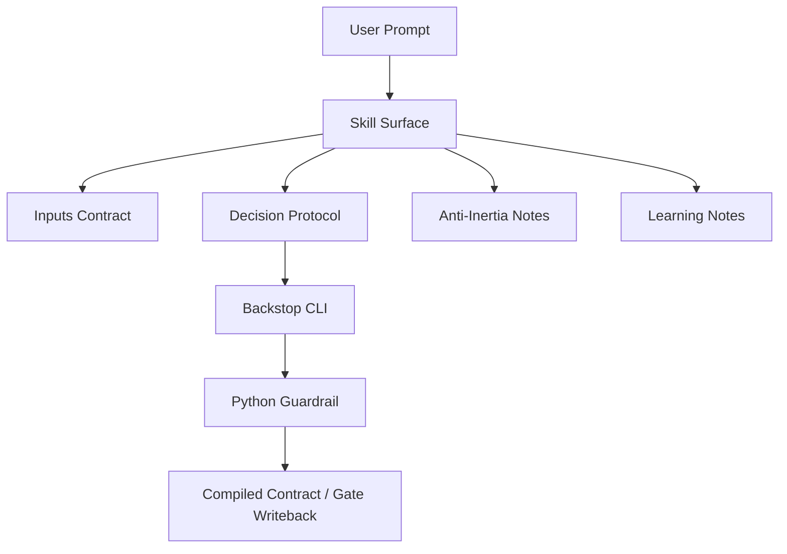
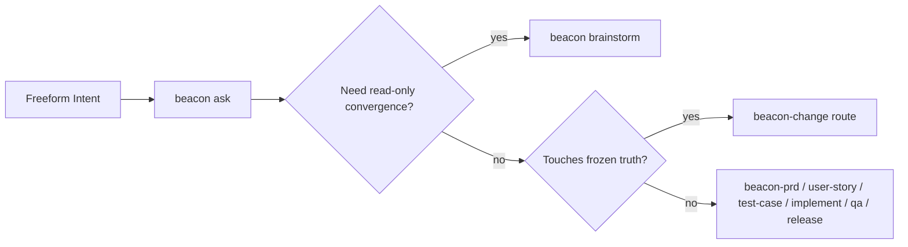
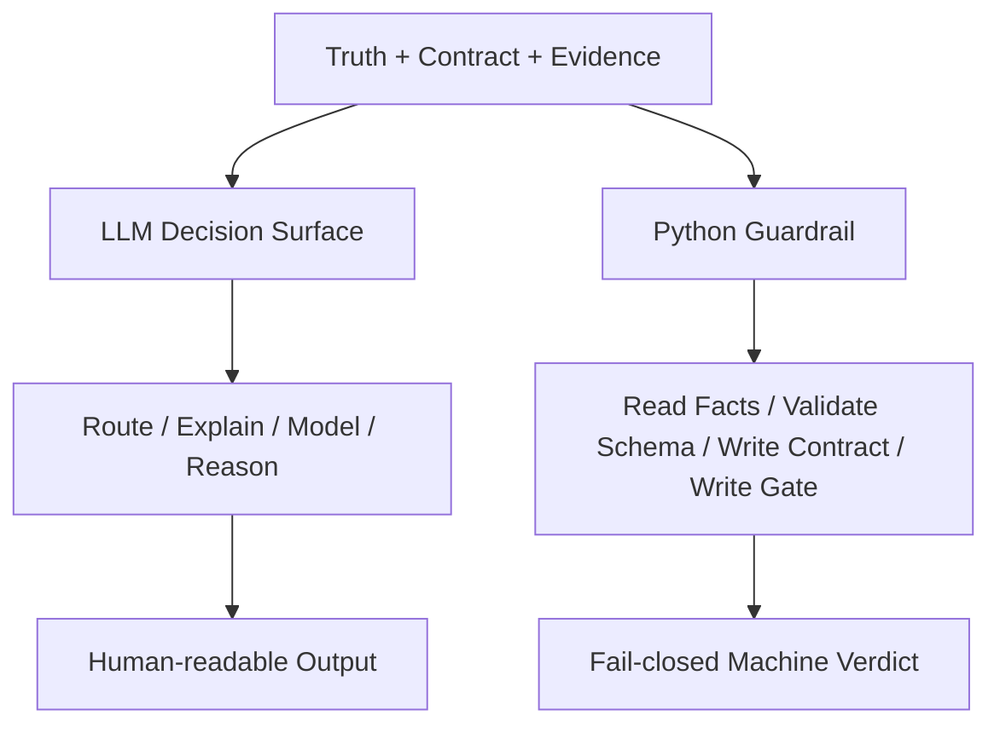
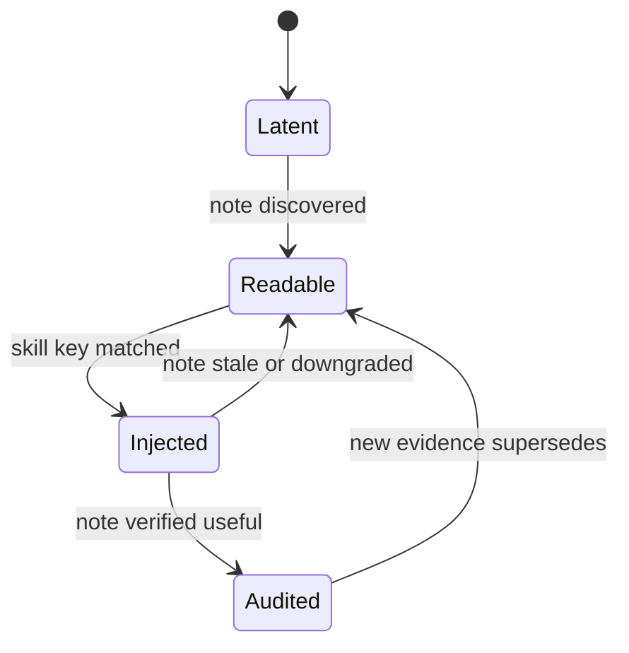

# PRD: Beacon v1.4.0 LLM decision surface and learning loop evolution

**Feature**: `beacon-v1.4.0-llm-decision-surface-and-learning-loop-evolution`  
**Version**: `v1.4.0`  
**Date**: `2026-05-08`  
**Status**: `freeze-ready`  
**Track**: `kernel-lightweight + skill-surface + learning-plane + prompt-governance`  
**Scenario**: `llm_decision_release + python_responsibility_reduction + governed_learning_reuse`  
**Template**: `main PRD / kernel-evolution supplement`

## Context

- Global boundaries: `docs/beacon/global-boundaries.md`
- Version package: `docs/beacon/v1.4.0/SUMMARY.md`
- Execution boundaries: `docs/beacon/v1.4.0/execution/index.md`
- Architecture blueprint: `docs/beacon/v1.4.0/execution/architecture-blueprint.md`
- Related PRD:
  - `docs/beacon/v1.4.0/prd/beacon-v1.4.0-lightweight-kernel-and-core-surface-refactor.md`
  - `docs/beacon/v1.4.0/prd/beacon-v1.4.0-branch-governance-human-surface-and-implement-gate.md`
- Source-grounded analysis:
  - `docs/brainstorms/2026-05-08-beacon-v1.4.0-llm-能力释放与learning-loop-收敛改造方案.md`
  - `docs/analysis/beacon-v1.4.0-改造方案-现状核实.md`
- Current implementation evidence:
  - `beacon/commands/ask.py`
  - `beacon/utils/learning_loop.py`
  - `beacon/utils/diagram_truth.py`
  - `beacon/utils/semantic_runtime.py`
  - `beacon/commands/prd.py`
  - `beacon/commands/user_story.py`
  - `beacon/commands/test_case.py`
  - `beacon/commands/qa.py`
  - `beacon/commands/implement.py`
  - `skills/beacon/beacon-prd/SKILL.md`
  - `skills/beacon/beacon-user-story/SKILL.md`
  - `skills/beacon/beacon-test-case/SKILL.md`
  - `skills/beacon/beacon-implement/SKILL.md`
  - `skills/beacon/beacon-qa/SKILL.md`

## Overview

`v1.4.0` 已经完成了 Beacon 继续减重的主方向冻结，但当前还存在一个高价值未闭环缺口：

- Beacon 已经拥有 ask、learning loop、diagram truth、semantic runtime、host bridge、skill routing 等能力；
- 但这些能力仍偏向散落在 Python 内核、兼容桥接和 `.machine` 投影中；
- 对宿主 LLM 来说，真正可用的“判断面”还不够厚，导致大量垂直判断仍沉在 Python fallback 分支里；
- 对人类来说，许多高价值能力“存在但不可见”，或者“能跑但没有被清楚治理”。

因此，本 PRD 的目标不是再发明一套新系统，而是：

> 在不破坏 truth / contract / gate 独占纪律的前提下，继续减轻 Beacon 默认重量，把已有的 ask、learning、diagram、semantic 能力升格为正式的 LLM 决策面与经验面，让 Python 退回到事实采集、schema 校验、contract 编译与 gate 写入职责。

## Scope

In scope:

- 为 `beacon-prd / user-story / test-case / implement / qa / release` 等核心 skill 建立更厚的 LLM decision surface。
- 复用现有 `beacon ask`，把它治理为受边界约束的自然语言路由入口，而不是新增一级命令。
- 复用现有 learning plane kernel，建立 per-skill 渐进披露与经验消费规则。
- 复用现有 diagram truth 与 semantic trace，把 requirement 建模与深度推理能力接入主链。
- 分阶段降低 `qa / implement / prd / release` 中与“决策协议”强耦合的 Python 逻辑占比。

Out of scope:

- 新增新的公开一级主命令。
- 让 ask / brainstorm / tasks ledger / goal / board 成为新的 truth 或 gate 判定源。
- 允许 LLM 自由改写 `docs/beacon/<version>/**/*.md` 或 `.machine` 真相路径。
- 在本轮直接重做整套 requirement package 目录结构。
- 在没有双读与回归对账前，一次性移除现有 Python 判定逻辑。
- 在本轮把 prototype bundle 伪装成已完成产物而跳过正式 `prototype` 阶段。

## Diagram Truth

- `branch-flow`
  - `user prompt -> skill decision protocol -> canonical command / contract writeback`
  - `frozen truth -> compiled contract -> LLM decision surface -> execution / qa / release`
  - `learning evidence -> typed learning contract -> progressive disclosure -> next skill run`
- `state-machine`
  - `skill_surface_state: thin -> thickened -> governed -> stable`
  - `python_responsibility_state: overloaded -> split_read_write -> reduced -> minimal_guardrail`
  - `learning_state: latent -> readable -> injected -> audited`
  - `modeling_state: implicit -> diagram-aware -> semantic-aware -> gate-consumed`
- `decision-priority`
  - `frozen truth > compiled contract > gate verdict > skill decision protocol > legacy python heuristics`
  - `existing capability reuse > new directory / new command invention`
  - `read-only convergence > freeform writeback`

### State Axes

- `skill_surface_state`
  - `thin | thickened | governed | stable`
- `python_responsibility_state`
  - `overloaded | split_read_write | reduced | minimal_guardrail`
- `learning_state`
  - `latent | readable | injected | audited`
- `modeling_state`
  - `implicit | diagram_aware | semantic_aware | gate_consumed`

## 1. 问题

### 1.1 Beacon 已有较强 LLM 相关能力，但没有形成正式的“LLM 判断面”

当前 Beacon 并不缺失 LLM 相关基础设施：

1. `beacon ask` 已存在，能做自然语言入口与 skill 路由。
2. `learning_loop.py` 已存在，能维护 typed learning/evo contract。
3. `diagram_truth.py` 已存在，能识别 `branch-flow / state-machine / decision-priority`。
4. `semantic_runtime.py` 已存在，能消费 semantic contract 与 host response。
5. `prd / user-story / test-case` 已存在 host bridge 读取入口。

但这些能力仍未形成正式、统一、对宿主 LLM 友好的“决策协议层”：

- 核心 skill 的 SKILL.md 仍普遍偏薄；
- 许多高价值判断逻辑沉在 Python fallback 里；
- learning plane 更像内核能力，而不是默认被 skill 消费的经验层；
- requirement 建模能力已经部分存在，但还没有稳定进入 PRD/story/case 的深度思考协议。

### 1.2 当前要减的不是 Python 语言本身，而是 Python 上承载的判断职责

现状分析已证明：

- 问题的主因不是 Beacon 使用 Python；
- 主因是 Python 里同时承载了事实采集、策略判断、兼容 fallback、文本模板、路由解释等多类职责；
- 当这些职责没有被切分成“LLM 决策协议 + Python 护栏”时，系统既重又难以释放宿主 LLM 的推理能力。

因此本特性的核心判断是：

> Beacon 继续减重的下一个高价值动作，不是迁语言，而是迁职责。

### 1.3 `beacon ask` 已存在，但其边界与定位还没有正式冻结

当前 `beacon ask` 是现实能力，而不是待新增能力。

但它还存在三类治理缺口：

1. 缺少正式的 host-visible SKILL.md 语义边界。
2. 缺少与 `brainstorm` 的稳定分工说明。
3. 默认 `plan-only` 是安全的，但 `--execute` 允许执行，仍需与 truth/gate 边界形成更明确契约。

因此本轮不应“再新增 ask 命令”，而应：

> 把现有 `beacon ask` 冻结为受边界约束的自然语言路由入口。

### 1.4 Learning Plane Kernel 已存在，但还没有进入每个 skill 的渐进披露闭环

Learning kernel 已经存在 typed contract、subject surface、forbidden surface、evaluation skeleton 等能力。

当前缺口不在“是否有 learning”，而在：

- skill 启动时不会系统性拉取相关 learning note；
- 宿主 LLM 很难在当前 feature / host / runner 场景中复用上次经验；
- learning 仍偏 kernel 内部能力，而不是 skill decision protocol 的显式输入。

### 1.5 requirement 深度思考能力已有基础，但未形成统一建模协议

现状并非“完全没有业务模型能力”：

- diagram truth 已能识别状态机与分支流；
- semantic trace 已能沉淀官方状态名、动作名、模块名、页面名；
- support / gate / release 已能消费 semantic contract。

但目前仍缺少：

- PRD / user-story / test-case 对 diagram truth 的统一建模协议；
- state/transition 级别覆盖与 requirement gate 的硬绑定；
- 对 events / invariants / entities 等概念的最小扩展策略；
- 宿主 LLM 在生成三件套时被“迫使做模型推理”的正式协议。

### 1.6 SKILL surface 的版本与内容漂移，会削弱 LLM 判断质量

当前多个核心 skill 的版本描述仍停留在 `v1.3.9 / v1.3.12` 叙事，而 `qa / release` 已切到 `v1.4.0`。

其影响包括：

- 宿主 LLM 读到的上下文版本不统一；
- skill 内的 operator rule 与真实运行时现状容易错位；
- 即使内核能力存在，也可能因 skill 面过旧而无法被正确调用。

所以本轮不能只谈“释放 LLM”，还必须先修：

> skill surface 自身的版本与决策协议漂移。

## 2. 目标

### 2.1 主要目标

1. 在不新增公开一级命令的前提下，正式冻结 Beacon 的 LLM decision surface 演进方案。
2. 把核心 skill 的宿主可见协议从“薄 operator rule”升级为“决策协议 + 反惯性说明 + learning 消费规则”。
3. 把现有 `beacon ask` 冻结为受治理的自然语言路由入口，而不是继续处于半隐式状态。
4. 把现有 learning plane kernel 接到每个核心 skill 的渐进披露入口。
5. 把现有 diagram truth 与 semantic trace 升格为 requirement 深度思考协议的一等输入。
6. 通过“先双读、后单读”的方式，把一部分判断逻辑从 Python 迁到 skill decision surface。
7. 保持 `docs/beacon/<version>/**/*.md`、compiled contract、gate verdict 的独占纪律不变。

### 2.2 非目标

- 不让 LLM 直接写 frozen truth 或 gate verdict。
- 不把 `ask`、`brainstorm`、learning note、tasks ledger 升格为新的真相源。
- 不在本轮强行新增完整 `business-model/` 五件目录。
- 不在没有一致性回归前，直接删除旧 Python 判断分支。
- 不因为释放 LLM 能力而放宽全局边界中“公开主命令面保持小”的原则。

### 2.3 核心判断

本特性的第一性原则是：

> Beacon 要释放的不是“任意写能力”，而是“在不写真相、不改 gate 的前提下，让宿主 LLM 获得更厚的决策协议、建模协议和经验消费能力”。

## 3. 设计原则

### 3.1 Reuse Before Invent

- 已存在的 `ask`、learning、diagram、semantic 能力优先复用。
- 能通过升格现有能力解决的问题，不再新增并行目录、并行命令、并行真相。

### 3.1A Canonical Truth First, Machine Projection Derived

- `docs/beacon/<version>/prd/`、`user-story/`、`qa/test-cases/`、以及条件触发时的 `prototype/` 继续构成唯一冻结 truth root。
- `.machine/` requirement materials 必须被重新定义为:
  - compiled projection
  - runtime cache
  - audit evidence
  - deterministic downstream input
- `.machine/` requirement materials 不得继续被表述为第二真相源，也不得因“尚未预写出投影文件”而默认阻断 `implement / qa`。
- 如果某个 machine projection 缺失，但能从当前 frozen human truth 确定性重建，则系统应优先重建或按需编译，而不是直接把操作者退回 change loop。
- 只有在 frozen human truth 本身不完整，或无法生成确定性编译结果时，主链 gate 才允许 fail-closed 阻断。

### 3.2 Decision In Prompt, Guardrail In Python

- LLM 负责现场决策协议、建模推理、收敛解释。
- Python 负责事实采集、schema 校验、contract 编译、gate 写入、阻断护栏。
- 两者必须明确分工，不得继续把解释性判断无边界堆回 Python。

### 3.2A Minimal Freeze Receipt Over Dual-Write Mirrors

- 强 gate 必须保留，但 gate 绑定的对象应收敛到最小 freeze receipt，而不是长期双重事务多写。
- 最小 freeze receipt 至少应能表达：
  - 当前 feature 对应的 canonical truth paths
  - freeze 时的 source hash / baseline hash
  - compile/runtime line stamp
  - 当前 feature 的 frozen transaction / revision receipt
- 旧式 PRD mirror、latest pointer、以及多份长期并行 machine mirror 可以继续存在于兼容窗口，但默认定位必须降级为 cache/audit，而不是主链 hard prerequisite。
- dual-read 仍应用于决策协议 cutover 对账；但 requirement package 不应长期依赖 dual-write mirror 作为 freeze 真相校验主手段。

### 3.3 Learning Is Hint, Not Truth

- learning note 是经验提示层，不是 truth。
- learning 可过期、可降级、可审计。
- learning 不得单独定义 pass / blocked / release_ready。

### 3.4 Diagram And Semantic Layers Are Requirement Inputs

- diagram truth 与 semantic trace 必须被视为 requirement 深度思考输入。
- 但它们仍然是 truth/contract 的从属建模层，不应绕开主链自由生长。

### 3.5 Ask And Brainstorm Must Stay Distinct

- `ask` 负责自然语言路由与入口收束。
- `brainstorm` 负责只读收敛、矛盾识别、路线建议。
- 两者都不应成为新的 truth 写入口。

### 3.6 Dual-Read Before Cutover

- 任何判断逻辑从 Python 迁出前，必须先做双读对账。
- 一致性不足时，保留 Python 作为主判定器。
- 迁移必须 fail-closed，而不是“先切再说”。

## 4. 范围

### In scope

- 核心 skill 的 decision surface 厚化。
- `beacon ask` 的正式边界治理。
- learning plane 的 skill 级消费与披露规则。
- diagram truth / semantic trace 在 requirement 三件套中的深度思考协议。
- `qa / implement / prd / release` 的 Python 职责瘦身路线。

### Out of scope

- 一次性重做所有 support / toolkit skill。
- 一次性为全部领域建完整业务模型目录。
- 在 `v1.4.0` 内引入新的主阶段或新的一级命令集合。

## 5. 功能需求

### FR-001 核心 skill 必须升级为正式 decision surface

以下核心 skill 至少应进入统一的厚化治理：

- `beacon-prd`
- `beacon-user-story`
- `beacon-test-case`
- `beacon-implement`
- `beacon-qa`
- `beacon-release`

每个 skill 至少要具备以下稳定段落：

1. Inputs Contract
2. Decision Protocol
3. Anti-Inertia Notes
4. Learning Notes
5. Backstop CLI

### FR-002 Inputs Contract 必须最小但可机器消费

每个核心 skill 至少要显式说明：

- `project-root`
- `version`
- `feature`
- 上游 truth / contract refs
- 可接受的 host / bridge 输入
- 输出边界

要求：

- 输入契约可以被宿主 LLM 直接消费；
- 不要求宿主理解底层实现细节；
- 但必须足以避免“凭印象调用”。

### FR-003 Decision Protocol 必须承载主要判断逻辑

每个核心 skill 的主要判断协议应优先写在 skill surface 中，而不是只藏在 Python fallback 内。

至少包括：

- 何时继续
- 何时阻断
- 何时降级
- 何时建议进入 `change`
- 何时建议进入 `brainstorm`
- 何时建议回退到 legacy Python 判定

### FR-004 Anti-Inertia Notes 必须显式纠正常见误锚

至少要覆盖：

- “ask 可以自由写真相”之类误解
- “goal / checkbox / board 可以替代 gate”之类误解
- “brainstorm 是新 stage”之类误解
- “learning 是第二真相”之类误解

目的不是加长文案，而是：

> 让宿主 LLM 在高频误区上被主动纠偏。

### FR-005 Learning Notes 必须复用现有 learning plane kernel

Learning Notes 段不得绕过现有 learning plane 重新造轮。

最小要求：

- 复用 `learning_loop.py` 的 typed contract 概念；
- 允许按 `feature -> host -> runner -> domain` 顺序做渐进披露；
- 允许 note 过期、降级为 hint；
- learning 不得直接写入 frozen truth 或 gate。

### FR-006 `beacon ask` 必须被冻结为正式的自然语言路由入口

系统必须正式承认：

- `beacon ask` 已存在且属于公开一级命令现实；
- 默认模式是 `plan-only`；
- `--execute` 是受安全边界约束的执行模式。

并要求：

- 为其补齐正式 skill surface 与使用边界；
- 明确其与 `brainstorm` 的职责分工；
- 明确其不得越权直写 truth / gate / release 状态。

### FR-007 `beacon ask` 的 `--execute` 必须有更严格的边界契约

当 `ask` 进入执行模式时，至少必须满足：

- 被路由到合法已存在的 Beacon surface；
- 不得绕过 `implement` / `qa` 唯一执行入口；
- 不得直接对 frozen truth 执行自由写入；
- 对混合边界 / 低置信度必须保留显式阻断或人工确认路径。

### FR-008 `brainstorm` 与 `ask` 必须建立清晰分工

最小分工要求：

- `ask`: 自然语言入口、路由、计划预览、受控执行；
- `brainstorm`: 只读收敛、矛盾核实、开放问题澄清、路线建议；
- 两者都不能替代 `prd -> user-story -> test-case -> implement -> qa -> release` 主链。

### FR-009 requirement 三件套必须增加 diagram-aware 深度思考协议

`beacon-prd / beacon-user-story / beacon-test-case` 的 Decision Protocol 必须显式要求宿主 LLM 优先检查：

- 是否存在 branch-flow
- 是否存在 state-machine
- 是否存在 decision-priority
- 是否需要 state axis

要求：

- 若问题复杂度达到 diagram truth 触发条件，则不允许直接模板填空；
- 必须围绕状态、转移、异常路径、不变量做显式建模推理；
- 相关输出应与 diagram truth 保持一致。

### FR-010 semantic trace 必须成为 requirement 深度思考的共享输入

在不新增第二真相的前提下，semantic trace 至少应服务于：

- 官方状态名引用
- 官方动作名引用
- 官方模块名引用
- 官方页面名引用

要求：

- PRD / story / case 生成时优先复用现有官方词汇；
- 避免 requirement 文本与实现/semantic trace 长期漂移；
- semantic trace 可作为校验输入，但不得单独成为 truth root。

### FR-011 requirement 建模增强优先采用“升格现有 diagram + semantic”，而不是直接新增五件套目录

本轮 requirement 建模增强策略应优先是：

1. 升格现有 diagram truth 到更强的 requirement protocol；
2. 升格现有 semantic dictionary 到更强的用词与映射校验源；
3. 仅对现有不足概念做最小增量扩展。

这意味着：

- `state-machine / branch-flow / decision-priority` 优先复用；
- `events / invariants / entities` 如确需补充，可作为后续最小扩展；
- 不在第一步就强制引入新的五件 truth 目录。

### FR-012 Python 后端必须逐步退回四类职责

迁移完成后的 Python 主职责应收敛为：

1. 事实采集
2. schema 校验
3. contract / projection 写入
4. gate 阻断与 verdict 写入

不再鼓励 Python 长期继续承载：

- 大段策略文案
- 主要决策协议
- 宿主使用说明
- 可迁移到 skill surface 的误区纠正

### FR-013 Python 职责瘦身必须覆盖 `qa / implement / prd / release`

本轮不得只盯 `qa`。

至少需要把以下模块纳入同一瘦身治理视角：

- `beacon/commands/qa.py`
- `beacon/commands/implement.py`
- `beacon/commands/prd.py`
- `beacon/commands/release.py`

并要求：

- 先识别哪部分是“事实/写入逻辑”，哪部分是“解释/判断逻辑”；
- 优先迁出后者；
- 迁移时保留 legacy 对账开关。

### FR-014 skill surface 的版本漂移必须先修复

在释放 LLM 决策能力前，必须先确保核心 skill 的版本叙事统一到当前 `v1.4.0` 线。

要求至少包括：

- 版本文字与 operator rule 对齐；
- docs line、runtime line、host-native line 解释一致；
- skill surface 不再混用过期版本叙事误导宿主。

### FR-015 迁移必须采用 trace-scorecard 或等价一致性回归

任何判断逻辑从 Python 迁入 skill surface 前，必须有一致性对账机制。

至少要验证：

- LLM decision surface 与旧 Python 判定的一致性；
- blocked reason 是否一致；
- downgrade / fallback 路线是否一致；
- gate 结果是否保持 fail-closed。

### FR-016 support surface 必须能够解释“为什么推荐这条 route”

当 skill surface 更厚以后，`help / status / doctor / ask` 至少应能更明确解释：

- 为什么建议进入 `brainstorm`
- 为什么建议进入 `change`
- 为什么建议走 `implement` 或 `qa`
- 当前 learning hint 是否被采用

### FR-017 本特性不得破坏 `v1.4.0` 已冻结的五层架构

本特性的所有演进都必须满足：

- truth 仍唯一；
- contract 仍单向；
- surface 仍最小；
- plugin/projection 仍为可选；
- 公开主命令面仍 version-frozen。

### FR-018 prototype 在本 feature 中必须被条件触发并补入正式 requirement 链

全局上，`prototype` 不再是默认必经主链。

但本 feature 实际存在宿主可见 route surface、状态展示、导航关系与交互 handoff 需求，因此不得停留在 `prd / user-story / test-case` 三层后直接宣称可进入实现。

对本 feature 而言，prototype 必须作为条件触发后的正式 requirement stage 被补入，且至少要冻结：

1. 核心 skill decision surface 的宿主可见结构
2. `ask / brainstorm / change` 的入口分工与跳转关系
3. learning hint 渐进披露的可见性层次
4. diagram / semantic 输入如何影响三件套与 support route
5. Python guardrail 与 LLM decision surface 的职责分层

约束：

- prototype 仍然只是 `requirement-driven wireframe freeze`；
- 必须覆盖页面职责、状态流转、导航关系、交互契约；
- 不要求在本 PRD 冻结时就已经产出完整 prototype bundle；
- 但在 prototype 未冻结前，本 feature 最多只能达到 `requirement-frozen / prototype-pending`，不得表述为 `implement-ready`。

## 6. 数据 / 状态 / 集成

### 6.1 Truth 输入

唯一 truth root 仍为：

- `docs/beacon/global-boundaries.md`
- `docs/beacon/<version>/**/*.md`

### 6.2 Skill Decision Surface

建议每个核心 skill 至少形成：

- human-readable skill contract
- host-readable decision protocol
- anti-inertia notes
- learning disclosure rules
- backstop CLI

### 6.3 Learning 集成

learning 集成优先复用现有 typed contract，并在必要时增加 version-scoped learning note projection。

允许的最小形态包括：

- runtime/state learning contract
- version-scoped `.machine` learning note
- stale / superseded 标记

但要求始终成立：

- learning 不写真相
- learning 不决定 gate
- learning 只能作为 hint / route input

### 6.4 Diagram 与 Semantic 集成

三件套相关 skill 在生成或校验时，应优先读取：

- diagram truth 信号
- semantic dictionary
- semantic contract
- host response payload

这些输入应帮助宿主 LLM 做更深的 requirement 建模，而不是仅生成格式化模板。

### 6.5 Ask 与 Brainstorm 集成

建议形成如下稳定关系：

- `ask`:
  - 用户自由自然语言入口
  - 路由到 skill 或计划预览
- `brainstorm`:
  - 只读收敛与矛盾识别
  - 不做 truth 写入
- `change`:
  - frozen truth 变更路由

### 6.6 Python 双读迁移

迁移路径应至少包括：

1. 保留旧 Python 判定
2. 新增 skill decision protocol
3. 双读并记录差异
4. 达到一致性阈值后切主
5. 保留一段兼容窗口

## 7. 风险与缓解

| 风险 | 影响 | 缓解 |
|------|------|------|
| 把“释放 LLM”误做成“允许自由写真相” | 高 | 强化 truth / contract / gate 不变量，禁止 freeform truth writeback |
| 新增大量目录或命令，反而让系统更重 | 高 | 坚持 reuse before invent，优先升格现有能力 |
| `ask` 执行模式边界不清导致越权执行 | 高 | 冻结 `plan-only` 默认与 `--execute` 安全契约 |
| learning 被误当成第二真相源 | 高 | 明确 learning 只作 hint，不参与 truth 或 gate 独占判定 |
| diagram / semantic 增强做成双轨建模体系 | 高 | 先升格现有 diagram truth 与 semantic trace，再做最小扩展 |
| Python 逻辑迁出后 verdict 漂移 | 高 | 双读对账、一致性回归、legacy fallback |
| skill 版本漂移不修，导致新 decision surface 继续误导宿主 | 中 | 先修 version surface，再厚化 skill |
| 为了“深度思考”把 PRD 再写成超重模板 | 中 | 约束为模型推理协议，而不是新增更长的静态模板 |

## 8. 验收标准

### AC-001 核心 skill 已具备正式 decision surface

- 至少 `prd / user-story / test-case / implement / qa / release` 的 skill surface 完成统一厚化。
- 每个 skill 至少具有 Inputs Contract、Decision Protocol、Anti-Inertia Notes、Learning Notes、Backstop CLI 五类稳定段落。

### AC-002 `beacon ask` 的定位与边界已冻结

- 系统正式承认 `beacon ask` 为自然语言路由入口。
- `ask` 与 `brainstorm` 的职责边界清晰可见。
- `ask --execute` 不会绕过 `implement / qa / gate` 独占入口。

### AC-003 learning plane 已进入 skill 渐进披露闭环

- 至少一个核心 skill 能按 feature / host / runner / domain 读取相关 learning hint。
- learning hint 支持 stale 或降级语义。
- learning 不会单独定义 truth 或 gate verdict。

### AC-004 requirement 三件套已具备 diagram-aware 深度思考协议

- `beacon-prd / beacon-user-story / beacon-test-case` 的 decision protocol 能显式要求状态/转移/异常路径推理。
- diagram truth 与 semantic trace 成为正式输入，而不是可选备注。

### AC-005 Python 职责瘦身已进入可验证迁移态

- 至少 `qa / implement / prd / release` 四类模块拥有“判断逻辑迁移 vs 护栏逻辑保留”的明确边界。
- 至少一个模块完成双读对账或等价一致性回归。

### AC-006 skill version surface 与当前 `v1.4.0` 叙事一致

- 核心 skill 不再混用过期 runtime line 叙事误导宿主。
- operator rule、docs line、runtime line 与当前版本包保持一致。

### AC-007 本特性不破坏既有全局边界

- 无新增公开一级主命令。
- `implement` 仍是唯一实现入口。
- `qa` 仍是唯一验收入口。
- `gate` 仍是最终阻断与完成判定器。
- `docs/beacon/<version>/**/*.md` 仍是唯一 frozen truth root。

### AC-008 prototype 已按条件触发方式纳入本 feature 的 requirement freeze 出口约束

- 本 feature 的 requirement package 必须明确声明：虽然 `prototype` 不是全局默认必经主链，但对当前 feature 属于被条件触发的正式阶段。
- prototype 至少要覆盖 route surface、state visibility、navigation contract、interaction contract。
- prototype 相关产物缺失时，本 feature 状态只能表述为 `prototype-pending`，不得宣称 `implement-ready`。

## 9. 成功指标

- 主指标：宿主 LLM 对核心 skill 的一次性判断质量提升，减少因 skill surface 过薄导致的回退解释成本。
- 主指标：核心路径中由 Python 直接承载的解释性判断逻辑明显下降。
- 辅指标：`ask`、learning、diagram、semantic 这些“已存在能力”被统一纳入正式产品叙事，而不是继续隐性存在。
- 辅指标：requirement 三件套更少出现模板化输出，更常出现状态、转移、异常路径层面的显式推理。
- 辅指标：support surface 能更清楚回答 route 推荐原因，而不是只给命令名。

## 10. 依赖与冻结决策

### 10.1 依赖

- 依赖 `docs/beacon/global-boundaries.md` 作为全局边界源。
- 依赖 `docs/beacon/v1.4.0/execution/architecture-blueprint.md` 的五层架构冻结。
- 依赖现有 ask / learning / diagram / semantic / host bridge 实现作为演进基础。
- 后续需要基于本 PRD 拆解：
  - `user-story`
  - `test-case`
  - skill surface rewrite plan
  - dual-read regression plan

### 10.2 Requirement Freeze Verdict

- Verdict: `freeze-ready`
- Reason:
  - 本特性方向已由 brainstorm 与现状核实共同收敛；
  - `user-story` 与 `test-case` 已完成正式拆解；
  - 各模块迁移优先级、双读切主纪律与边界约束已进入正式 requirement truth；
  - prototype 已被正式补入 requirement stage，且当前 feature 的 prototype freeze 已完成。
- Follow-up:
  - 进入 `implement`，并以 dual-read consistency 与 support explainability 作为首批验证焦点；
  - 后续进入 `qa`，验证 skill surface、route explainability 与 cutover guardrail 是否与 frozen prototype 一致。

## 11. Diagram Truth Layer

### 11.1 LLM Decision Flow

### 11.2 Ask / Brainstorm / Change Route

### 11.3 Responsibility Split

### 11.4 Learning Disclosure State Machine

### 11.5 Propagation Contract

- truth 仍是唯一 requirement 与 delivery truth；
- skill decision surface 只能解释、建模、路由、建议；
- Python guardrail 仍是 schema / contract / gate 的最后写入护栏；
- learning 只作 hint，不得反向定义 truth；
- ask 与 brainstorm 都不得成为自由 truth 写入口。

---

**Created**: 2026-05-08  
**Version**: v1.4.0  
**Status**: Freeze Ready  
**Change Context**: continue Beacon lightweight evolution by upgrading existing LLM decision surface instead of inventing parallel command or truth systems
