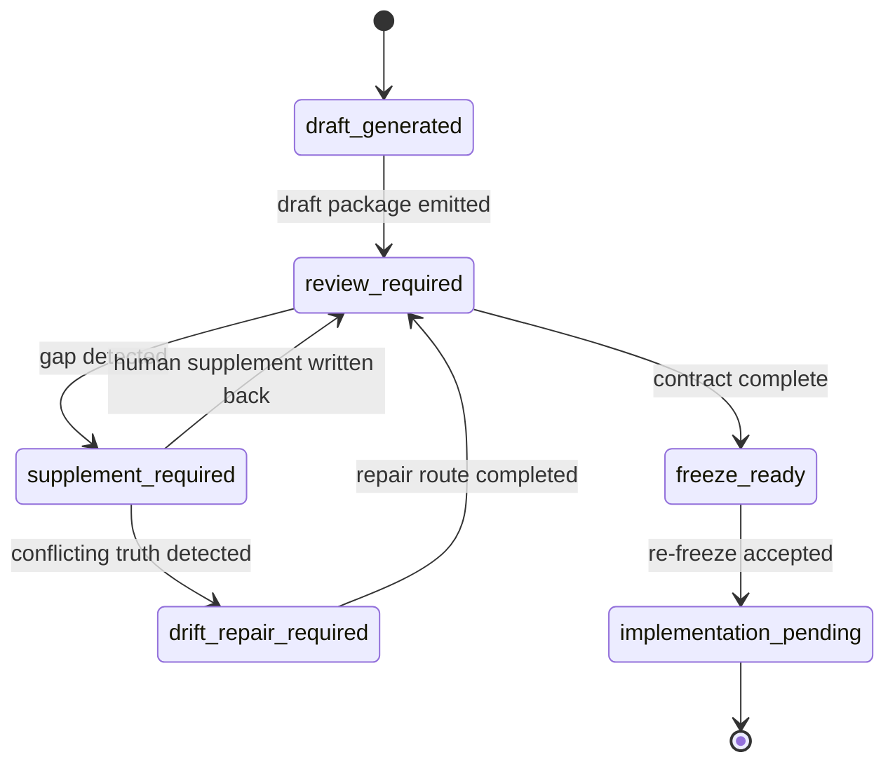

# PRD: Beacon v1.4.0 PRD bootstrap safe requirement bootstrap and freeze closure

**Feature**: `beacon-v1.4.0-prd-bootstrap-safe-requirement-bootstrap-and-freeze-closure`  
**Version**: `v1.4.0`  
**Date**: `2026-05-06`  
**Status**: `freeze-ready`  
**Track**: `optional-support-surface`  
**Scenario**: `safe_requirement_bootstrap + optional_skill_governance + freeze_closure_alignment`  
**Template**: `support-surface / requirement-bootstrap`

## Context

- Global boundaries: `docs/beacon/global-boundaries.md`
- Parent kernel blueprint:
  - `docs/beacon/v1.4.0/prd/beacon-v1.4.0-lightweight-kernel-and-core-surface-refactor.md`
  - `docs/beacon/v1.4.0/execution/architecture-blueprint.md`
- Existing skill surface:
  - `skills/beacon/beacon-prd-bootstrap/SKILL.md`
  - `skills/beacon/scripts/run_beacon_prd_bootstrap.sh`
- Existing implementation:
  - `beacon/commands/prd_bootstrap.py`
  - `beacon/utils/prd_bootstrap.py`
- Historical baseline:
  - `docs/beacon/v1.3.3/prd/beacon-v1.3.3-core-slimming-and-external-skill-demotion.md`
  - `docs/beacon/v1.3.3/user-story/beacon-v1.3.3-core-slimming-and-external-skill-demotion.md`
  - `docs/beacon/v1.3.3/qa/test-cases/beacon-v1.3.3-core-slimming-and-external-skill-demotion.md`

## Overview

This feature freezes the existing `prd-bootstrap` support surface into the `v1.4.0` requirement package as a safe draft initializer.

## Scope

In scope: optional bootstrap, safe defaults, draft package generation, review/refreeze routing, and traceability.

Out of scope: public lifecycle expansion, automated truth promotion, or bypassing frozen truth and review gates.

## 1. 问题

### 1.1 Beacon 已有 bootstrap 能力，但还不是 `v1.4.0` 冻结 requirement 包的一部分

当前 Beacon 已经具备：

- hidden command：`prd-bootstrap`
- optional skill：`beacon-prd-bootstrap`
- packaged wrapper：`run_beacon_prd_bootstrap.sh`
- safe defaults：
  - `strict context verify`
  - `dry-run by default`
  - `no-overwrite by default`
  - `lock + state artifact + rollback`

但它目前仍主要停留在：

- skill 说明
- 代码实现
- `v1.3.3` 历史 requirement 痕迹

没有被重新冻结到 `v1.4.0` 当前正式 requirement 包里。

结果是：

- 它存在，但不属于当前版本的正式能力地图
- 它可运行，但尚未被 `v1.4.0` 的轻量内核原则重新约束
- 它能生成三件套，但生成产物和 `v1.4.0` requirement freeze 规范之间仍存在缺口

### 1.2 当前 bootstrap 输出仍偏模板化，离正式 requirement closure 还有距离

从源码可确认，当前 `beacon.utils.prd_bootstrap` 已有基础防线，但默认生成内容仍偏：

- 通用模板
- 草案级文案
- 最小 AC/TC 映射

尚未显式满足 `v1.4.0` 的要求：

- 输出要明确区分：
  - bootstrap draft
  - freeze-ready requirement
  - implemented reality
- 输出要与：
  - `global-boundaries`
  - 当前版本目录结构
  - 统一 slug / version / revision 语义
  对齐
- 输出要进入后续：
  - `prd -> user-story -> test-case -> implement -> qa -> release`
  的正式主链，而不是形成旁路真相

### 1.3 `prd-bootstrap` 必须保留，但不能污染 Beacon 主面和真相层级

在 `v1.4.0` 的总蓝图下，`prd-bootstrap` 的正确定位不是：

- 新的公开一级主命令
- 主流程替代者
- 直接冻结 truth 的自动化按钮

它的正确定位是：

> 一个可选 support-surface bootstrap capability，用来降低 requirement 启动摩擦，但仍然服从 Beacon 的 frozen truth、gate 与人工收敛边界。

### 1.4 `prd-bootstrap` 的价值在于降低启动摩擦，而不是跳过治理

正确的产品目标不是“一键把需求做完”，而是：

- 快速产出结构完整的 requirement draft package
- 保持默认安全
- 保持一致性检查
- 明确 review / refreeze / implement 的后续路由

因此 `prd-bootstrap` 在 `v1.4.0` 中必须服务于：

1. requirement startup friction reduction
2. truth package initialization
3. support-surface action clarity
4. freeze closure alignment

而不是服务于：

- 自动绕过人工判断
- 自动宣称 freeze pass
- 自动宣称 implement ready without review

### 1.5 分层与恢复

- 本 feature 的分层是 `truth -> contract -> support surface`，bootstrap 只能在 support surface 层做编排，不能改写 truth。
- 当 context verify、quality gate 或 no-overwrite 失败时，必须走恢复路径并回到 review / refreeze，而不是继续写盘。

## 2. 目标

### 2.1 主要目标

`v1.4.0` 必须把 `beacon-prd-bootstrap` 冻结成正式 requirement feature，达成以下目标：

1. 明确 `beacon-prd-bootstrap` 是 optional support skill，不替代主流程
2. 保留一键生成 `prd + user-story + test-case` 的低摩擦入口
3. 保持 `strict verify + dry-run + no-overwrite + atomic write + lock + state + rollback` 安全默认值
4. 让 bootstrap 输出符合 `v1.4.0` 目录、slug、version、traceability 规范
5. 明确 bootstrap 产物是 `bootstrap-generated requirement draft package`，而不是自动 freeze truth
6. 让 support surface 能解释：
   - 当前 bootstrap 产物状态
   - 是否可进入 review/refreeze
   - 下一步建议命令
7. 让 bootstrap 结果可审计、可回滚、可阻断
8. 让该 feature 在 `v1.4.0` requirement closure 中正式进入 `implementation-pending`

### 2.2 非目标

- 不新增新的公开一级主命令
- 不让 `prd-bootstrap` 直接替代 `prd / user-story / test-case`
- 不让 bootstrap 自动定义 `freeze-ready`、`qa pass` 或 `release pass`
- 不让 bootstrap 绕过 `doctor verify-context`、review、change/refreeze 或 gate
- 不把 bootstrap 输出写入数据库或投影层作为 truth source

## 3. 设计原则

- support surface only
- safe by default
- canonical truth first
- auditability over convenience

## 3. 产品定位

### 3.1 正式定位

`beacon-prd-bootstrap` 在 `v1.4.0` 的定位是：

- optional skill
- support surface
- requirement draft initializer
- safe-by-default bootstrap capability

### 3.2 与主链关系

它的正确路由是：

```text
feature intent
-> prd-bootstrap draft package
-> human review / supplement / refreeze
-> frozen prd / user-story / test-case
-> prototype
-> implement
-> qa
-> release
```

### 3.3 与轻量内核关系

它符合轻量内核原则，因为：

- 不扩张主命令面
- 不引入新的 truth root
- 只降低 requirement 启动摩擦
- 继续把复杂度压在机器内部，而不是扩张人类心智面

## 4. 范围

- in scope:
  - safe bootstrap draft generation
  - review and freeze closure guidance
  - AC/TC traceability
- out of scope:
  - new public lifecycle stage
  - automatic freeze truth promotion
  - non-canonical truth roots

## 5. 功能需求

## 4. Functional Requirements

### FR-001 Optional Support Surface

`prd-bootstrap` 必须继续作为 optional support capability 存在，不得升级成公开一级主命令，也不得被叙述为主流程替代。

### FR-002 One-Click Requirement Draft Package

系统必须支持在一次运行中生成：

- PRD
- User Story
- Test Case

并写入当前版本的 canonical docs tree。

### FR-003 Safe-by-Default Execution

默认行为必须保持：

1. `doctor verify-context --strict`
2. `dry-run`
3. `no-overwrite`
4. block on quality / consistency failure

### FR-004 Atomic and Recoverable Write

Apply 模式必须具备：

- lock
- atomic write
- state artifact
- rollback manifest
- failure cleanup

不得留下半成品 requirement docs。

### FR-005 Bootstrap Output Status Contract

bootstrap 生成的 requirement package 必须显式标记为：

- `bootstrap-generated`
- `review-required`
- `not-yet-frozen`

禁止默认伪装成：

- already-frozen truth
- implementation-complete package

### FR-006 Traceability Contract

bootstrap 产物必须共享统一的：

- feature slug
- version
- source description
- AC/TC traceability
- generation timestamp

并可被后续 `change / review / refreeze / gate` 读取。

### FR-007 Quality and Consistency Gate

bootstrap 运行必须阻断以下情况：

- placeholder 超阈值
- story AC 与 test-case AC 映射不完整
- context verify 失败
- overwrite 风险未显式允许
- lock 已存在

### FR-008 Human-Readable Next-Step Guidance

bootstrap 输出必须告诉操作者：

- 当前状态
- 阻断原因
- 下一步动作
- 建议命令
- 进入 freeze 主链前还缺什么

### FR-009 No Reverse Truth Drift

bootstrap 输出不得通过 state artifact、support surface 或 runtime projection 反向定义 frozen truth。

只有正式 review / refreeze 路由，才能把 bootstrap draft 提升为正式冻结材料。

### FR-010 v1.4.0 Format Alignment

bootstrap 生成的三件套必须对齐 `v1.4.0` 的正式文档规范，至少包括：

- metadata fields
- status fields
- acceptance structure
- execution handoff compatibility

## 8. 验收标准

- `prd-bootstrap` 仍是 optional support skill
- 三件套 draft package 可一次生成
- 默认行为保持 strict verify / dry-run / no-overwrite
- 输出明确标记 `bootstrap-generated / review-required / not-yet-frozen`
- 失败时给出可执行的下一步命令

## 5. 设计原则

- support surface only
- safe by default
- canonical truth first
- auditability over convenience

## 6. 范围

- in scope:
  - safe bootstrap draft generation
  - review and freeze closure guidance
  - AC/TC traceability
- out of scope:
  - new public lifecycle stage
  - automatic freeze truth promotion
  - non-canonical truth roots

## 7. 验收标准

- `prd-bootstrap` 仍是 optional support skill
- 三件套 draft package 可一次生成
- 默认行为保持 strict verify / dry-run / no-overwrite
- 输出明确标记 `bootstrap-generated / review-required / not-yet-frozen`
- 失败时给出可执行的下一步命令

避免继续生成只适用于旧版本的模板。

## 8. 风险与缓解

| 风险 | 影响 | 缓解 |
| --- | --- | --- |
| bootstrap 被误解为主流程替代 | 高 | 明确 optional support 定位，禁止新增公开一级主命令 |
| 自动生成文档被误认作已冻结 truth | 高 | 强制 `bootstrap-generated / review-required / not-yet-frozen` 状态语义 |
| 覆盖既有 requirement docs 导致真相漂移 | 高 | 默认 `no-overwrite`，只在显式允许时 apply |
| 上下文不完整时生成错误版本路径 | 高 | 强制 `doctor verify-context --strict` |
| 产物模板化过强，无法进入后续 implement | 中 | 增加 `v1.4.0` 结构对齐与 quality gate |
| state artifact 成为第二真相源 | 高 | 明确 state artifact 只做 run audit，不做 truth source |

## 9. 成功标准

1. `beacon-prd-bootstrap` 在 `v1.4.0` 中拥有正式 PRD / user-story / test-case
2. 它继续是 optional support skill，而不是新的主流程
3. 默认安全防线完整保留
4. bootstrap 产物状态明确，不会伪装成 frozen truth
5. support output 可以清晰引导下一步 review/refreeze
6. 产物可以顺畅进入后续 `prototype / implement / qa`
7. feature 状态可进入：`requirement-freeze-ready / implementation-pending`

## 10. 冻结结论

本 PRD 的冻结目标不是证明实现已完成，而是明确：

- `prd-bootstrap` 作为可选 bootstrap capability 应继续保留
- 它必须按照 `v1.4.0` 轻量内核边界重新规范
- 它已经达到 requirement closure 粒度
- 可作为后续实现与回归验证的正式上游物料

## 11. State Machine Truth



### 11.1 State Axes

- `package_state`: `empty | prd_only | user_story_only | test_case_only | prd_user_story | prd_test_case | user_story_test_case | full_consistent | full_inconsistent`
- `bootstrap_state`: `draft_generated | review_required | supplement_required | drift_repair_required | freeze_ready | implementation_pending`
- `truth_origin_state`: `native_truth | derived_from_downstream | needs_truth_review`
- `decision_state`: `accepted | rejected | deferred`
- `routing_state`: `canonical_compile | reverse_derive | repair_route | freeze_promotion`
