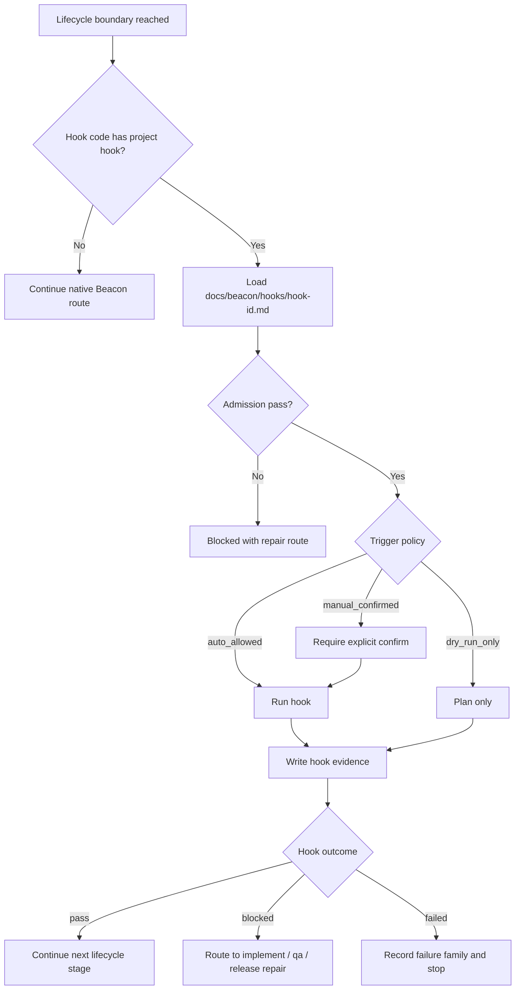
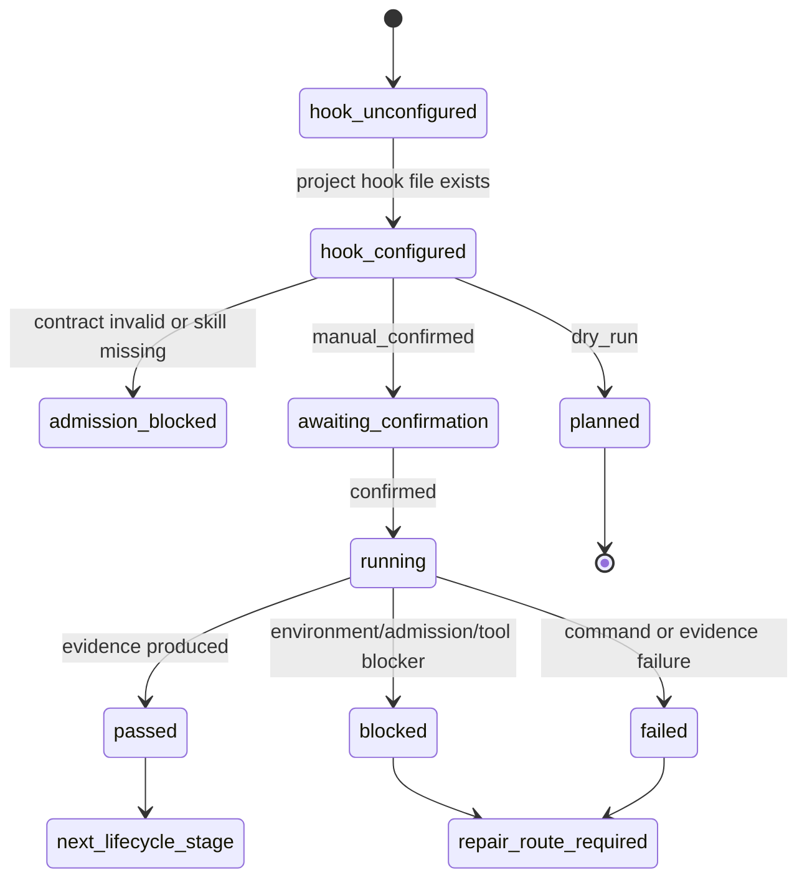

# Research: Project Lifecycle Hook Skill Toolkit Contract

**Feature**: `project-lifecycle-hook-skill-toolkit-contract`  
**Version**: `v1.4.10`  
**Status**: `research-input`  
**Date**: `2026-05-23`

## 0. CEO Review Correction

Verdict: `reframe / reduce`.

上一版把 hook contract 放到版本目录：

```text
docs/beacon/<version>/hooks/<hook-id>.md
```

这个方向不对。Hook 是项目级能力，不是版本级 requirement 特性。它应该稳定存在于项目根 Beacon 目录：

```text
docs/beacon/hooks/<hook-id>.md
```

版本线只记录这项能力的设计研究和冻结需求；实际 hook 定义不应按版本复制。否则同一个项目交付动作会在每个版本重复定义、重复迁移、重复失真。

Additional CEO challenge: this feature should not be part of v1.4.10 P0 unless the version explicitly chooses delivery automation over QA / harness governance.

理由：

- `too_smooth_path`: hook 看起来只是“生命周期边界触发 skill”，但现实里会触发 git、UAT、pipeline、全局安装、Debug Lab 等高副作用动作。
- `truth_freeze_destabilization`: 如果 hook 自动触发并写回状态，很容易让 operator 把 hook 成功误读成 QA 或 release 成功。
- `operator_cost_underpricing`: 每个项目 hook 都需要维护参数、凭证、权限、失败分类和人工确认，治理成本比普通 support skill 高。

因此本 research 的冻结建议应降级为：

- P1：项目级 hook contract 与手动 toolkit。
- 不进入 P0 自动执行。
- 不和 `qa-evo-deep` / Skill Eval Kit 争夺 v1.4.10 主轴。
- 首版只允许 `plan`、`dry-run`、`manual_confirmed run`，不允许 hidden auto-run。

## 1. 背景

Beacon v1.4.9 已经有 project skill profile、skill admission、agent surface materialization 和 release / implement / QA 主链。

真实项目里还存在一类项目级动作：

- Beacon 源码项目 release 完成后，需要提交开发分支代码、安装到全局 agent skill、安装最新 Beacon CLI。
- Rolo 项目 implement 完成后，需要调用 `rolo-dev-git-to-pipeline-uat` 将目标服务送到 UAT / pipeline，再进入 QA 验收。
- Rolo 项目 QA blocked 或需要 UAT 诊断时，需要调用 `rolo-dev-debuglab` 进入固定 Debug Lab 诊断序列。

这些动作有共同点：

- 依赖项目上下文，不是 Beacon 通用默认能力。
- 应绑定在稳定 Beacon lifecycle 边界。
- 需要调用项目级 skill 或项目内 command toolkit。
- 需要可审计、可调整、可禁用、可 dry-run。
- 不能让 hook 越权修改 requirement truth 或 gate verdict。

本研究建议 v1.4.10 增加“项目级 lifecycle hook skill toolkit”契约，但 hook 本体必须是项目级单文件 Markdown。

## 2. Source Anchors

- `beacon/utils/project_skills.py`
- `beacon/utils/skill_discovery.py`
- `beacon/utils/skill_admission.py`
- `beacon/utils/agent_surface.py`
- `beacon/commands/skill.py`
- `docs/beacon/v1.4.10/research/qa-evo-deep-and-skill-eval-kit-evolution.md`
- `docs/beacon/v1.4.9/research/read-only-support-research-write-topology-gate-contract.md`
- Rolo project skill: `rolo-dev-git-to-pipeline-uat`
- Rolo project skill: `rolo-dev-debuglab`

## 3. 当前能力与缺口

### 3.1 已有能力

Beacon 当前已有：

- `beacon.config.yaml` 的 `project_skills` 配置入口。
- project profile：stage 到 skill 的绑定。
- orchestration nodes：可定义 profile 下的命令节点。
- skill registry：可登记 external skill。
- skill admission：可验证 skill root、contract、supported stage、host runtime。
- agent surface：可安装 Beacon packaged skills 到 project-local agent surface。

这些能力说明 Beacon 已经有“项目 skill 编排”的雏形。

### 3.2 缺口

当前缺少一个明确的项目级 hook 模型：

- 没有固定项目级 hook 目录。
- 没有单文件 Markdown hook contract。
- 没有有限 hook code taxonomy。
- 没有 hook admission：是否允许自动执行、是否必须人工确认、是否只能 dry-run。
- 没有 hook run evidence：触发原因、输入、调用 skill、输出、下一跳。
- 没有人类面 toolkit 用于增删改查项目级 hook。
- 没有 hook 与主链 gate 的边界：hook 失败是 delivery blocker、QA blocker、还是 release supplement。

因此项目经验会落成“手动记忆”：Beacon 源码 release 后人工安装 CLI / skill；Rolo implement 后人工调用 UAT 部署；Rolo QA 时人工调用 Debug Lab。

## 4. 核心判断

项目级 hook 应该是 lifecycle boundary 的 project-level extension，不是 Beacon 新 stage，也不是 version-level artifact。

它的正确定位：

```text
Beacon lifecycle stage reaches boundary
-> finite hook code opens
-> load docs/beacon/hooks/<hook-id>.md
-> project hook admission
-> project skill/toolkit invocation
-> hook evidence
-> next lifecycle route
```

它不应该：

- 替代 `implement`、`qa` 或 `release`。
- 自动改 PRD / user-story / test-case。
- 自动给 gate pass。
- 成为所有项目默认必跑动作。
- 把某个项目的 Rolo / Beacon 发布动作硬编码进 Beacon core。
- 把 hook contract 复制到每个 version 目录。

## 5. 极简模型

### 5.1 项目级单文件 hook contract

Hook 本体是项目级单文件 Markdown，借鉴 skill 的可读、可审计、可手改优势：

```text
docs/beacon/hooks/<hook-id>.md
```

示例：

```text
docs/beacon/hooks/beacon-post-release-local-install.md
docs/beacon/hooks/rolo-post-implement-uat.md
docs/beacon/hooks/rolo-qa-debuglab.md
```

该文档说明：

- hook id。
- 有限 hook code。
- Beacon lifecycle binding。
- applies_to project / repo / optional feature pattern。
- invoked skill 或 subskill。
- allowed command template。
- required evidence。
- manual approval policy。
- dry-run behavior。
- failure route。
- security boundary。

### 5.2 Hook 文件形态

建议使用 Markdown frontmatter + 正文说明，不引入第二套 YAML truth：

```md
---
hook_id: rolo-post-implement-uat
hook_code: post_implement_pre_qa
project: rolo
enabled: true
trigger_policy: manual_confirmed
skill: rolo-dev-git-to-pipeline-uat
command_template: "rolo_dev.sh rolo-dev-git-to-pipeline-uat --service {service_name} --pipeline uat_app_service"
produces_evidence:
  - uat_pipeline_run
  - origin_uat_contains_commit
  - pipeline_status
failure_route: implement
---

# Rolo Post Implement UAT Hook

## Purpose

After Beacon implementation evidence is bound, deliver the target Rolo service to UAT before formal QA.

## Admission

- Source branch must be `feature/*` or `hotfix/*`.
- Worktree must be clean.
- Latest `origin/master` gate must pass.

## Evidence

- Target service.
- Source commit.
- `origin/uat` contains source commit.
- Yunxiao pipeline run id and current status.
```

原则：

- Markdown 文件是 hook contract 的唯一项目级定义。
- `beacon.config.yaml` 可以后续缓存 discovery / enablement，但不能成为第二份 hook truth。
- 人类面 toolkit 修改的是这个单文件 Markdown。

### 5.3 有限 Hook Code

首版只允许有限 hook code：

| Hook code | Beacon boundary | 典型用途 |
| --- | --- | --- |
| `post_implement_pre_qa` | implementation evidence bound 后，QA 前 | UAT 部署、测试环境刷新、接口文档同步、项目冒烟 |
| `qa_diagnostics` | QA 运行前或 QA blocked 后 | Debug Lab、trace triage、环境诊断、补充验收证据 |
| `post_qa_pre_release` | QA pass / supplement ready 后，release 前 | release 前外部平台状态确认 |
| `post_release` | release 完成后 | CLI 安装、agent skill 安装、归档、通知 |

不支持任意 hook code，不支持任意 shell hook。

### 5.4 Runtime evidence

Hook 运行证据建议写到：

```text
.beacon/state/hooks/<hook-id>/<run-id>.json
docs/beacon/.machine/hooks/<hook-id>.latest.json
```

说明：

- `.beacon/state/hooks` 是 runtime run evidence。
- `docs/beacon/.machine/hooks` 是项目级 read model，供 help / status / release supplement 读取。
- 两者都不是 requirement truth。

### 5.5 Research 索引

v1.4.10 research 只记录这项能力的设计输入和 route decision。

Hook contract 本体进入：

```text
docs/beacon/hooks/<hook-id>.md
```

## 6. Hook Skill 编排样例

### 6.1 Rolo implement 完成后送 UAT

Hook 文件：

```text
docs/beacon/hooks/rolo-post-implement-uat.md
```

建议 frontmatter：

```yaml
hook_id: rolo-post-implement-uat
hook_code: post_implement_pre_qa
project: rolo
skill: rolo-dev-git-to-pipeline-uat
command_template: "rolo_dev.sh rolo-dev-git-to-pipeline-uat --service {service_name} --pipeline uat_app_service"
trigger_policy: manual_confirmed
failure_route: implement
```

语义：

- Beacon `implement` 完成并绑定 implementation evidence。
- Hook toolkit 检查 `rolo-post-implement-uat`。
- 通过 `rolo-dev-git-to-pipeline-uat` 执行 Rolo feature/hotfix -> UAT -> pipeline。
- 产出 UAT pipeline / delivery evidence。
- 成功后进入 `qa`；失败回 `implement` / delivery repair。

### 6.2 Rolo QA 诊断 / Debug Lab

Hook 文件：

```text
docs/beacon/hooks/rolo-qa-debuglab.md
```

建议 frontmatter：

```yaml
hook_id: rolo-qa-debuglab
hook_code: qa_diagnostics
project: rolo
skill: rolo-dev-debuglab
command_template: "rolo_dev.sh marketing-debuglab"
trigger_policy: manual_confirmed
failure_route: qa
```

语义：

- QA 阶段需要 UAT Debug Lab 诊断或 QA blocked 时触发。
- 通过 `rolo-dev-debuglab` 使用固定 Rolo Debug Lab 诊断序列。
- 产出 env / dependency / http / logs / SQL 证据。
- Debug Lab evidence 是 QA support evidence，不是 release verdict。

### 6.3 Beacon 源码项目 release 后本地安装

Hook 文件：

```text
docs/beacon/hooks/beacon-post-release-local-install.md
```

建议 frontmatter：

```yaml
hook_id: beacon-post-release-local-install
hook_code: post_release
project: beacon
skill: beacon-release-local-install
command_template: "beacon local-install --version {version}"
trigger_policy: manual_confirmed
failure_route: release
```

语义：

- Beacon 源码项目 release 完成后触发。
- 提交 / 合并 / 安装全局 agent skill / 安装最新 Beacon CLI。
- 验证 CLI version 和 skill drift。
- 这是 Beacon 项目 hook，不是所有 Beacon 项目的默认 release 行为。

## 7. Human-Facing Toolkit

建议新增或扩展人类面 skill：

```text
beacon-project-hooks
```

职责：

- 查看当前项目 hook。
- 创建 hook contract 草案。
- 修改 hook code / skill / command template。
- dry-run hook。
- 解释 hook evidence。
- 禁用或 supersede hook。
- 将 hook failure route 到 implement / qa / release。

建议 CLI：

```bash
beacon hooks list --project .
beacon hooks plan <hook-id> --project . --version v1.4.10 --feature <feature>
beacon hooks run <hook-id> --project . --version v1.4.10 --feature <feature> --dry-run
beacon hooks run <hook-id> --project . --version v1.4.10 --feature <feature> --confirm
beacon hooks disable <hook-id> --project .
beacon hooks status <feature> --project . --version v1.4.10
```

这些命令的 `--version` 只用于绑定当前 Beacon lifecycle context 和 evidence read model，不改变 hook contract 的项目级存放位置。

不建议一开始允许：

- arbitrary shell hook。
- hidden auto-run。
- hook 自己改 truth。
- hook 自动创建 PRD / test-case。
- hook failure 被静默跳过。

## 8. Business Flow



## 9. State Machine



## 10. Decision Priority

1. Hook 是 project-level extension，不是 version-level feature artifact。
2. Hook contract 固定在 `docs/beacon/hooks/<hook-id>.md`。
3. Hook 必须绑定有限 hook code，不允许任意时机隐式触发。
4. Hook 必须有 contract、admission、dry-run 和 evidence。
5. 项目特有动作不得硬编码成 Beacon 全局默认。
6. 涉及全局安装、UAT 发布、pipeline、写数据的 hook 必须 `manual_confirmed`。
7. Hook 输出只能作为 runtime / delivery / QA support evidence，不能改 requirement truth。
8. Hook failure 必须有 failure family 和 route，不得静默跳过。
9. `beacon.config.yaml` 不能成为 hook truth 的第二份副本。

## 11. 与 v1.4.10 其他候选功能的关系

| Candidate | 关系 |
| --- | --- |
| `qa-evo-deep` | 可读取 hook evidence 判断 QA admission 是否充分 |
| Skill Eval Kit | 可将 hook route / admission failures 收成 eval candidates |
| Ralph Task Loop | Ralph 可在 stage boundary 调用 hook plan / status，但不绕过 hook admission |
| `beacon learn` project skill | 可从反复 hook 调用中提炼项目级 skill，但需 admission |

## 12. 推荐冻结方向

建议作为 v1.4.10 独立 change 候选：

```text
project-lifecycle-hook-skill-toolkit-contract
```

最小冻结范围：

- Hook code taxonomy。
- `docs/beacon/hooks/<hook-id>.md` single-file Markdown contract。
- Hook admission rules。
- Hook evidence paths。
- Human-facing `beacon-project-hooks` toolkit 行为。
- Beacon self post-release、Rolo post-implement UAT、Rolo QA Debug Lab 三个 fixture。

CEO review priority:

- 不建议进入 v1.4.10 P0。
- 若同版冻结，必须标记为 P1，并且首版只支持 manual toolkit。
- 自动触发、后台 hook、跨项目默认 hook、任意 shell hook 都应明确排除。

后续再实现：

- `beacon hooks list/plan/run/status/disable`。
- help/status 对 hook blocker 的展示。
- release / implement / qa 在稳定边界读取 hook recommendation。

## 13. 收敛结论

这个能力的本质不是“让 Beacon 自动做更多事”，而是给项目特有的交付动作一个受治理的入口。

Beacon 保持主链稳定：

```text
prd -> user-story -> test-case -> implement -> qa -> release
```

项目 hook 只在主链边界按有限 hook code 打开：

```text
post_implement_pre_qa
qa_diagnostics
post_qa_pre_release
post_release
```

这样 Beacon 源码项目可以在 release 后稳定安装 CLI / agent skill，Rolo 项目可以在 implement 后稳定调用 `rolo-dev-git-to-pipeline-uat` 送 UAT，并在 QA 诊断时稳定调用 `rolo-dev-debuglab`，而这些项目特有动作不会污染 Beacon 的通用生命周期。
