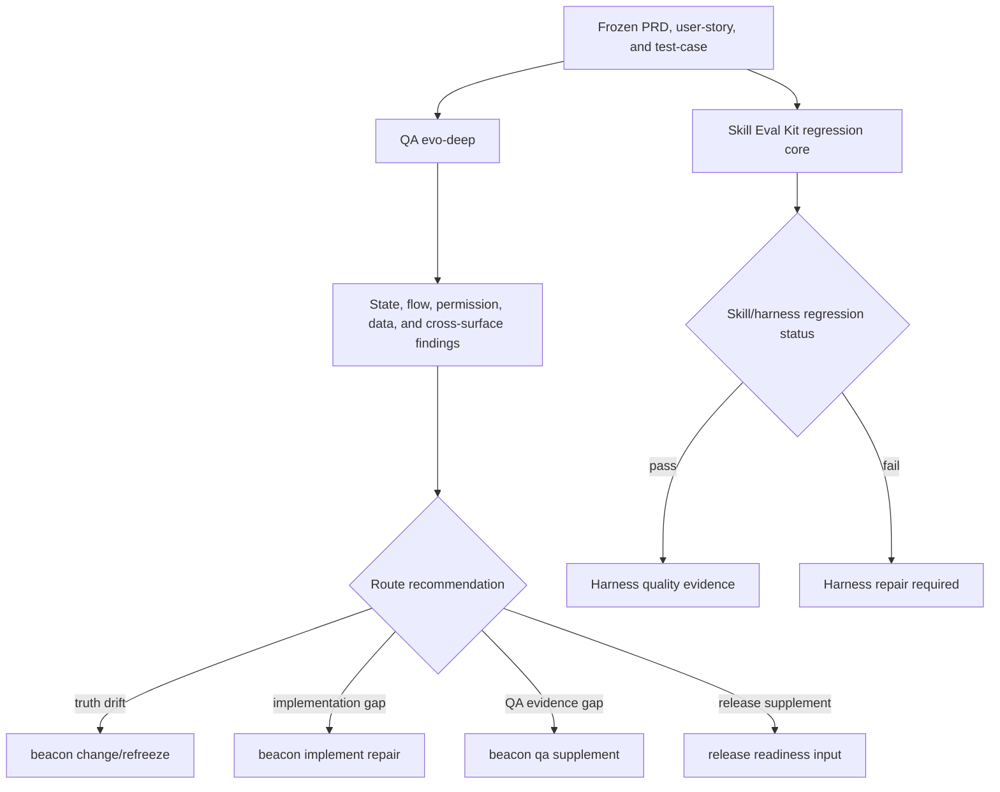
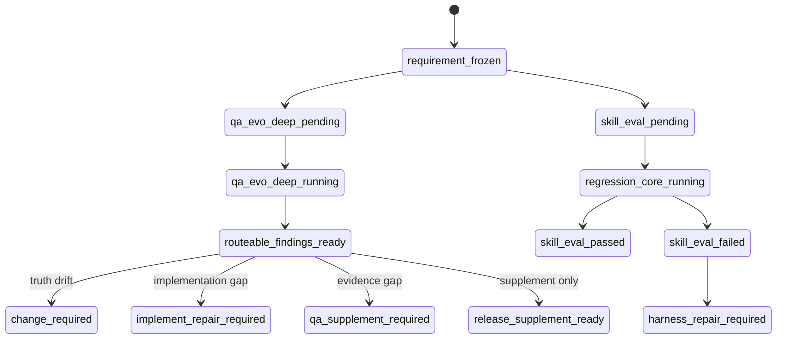

# Research: QA Evo Deep And Skill Eval Kit v1.4.10

**Feature**: `qa-evo-deep-and-skill-eval-kit-v1410`  
**Version**: `v1.4.10`  
**Status**: `refreeze-input`  
**Date**: `2026-05-23`

## 1. Background

This research closure adopts the v1.4.10 P0 recommendation from `docs/beacon/v1.4.10/research/qa-evo-deep-and-skill-eval-kit-evolution.md`.

v1.4.10 must not try to ship every advanced lifecycle idea at once. The accepted P0 is limited to:

- QA evo-deep state, scenario, and round-memory analysis.
- Better Harness Skill Eval Kit regression core.

Ralph Task Loop, project lifecycle hooks, implement mode playbooks, and `beacon learn` context-to-project-skill injection remain research inputs for later changes.

## 2. Architecture

The frozen architecture has two governed support/evidence surfaces:

```text
frozen requirement package
  -> QA evo-deep
  -> docs/beacon/<version>/qa/evo-deep/<feature>.md
  -> routeable findings only

skill / harness candidate
  -> Skill Eval Kit
  -> .beacon/state/skill-eval/ or machine evidence
  -> regression scorecard only
```

Detailed architecture is tracked in `docs/beacon/v1.4.10/source-architecture/qa-evo-deep-and-skill-eval-kit-v1410.md`.

## 3. Business Flow



## 4. State Machine



## 5. Decision Priority

1. Markdown requirement truth wins over QA deep output and skill eval evidence.
2. QA evo-deep produces routeable findings, not release pass verdicts.
3. QA round memory is advisory influence and must be separated from current evidence.
4. Skill Eval Kit governs skill/harness quality, not product requirement truth.
5. Regression core failures block skill/harness release readiness, not unrelated requirement truth.
6. P1/P2 research inputs cannot silently expand the v1.4.10 P0 scope.

## 6. Required Research Sections

This feature research closure keeps the P0 contract explicit:

```md
## QA Evo Deep Contract
## QA Round Memory Influence
## Skill Eval Kit Contract
## Route Stability Regression
## Authority Boundary
## P1/P2 Deferred Inputs
```

## 7. QA Evo Deep Contract

QA evo-deep findings must include:

- source refs
- finding family
- risk
- affected ACs
- route recommendation
- blocked admissions
- release supplement input
- authority boundary

Allowed finding families:

- state machine
- business flow
- scenario combination
- permission boundary
- data-source consistency
- cross-surface closure
- repeated failure

## 8. QA Round Memory Influence

Round memory may prioritize deeper exploration when a scenario repeatedly fails, blocks, or changes. It must never count as pass evidence without a current run reference.

## 9. Skill Eval Kit Contract

Skill Eval Kit cases must include:

- case id
- prompt
- expected route
- boundary expectations
- source anchor requirements
- tags
- split
- expected evidence
- scoring dimensions

Required scoring dimensions:

- route stability
- boundary preservation
- source anchor sufficiency
- actionability
- material effect closure
- clarification quality
- token efficiency

## 10. Route Stability Regression

The regression core must include cases for:

- ordinary support skills routing into research.
- `beacon-deep` routing into deep artifacts.
- `beacon-learn` routing into learning influence.
- `beacon-implement --mode single`.
- `beacon-implement --mode team`.
- `beacon-implement --mode ralph`.

The route stability cases must assert that no nonexistent public skills such as `beacon-implement-team` or `beacon-implement-ralph` are selected.

## 11. Authority Boundary

QA evo-deep and Skill Eval Kit must not claim authority over:

- PRD truth
- user-story truth
- test-case truth
- freeze state
- QA verdict
- release verdict

Any such claim is a fail-closed requirement clarity or release readiness issue.

## 12. P1/P2 Deferred Inputs

Deferred research remains useful but is not P0 truth:

- Ralph Task Loop can later consume QA/eval evidence.
- Project lifecycle hooks can later use manual toolkit governance.
- Implement mode playbooks can later use route stability evals.
- `beacon learn` can later use candidate skill admission and learning influence audit.

## 13. Truth Bindings

- `prd_refs`: `docs/beacon/v1.4.10/prd/qa-evo-deep-and-skill-eval-kit-v1410.md`
- `user_story_refs`: `docs/beacon/v1.4.10/user-story/qa-evo-deep-and-skill-eval-kit-v1410.md`
- `test_case_refs`: `docs/beacon/v1.4.10/qa/test-cases/qa-evo-deep-and-skill-eval-kit-v1410.md`
- `coverage_notes`: AC-001 through AC-009 cover QA evo-deep output, round memory boundary, deep taxonomy, write topology, eval schema, regression core, evidence boundary, route stability, and authority gate.
- `out_of_scope_notes`: This research does not implement Ralph Task Loop, project hooks, automatic learn injection, public implement skill splitting, implementation, QA, or release.

## 14. Conclusion

This contract gives Beacon a focused v1.4.10 P0: deeper QA can find routeable gaps, and skill/harness behavior can be regression-tested, while Markdown-first requirement truth remains authoritative.

## Deep Summary

- source_skill: `beacon-deep`
- updated_at: `2026-05-23T09:00:22.158619+00:00`
- deep_artifact_root: `docs/beacon/v1.4.10/deep/qa-evo-deep-and-skill-eval-kit-v1410`
- machine_artifact_root: `docs/beacon/v1.4.10/.machine/deep/qa-evo-deep-and-skill-eval-kit-v1410`
- deep_requirement_state: `required`
- status: `closed`
- route_decision: `closed`
- release_supplement_ref: `docs/beacon/v1.4.10/.machine/deep/qa-evo-deep-and-skill-eval-kit-v1410/release-supplement.json`
- adoption_status: `route_only`

## Support Findings

### CEO Review

#### Round 2026-05-23T09:02:05.426165+00:00

- source_skill: `beacon-ceo-review`
- round_id: `2026-05-23T09:02:05.426165+00:00`
- material_effect: `read_only_route_only`
- adoption_status: `route_only`
- route_decision: implement
- finding_summary: CEO review did not find a version-level reframing blocker after challenging default downside axes.
- source_refs: `docs/beacon/v1.4.10/.machine/execution/beacon-ceo-review-transaction.json`, `docs/beacon/v1.4.10/execution/beacon-ceo-review-transaction.md`
