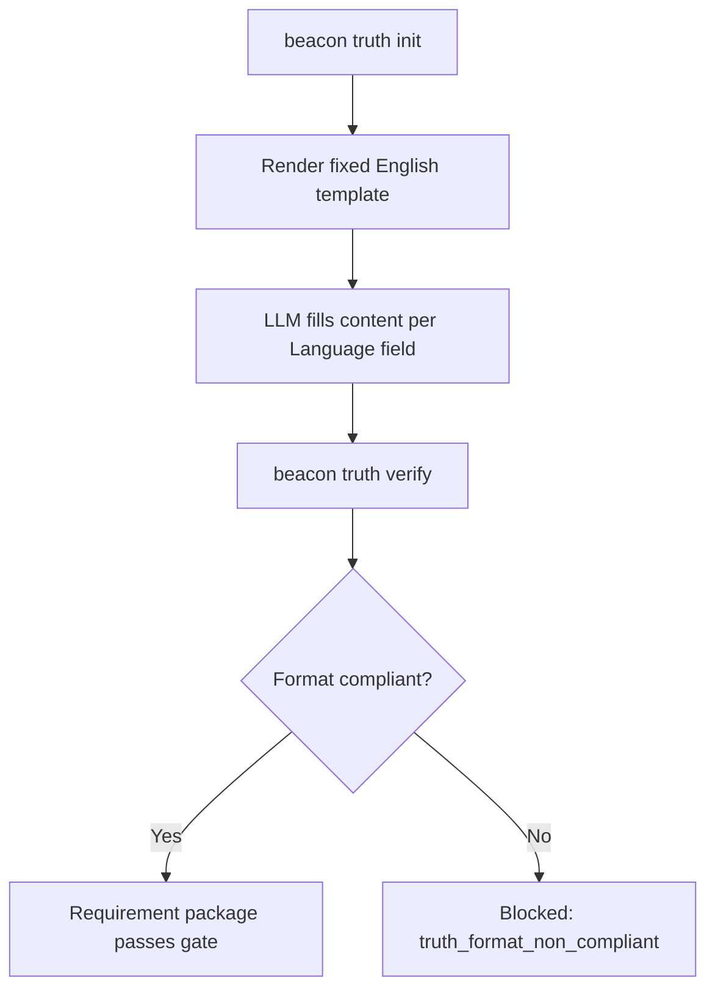

# PRD: Unified Truth Template CLI Contract

**Feature**: `unified-truth-template-cli-contract`
**Version**: `v1.4.12`
**Status**: `frozen`
**Date**: `2026-05-31`
**Language**: `en`

## Overview

Beacon's truth triptych (PRD, user-story, test-case) has no unified format specification. Section titles, table column names, and numbering conventions vary across features and LLM-generated content. This contract introduces fixed English templates with mandatory mermaid Outline diagrams, eliminating format drift and enabling machine-verified truth format compliance.

## Outline

## Context

- Global boundaries: `docs/beacon/global-boundaries.md`
- Source-anchored evidence: `docs/beacon/v1.4.12/research/unified-truth-template-cli-contract.md`
- Source architecture: `docs/beacon/v1.4.12/source-architecture/unified-truth-template-cli-contract.md`
- Diagram truth closure: `docs/beacon/v1.4.12/research/diagram-truth-triptych-closure.md`

## Problem

LLM-generated truth documents have inconsistent section titles (mixed Chinese and English, varying numbering), inconsistent table column names, and no Outline diagrams. `_render_prd` in `prd.py:1298` has no template constraint. `prd_bootstrap.py` generates numbered sections with Chinese content. The format drift makes machine verification impossible and obscures the feature's core flow from the reader.

## Goals

- AC-001: `beacon truth init` generates truth documents with fixed English section titles, no numbering, and mandatory mermaid Outline diagrams.
- AC-002: `beacon truth verify --strict` enforces format compliance: mandatory sections present, no numbering prefixes, table columns match template, Language field consistent with content, mermaid blocks present.
- AC-003: Section titles and table column names are pure English, CLI-controlled, immutable by LLM.
- AC-004: `--lang en|zh` controls content language expectation via `**Language**` front matter field.
- AC-005: `beacon truth init all` integrates with `beacon manifest add-feature` for path registration.
- AC-006: Format upgrade path goes through `beacon change --refreeze-chain`, not an independent doctor command.
- AC-007: Old entry points (`beacon prd create`, `prd_bootstrap.py`) use new template functions for v1.4.12+.
- AC-008: PRD Outline section contains a mermaid diagram positioned after Overview, before detailed sections.
- AC-009: User Story Outline section contains a mermaid diagram positioned after Story.
- AC-010: Test Case Outline section contains a mermaid diagram positioned before Coverage Matrix.

## Design Principles

- Structure layer is English and immutable; content layer defaults to English, configurable via `--lang`.
- No format migration command: old versions are treated as released; upgrades go through refreeze.
- Mandatory Outline mermaid diagrams are the reader's first visual map, placed before detailed sections.
- Diagram Truth Layer remains optional for complex features; Outline is mandatory for all features.
- `beacon truth verify` distinguishes `truth_format_compliant` from `requirement_closure`.

## Scope

### In Scope

- `beacon/commands/truth.py` CLI: init, verify, show with `--lang en|zh`
- `beacon/utils/truth_template.py` render functions with fixed English templates and Outline mermaid
- `beacon/utils/truth_format.py` structure validation + language detection + mermaid syntax check
- `beacon/commands/prd.py` `_render_prd` v1.4.12+ calls `truth_template.render_prd_template()`
- `beacon/utils/prd_bootstrap.py` v1.4.12+ uses new template rendering
- `beacon/utils/material_audit.py` gate integration with `truth_format_non_compliant`
- `beacon/utils/diagram_truth.py` updated: no numbering sub-headings, Outline separated, mermaid support
- Skill reference file `skills/beacon/references/truth-format-spec.md` for LLM prompt injection

### Out of Scope

- `beacon doctor migrate-truth-format` command (deleted — upgrades go through refreeze)
- v1.4.11 or earlier version compatibility
- Modification of `.beacon/state/` or runtime-ledger projection
- Full mermaid rendering or visualization (only syntax checking)

## Functional Requirements

| FR ID | Related AC | Requirement |
|-------|-----------|-------------|
| FR-001 | AC-001 | `render_prd_template` generates fixed English sections with no numbering, mandatory Outline mermaid, and Language front matter |
| FR-002 | AC-001 | `render_user_story_template` generates Story, Outline (mermaid), Acceptance Criteria, Test Story Map, References, optional State Axis Coverage |
| FR-003 | AC-001 | `render_test_case_template` generates Outline (mermaid), Coverage Matrix, optional Branch Coverage Mapping, Explicit Non Coverage |
| FR-004 | AC-002 | `validate_prd_format` checks mandatory sections, rejects numbering prefixes, validates table columns, checks mermaid blocks |
| FR-005 | AC-003 | Section titles in templates are pure English strings, not LLM-configurable |
| FR-006 | AC-004 | `--lang en|zh` writes `**Language**: en` or `**Language**: zh` to front matter; content language heuristic checks consistency |
| FR-007 | AC-005 | `beacon truth init all` calls `manifest add-feature` after creating truth files |
| FR-008 | AC-006 | No `migrate-truth-format` command exists; format upgrades go through `beacon change --refreeze-chain` |
| FR-009 | AC-007 | `beacon prd create` calls `truth_template.render_prd_template()` for v1.4.12+ |
| FR-010 | AC-007 | `_minimal_prd_from_downstream` uses `truth_template.render_prd_template()` for v1.4.12+ |
| FR-011 | AC-008 | PRD template has `## Outline` section immediately after `## Overview` with mermaid FILL annotation |
| FR-012 | AC-009 | User Story template has `## Outline` section immediately after `## Story` with mermaid FILL annotation |
| FR-013 | AC-010 | Test Case template has `## Outline` section before `## Coverage Matrix` with mermaid FILL annotation |

## Source Contract

- `beacon/commands/prd.py:1298-1575` — `_render_prd` migration to template call
- `beacon/utils/prd_bootstrap.py:156-720` — `_minimal_prd_from_downstream` migration
- `beacon/utils/diagram_truth.py:68-94` — `render_diagram_truth_section` numbering removal
- `beacon/commands/prd.py` — `--include-diagrams` and `--state-axis` CLI parameters
- `beacon/utils/material_audit.py:849-920` — `build_requirement_package_gate` gate integration

## State Axes

| Axis | States | Meaning |
|------|--------|---------|
| template_state | absent, template_created, content_filled, format_verified | Template lifecycle |
| content_language | en, zh | Language of content body |
| format_compliance | unverified, compliant, non_compliant | Format verification result |

## Acceptance Criteria

- AC-001: `beacon truth init prd --feature test` generates file with English section titles, no numbering, and Outline mermaid block
- AC-002: `beacon truth verify --strict` passes for format-compliant files and exits 2 for non-compliant
- AC-003: Section titles are pure English, not LLM-configurable
- AC-004: `--lang zh` writes `**Language**: zh` to front matter
- AC-005: `beacon truth init all` registers feature in manifest
- AC-006: No `migrate-truth-format` command exists
- AC-007: `beacon prd create` uses new template for v1.4.12+
- AC-008: PRD Outline section has mermaid block after Overview
- AC-009: User Story Outline section has mermaid block after Story
- AC-010: Test Case Outline section has mermaid block before Coverage Matrix

## Non-Goals

- Migration of old version truth files (go through refreeze)
- Full mermaid rendering or visualization
- Modification of PRODUCT.md, DESIGN.md, or research document formats
- Language detection with 100% precision (95%+ target)

## Success Metrics

- All v1.4.12 truth documents have English section titles, no numbering, and Outline mermaid blocks
- `beacon truth verify --strict` exits 0 for all v1.4.12 truth documents
- Numbering prefixes (`## 1.`, `## 2.`) are rejected by verify
- Missing Outline section is caught as `missing_mandatory_section`
- Missing mermaid block is caught as `missing_mermaid_block`
